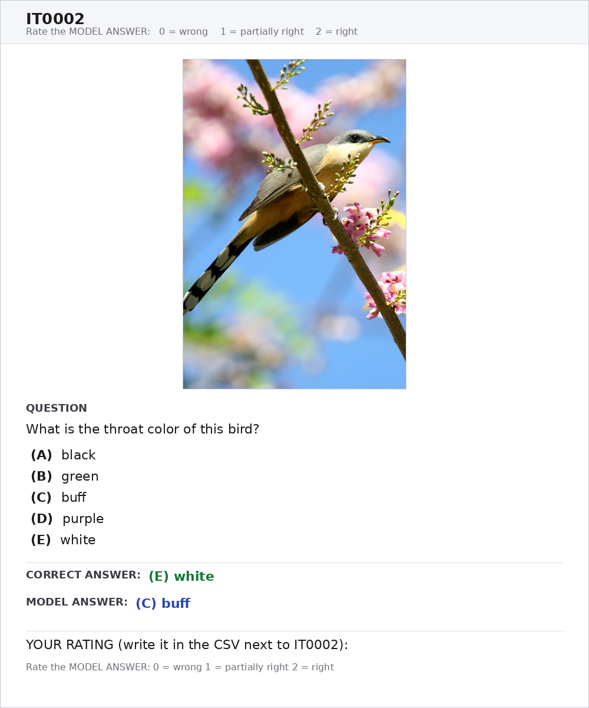
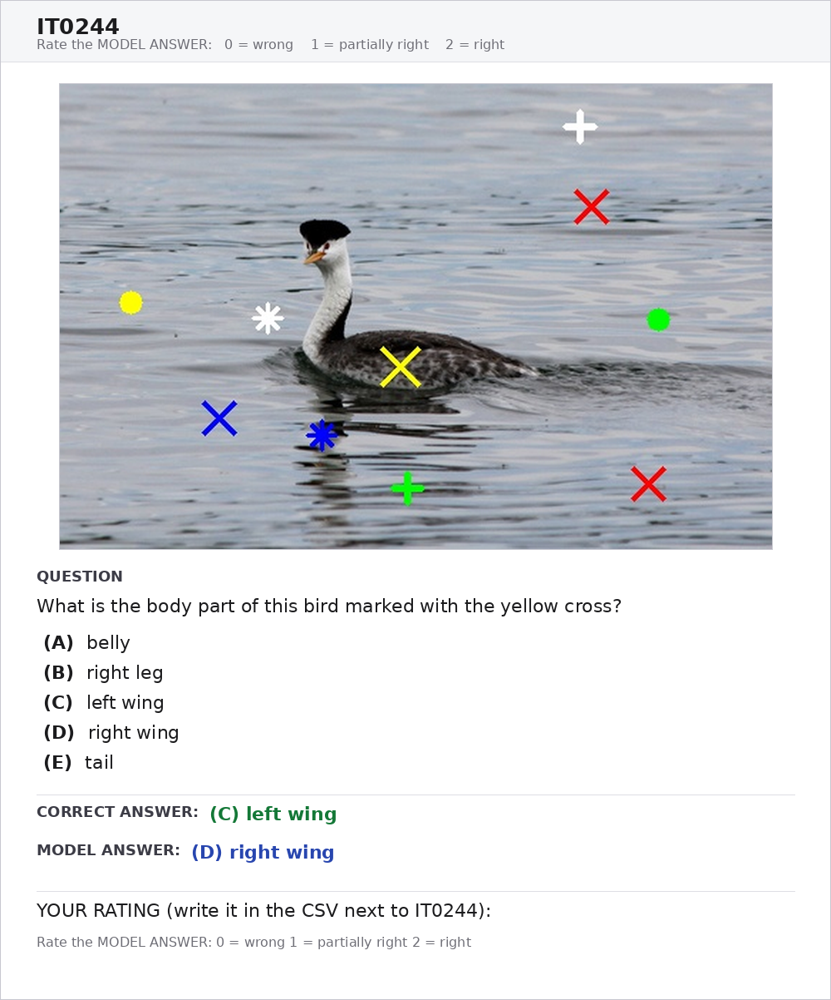
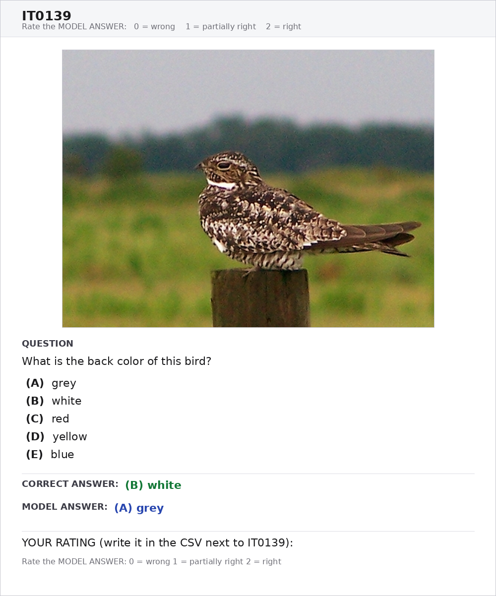
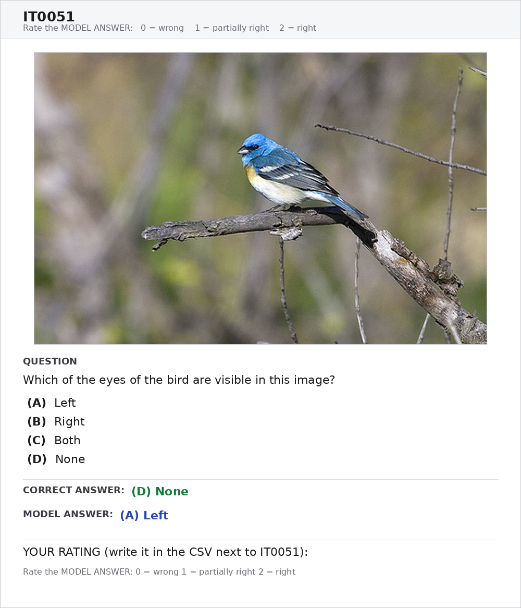
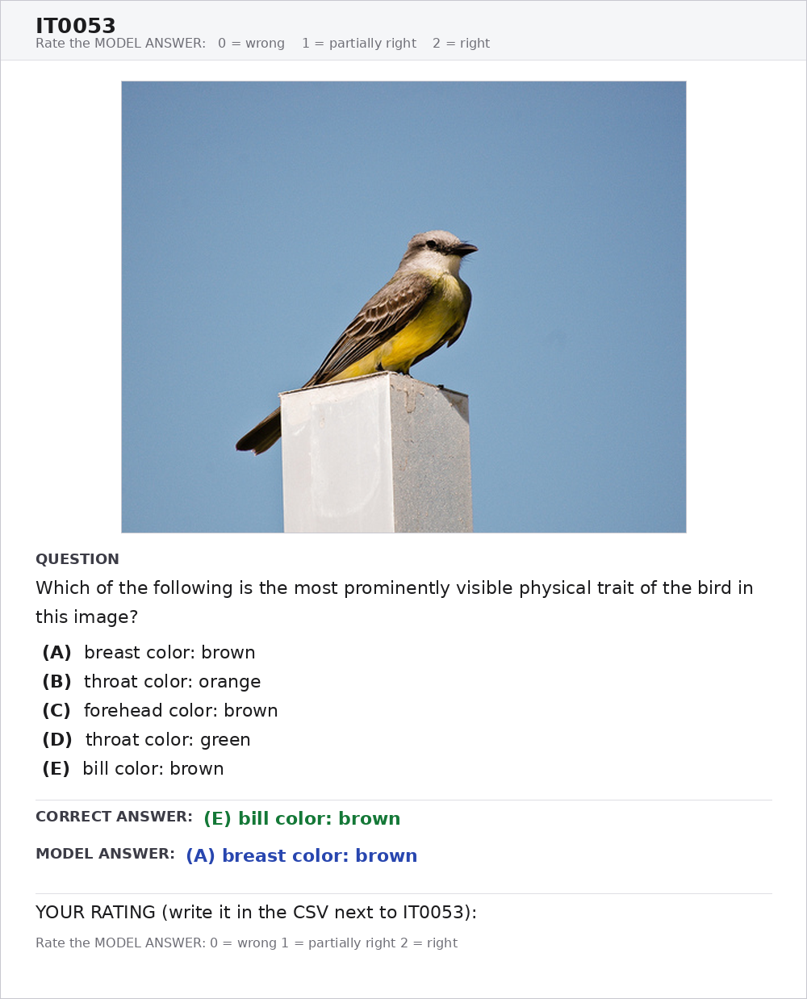
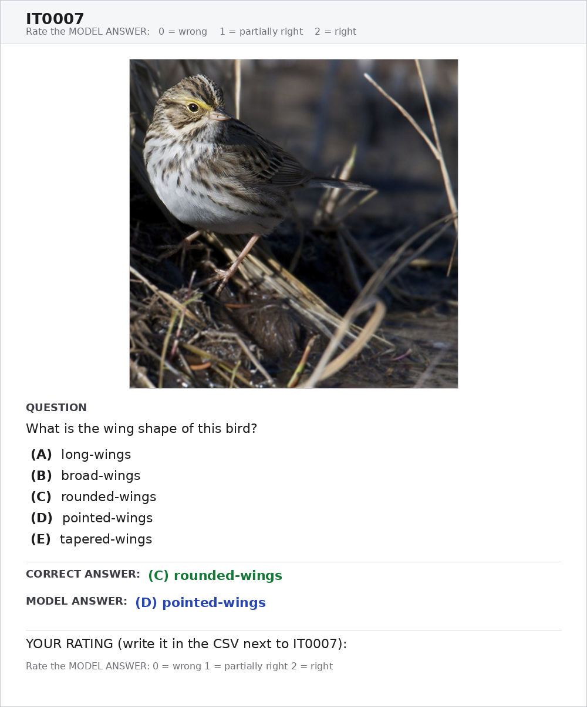

<h1 align="center">Human Study — External Validation of CAGS</h1>
<p align="center">
  <b>Do the graded scores agree with what people actually judge?</b>
</p>
<p align="center">
  
  
  
  
  
  
  
</p>

---

## Table of Contents

1. [Overview](#1-overview)
2. [Motivation](#2-motivation)
3. [Validation Objectives](#3-validation-objectives)
4. [Workflow](#4-workflow)
5. [Sampling Design](#5-sampling-design)
6. [Annotation Protocol](#6-annotation-protocol)
7. [Constructing the Human Label](#7-constructing-the-human-label)
8. [Estimators](#8-estimators)
9. [Results](#9-results)
10. [Worked Examples](#10-worked-examples)
11. [Findings](#11-findings)
12. [Threats to Validity](#12-threats-to-validity)
13. [Reproduction](#13-reproduction)
14. [Files and Schemas](#14-files-and-schemas)
15. [Glossary](#15-glossary)
16. [References](#16-references)

---

## 1. Overview

This directory holds the **human validation study** for CAGS, the graded scoring metric used on the fine-grained visual attribute grounding axis. It contains the sampled item set, the blind annotation sheet, the completed ratings from three annotators, the rendered annotation cards, and the full statistical report produced from them.

CAGS assigns partial credit to a wrong answer according to how close it is to the reference answer — a neighbouring colour in CIELAB, an adjacent body part in an anatomical layout, an off-by-one step on an ordinal scale — and then subtracts the credit an uninformed guesser would have earned from that item's own distractor set. The metric is defined and documented in the parent evaluation README. **This document is about whether that partial credit means anything to a person**, and it is self-contained: every quantity it uses is defined here.

The study answers that question with 306 model responses rated independently by three annotators on a three-level ordinal scale, and reports four headline quantities:

| Quantity | Value | Interval |
|:--|--:|:--|
| Inter-annotator reliability, Krippendorff $\alpha$ (ordinal) | **0.7937** | — |
| Rank agreement, CAGS vs human, Kendall $\tau_b$ | **0.5883** | $[0.5149,\ 0.6566]$ |
| Agreement as a share of the inter-annotator ceiling | **90.8 %** | — |
| Discrimination within the exact-match-zero subset, AUC | **0.6755** | $[0.5912,\ 0.7570]$ |

---

## 2. Motivation

Two properties of a graded metric are independent, and only one of them is checkable from the metric's own outputs.

**Internal stability** asks whether the leaderboard survives perturbation of the metric's free constants — the colour-kernel temperature $\tau$, the group/value mixing weight $\alpha$, the linear-versus-exponential kernel shape. `sensitivity_sweep.py` in the parent directory establishes this. It is necessary and it is not sufficient: a kernel can be perfectly stable and still measure something no person recognises. Stability under perturbation is a statement about the metric's own arithmetic.

**External validity** asks whether the ordering the metric imposes on wrong answers matches the ordering a person imposes. This is the standard by which automatic evaluation metrics are assessed elsewhere: a metric earns its place by correlating with human judgement, not by internal coherence [15, 16, 17]. Nothing internal to the scoring pipeline can answer this, because the pipeline has no access to a criterion outside itself. The only available criterion is human judgement, elicited independently, from people who cannot see the metric's output.

I run this study because the graded axis is the contestable part of the evaluation. Exact match needs no validation — its semantics are definitional. CAGS makes a substantive empirical claim every time it awards 0.59 rather than 0.00 to a wrong answer, and that claim is either supported by human judgement or it is not.

---

## 3. Validation Objectives

I separate the validation into three claims and test them in order, because collapsing them produces a study that appears to establish more than it does.

**Claim A — the human reference is reliable.** Human ratings can serve as a criterion only if they reproduce across annotators. This is a gate rather than a result: if it fails, every downstream statistic is uninterpretable, because a correlation with an unreliable criterion is uninformative in both directions.

**Claim B — CAGS orders responses as annotators order them.** Rank agreement between the metric and the aggregated human rating, with a bootstrap interval, and read against the agreement annotators achieve among themselves.

**Claim C — CAGS recovers structure that exact match discards.** This is the claim that justifies the metric existing at all. I test it by restricting attention to the responses exact match scores zero — where exact match has zero variance and therefore zero information — and asking whether CAGS separates the responses annotators credited from those they rejected.

The study does not test whether CAGS is the best achievable graded metric, whether the kernel constants are optimal, or whether the leaderboard would be identical under a different graded scheme. It tests whether the graded axis carries human-recognisable signal, and it localises the places where it does not.

---

## 4. Workflow

```
        eval_soft_scored.csv                     eval_soft_leaderboard.csv
        (per-item CAGS, one file per model)      (model ranking by CAGS)
                    │                                       │
                    └───────────────┬───────────────────────┘
                                    ▼
                   ┌────────────────────────────────────────────┐
   STAGE 1         │  setup_manual_review_images.py             │
   sample          │  stratify on category × CAGS band,         │
                   │  34 items per cell, seed 42                │
                   └────────────────────────────────────────────┘
                                    │
                 ┌──────────────────┴──────────────────┐
                 ▼                                     ▼
     annotation_sheet.csv                     annotation_key.csv
     item · image · question ·                model · category · family ·
     gold · prediction · blank                CAGS · exact · band
     rating columns                           ── WITHHELD from annotators ──
                 │
                 ▼
                   ┌────────────────────────────────────────────┐
   STAGE 2         │  setup_manual_review_pdf_annotate.py       │
   render          │  one self-contained card per item          │
                   └────────────────────────────────────────────┘
                                    │
                                    ▼
                          cards/annotation_cards.pdf
                                    │
                     ┌──────────────┼──────────────┐
                     ▼              ▼              ▼
                annotator 1    annotator 2    annotator 3     ← independent, no conferring
                     └──────────────┼──────────────┘
                                    ▼
                          ratings_filled_r3.csv
                                    │
                                    ▼   (+ annotation_key.csv rejoined here)
                   ┌────────────────────────────────────────────┐
   STAGE 3         │  validate_cags_human.py                    │
   validate        │  reliability · agreement · discrimination  │
                   │  · ceiling · calibration · sensitivity     │
                   └────────────────────────────────────────────┘
                                    │
              ┌─────────────────────┼─────────────────────┐
              ▼                     ▼                     ▼
   validation_report.txt   validation_summary.csv   validation_items.csv
   full report             machine-readable         per-item atoms
```

The key is withheld until Stage 3. Annotators see the photograph, the question, the reference answer, and the model's answer, and nothing else.

---

## 5. Sampling Design

### 5.1 Frame

The frame is the union of per-item scored outputs, over CUB-200-2011 [13], for the three highest-ranked models on the CAGS leaderboard, restricted to the three evaluation categories whose scoring passes through a similarity kernel:

- **Anatomical Localization** — part visibility and visually-prompted marker localization
- **Morphological Attributes** — attribute values (colour, pattern, shape, size)
- **Relative Salience** — which of several traits is most prominently visible

I exclude *Taxonomy & Naming*. Its open-ended items are scored by name-similarity and genus-agreement kernels whose validation calls for taxonomic rather than visual judgement, and its chance baseline is estimated from a sampled name pool rather than from an item's own option list, which makes it a structurally different object.

Contributing models: `Qwen3VL_30B` (105 items), `Qwen3VL_32B` (103), `InternVL3_38B` (98).

### 5.2 Stratification

I stratify on the interaction of category and CAGS band [14]. Writing $\mathcal{C}$ for the three categories and $\mathcal{B}$ for the three bands, I draw

$$
n_{cb} = 34 \quad \text{for every } (c,b) \in \mathcal{C}\times\mathcal{B}, \qquad N = 9 \times 34 = 306 .
$$

| Band | CAGS interval | Per category | Total |
|:--|:--|--:|--:|
| `low` | $[0.0,\ 0.2)$ | 34 | 102 |
| `mid` | $[0.4,\ 0.6)$ | 34 | 102 |
| `high` | $[0.8,\ 1.0]$ | 34 | 102 |

The bands are deliberately non-contiguous. The gaps at $[0.2,0.4)$ and $[0.6,0.8)$ separate the strata so that band membership is unambiguous and the three levels are genuinely distinct, which matters because the bands later serve as the metric's discretisation in the ceiling comparison.

**Why stratify.** The corpus distribution of CAGS is heavily right-skewed: within this frame the high band holds $77.9\%$ of scored items and the mid band holds $1.5\%$. A uniform sample of 306 items therefore yields roughly

$$
306 \times 0.0145 \approx 4.4
$$

mid-band items — no power whatever to test the partial-credit region, which is the only part of the metric in question. Stratification buys that power at the cost of making sample statistics estimates for a band-balanced population rather than for the corpus. I address the cost directly with an inverse-probability-weighted estimate in [Section 9.7](#97-calibration-and-corpus-reweighting).

Question families are not stratified on and therefore appear at their natural within-category rates:

| Family | Items | What the item asks |
|:--|--:|:--|
| `attr_bare_value` | 102 | An attribute value, options are bare values — *"What is the throat color of this bird?"* |
| `attr_group_value` | 102 | Most salient trait, options are `group: value` pairs |
| `visibility_side` | 41 | Laterality — Left / Right / Both / None |
| `visibility_partset` | 40 | Which of an enumerated set of parts are visible |
| `marker_localization` | 21 | Which body part carries a coloured symbolic marker |

All 306 items carry `resolve_status = letter`: every prediction resolves to an option letter unambiguously, so answer-parsing failure is not a confound anywhere in this study.

### 5.3 Blinding

Sampling emits two files from a single seeded pass. The sheet carries `item_id, image_path, question, gold_answer, model_answer` and empty rating columns. The key carries `model, category, family, cags, exact, band, resolve_status`. Rows are shuffled before identifiers are assigned, so band, category, and model are not recoverable from row order. Sampling is deterministic under `--seed 42`, so the item set regenerates exactly from the scored outputs.

---

## 6. Annotation Protocol

### 6.1 Presentation

Each item is rendered as a single self-contained card: photograph at the top, then the question with its complete option list, the reference answer, and the model's answer, each explicitly labelled. Cards are generated from the sheet alone, so they cannot leak the metric value, the band, or the model identity.

I render cards rather than distribute a spreadsheet of file paths because a spreadsheet permits an annotator to rate a row without opening the corresponding photograph, and several of the judgements in this study — whether a bird's left eye is visible, whether a back is better described as white or grey — are undecidable from the text alone.

<p align="center">
  
  <br>
  <sub>Card for IT0002, the item traced in [Section 10.1](#101-metric-and-annotators-agree-it0002). The annotator sees the photograph,
  the question with its full option list, the reference answer, and the model's answer —
  and nothing else.</sub>
</p>

### 6.2 The scale

| Value | Label | Criterion given to annotators |
|:--:|:--|:--|
| **2** | Correct | The response is correct, or equivalent to the reference answer |
| **1** | Partially correct | The response is incorrect but close — the right body region with the wrong property, an adjacent colour, an off-by-one size, one of two correct parts, a near-miss location |
| **0** | Incorrect | The response is unrelated, clearly incorrect, or far off |

The scale is coarse on purpose. A finer scale invites annotators to reconstruct a continuous score, which is the very object under test; three levels ask only for the ordinal distinction the metric claims to make, and nothing more.

### 6.3 Independence and abstention

Annotators rate independently and do not confer. Where an annotator judges that the photograph does not support the reference answer, they leave the cell blank rather than guessing.

Abstention is a first-class outcome, not a missing value awaiting imputation. It records disagreement with the **source dataset**, not with the model. Imputing it as zero would silently convert reference-label noise into model error and would inflate every agreement statistic in the study, since both the metric and the annotators would be scored against a label neither of them can satisfy.

### 6.4 Realised coverage

Of 306 items, 292 are rated by all three annotators and 14 by two. No item is abstained on by all three, so every item enters the agreement statistics. The 904 individual ratings distribute as 316 zeros, 211 ones, and 377 twos, with 14 abstentions.

The rate at which at least one annotator abstains is $4.58\%$:

| Category | $n$ | Abstained | Rate | | Family | $n$ | Abstained | Rate |
|:--|--:|--:|--:|:-:|:--|--:|--:|--:|
| Anatomical Localization | 102 | 2 | 0.020 | | `attr_bare_value` | 102 | 8 | 0.078 |
| Morphological Attributes | 102 | 8 | 0.078 | | `attr_group_value` | 102 | 4 | 0.039 |
| Relative Salience | 102 | 4 | 0.039 | | `marker_localization` | 21 | 0 | 0.000 |
| | | | | | `visibility_partset` | 40 | 0 | 0.000 |
| | | | | | `visibility_side` | 41 | 2 | 0.049 |

Abstention concentrates in `attr_bare_value`, where the reference label is a CUB attribute annotation that must hold of one specific photograph — a colour or pattern that may be occluded, shadowed, or out of frame in that view. It is absent from `marker_localization` and `visibility_partset`, whose reference answers derive from part annotations that are directly checkable in the image. This gradient is itself a measurement: it estimates residual ambiguity in the source annotations, family by family.

---

## 7. Constructing the Human Label

### 7.1 Aggregation

Let $x_{ir}\in\{0,1,2\}$ be annotator $r$'s rating of item $i$, and let $A_i$ be the set of annotators who rated it. With weights $w_r$, the aggregate label is the weight-renormalised mean, rescaled to the unit interval so that it is directly comparable with CAGS:

$$
h_i \;=\; \frac{1}{2}\cdot\frac{\displaystyle\sum_{r\in A_i} w_r\,x_{ir}}{\displaystyle\sum_{r\in A_i} w_r} \;\in\; [0,1]
$$

Renormalising over $A_i$ rather than over all annotators is what lets partially rated items stay in the analysis without imputation. If every annotator abstains, $A_i=\emptyset$, $h_i$ is undefined, and the item is retained in `validation_items.csv` but excluded from the agreement statistics.

I report the primary analysis under **equal weights**, $w_r = 1/|A_i|$ after renormalisation, so that $h$ carries no free parameter and requires no defence. Sensitivity to that choice appears in [Section 9.6](#96-sensitivity-to-aggregation).

Where a discrete human category is required — the ceiling comparison in [Section 9.5](#95-agreement-relative-to-the-ceiling) — I use

$$
\tilde h_i \;=\; \mathrm{round}(2h_i) \;\in\;\{0,1,2\}.
$$

### 7.2 Worked instances

| Item | Ratings $(x_{i1},x_{i2},x_{i3})$ | $\lvert A_i\rvert$ | $\sum w_r x_{ir} / \sum w_r$ | $h_i$ | $\tilde h_i$ |
|:--|:--|--:|--:|--:|--:|
| IT0002 | $(1,1,1)$ | 3 | $3/3 = 1.000$ | 0.500 | 1 |
| IT0244 | $(0,0,0)$ | 3 | $0/3 = 0.000$ | 0.000 | 0 |
| IT0051 | $(2,2,2)$ | 3 | $6/3 = 2.000$ | 1.000 | 2 |
| IT0053 | $(1,0,2)$ | 3 | $3/3 = 1.000$ | 0.500 | 1 |
| IT0007 | $(0,\emptyset,0)$ | 2 | $0/2 = 0.000$ | 0.000 | 0 |

IT0007 shows the renormalisation: annotator 2 abstained, so the denominator is 2 rather than 3 and the item contributes normally. IT0053 shows a three-way split — one annotator each at 0, 1 and 2 — which averages to the same $h$ as the unanimous IT0002 while carrying far less information. Four items in the study split three ways.

### 7.3 Complete-case reporting

Every agreement statistic is computed twice: over all 306 rated items, and over the 292 complete cases. Reporting both makes the influence of the partially rated items visible instead of assumed away. In this study the two sets of estimates are indistinguishable ([Section 9.3](#93-metric-human-agreement-claim-b)).

---

## 8. Estimators

All estimators are implemented directly in `validate_cags_human.py` with NumPy and pandas only. Intervals are nonparametric bootstrap percentile intervals [10, 11] over items with $B = 5000$ resamples and seed 42; differences between two statistics use **paired** resampling, so the interval reflects the correlation between them rather than treating them as independent samples.

### 8.1 Krippendorff's alpha, ordinal

$\alpha$ [1, 2] is the primary reliability statistic because it absorbs abstentions natively. Units carrying fewer than two ratings are unpairable and contribute nothing to the coincidence matrix, so no listwise deletion occurs and no value is imputed.

For each unit $u$ with $m_u \ge 2$ ratings, every ordered pair of distinct ratings contributes $1/(m_u-1)$ to the coincidence matrix $o_{ck}$. Writing $n_c=\sum_k o_{ck}$ and $n=\sum_c n_c$,

$$
D_o \;=\; \frac{1}{n}\sum_{c}\sum_{k} o_{ck}\,\delta^2_{ck},
\qquad
D_e \;=\; \frac{1}{n(n-1)}\Big[\sum_c\sum_k n_c n_k \delta^2_{ck} - \sum_c n_c \delta^2_{cc}\Big],
\qquad
\alpha \;=\; 1-\frac{D_o}{D_e}
$$

with the **ordinal** difference function

$$
\delta^2_{ck} \;=\; \Big(\sum_{g=c}^{k} n_g \;-\; \frac{n_c+n_k}{2}\Big)^{2}.
$$

The ordinal metric is what makes a 0-versus-2 disagreement cost more than a 1-versus-2 disagreement, and it weights the levels by their observed frequency rather than treating them as equally spaced a priori.

### 8.2 Quadratic-weighted Cohen's kappa

I report pairwise $\kappa$ [3, 4] alongside $\alpha$ because the pairwise decomposition localises disagreement in a way a single pooled coefficient cannot, and because the mean pairwise $\kappa$ is the natural comparator for the metric-human $\kappa$ in [Section 9.5](#95-agreement-relative-to-the-ceiling). With observed joint distribution $O$, expected $E = p_{\text{row}}p_{\text{col}}^\top$, and $K=3$ levels,

$$
w_{jk} \;=\; \left(\frac{|j-k|}{K-1}\right)^{2},
\qquad
\kappa_w \;=\; 1-\frac{\sum_{jk} w_{jk} O_{jk}}{\sum_{jk} w_{jk} E_{jk}}.
$$

### 8.3 Kendall's tau-b

$\tau_b$ [5, 6] is the primary agreement statistic between metric and human label. The tie correction is essential here: the human scale has three levels, so ties dominate the pair count, and an uncorrected concordance measure would understate agreement mechanically. For concordant $C$, discordant $D$, and tie counts $T_x, T_y$ within each variable,

$$
\tau_b \;=\; \frac{C-D}{\sqrt{(C+D+T_x)(C+D+T_y)}}.
$$

The implementation admits per-item weights $w_i$ with pair weight $w_iw_j$, which is what the reweighted estimate in [Section 9.7](#97-calibration-and-corpus-reweighting) uses. Spearman's $\rho$ [7] with average ranks is reported alongside for comparability.

### 8.4 AUC within the exact-match-zero subset

On items with $\mathrm{EM}=0$, exact match is constant and therefore carries no information by construction. Within that subset I compute the probability that a response annotators credited outranks one they rejected, ties contributing $\tfrac12$ [8, 9]:

$$
\mathrm{AUC} \;=\; \frac{1}{|P|\,|N|}\sum_{i\in P}\sum_{j\in N}\Big[\mathbf{1}\left[c_i>c_j\right]+\tfrac12\,\mathbf{1}\left[c_i=c_j\right]\Big],
\qquad
\begin{aligned}
P&=\{i:\ h_i>0\}\\
N&=\{j:\ h_j=0\}
\end{aligned}
$$

where $c_i$ is the item's CAGS. I also report a **strict** variant with $P=\{i: 0<h_i<1\}$, which excludes responses annotators judged fully correct despite $\mathrm{EM}=0$, so the statistic isolates the partial-credit distinction rather than absorbing reference-label errors.

### 8.5 Agreement relative to the ceiling

A correlation between a metric and human ratings has no absolute scale — what counts as high depends on how well humans agree with each other [17, 18]. I therefore discretise CAGS to its band level $b_i\in\{0,1,2\}$, compute the quadratic $\kappa$ against $\tilde h$, and form

$$
\text{ceiling ratio} \;=\; \frac{\kappa_w(b,\ \tilde h)}{\overline{\kappa_w(x_r,\ x_s)}}\ ,
$$

the denominator being the mean over annotator pairs. The ratio has a known asymmetry: the numerator compares the metric against an aggregate of three annotators, which is less noisy than any single annotator, while the denominator compares single annotators to one another. The comparison therefore favours the metric, and I read the ratio as *reaching* rather than *exceeding* human-level agreement.

### 8.6 Sensitivity to aggregation

With three or more annotators the harness reports a **leave-one-annotator-out** analysis: each row rebuilds $h$ from the remaining annotators and recomputes $\tau_b$, the AUC, and the metric-human $\kappa$. This establishes that no single annotator drives the result. With exactly two annotators it instead sweeps the weight on the first annotator from $0.5$ to $1.0$, which is the corresponding analysis when leave-one-out would reduce the reference to a single unreplicated pass.

### 8.7 Corpus reweighting

Because the sample is stratified on CAGS, the design-based statistics estimate a band-balanced population. The reweighted estimate applies Horvitz-Thompson weights [12],

$$
w_i \;=\; \frac{\Pr_{\text{corpus}}(\text{band}_i)}{\Pr_{\text{sample}}(\text{band}_i)}
$$

inside the weighted $\tau_b$, and reports $\max_i w_i / \min_i w_i$ as a diagnostic of effective sample size.

### 8.8 Integrity checks

Two conditions are verified before any statistic is computed, because both failure modes produce numerically plausible output that no downstream check would catch.

**Provenance.** Item identifiers join cleanly across sampling runs, so a key from a different run pairs each rating with a different question and yields a scrambled analysis invisible in the report. The check is structural: a response identical to the reference answer cannot carry $\mathrm{EM}=0$, so a rate above $10\%$ of such rows indicates a mismatched key and the harness aborts.

**Annotator independence.** For each annotator I report the **unique-dissent rate**, the fraction of items on which that annotator's rating differs from every other annotator's:

$$
\mathrm{UD}_r \;=\; \frac{1}{|I_r|}\sum_{i \in I_r} \mathbf{1}\left[\, x_{ir} \neq x_{is} \ \text{ for every } s \neq r,\ s \in A_i \,\right]
$$

An independent pass on a three-level scale with genuine disagreement produces a non-trivial rate. A rate of exactly zero over many items indicates a column whose values are always drawn from the set of values other columns already hold — the signature of a derived rather than an independent pass. Reliability statistics are meaningless if the passes are not independent, and that condition is not otherwise checkable from the released artefacts.

---

## 9. Results

Every value below is reproduced verbatim in `validation_report.txt` and machine-readably in `validation_summary.csv`.

### 9.1 Inter-annotator reliability - Claim A

| Statistic | Value | $n$ |
|:--|--:|--:|
| **Krippendorff $\alpha$ (ordinal)** | **0.7937** | 904 pairable values |
| Mean pairwise quadratic $\kappa$ | 0.7914 | — |
| $\kappa$, annotator 1 vs 2 | 0.7579 | 292 |
| $\kappa$, annotator 1 vs 3 | 0.8312 | 306 |
| $\kappa$, annotator 2 vs 3 | 0.7851 | 292 |

Exact agreement on the raw scale is $0.730$, $0.853$, and $0.777$ for the three pairs. Reliability clears the $0.667$ threshold conventionally taken as adequate for drawing tentative conclusions [1], and exceeds $0.80$ for one pair. Claim A holds.

### 9.2 Annotator independence

| Annotator | Unique-dissent rate | Items |
|:--|--:|--:|
| 1 | 0.1027 | 30 of 292 |
| 2 | 0.1815 | 53 of 292 |
| 3 | 0.0548 | 16 of 292 |

All three dissent from both others on a non-trivial fraction of items, consistent with three independent passes.

### 9.3 Metric-human agreement - Claim B

| Statistic | All rated items ($n=306$) | Complete cases ($n=292$) |
|:--|--:|--:|
| **$\tau_b$, CAGS vs human** | **0.5883** $[0.5149,\ 0.6566]$ | 0.5879 $[0.5137,\ 0.6587]$ |
| $\tau_b$, EM vs human | 0.7178 | 0.7245 |
| Difference, CAGS $-$ EM | $-0.1295$ $[-0.1804,\ -0.0808]$ | $-0.1366$ $[-0.1870,\ -0.0872]$ |
| $\rho$, CAGS vs human | 0.7328 | 0.7330 |
| $\rho$, EM vs human | 0.8044 | 0.8102 |

The two columns are indistinguishable, so the 14 partially rated items exert no influence. The negative difference is a property of the sampling design; [Section 11.2](#112-overall-rank-correlation-does-not-support-a-cags-versus-em-comparison-on-this-sample) develops the argument in full.

### 9.4 Discrimination within exact match = 0 - Claim C

| Statistic | Value | Counts |
|:--|--:|:--|
| Items with $\mathrm{EM}=0$ | 204 | 102 `low` $+$ 102 `mid` |
| **AUC, credited vs rejected** | **0.6755** $[0.5912,\ 0.7570]$ | $n^+=129$, $n^-=75$ |
| AUC, partial vs rejected (strict) | 0.6823 | $n^+=122$, $n^-=75$ |

The interval excludes $0.5$. Among responses exact match discards without distinction, CAGS ranks the ones annotators credited above the ones annotators rejected at a rate reliably better than chance. The strict variant is marginally higher, so the effect is not carried by the seven items annotators judged fully correct despite $\mathrm{EM}=0$. Claim C holds.

### 9.5 Agreement relative to the ceiling

| Statistic | Value |
|:--|--:|
| Quadratic $\kappa$, CAGS band vs human label | 0.7187 |
| Mean pairwise inter-annotator $\kappa$ | 0.7914 |
| **Ceiling ratio** | **0.908** |

Metric–human agreement reaches $90.8\%$ of the agreement annotators achieve with one another.

### 9.6 Sensitivity to aggregation

| Dropped | Annotators | $\tau_b$ CAGS | AUC (EM $=0$) | $\kappa$ metric–human |
|:--|--:|--:|--:|--:|
| none | 3 | 0.5883 | 0.6755 | 0.7187 |
| annotator 1 | 2 | 0.5306 | 0.6071 | 0.6464 |
| annotator 2 | 2 | 0.6294 | 0.7063 | 0.7189 |
| annotator 3 | 2 | 0.6039 | 0.6805 | 0.6782 |

$\tau_b$ ranges over $[0.5306,\ 0.6294]$ and the AUC over $[0.6071,\ 0.7063]$. The AUC stays above chance under every reconstruction of the label, so no single annotator drives the discrimination result.

### 9.7 Calibration and corpus reweighting

| Band | $n$ | Mean CAGS | Mean $h$ | SD $h$ |
|:--|--:|--:|--:|--:|
| `low` | 102 | 0.0357 | 0.2484 | 0.3211 |
| `mid` | 102 | 0.4647 | 0.3595 | 0.2619 |
| `high` | 102 | 1.0000 | 0.9861 | 0.0587 |

Mean human rating increases monotonically across the bands, so the bands order responses in the direction the metric claims. Mean absolute difference is $|c-h| = 0.1657$.

The relation is not the identity, and I do not expect it to be. CAGS is chance-adjusted and human ratings are not: subtracting the credit a confused guesser would earn from an item's own distractor set systematically depresses scores where distractors sit close to the reference answer. This is why CAGS is stricter than annotators in the low band ($0.036$ against $0.248$) while being marginally more generous in the mid band. Rank agreement is the interpretable comparison; absolute agreement is reported for completeness.

Under corpus reweighting, $\tau_b = 0.8181$. The largest weight ratio is $53.75\!:\!1$, implying a small effective sample size, so the design-based estimate in [Section 9.3](#93-metric-human-agreement-claim-b) remains primary.

### 9.8 Breakdown by category and family

| Category | $n$ | $\tau_b$ CAGS | $\tau_b$ EM | Mean CAGS | Mean $h$ |
|:--|--:|--:|--:|--:|--:|
| Anatomical Localization | 102 | 0.5335 | 0.7334 | 0.4876 | 0.4902 |
| Morphological Attributes | 102 | 0.6692 | 0.7124 | 0.4999 | 0.5596 |
| Relative Salience | 102 | 0.5544 | 0.7180 | 0.5130 | 0.5441 |

| Family | $n$ | $\tau_b$ CAGS | $\tau_b$ EM | Mean CAGS | Mean $h$ |
|:--|--:|--:|--:|--:|--:|
| `attr_bare_value` | 102 | 0.6692 | 0.7124 | 0.4999 | 0.5596 |
| `attr_group_value` | 102 | 0.5544 | 0.7180 | 0.5130 | 0.5441 |
| `marker_localization` | 21 | **0.4431** | 0.7785 | **0.6231** | **0.2857** |
| `visibility_partset` | 40 | **0.8063** | 0.7977 | 0.3611 | 0.4542 |
| `visibility_side` | 41 | 0.5638 | 0.6695 | 0.5415 | 0.6301 |

Cell counts range from 21 to 102 and no per-cell interval is reported; these tables are descriptive and the pooled statistics in Sections [9.3](#93-metric-human-agreement-claim-b) and [9.4](#94-discrimination-within-exact-match-0-claim-c) carry the inferential claims.

---

## 10. Worked Examples

Six items traced end to end, from the kernel arithmetic that produces the CAGS value to the ratings the annotators independently assign. Each is shown as the annotation card the annotators actually saw, so the judgement can be checked against the same evidence they had.

Kernel values below use the **schematic** part layout for legibility. The deployed pipeline substitutes an empirical layout estimated from CUB part annotations, so the illustrative arithmetic differs slightly from the released CAGS values; both are given wherever they diverge.

---

### 10.1 Metric and annotators agree - IT0002

<p align="center">
  
</p>

| Field | Value |
|:--|:--|
| Question | *What is the throat color of this bird?* (A) black, (B) green, (C) buff, (D) purple, (E) white |
| Reference | (E) white |
| Model | (C) buff |
| Ratings | $(1,1,1)$ &nbsp;&rarr;&nbsp; $h = 0.500$ |
| CAGS | 0.4434 &nbsp;&middot;&nbsp; band `mid` &nbsp;&middot;&nbsp; family `attr_bare_value` |

**How the score arises.** Both terms are colours, so the item routes to the colour kernel. Each term maps to an sRGB anchor, converts to CIELAB, and the perceptual distance between them is computed with CIEDE2000 [19, 20]. Buff and white are close in that space, and the exponential kernel at temperature $\tau = 30$ converts the distance to a similarity:

$$
s(\text{buff},\text{white}) \;=\; \exp\!\big(-\Delta E_{00}(\text{buff},\text{white})\,/\,30\big) \;=\; 0.580 .
$$

The item's other three distractors — black, green, purple — are far from white, so the chance baseline $b$, the mean similarity of the distractor set to the reference, stays low and most of the raw similarity survives the chance adjustment.

**Why it matters.** This is the case the graded metric exists to handle. Exact match scores the response 0, identically to a response of "black". CAGS places it near the middle of its range, and all three annotators independently choose the middle level of theirs. The metric and the annotators are making the same distinction, and they are making it on an item where exact match makes none.

---

### 10.2 The metric over-credits - IT0244

<p align="center">
  
</p>

| Field | Value |
|:--|:--|
| Question | *What is the body part of this bird marked with the yellow cross?* |
| Reference | (C) left wing |
| Model | (D) right wing |
| Ratings | $(0,0,0)$ &nbsp;&rarr;&nbsp; $h = 0.000$ |
| CAGS | 0.5884 &nbsp;&middot;&nbsp; band `mid` &nbsp;&middot;&nbsp; family `marker_localization` |

**How the score arises.** The anatomy kernel places every annotated part at a coordinate in a three-dimensional layout and scores similarity as complement of normalised Euclidean distance,

$$
s(p,q) \;=\; \max\!\Big(0,\ 1-\frac{\lVert p-q\rVert}{d_{\max}}\Big),
$$

where $d_{\max}$ is the diameter of the layout. Left and right wing sit at $(0.55,\,0.45,\,-0.05)$ and $(0.55,\,0.45,\,+0.05)$, so they differ only in the lateral coordinate $z$, by $0.10$, against a layout diameter of $d_{\max} = 0.856$:

$$
s(\text{left wing},\ \text{right wing}) \;=\; 1-\frac{0.10}{0.856} \;=\; 0.883 .
$$

With a five-option set the distractors average $b = 0.689$ similarity to the reference, and the chance adjustment gives

$$
\mathrm{CAGS} \;=\; \frac{s-b}{1-b} \;=\; \frac{0.883-0.689}{1-0.689} \;=\; 0.625 ,
$$

against the released $0.588$ under the empirical layout.

**Why it matters.** All three annotators score the response zero: naming the wrong wing is not a near miss, it is the wrong part. The kernel disagrees because the two parts are $0.10$ apart in a space whose diameter is $0.856$, and it has no way to know that this particular displacement is categorical rather than gradual. Every other axis of the layout encodes genuine anatomical proximity — beak is near forehead, belly is near breast — and along those axes the kernel is well behaved. Laterality is the one distinction that a symmetric metric embedding cannot represent, and this item is where that shows. [Section 11.3](#113-the-anatomy-kernel-over-credits-contralateral-confusions) traces the consequence across the whole family.

---

### 10.3 The metric is stricter than annotators - IT0139

<p align="center">
  
</p>

| Field | Value |
|:--|:--|
| Question | *What is the back color of this bird?* options include (A) grey, (B) white |
| Reference | (B) white |
| Model | (A) grey |
| Ratings | $(2,2,2)$ &nbsp;&rarr;&nbsp; $h = 1.000$ |
| CAGS | 0.0989 &nbsp;&middot;&nbsp; band `low` &nbsp;&middot;&nbsp; family `attr_bare_value` |

**How the score arises.** Grey and white are separated in CIELAB mainly by lightness, giving a raw similarity of $s(\text{grey},\text{white}) = 0.330$. The option set, however, contains further pale terms, so an uninformed guess also lands close to the reference and the chance baseline is nearly as high, $b = 0.296$:

$$
\mathrm{CAGS} \;=\; \frac{0.330-0.296}{1-0.296} \;=\; 0.049 ,
$$

against the released $0.099$. Almost all of the raw similarity is absorbed by the chance term.

**Why it matters.** The arithmetic is behaving exactly as designed. Chance adjustment exists precisely so that a response only marginally better than a confused guess earns almost nothing, and on an option set of pale colours "grey for white" is marginally better than a guess. What the annotators are disagreeing with is not the kernel but the reference label: looking at this photograph, all three judge grey the better description of the bird's back. The item therefore measures the accuracy of the CUB attribute annotation, not the behaviour of the metric, and it belongs to the group analysed in [Section 11.4](#114-items-where-cags-is-stricter-than-annotators-reflect-reference-label-disagreement).

---

### 10.4 A reference-label error - IT0051

<p align="center">
  
</p>

| Field | Value |
|:--|:--|
| Question | *Which of the eyes of the bird are visible in this image?* (A) Left, (B) Right, (C) Both, (D) None |
| Reference | (D) None |
| Model | (A) Left |
| Ratings | $(2,2,2)$ &nbsp;&rarr;&nbsp; $h = 1.000$ |
| CAGS | 0.0000 &nbsp;&middot;&nbsp; band `low` &nbsp;&middot;&nbsp; family `visibility_side` |

**How the score arises.** Laterality options map to sets of visible sides: Left $\mapsto \{L\}$, Right $\mapsto \{R\}$, Both $\mapsto \{L,R\}$, None $\mapsto \emptyset$. Similarity is a soft Jaccard index over those sets. The reference set is empty and the response set is $\{L\}$, so the intersection is empty and

$$
s \;=\; \frac{|\{L\} \cap \emptyset|}{|\{L\} \cup \emptyset|} \;=\; 0 ,
$$

with no partial credit available at any parameter setting. The chance baseline over the remaining options is also low, so CAGS is exactly zero.

**Why it matters.** This item is unfixable by any adjustment to the metric, because the failure is upstream of scoring. The bird's left eye is plainly visible in the photograph; all three annotators see it and credit the model in full. The reference answer is wrong. Items of this shape are what the abstention mechanism ([Section 6.3](#63-independence-and-abstention)) is designed to surface, and they place a floor on the agreement any metric can reach with human judgement on this corpus.

---

### 10.5 Annotators split three ways - IT0053

<p align="center">
  
</p>

| Field | Value |
|:--|:--|
| Question | *Which of the following is the most prominently visible physical trait of the bird in this image?* |
| Reference | (E) bill color: brown |
| Model | (A) breast color: brown |
| Ratings | $(1,0,2)$ &nbsp;&rarr;&nbsp; $h = 0.500$ |
| CAGS | 0.5954 &nbsp;&middot;&nbsp; band `mid` &nbsp;&middot;&nbsp; family `attr_group_value` |

**How the score arises.** Options in this family are `group: value` pairs, so the kernel decomposes into a group term and a value term,

$$
s \;=\; \alpha\, s_{\text{group}} + (1-\alpha)\, s_{\text{value}}, \qquad \alpha = 0.5 ,
$$

with $s_{\text{group}}$ itself the mean of an anatomical-region similarity and a property-match indicator. Here the value matches exactly — brown against brown, so $s_{\text{value}} = 1$ — while the group does not, since bill and breast are different regions carrying the same property. The response therefore lands near the middle of the range.

**Why it matters.** The annotators disagree completely: one each at 0, 1, and 2. This is not carelessness. Deciding which trait is *most prominently visible* is a graded perceptual judgement about what dominates a photograph, and three people can reasonably rank a brown bill against a brown breast differently. The aggregate $h = 0.500$ is numerically identical to the unanimous $h$ of IT0002 while carrying far less information about where the truth lies. Four items in the study split this way, and all of them fall in families where the underlying judgement is intrinsically graded. [Section 11.5](#115-disagreement-concentrates-in-the-partial-credit-category) quantifies the effect on the measurable ceiling.

---

### 10.6 A partially rated item - IT0007

<p align="center">
  
</p>

| Field | Value |
|:--|:--|
| Question | *What is the wing shape of this bird?* (A) long-wings, (B) broad-wings, (C) rounded-wings, (D) pointed-wings, (E) tapered-wings |
| Reference | (C) rounded-wings |
| Model | (D) pointed-wings |
| Ratings | $(0,\ \emptyset,\ 0)$ &nbsp;&rarr;&nbsp; $h = 0.000$ |
| CAGS | 0.0000 &nbsp;&middot;&nbsp; band `low` &nbsp;&middot;&nbsp; family `attr_bare_value` |

**How the score arises.** Wing shape is a nominal attribute with no ordinal scale and no colour anchors, so the kernel falls back to token overlap between the two option strings. "Rounded-wings" and "pointed-wings" share only the token *wings*, which every option in the set shares, so the raw similarity does not exceed the chance baseline and CAGS is zero.

**Why it matters.** Annotator 2 abstains: from this view the wing is folded and its shape is not determinable, so the reference label cannot be checked against the photograph. Renormalising over $A_i = \{1,3\}$ gives

$$
h \;=\; \tfrac12 \cdot \frac{0+0}{2} \;=\; 0 ,
$$

and the item participates fully in every statistic. Under listwise deletion it would have been discarded, throwing away two valid ratings and biasing the sample toward items that happen to be easy to rate — which is precisely the direction that would inflate every agreement number in the study. This is why abstention is modelled as a missing value rather than as a zero ([Section 6.3](#63-independence-and-abstention)).

---

## 11. Findings

### 11.1 The graded axis carries human-recognisable signal

Three results rest on different aspects of the data and reinforce one another. Rank agreement of $\tau_b = 0.588$ establishes that the ordering CAGS imposes matches the ordering annotators impose. The ceiling ratio of $0.908$ establishes that this agreement is close to what annotators achieve among themselves, which is the relevant standard — a metric cannot be expected to agree with a noisy criterion better than the criterion agrees with itself. The AUC of $0.676$ within the $\mathrm{EM}=0$ subset establishes that the agreement is not carried by the easy part of the range: the metric distinguishes degrees of wrongness among responses exact match treats as identically wrong, which is the capability the graded axis exists to provide.

### 11.2 Overall rank correlation does not support a CAGS-versus-EM comparison on this sample

Exact match attains a higher overall $\tau_b$ with human ratings ($0.718$) than CAGS ($0.588$), and the paired bootstrap interval on the difference excludes zero. This follows from the sampling design rather than from any property of the two metrics.

The cross-tabulation is degenerate:

| Band | $\mathrm{EM}=0$ | $\mathrm{EM}=1$ |
|:--|--:|--:|
| `low` | 102 | 0 |
| `mid` | 102 | 0 |
| `high` | 0 | 102 |

CAGS equals exactly $1$ when a response is an exact match, so the high band coincides with $\mathrm{EM}=1$ by construction, and the strata are drawn on CAGS. Exact match is therefore a binary predictor that splits the sample precisely along the stratification variable. Under $\tau_b$ it orders only the $102\times 204 = 20{,}808$ cross-stratum pairs and declines to order the remaining $25{,}857$ pairs, which enter as ties in $T_x$ and cost it nothing. CAGS orders all $\binom{306}{2} = 46{,}665$ pairs, including the hard within-band ones, and absorbs the resulting errors. The comparison rewards abstention from ordering.

The comparison the design does support is the within-stratum one, and that is [Section 9.4](#94-discrimination-within-exact-match-0-claim-c): restricted to the 204 items exact match collapses to a single value, CAGS separates credited from rejected responses at $\mathrm{AUC}=0.676$ $[0.591,\ 0.757]$. No exact-match-derived quantity produces a non-degenerate value on that subset.

I report the negative difference explicitly rather than omitting it, because it is the first comparison a reader computes and because the explanation is structural and checkable from the released cross-tabulation.

### 11.3 The anatomy kernel over-credits contralateral confusions

`marker_localization` is the weakest cell in the study: $\tau_b = 0.4431$, with mean CAGS $0.6231$ against mean $h$ of $0.2857$ — the only family where the metric is substantially more generous than annotators. The discrepancy table localises the cause. Of the eight items on which CAGS most exceeds the human rating, five are contralateral confusions:

| Item | Reference | Response | CAGS | $h$ |
|:--|:--|:--|--:|--:|
| IT0244 | (C) left wing | (D) right wing | 0.5884 | 0.0 |
| IT0305 | (A) left wing | (C) right wing | 0.5693 | 0.0 |
| IT0097 | (D) left wing | (C) right wing | 0.5594 | 0.0 |

As [Section 10.2](#102-the-metric-over-credits-it0244) shows, the lateral coordinate $z=\pm0.05$ is small relative to the layout diameter $d_{\max}=0.856$, so mirrored parts are near-coincident and score around $0.56$–$0.59$ where annotators score zero. The diagnosis is specific: laterality is categorical and a symmetric metric layout does not encode it.

The complementary family behaves in the opposite direction. `visibility_partset` attains $\tau_b = 0.8063$, the highest of the five, with the metric slightly stricter than annotators. Set-overlap scoring over explicitly enumerated parts requires no distance assumption and correspondingly incurs no calibration error. The contrast is informative: the graded machinery is well calibrated wherever the underlying space is genuinely metric, and miscalibrated where a categorical distinction has been embedded in a metric space.

I report CAGS on these items unchanged and record the calibration gap rather than retuning the kernel against the validation set, since a kernel fitted to the validation data would no longer be validated by it.

### 11.4 Items where CAGS is stricter than annotators reflect reference-label disagreement

The eight items on which $h$ most exceeds CAGS are not kernel failures. Five have a reference answer of `(D) None` on a visibility question, and annotators credit the model for reporting a part they can see:

| Item | Question | Reference | Response | CAGS | $h$ |
|:--|:--|:--|:--|--:|--:|
| IT0051 | Which of the eyes are visible? | (D) None | (A) Left | 0.000 | 1.000 |
| IT0183 | Which of the eyes are visible? | (D) None | (A) Left | 0.000 | 1.000 |
| IT0162 | Which of the legs are visible? | (D) None | (C) Both | 0.000 | 0.833 |
| IT0208 | Which parts are visible? | (D) None | (B) right eye | 0.000 | 0.833 |

The remaining three are colour items of the IT0139 type, where annotators judge the model's term at least as defensible as the CUB label for that photograph. These items measure the accuracy of the source annotations, not the behaviour of the metric, and they are the same phenomenon the $4.58\%$ abstention rate measures from the other direction — an annotator who cannot reconcile the reference label with the image either abstains or credits the model. Together the two figures place a floor on the agreement any metric can achieve with human judgement on this corpus.

### 11.5 Disagreement concentrates in the partial-credit category

Agreement between annotators is near-perfect at the endpoints of the scale and weakest in the middle. Across the 904 ratings, the modal disagreement is one annotator assigning 1 where another assigns 0 or 2; four items split three ways, and every one of them is a `attr_group_value` or `visibility_side` item where the judgement is intrinsically graded ([Section 10.5](#105-annotators-split-three-ways-it0053)).

This is a threshold-placement difference rather than a competence difference — annotators agree on what is right and what is wrong, and differ on how much proximity earns partial credit. It nonetheless bounds the achievable AUC in [Section 9.4](#94-discrimination-within-exact-match-0-claim-c) from above, because the criterion is least reliable exactly where the metric is being tested most sharply. The measured $0.676$ should be read against that bound rather than against $1.0$.

---

## 12. Threats to Validity

**Model coverage.** The study covers three of the eighteen evaluated models, the top three by CAGS. Kernel calibration is a property of the scoring function rather than of the model, so the findings in Sections [11.3](#113-the-anatomy-kernel-over-credits-contralateral-confusions) and [11.4](#114-items-where-cags-is-stricter-than-annotators-reflect-reference-label-disagreement) transfer; the response distribution does not, and lower-scoring models place more mass in the low band, where [Section 9.7](#97-calibration-and-corpus-reweighting) shows the largest metric–human gap.

**Category coverage.** *Taxonomy & Naming* is excluded, so the name-similarity and genus-agreement kernels are unvalidated by this study.

**Stratified design.** Sample statistics estimate a band-balanced population rather than the corpus. [Section 9.7](#97-calibration-and-corpus-reweighting) gives the reweighted estimate; its largest weight ratio of $53.75\!:\!1$ implies a small effective sample size, and the design-based estimate is primary.

**Criterion noise in the partial category.** Inter-annotator agreement is weakest on the middle level of the scale, which caps the measurable metric–human agreement in the region that matters most for a graded metric ([Section 11.5](#115-disagreement-concentrates-in-the-partial-credit-category)).

**Reference-label noise.** The $4.58\%$ abstention rate and the composition of the negative discrepancy table both indicate residual error in CUB-200-2011 attribute and visibility annotations. This study measures that error rather than correcting it.

**Cell sizes in the breakdowns.** Per-family counts range from 21 to 102. [Section 9.8](#98-breakdown-by-category-and-family) is descriptive and carries no intervals.

**Single-site annotation.** All three annotators work from the same rendered cards and the same written rubric, so shared misreadings of the rubric are not detectable from these data.

**No post-hoc adjustment.** No kernel, constant, or scoring rule is modified after the ratings are collected. The calibration failure identified in [Section 11.3](#113-the-anatomy-kernel-over-credits-contralateral-confusions) is reported as a finding rather than repaired, so the study remains a test of the metric as evaluated rather than a fit to the validation data.

---

## 13. Reproduction

Three stages, each deterministic under a fixed seed.

**Stage 1 — sample.** Draws the stratified item set from the per-model scored outputs and emits the blind sheet, the withheld key, and the annotator instructions.

```bash
python ../setup_manual_review_images.py \
  --base_dir   <dataset_root> \
  --per_cell   34 \
  --raters     3 \
  --top_models 3 \
  --exclude_no_parse \
  --seed       42
```

**Stage 2 — render cards.** Converts each sheet row into a self-contained card and bundles them into one PDF.

```bash
python ../setup_manual_review_pdf_annotate.py \
  --base_dir <dataset_root> \
  --pdf
```

**Stage 3 — validate.** Computes every statistic in [Section 9](#9-results) and writes the three output artefacts.

```bash
python validate_cags_human.py \
  --ratings   ./ratings_filled_r3.csv \
  --key       ./annotation_key.csv \
  --base_dir  <dataset_root> \
  --bootstrap 5000 \
  --seed      42
```

Omitting `--base_dir` skips the corpus-reweighted section. `--use_raters` restricts the analysis to a named subset of annotator columns. `--rater_weights` supplies non-uniform aggregation weights and requires every annotator column to be named explicitly, so that no annotator can be dropped silently.

Stage 3 runs in roughly 90 seconds at $n=306$ with $B=5000$, dominated by the four bootstrap loops. Dependencies are `numpy` and `pandas`; Stage 2 additionally requires `Pillow`.

---

## 14. Files and Schemas

```
Human Study/
├── README.md                    this document
├── INSTRUCTIONS.txt             rating scale and protocol given to annotators
├── annotation_sheet.csv         blind sheet: items and empty rating columns
├── annotation_key.csv           withheld key: model, category, family, CAGS, band
├── ratings_filled.csv           completed sheet, annotators 1–2
├── ratings_filled_r3.csv        completed sheet, annotators 1–3   ← analysis input
├── cards/
│   └── annotation_cards.pdf     one rendered card per item
├── validation_report.txt        full report, sections 1–13
├── validation_summary.csv       headline statistics, machine-readable
└── validation_items.csv         per-item ratings, aggregate label, metric values
```

| File | Columns |
|:--|:--|
| `annotation_sheet.csv` | `item_id`, `image_path`, `question`, `gold_answer`, `model_answer`, `rater1` … `raterR`. No metric value, band, or model identity. |
| `annotation_key.csv` | `item_id`, `model`, `category`, `family`, `cags`, `exact`, `band`, `resolve_status`. One row per sheet row; withheld until rating is complete. |
| `ratings_filled_r3.csv` | The sheet with annotator columns populated. Values begin with `0`, `1`, or `2`; empty cells denote abstention. Free-text remark columns may be present and are ignored by the harness. |
| `validation_summary.csv` | `statistic`, `value`, `ci_low`, `ci_high`, `n`, `note`. One row per reported quantity, including every pairwise $\kappa$, every unique-dissent rate, both agreement blocks, both AUC variants, the ceiling ratio, the aggregation-sensitivity extrema, and the reweighting diagnostics. |
| `validation_items.csv` | `item_id`, `model`, `category`, `family`, `band`, `cags`, `exact`, `resolve_status`, one column per annotator, `n_ratings`, `h_raw`, `h`, `h_level`, `metric_level`. The atom from which every statistic is computed, and sufficient to recompute all of them independently. |

---

## 15. Glossary

| Term | Definition |
|:--|:--|
| **Human rating $x_{ir}$** | Annotator $r$'s three-level ordinal judgement of item $i$: 0 incorrect, 1 partially correct, 2 correct. Abstentions are missing values, not zeros. |
| **Aggregate label $h_i$** | Weight-renormalised mean rating over the annotators who rated item $i$, rescaled to $[0,1]$. |
| **$\tilde h_i$** | $h_i$ rounded to the nearest scale point, used where a discrete human category is required. |
| **Band** | Stratum defined on CAGS: `low` $[0,0.2)$, `mid` $[0.4,0.6)$, `high` $[0.8,1]$. |
| **Krippendorff $\alpha$** | Chance-corrected inter-annotator reliability under the ordinal difference function; unpairable units are excluded from the disagreement terms. |
| **Quadratic $\kappa$** | Cohen's $\kappa$ with squared disagreement weights, so a 0-versus-2 disagreement costs more than 1-versus-2. |
| **Kendall $\tau_b$** | Rank correlation with a tie correction, the primary agreement statistic because the human scale has three levels and ties are frequent. |
| **AUC within EM $=0$** | Probability that a response annotators credited receives a higher CAGS than one they rejected, computed over responses exact match scores zero. |
| **Ceiling ratio** | Metric–human quadratic $\kappa$ divided by the mean pairwise inter-annotator $\kappa$. |
| **Unique-dissent rate** | Fraction of items on which an annotator's rating differs from that of every other annotator. |
| **Complete case** | An item rated by every annotator. |
| **Chance baseline $b$** | Mean raw kernel similarity of an item's own distractors to its reference answer; the quantity CAGS subtracts. |
| **Intervals** | Nonparametric bootstrap percentile intervals over items, $B=5000$, seed 42; differences use paired resampling. |

---

## 16. References

Methodological choices in [Section 8](#8-estimators) follow the sources below. Numbers correspond to the inline markers.

**Inter-annotator reliability**

1. Krippendorff, K. (2019). *Content Analysis: An Introduction to Its Methodology*, 4th ed. SAGE. — Definition of $\alpha$, the ordinal difference function, and the $0.667$ / $0.800$ interpretive thresholds.
2. Hayes, A. F., & Krippendorff, K. (2007). Answering the call for a standard reliability measure for coding data. *Communication Methods and Measures*, 1(1), 77–89. — Computational formulation of $\alpha$ from the coincidence matrix, including the treatment of missing values.
3. Cohen, J. (1960). A coefficient of agreement for nominal scales. *Educational and Psychological Measurement*, 20(1), 37–46. — Chance-corrected pairwise agreement.
4. Cohen, J. (1968). Weighted kappa: nominal scale agreement with provision for scaled disagreement or partial credit. *Psychological Bulletin*, 70(4), 213–220. — Quadratic disagreement weights on an ordered scale.

**Rank agreement**

5. Kendall, M. G. (1938). A new measure of rank correlation. *Biometrika*, 30(1–2), 81–93.
6. Kendall, M. G. (1945). The treatment of ties in ranking problems. *Biometrika*, 33(3), 239–251. — The $\tau_b$ tie correction used throughout.
7. Spearman, C. (1904). The proof and measurement of association between two things. *American Journal of Psychology*, 15(1), 72–101.

**Discrimination**

8. Mann, H. B., & Whitney, D. R. (1947). On a test of whether one of two random variables is stochastically larger than the other. *Annals of Mathematical Statistics*, 18(1), 50–60. — The rank statistic underlying the AUC in [Section 8.4](#84-auc-within-the-exact-match-zero-subset).
9. Hanley, J. A., & McNeil, B. J. (1982). The meaning and use of the area under a receiver operating characteristic (ROC) curve. *Radiology*, 143(1), 29–36.

**Resampling and weighting**

10. Efron, B. (1979). Bootstrap methods: another look at the jackknife. *Annals of Statistics*, 7(1), 1–26.
11. Efron, B., & Tibshirani, R. J. (1993). *An Introduction to the Bootstrap*. Chapman & Hall. — Percentile intervals and paired resampling for differences of statistics.
12. Horvitz, D. G., & Thompson, D. J. (1952). A generalization of sampling without replacement from a finite universe. *Journal of the American Statistical Association*, 47(260), 663–685. — Inverse-probability weighting used in [Section 9.7](#97-calibration-and-corpus-reweighting).

**Data and design**

13. Wah, C., Branson, S., Welinder, P., Perona, P., & Belongie, S. (2011). *The Caltech-UCSD Birds-200-2011 Dataset*. Technical Report CNS-TR-2011-001, California Institute of Technology. — Source of the images, attribute annotations, and part annotations.
14. Cochran, W. G. (1977). *Sampling Techniques*, 3rd ed. Wiley. — Stratified sampling and the estimation of population quantities from disproportionate strata.

**Validating automatic metrics against human judgement**

15. Callison-Burch, C., Osborne, M., & Koehn, P. (2006). Re-evaluating the role of BLEU in machine translation research. *Proceedings of EACL*, 249–256. — Demonstration that internal properties of a metric do not establish its agreement with human judgement.
16. Zhang, T., Kishore, V., Wu, F., Weinberger, K. Q., & Artzi, Y. (2020). BERTScore: evaluating text generation with BERT. *Proceedings of ICLR*. — Correlation with human ratings as the primary validation of a similarity-based metric.
17. Freitag, M., Foster, G., Grangier, D., Ratnakar, V., Tan, Q., & Macherey, W. (2021). Experts, errors, and context: a large-scale study of human evaluation for machine translation. *Transactions of the ACL*, 9, 1460–1474. — Graded human judgement as the criterion, and inter-annotator agreement as the ceiling against which metric agreement is read.
18. Artstein, R., & Poesio, M. (2008). Inter-coder agreement for computational linguistics. *Computational Linguistics*, 34(4), 555–596. — Reading chance-corrected agreement coefficients, and the role of the human ceiling in interpreting them.

**Colour difference**

19. CIE (2001). *Improvement to Industrial Colour-Difference Evaluation*. CIE Publication 142-2001, Central Bureau of the CIE, Vienna. — The CIEDE2000 formula.
20. Sharma, G., Wu, W., & Dalal, E. N. (2005). The CIEDE2000 colour-difference formula: implementation notes, supplementary test data, and mathematical observations. *Color Research & Application*, 30(1), 21–30. — The implementation followed by the colour kernel.
