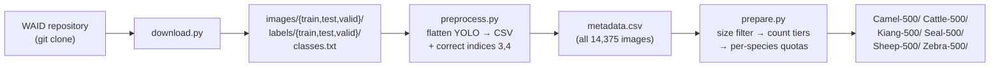
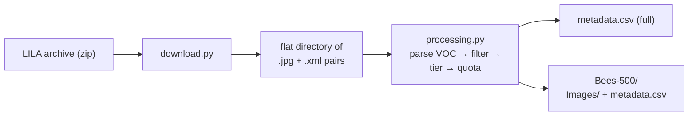
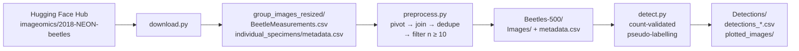
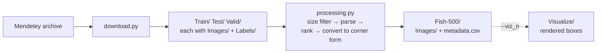
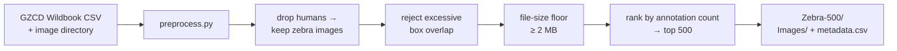

<h1 align="center"> Bio-VQA &rarr; Spatial Visual Reasoning &rarr; Dataset Construction </h1>

<p align="center">
  <b>Five upstream sources · Five acquisition pipelines · One output contract</b>
</p>
<p align="center">
  
  
  
  
  
  
</p>

## Table of Contents

- [Overview](#overview)
- [Motivation and Design Requirements](#motivation-and-design-requirements)
- [Output Contract](#output-contract)
- [Directory Layout](#directory-layout)
- [Terminology and Coordinate Conventions](#terminology-and-coordinate-conventions)
- [Source Collections and Acquisition Pipelines](#source-collections-and-acquisition-pipelines)
  - [1. Aerial &mdash; WAID](#1-aerial--waid)
  - [2. Bees &mdash; Boxes on Bees and Pollen](#2-bees--boxes-on-bees-and-pollen)
  - [3. Beetles &mdash; 2018-NEON-beetles](#3-beetles--2018-neon-beetles)
  - [4. Fish &mdash; DePondFi](#4-fish--depondfi)
  - [5. Zebra &mdash; GZCD](#5-zebra--gzcd)
- [Correction Applied to Upstream Annotations](#correction-applied-to-upstream-annotations)
- [Reproduction Procedure](#reproduction-procedure)
- [Derived Subsets and Supported Question Classes](#derived-subsets-and-supported-question-classes)
- [Dataset Statistics](#dataset-statistics)
- [Limitations](#limitations)
- [References](#references)

---

## Overview

This directory contains the **data acquisition and curation layer** of the spatial visual reasoning
component of Bio-VQA. It is the stage that runs before any question is written and before any model is
prompted. Its sole responsibility is to convert five heterogeneous, independently published biological
image collections into a small number of **curated, uniformly described image subsets** on which spatial
questions can be posed without ambiguity.

We state the scope precisely, because the boundary matters for anyone reading the rest of the
benchmark. The scripts here do **not**:

- generate questions or answers,
- run any vision&ndash;language model,
- compute any evaluation metric,
- or perform any train/test splitting.

They do exactly one thing: **they turn raw upstream archives into `Images/` plus `metadata.csv`.** Every
downstream stage of the component consumes that pair and nothing else. If you want to understand where
the numbers in the spatial reasoning results come from, this is the layer that determines which images
are in play and what the ground truth says about them.

We use the word *component* throughout to mean one of the four measurement axes of Bio-VQA. The one served
by this directory probes whether a model can reason about **quantity, position, extent, and arrangement**
of organisms within a single image &mdash; how many there are, where they sit relative to one another, and
how large they are relative to each other and to the frame.

---

## Motivation and Design Requirements

Five public datasets already supply images and bounding boxes. Curation is nonetheless required, for four
reasons, each of which motivates a design decision recurring across all five pipelines.

**First, spatial questions are only well-posed on images whose annotations are complete.** If we ask *"how
many beetles are in this image?"* and the ground truth records twelve boxes while the photograph actually
contains fifteen specimens, then the correct answer is fifteen and our benchmark penalizes a model for
being right. Object-detection datasets are frequently annotated for *training* rather than for
*exhaustive census*, and partial annotation is tolerable for the former and fatal for the latter. Each
pipeline therefore applies source-specific filters that remove images whose annotation completeness
we cannot vouch for.

**Second, spatial questions are only interesting on images with enough objects.** An image containing one
organism supports no relative-position question, no counting question worth asking, and no relative-size
comparison. Every pipeline therefore imposes a **minimum object count**, and several impose a stratified
distribution over counts so that the resulting subset spans a controlled range of difficulty rather than
piling up at the easy end.

**Third, spatial questions are only answerable on images a model can actually see.** Several of the
upstream archives contain truncated files, thumbnails, or images whose resolution is too low for the
annotated objects to be visually resolvable after a vision encoder's downsampling. Every pipeline
therefore imposes a **file-size floor**, which functions as a cheap proxy for "this file decodes and
carries enough pixels to be worth asking about."

**Fourth, and most importantly, the ground truth must mean the same thing in every subset.** Five
upstream sources use four different annotation formats and at least three different coordinate
conventions. If one subset stores box corners in pixels and another stores box centers in normalized
units, and both name the columns `x` and `y`, then any downstream code that treats them uniformly is
silently wrong for one of them. Unifying these conventions is the single most consequential thing this
layer does, and the resulting conventions are tabulated in
[Terminology and Coordinate Conventions](#terminology-and-coordinate-conventions).

---

## Output Contract

Every pipeline in this directory terminates in the same two artefacts. We call this the **output
contract**, and it is the interface that the rest of the component programs against.

```
<SUBSET_NAME>/
├── Images/          # the selected image files, copied byte-for-byte from the source
└── metadata.csv     # one row per annotated object, not per image
```

Two properties of this contract deserve emphasis because they are easy to get wrong.

**The metadata table is annotation-major, not image-major.** A single row describes a single organism.
An image containing seventeen bees therefore contributes seventeen rows. The per-image object count is
carried redundantly on every row belonging to that image (as `num_bees`, `num_fish`,
`no_of_beetles_in_image`, or `num_animals_in_image`, depending on the subset). This redundancy is
deliberate: it means a consumer can compute per-image counts either by reading the count column or by
grouping and counting rows, and **the two must agree**. Any disagreement is a bug, and the statistics
script described below checks for exactly this.

Formally, for an image $i$ with annotation row set $R_i$ and recorded count column $c$, we require:

$$
|R_i| \;=\; c(r) \qquad \forall\, r \in R_i
$$

**Images are copied, never re-encoded.** Every pipeline uses `shutil.copy2`, which reproduces the file
bytes and preserves modification metadata. It does not decode the image and write it back out. This is a
correctness requirement rather than a performance preference. Decoding and re-encoding a JPEG resamples
the pixel data and, critically, **discards EXIF metadata including the orientation tag**. If a source
image carries a non-identity EXIF orientation, its annotations were authored in the coordinate frame that
a viewer produces *after* applying that rotation. Strip the tag and the stored pixels no longer
correspond to the coordinate frame of the boxes, and every annotation on that image is silently wrong.
Byte-identical copying makes this class of failure impossible.

---

## Directory Layout

```
Datasets/
├── README.md                  # this document
│
├── Aerial/                    # WAID — six terrestrial species, drone imagery
│   ├── download.py            # git clone of the upstream repository
│   ├── preprocess.py          # YOLO label directory  →  flat metadata.csv (+ label correction)
│   └── prepare.py             # count-stratified selection  →  six 500-image subsets
│
├── Bees/                      # Boxes on Bees and Pollen — hive-entrance imagery
│   ├── download.py            # HTTP download + archive extraction
│   └── processing.py          # Pascal VOC XML  →  metadata.csv, tiered 500-image subset
│
├── Beetles/                   # 2018-NEON-beetles — lattice-arranged specimen photographs
│   ├── download.py            # Hugging Face Hub snapshot
│   ├── preprocess.py          # three-way metadata join  →  metadata.csv + Images/
│   └── detect.py              # count-validated box pseudo-labelling
│
├── Fish/                      # DePondFi — underwater pond video keyframes
│   ├── download.py            # HTTP download + archive extraction
│   └── processing.py          # YOLO labels  →  corner-form metadata.csv
│
└── Zebra/                     # GZCD — Great Grévy's Rally census photographs
    ├── download.py            # Hugging Face Hub snapshot
    └── preprocess.py          # Wildbook CSV  →  overlap-filtered 500-image subset
```

Shell submission scripts are not committed. Where a stage benefits from parallel execution we give the
submission template inline.

---

## Terminology and Coordinate Conventions

We define these terms once and use them consistently. Readers coming from a different subfield may attach
slightly different meanings to some of them, so we are explicit.

| Term | Definition as used here |
| :--- | :--- |
| **Annotation** | One labelled organism instance, described by a bounding box. Synonymous with *object* and *instance*. |
| **Group image** | An image containing multiple annotated organisms. All five subsets consist exclusively of group images. |
| **Object count** | The number of annotated organisms in one image. This is the ground truth for counting questions. |
| **Corner form** | A box expressed as $(x_{\min}, y_{\min}, w, h)$ in absolute pixels: the coordinates of the top-left corner plus width and height. |
| **center form** | A box expressed as $(x_c, y_c, w, h)$: the coordinates of the box center plus width and height. YOLO label files use this form with all four values normalized to $[0,1]$. |
| **normalized** | Coordinates divided by image width (for $x$, $w$) or image height (for $y$, $h$), yielding values in $[0,1]$ that are independent of resolution. |
| **Absolute** | Coordinates in pixels, valid only alongside the image dimensions that produced them. |
| **Difficulty tier** | A partition of images by object count into bands. Used to control the count distribution of a subset rather than to weight scoring. |
| **File-size floor** | A minimum byte size below which an image is discarded, used as a proxy for decodability and resolution. |

**Coordinate origin.** Every pixel coordinate in this directory follows the image-processing convention:
the origin $(0,0)$ is the **top-left** corner of the image, $x$ increases to the right, and $y$ increases
**downward**. This is the convention used by Pascal VOC, YOLO, OpenCV, and PIL. It is not the
mathematical convention, and a box with a larger $y$ is lower in the frame, not higher.

**Conversion between forms.** Given a YOLO record $(x_c, y_c, w_n, h_n)$ with all values normalized, and
an image of width $W$ and height $H$ pixels, the corner form in absolute pixels is:

$$
w = w_n \cdot W, \qquad h = h_n \cdot H
$$

$$
x_{\min} = x_c \cdot W - \frac{w}{2}, \qquad y_{\min} = y_c \cdot H - \frac{h}{2}
$$

Omitting the subtraction of the half-extent displaces every box down and to the right by half its own
size, so the two forms are not interchangeable despite both being four numbers.

### Coordinate conventions across the released subsets

The five sources use four different annotation formats, and the released subsets preserve that
heterogeneity rather than forcing a single representation. The following table governs any code that
touches box geometry:

| Subset | Meaning of the position columns | Units | Column names |
| :--- | :--- | :--- | :--- |
| Aerial (six species) | **center** | **normalized** $[0,1]$ | `x_center`, `y_center`, `width`, `height` |
| Bees | top-left corner | absolute px | `x`, `y`, `w`, `h` |
| Beetles (main) | *not boxes* &mdash; measurement endpoints | absolute px | `elytra_length_coords`, `elytra_width_coords` |
| Beetles (`Detections/`) | corner pair | **normalized** $[0,1]$ | `coordinates` (JSON: `x_min`, `y_min`, `x_max`, `y_max`) |
| Fish | top-left corner | absolute px | `bbox_x`, `bbox_y`, `bbox_w`, `bbox_h` |
| Zebra | top-left corner | absolute px | `bbox x`, `bbox y`, `bbox w`, `bbox h` |

Three of the six rows in that table differ from the others in either form or units. The Aerial subsets
are normalized center form, but their column names say so. The beetle detections are a normalized corner
*pair* rather than corner-plus-extent. Everything else is absolute corner-plus-extent. **No consumer
should assume a single convention across subsets**; the correct pattern is to dispatch on subset and
convert to a common internal representation at load time.

---

**Intersection over Union.** For two boxes $A$ and $B$ in corner form, we measure overlap as:

$$
\mathrm{IoU}(A, B) \;=\; \frac{|A \cap B|}{|A \cup B|} \;=\; \frac{|A \cap B|}{|A| + |B| - |A \cap B|}
$$

where the intersection width is $\max(0,\; \min(x_A + w_A,\, x_B + w_B) - \max(x_A, x_B))$ and the
intersection height is defined symmetrically. The clamping at zero handles disjoint boxes. $\mathrm{IoU}$
ranges over $[0, 1]$, taking the value $0$ for disjoint boxes and $1$ for identical ones.

---

## Source Collections and Acquisition Pipelines

We describe each pipeline in the same order: what the upstream data is, what shape it arrives in, what
each script does and why, what comes out, and what we know to be imperfect about it.

---

### 1. Aerial &mdash; WAID

#### Upstream

WAID (*Wildlife Aerial Images from Drone*) is a drone-captured wildlife detection dataset of 14,375
images spanning six large-mammal classes, released with the SE-YOLO detector paper (Mou et al., 2023).
Annotations are supplied in **YOLO format**: one plain-text file per image, one line per object, each
line reading `class_index x_center y_center width height` with the four geometric values normalized to
$[0,1]$. Class indices are resolved against a `classes.txt` file at the dataset root.

The six classes are sheep, cattle, seal, camel (listed upstream as *camelus*), kiang (the Tibetan wild
ass, *Equus kiang*), and zebra.

We use this source because aerial imagery gives me something no other source does: **a true overhead
viewpoint with a flat ground plane**. In a nadir photograph the projection is close to orthographic over
the animals, so relative sizes in the image plane correspond to relative sizes on the ground, and
left/right/above/below relations are unambiguous. In an oblique or handheld photograph, an animal nearer
the camera is larger in the frame regardless of its physical size, which confounds every relative-size
question we might want to ask.

#### Pipeline



**`download.py`** clones the upstream Git repository into a target directory. It warns rather than fails
if the target is non-empty, so a partial clone is visible rather than silently merged.

**`preprocess.py`** walks the three splits, pairs each image with its label file, and emits one CSV row
per annotation. It assigns a UUID to every annotation, records the split it came from, and stores the
per-image object count on every row belonging to that image. Geometry is written through **unchanged**,
which means the Aerial subsets are the only ones in this directory carrying **normalized center-form**
coordinates. We preserve the upstream form here rather than converting because the column names
(`x_center`, `y_center`, `width`, `height`) declare the convention unambiguously, and because normalized
coordinates remain valid if a consumer later resizes the imagery. This is a deliberate asymmetry with the
other four subsets and is documented again in the [schema table](#derived-subsets-and-supported-question-classes).

It also applies the label correction described in
[the correction section](#correction-applied-to-upstream-annotations), and normalises the upstream
spelling *camelus* to *camel* so that the class vocabulary is consistent English common names.

**`prepare.py`** performs selection. It proceeds in four stages:

1. **Resolve and validate paths.** Relative image paths from the CSV are resolved against the dataset
   root, and any image that does not exist on disk or falls below the file-size floor
   (`--file_size_kb`, default 20 KB) is dropped along with all of its annotations.

2. **Recompute per-image, per-class counts.** Rather than trusting the count column, it regroups the
   surviving annotations by `(image, class)`. This matters because the file-size filter may have removed
   rows, and because an image may in principle carry more than one class.

3. **Apply per-species count tiers.** Each species has a hand-specified tier schedule: a list of
   `(low, high, quota)` triples. For each tier in order, the script takes images whose object count falls
   in $[\text{low}, \text{high}]$, excludes any image already claimed by an earlier tier, sorts the
   remainder by descending file size (then descending count), and takes the first `quota` images. The
   schedules are:

   | Species | Tier 1 | Tier 2 | Tier 3 |
   | :--- | :--- | :--- | :--- |
   | camel | 5&ndash;10 &rarr; 300 | 11&ndash;30 &rarr; 200 | &mdash; |
   | cattle | 5&ndash;10 &rarr; 200 | 11&ndash;30 &rarr; 200 | 31+ &rarr; 100 |
   | kiang | 2&ndash;4 &rarr; 150 | 5&ndash;10 &rarr; 300 | 11&ndash;30 &rarr; 50 |
   | seal | 31+ &rarr; 75 | 11&ndash;30 &rarr; 200 | 5&ndash;10 &rarr; 225 |
   | sheep | 5&ndash;10 &rarr; 200 | 11&ndash;30 &rarr; 200 | 31+ &rarr; 100 |
   | zebra | 2&ndash;4 &rarr; 100 | 5&ndash;10 &rarr; 250 | 11&ndash;30 &rarr; 150 |

   The quotas sum to 500 per species by construction. They differ between species because the underlying
   count distributions differ: seals photograph in dense haul-outs and supply many high-count images,
   whereas kiang and zebra appear in smaller groups and their schedules reach down to a floor of two
   animals to fill the quota at all.

4. **Backfill and write.** If the tiers under-deliver &mdash; which happens when a species has fewer
   qualifying images than its schedule assumes &mdash; the shortfall is filled from the unclaimed
   remainder, again by descending file size. The selection is then truncated to exactly
   `--dataset_size` images, the annotations for the selected images and target class are written to
   `metadata.csv`, and the image files are copied.

Sorting by descending file size inside each tier is a resolution heuristic: within a fixed count band,
larger files are generally higher-resolution captures in which individual animals occupy more pixels.

#### Running

```bash
python Aerial/download.py \
  --repo https://github.com/xiaohuicui/WAID \
  --local_path <RAW_ROOT>/WAID

python Aerial/preprocess.py <RAW_ROOT>/WAID/WAID     # positional; writes metadata.csv in place

python Aerial/prepare.py \
  --base_dir        <RAW_ROOT>/WAID/WAID \
  --output_base_dir <SUBSET_ROOT> \
  --file_size_kb    20 \
  --dataset_size    500
```

#### Output schema

| Column | Type | Meaning |
| :--- | :--- | :--- |
| `annot_uuid` | string | Unique identifier for this annotation row. |
| `image_path` | string | Path relative to the WAID root, e.g. `images/train/xyz.jpg`. |
| `split` | string | Upstream split the image came from (`train`, `test`, `valid`). Retained for provenance only; we do not use upstream splits. |
| `class_name` | string | Corrected English common name. |
| `x_center`, `y_center` | float | **normalized** box center, in $[0,1]$. |
| `width`, `height` | float | **normalized** box extent, in $[0,1]$. |
| `num_animals_in_image` | int | Object count for the image. |
| `full_path` | string | Absolute path at build time. Environment-specific; ignore on re-use. |

#### Known imperfections

- The `full_path` column records absolute paths from the build machine and is not portable.
- Sorting by file size within a tier correlates with, but does not guarantee, resolution.
- The upstream splits are carried through but carry no meaning in our use, since we re-select across all
  three.

---

### 2. Bees &mdash; Boxes on Bees and Pollen

#### Upstream

This dataset comes from the **BeeLivingSensor** project, which non-invasively monitors honey bees at hive
entrances in order to track the type and volume of pollen carried into the hive. It contains
approximately 5,000 images (4,993 image files) with roughly 50,000 bounding-box annotations covering both
bees and pollen loads, distributed through LILA BC under the permissive variant of the Community Data
License Agreement.

Annotations are in **Pascal VOC XML**, one file per image, sharing the image's basename. Each `<object>`
element carries a class `<name>`, a `<bndbox>` with absolute-pixel `xmin`, `ymin`, `xmax`, `ymax`, and
two boolean-valued flags, `truncated` and `difficult`.

We use this source because it is the densest counting material available to me. A single hive-entrance
frame regularly contains dozens of bees, which pushes counting questions well past the range where a
model might plausibly succeed by subitising &mdash; the perceptual capacity to apprehend small quantities
(roughly four or fewer) at a glance without deliberate enumeration.

#### Pipeline



**`download.py`** streams the archive to disk with a progress bar and optionally extracts it, dispatching
on extension for ZIP and TAR variants.

**`processing.py`** builds the subset. Its steps, in order:

1. **Exclude one recording site.** Any XML whose filename contains `Chueried_HempBox` is skipped
   entirely, because the box coordinates from that site do not align with the imagery. This is a
   source-specific defect rather than a general quality filter, and excluding the site is the only
   correct response: We cannot repair coordinates whose relationship to the pixels is unknown.

2. **Require a matching image.** XML files with no corresponding `.jpg` are skipped.

3. **Apply the file-size floor.** Images at or below `--image_size` KB (default 200 KB) are discarded.
   The archive contains a substantial number of JPEG files that cannot be opened; the size floor removes
   them without needing to attempt a decode of every file.

4. **Parse only bee objects.** The parser retains `<object>` elements whose `<name>` is `bee` and
   discards pollen annotations. This is a scoping decision: the counting ground truth for this subset is
   *number of bees*, and admitting pollen boxes would make the object count ambiguous. Corner form is
   computed directly, since VOC stores two corners:

   $$w = x_{\max} - x_{\min}, \qquad h = y_{\max} - y_{\min}$$

5. **Impose a stable reading order.** Within an image, bees are sorted by vertical band and then
   horizontally:

   $$\text{key}(b) = \left( 50 \cdot \left\lfloor \frac{y_{\min}(b)}{50} \right\rceil,\; x_{\min}(b) \right)$$

   Rounding $y$ to the nearest 50-pixel band before sorting means bees at approximately the same height
   are ordered left-to-right rather than being interleaved by single-pixel differences in their box tops.
   The resulting `bee index` (`bee_1`, `bee_2`, &hellip;) is a **stable, human-legible ordinal** that can
   be referred to in a question &mdash; "the third bee from the top-left" &mdash; without depending on
   the order in which the annotation file happened to list objects.

6. **Assign difficulty tiers** by object count $n$:

   ```math
   \text{tier}(n) = \begin{cases}
     \texttt{too\_easy} & n < 5 \\
     \texttt{easy}      & 5 \le n \le 20 \\
     \texttt{medium}    & 20 < n \le 60 \\
     \texttt{hard}      & n > 60
   \end{cases}
   ```

   Images in `too_easy` are not selected: fewer than five bees supports no interesting spatial question.

7. **Fill quotas.** From the deduplicated per-image table, the script takes the 250 highest-count `easy`
   images, the 150 highest-count `medium` images, and the 100 highest-count `hard` images, for 500 total.
   Selecting by *descending* count within a tier means each tier is populated from its upper edge; the
   `easy` tier in practice supplies images near twenty bees rather than near five. This is a known
   consequence of the selection rule and is discussed under [Limitations](#limitations).

8. **Sort and write.** Rows are ordered by tier, then descending count, then image name, then bee index,
   which makes the released CSV readable top-to-bottom as a difficulty progression. Images are copied.

#### Running

```bash
python Bees/download.py \
  --url <LILA_ZIP_URL> \
  --output <RAW_ROOT>/bees.zip \
  --extract

python Bees/processing.py \
  --base_dir     <RAW_ROOT>/bees \
  --output_csv   <RAW_ROOT>/bees_full \
  --filtered_dir <SUBSET_ROOT>/Bees-500/Images \
  --filtered_csv <SUBSET_ROOT>/Bees-500/metadata.csv \
  --image_size   200
```

Note that `--output_csv` is a **directory**, into which the script writes an unfiltered `metadata.csv`
covering every surviving image, while `--filtered_csv` is a **file path** for the 500-image subset. The
unfiltered table is useful for computing what the tier distribution looked like before quotas were
applied.

#### Output schema

| Column | Type | Meaning |
| :--- | :--- | :--- |
| `image` | string | Image filename. |
| `num_bees` | int | Object count for the image. |
| `bee index` | string | Stable ordinal within the image, `bee_1` upward, in top-to-bottom then left-to-right order. |
| `x`, `y` | int | **Absolute pixel** top-left corner. |
| `w`, `h` | int | **Absolute pixel** extent. |
| `difficulty_tier` | string | `easy`, `medium`, or `hard`. |

#### Known imperfections

- The `truncated` and `difficult` flags are parsed from the XML but not carried into the output. A bee
  clipped by the frame edge is counted identically to a fully visible one.
- Tier boundaries are inclusive at 20 and 60 in a way that leaves 20 in `easy` and 60 in `medium`.

---

### 3. Beetles &mdash; 2018-NEON-beetles

#### Upstream

This dataset consists of 577 photographs of ethanol-preserved ground beetles (Carabidae) collected at
National Ecological Observatory Network (NEON) sites during 2018 and photographed in 2022. Each
photograph shows a set of specimens **arranged on a regular lattice**, together with a centimetre
scalebar and a barcode identifying the sample. All individuals within a single image come from one plot
at one site and belong to one species. Across the collection there are 11,459 individual beetles. For
each individual, the **elytra length** and **elytra width** were annotated through Zooniverse; the elytra
are the hardened forewings whose dimensions serve as standard body-size proxies in carabid morphometrics.

The repository ships three tables we use:

| File | Granularity | Content |
| :--- | :--- | :--- |
| `BeetleMeasurements.csv` | one row per *measurement* | Pixel coordinate pairs and physical distances for each structure (`ElytraLength` or `ElytraWidth`), plus annotator identity and scalebar. |
| `individual_specimens/metadata.csv` | one row per individual | Taxonomic identification for each cropped specimen. |
| `group_images_resized/metadata.csv` | one row per group image | Site and species information for the photograph. |

We use this source as the **primary defensible dataset** for spatial reasoning. The lattice arrangement makes it uniquely well-suited to relative-position
questions. Because specimens are laid out on an approximately regular grid against a plain background at
uniform scale and illumination, an instruction such as *"which specimen is immediately to the left of the
third specimen in the top row?"* has an unambiguous answer that does not depend on depth, occlusion, or
perspective. In a field photograph the same question is frequently unanswerable in principle, because
two animals at different distances have no well-defined left/right relation in the image plane that
corresponds to anything in the world. The lattice removes that confound by construction.

#### Pipeline



**`download.py`** fetches only what is needed: a snapshot restricted to `group_images_resized/*` plus the
two metadata tables, rather than the full repository.

**`preprocess.py`** assembles the subset table. The central operation is a **pivot from measurement-major
to specimen-major** form. Upstream, one beetle contributes two rows, one for its elytra length and one
for its width. We split the table on the `structure` column and inner-join the halves on the composite key
`(pictureID, individual)`, so that each beetle becomes a single row carrying both dimensions. The inner
join is meaningful: a specimen measured for only one of the two structures is dropped, because a
half-measured specimen supports no size comparison.

The remaining steps are:

1. **Parse coordinate strings.** `coords_pix` and `scalebar` arrive as string literals of Python
   sequences and are evaluated into structured values with `ast.literal_eval`.

2. **Construct specimen filenames** in the form `<pictureID without extension>_specimen_<individual>.png`,
   which is the join key into the individual-level metadata.

3. **Compute per-image counts** as the number of distinct `individual` values per `pictureID`.

4. **Join taxonomy and site information** from the individual-level and group-level tables, both as left
   joins so that a missing identification does not remove a specimen.

5. **Resolve duplicate annotations.** Where a specimen was measured by more than one Zooniverse
   annotator, the script keeps a single row, preferring the annotator `IsaFluck` where present and
   otherwise taking the first row in group order. Fixing a preferred annotator is a deliberate
   consistency choice: it means that within any image, all retained measurements come from one person
   wherever that person contributed, so relative-size comparisons within an image are not contaminated by
   inter-annotator variation in where the elytra endpoints are placed. The rule is arbitrary in the sense
   that a different annotator could have been chosen; it is not arbitrary in the sense that *some*
   deterministic rule is required.

6. **Filter to dense images.** Only images with at least ten distinct beetles survive:

   $$n_{\text{beetles}}(i) \ge 10$$

7. **Write the table and copy the unique group images.**

**`detect.py`** is a separate, optional stage that produces bounding boxes. The upstream annotations are *measurement segments* &mdash; coordinate pairs describing the ends
of a length or width measurement &mdash; and not boxes. To ask localization questions we need boxes, so we
generate them with the Moondream vision model and then **gate every result on an exact count match**:

$$
\text{accept detections } D \text{ for image } i \iff |D| = n_{\text{beetles}}(i)
$$

If the detector finds a different number of beetles than the ground truth records, the entire detection
set for that image is discarded &mdash; not corrected, not partially kept. This gate is what makes the
procedure defensible. The model is not being trusted to count; it is being used only to *localise*
objects whose number we already know from human annotation, and any disagreement in number is treated as
evidence that the localization is untrustworthy. The output is therefore a high-precision, low-recall set
of images with boxes, and the images that fail the gate simply do not participate in localization
questions.

The script restricts itself to images in the ten-to-nineteen beetle range, shards work across array tasks
by contiguous index range, saves results incrementally after every accepted image so that an interrupted
job loses nothing, and retries with exponential backoff on HTTP 429 rate-limit responses. It renders each
accepted detection set onto a copy of the image for visual inspection.

`detect.py` requires an API credential supplied through the environment:

```bash
export MOONDREAM_API_KEY="<your key>"
```

The credential must never be written into a script or committed.

#### Running

```bash
python Beetles/download.py --output_dir <RAW_ROOT>/beetles

python Beetles/preprocess.py \
  --base_dir   <RAW_ROOT>/beetles \
  --output_dir <SUBSET_ROOT>/Beetles-500

# optional localization stage, six parallel shards
for TASK in 0 1 2 3 4 5; do
  python Beetles/detect.py \
    --base_dir <SUBSET_ROOT>/Beetles-500 \
    --task_id  $TASK \
    --num_tasks 6 &
done
wait

# merge shards, preserving the header exactly once
awk 'NR==1 || FNR>1' <SUBSET_ROOT>/Beetles-500/Detections/detections_*.csv \
  > <SUBSET_ROOT>/Beetles-500/Detections/Detections.csv
```

Under a scheduler, replace the loop with an array job and pass `$SLURM_ARRAY_TASK_ID` as `--task_id`,
keeping `--num_tasks` equal to the array size. A mismatch between the two silently drops the tail of the
image list.

#### Output schema

| Column | Type | Meaning |
| :--- | :--- | :--- |
| `beetle_name` | string | Individual specimen identifier. |
| `group_image_path` | string | Path to the group photograph, relative to the subset root. |
| `no_of_beetles_in_image` | int | Object count for the image. |
| `scalebar` | structured | Scalebar coordinates, enabling pixel-to-centimetre conversion. |
| `elytra_length_coords`, `elytra_width_coords` | structured | Pixel endpoints of each measurement. |
| `elytra_length_cm`, `elytra_width_cm` | float | Physical dimensions in centimetres. |
| `site` | string | NEON site identifier. |
| `scientificName`, `genus`, `species_epithet` | string | Taxonomic identification. |
| `barcode_text` | string | Sample barcode, where the picture identifier encodes one. |
| `user_name` | string | Zooniverse annotator retained for this specimen. |

The `Detections/` output, when produced, carries `image_name`, `image_path`, `no_of_beetles`, and
`coordinates` &mdash; the last being a JSON array of normalized `x_min`, `y_min`, `x_max`, `y_max`
values.

#### Known imperfections

- Detection coverage is partial by design. Images failing the count gate have no boxes.
- Detection coordinates are normalized corner-pair form, which differs from the `(x, y, w, h)` form used
  by the main metadata tables. Consumers must convert.
- The annotator preference rule is deterministic but arbitrary in its choice of individual.

---

### 4. Fish &mdash; DePondFi

#### Upstream

DePondFi (*Detection of Pond Fish*) comprises 586 keyframes extracted from underwater video of Orange
Chromide (*Etroplus maculatus*) in ponds at Kolathur, Chennai, India. Video was captured with a Crosstour
CT9000 underwater camera at 60 fps at depths under four metres and an approximately 135-degree field of
view. Keyframes were standardized to 640&times;640 pixels and annotated with bounding boxes, giving
10,607 fish instances. The published material notes turbidity between 40 and 80 NTU and illumination
between 100 and 500 lux, together with substantial occlusion and high per-frame fish density.

Labels are in **YOLO format**: normalized center form, one line per fish.

We use this source because it supplies **occluded, overlapping, deformable targets in a low-contrast
medium** &mdash; the hardest counting regime in the collection. Where the beetle lattice is the clean
extreme, DePondFi is the adversarial one.

#### Pipeline



**`processing.py`** runs a single pass:

1. **Traverse all three upstream splits.** We do not honour the upstream train/validation/test partition,
   because we are not training anything; the whole collection is a candidate pool.

2. **Apply the file-size floor** (`--file_size_kb`, default 20 KB).

3. **Parse labels defensively.** A line is accepted only if it splits into exactly five whitespace-
   separated fields that all parse as floating-point numbers. Blank lines and malformed lines are
   skipped. Images with no acceptable boxes are dropped.

4. **Rank and truncate.** Candidates are sorted by descending box count and the top `--top_k` (default
   500) are kept.

5. **Guard against duplicate basenames.** If the same filename occurs in more than one upstream split,
   the second occurrence is skipped with a warning rather than overwriting the already-copied file.

6. **Read dimensions without decoding.** `PIL.Image.open` reads only the header, so width and height are
   obtained without paying to decompress the pixel data.

7. **Convert to corner form and clamp.** Each box is converted by the equations in
   [Vocabulary and Conventions](#terminology-and-coordinate-conventions) and then clamped so that it lies inside the
   frame:

   $$x_{\min} \leftarrow \min\!\big(\max(0,\, x_{\min}),\, W\big), \qquad w \leftarrow \min\!\big(w,\; W - x_{\min}\big)$$

   with $y$ handled symmetrically. Clamping matters because a box extending past the frame edge produces
   a negative coordinate or an out-of-frame extent, either of which breaks area computations and renders
   incorrectly.

8. **Derive the count from parsed boxes.** `num_fish` is the number of boxes that survived parsing, not
   the number of lines in the label file. These differ whenever a file contains a blank or malformed
   line, and the difference would otherwise propagate directly into the counting ground truth.

9. **Copy images byte-for-byte** and write the table. If nothing survives filtering, the script exits
   with a message naming the expected directory layout rather than failing with an opaque error.

The optional `--viz_n` flag renders that many images with their boxes drawn and the count printed, which
is the fastest way to confirm the coordinate convention is right.

#### Running

```bash
python Fish/download.py \
  --url <MENDELEY_ZIP_URL> \
  --output <RAW_ROOT>/depondfi.zip \
  --extract

python Fish/processing.py \
  --base_dir     <RAW_ROOT>/depondfi \
  --output_dir   <SUBSET_ROOT>/Fish-500 \
  --file_size_kb 20 \
  --top_k        500 \
  --viz_n        20
```

#### Output schema

| Column | Type | Meaning |
| :--- | :--- | :--- |
| `annot_uuid` | string | Unique identifier for this annotation row. |
| `image_name` | string | Image filename. |
| `species` | string | Constant `Etroplus_maculatus`; the source is single-species. |
| `bbox_x`, `bbox_y` | float | **Absolute pixel** top-left corner. |
| `bbox_w`, `bbox_h` | float | **Absolute pixel** extent. |
| `num_fish` | int | Object count for the image. |

#### Known imperfections

- Selection is a pure top-$k$ by count with no tiering, so the count distribution is a truncated upper
  tail rather than a stratified spread. This is the least controlled selection rule in the directory.
- The species column is constant and carries no information; it exists for schema parity.
- With 586 source images and a target of 500, the selection pressure is weak and most of the collection
  survives.

---

### 5. Zebra &mdash; GZCD

#### Upstream

GZCD (the *Great Zebra Count Dataset*) contains 5,464 photographs taken in Meru County, Kenya, over four
days of the Great Grévy's Rally in 2016 and 2018 by thirteen photographers. Photographers were trained to
capture a consistent right-side viewpoint of Grévy's zebra. The collection is heavily curated: bounding
boxes and labels for species, viewpoint, and quality were all set by human reviewers.

The annotations arrive as a **Wildbook-style flat CSV** in which each row is one annotation, joined to
images by `image uuid` and carrying an `image fname`. Boxes are in **absolute-pixel corner form** under
the column names `bbox x`, `bbox y`, `bbox w`, `bbox h`. A boolean column, `census annot region`, marks
annotations belonging to a designated census region.

We use this source because it supplies **ground-level photographs of free-ranging animals at natural
group sizes**, which is the complement to the aerial and laboratory material. It is also the only source
whose annotations were produced under an explicit census protocol, which is the strongest available
evidence that the object counts are exhaustive rather than merely sufficient for training.

#### Pipeline



**`download.py`** retrieves the image directory and both metadata files from the Hugging Face Hub. The
repository ships annotations as `final_metadata.json` and `initial_metadata.json`; `preprocess.py`
consumes the flattened tabular form of `final_metadata.json`, in which each row is one annotation and the
Wildbook column names (`image uuid`, `annot uuid`, `bbox x`, and so on) are present as columns. Pass the
path to that flattened table as `--csv_path`.

**`preprocess.py`** applies five filters in sequence:

1. **Remove human annotations.** Any row whose `annot species` contains *human* is dropped. People
   appear in census photographs and are not part of the counting ground truth.

2. **Restrict to zebra-bearing images.** An image is retained only if at least one of its annotations is
   a zebra. Non-zebra annotations on a retained image are kept, since they are still objects in the
   frame.

3. **Reject images with excessive box overlap.** For each image, all pairs of boxes are examined and a
   pair is flagged when $\mathrm{IoU} > 0.5$. If more than two pairs are flagged, the image is discarded
   entirely. The reasoning is that heavy mutual overlap indicates either duplicate annotations of one
   animal or a pile-up so dense that individual animals are not separable, and in both cases the object
   count is unreliable. Allowing up to two flagged pairs tolerates the ordinary case of two animals
   genuinely standing in front of one another. The pairwise scan is $O(k^2)$ in the number of boxes per
   image, which is acceptable at these group sizes.

4. **Apply a file-size floor of 2 MB.** This is far higher than the floors used elsewhere and reflects
   the source: these are full-resolution photographs, and a file under 2 MB is a thumbnail or a failed
   transfer rather than a usable census image.

5. **Rank and truncate.** Images are ordered by descending count of distinct `annot uuid` values and the
   top `--top_k` (default 500) are kept.

Images are then copied, with a second existence-and-size check at copy time, and the metadata for
successfully copied images is written after removing rows where `census annot region` is true.

#### Running

```bash
python Zebra/download.py --output_dir <RAW_ROOT>/gzcd

python Zebra/preprocess.py \
  --csv_path   <RAW_ROOT>/gzcd/annotations.csv \
  --image_dir  <RAW_ROOT>/gzcd/images \
  --output_dir <SUBSET_ROOT>/Zebra-500 \
  --top_k      500
```

#### Output schema

The Wildbook columns are carried through unchanged. The ones that matter downstream are `image uuid`,
`image fname`, `annot uuid`, `annot species`, `annot viewpoint`, `annot quality`, and the four `bbox`
columns in absolute-pixel corner form.

#### Known imperfections

- The census-region filter is applied **after** image selection and copying. The ranking that chooses the
  top 500 therefore counts annotations that are subsequently removed from the metadata, and `Images/` can
  contain images whose surviving annotation set is smaller than the count that earned them their place
  &mdash; or, in principle, empty. A consumer should recompute counts by grouping the released metadata
  rather than trusting any count derived from the selection stage. Moving the filter ahead of the ranking
  is the correct fix and is deferred to preserve the exact subset used in the reported results.
- Image selection iterates a Python set, so the copy order is not deterministic across runs. The
  *selected set* is deterministic; only the order in which files are written is not.

---

## Correction Applied to Upstream Annotations

The correction below alters ground truth relative to what the upstream source supplies. We document it
prominently because a benchmark that silently modifies its inputs is not reproducible, and because
anyone comparing our subsets against the original archive will otherwise find a discrepancy and have no
way to determine whether it is deliberate. It is the only such alteration in this directory; the other
four sources are consumed as published.

---

### Class-index transposition between camel and kiang in WAID

#### Observation

While inspecting WAID imagery against its labels, we find that the class indices `3` and `4` do not
resolve to the animals actually depicted. Images whose annotations carry index `3` show **kiang**
(*Equus kiang*, the Tibetan wild ass), and images whose annotations carry index `4` show **camels**.
Resolving these indices through `classes.txt` in the ordinary way assigns them the opposite labels. The
two classes are exchanged relative to the declared class list.

#### Declared class ordering

The upstream class list orders the six classes as sheep, cattle, seal, camelus, kiang, zebra, placing
camel at index `3` and kiang at index `4`. This ordering is corroborated by the WAID publication, which
enumerates the dataset's species in the same sequence, and by third-party mirrors of the archive whose
class strings preserve it. The annotations we observe carry the opposite assignment for these two
indices.

We record that this determination rests on inspection of the imagery against the label files. We are not
aware of an upstream erratum, and the discrepancy has not been confirmed by the dataset's authors. The
correction below should therefore be read as an empirical finding about the archive as distributed at the
commit we pin, not as a documented defect.

#### Basis for the determination

The two animals are not visually confusable at the resolution of the imagery, and their habitats are
disjoint in the captured scenes. Kiang are photographed on open high-altitude steppe in herds with a
characteristic pale flank and dark dorsal stripe; camels are photographed in desert terrain with an
unmistakable silhouette and a distinctive shadow profile under nadir illumination. A label error between
two similar ungulates might have escaped notice; this one does not survive a few minutes of looking at
the images.

#### Consequences

For the spatial reasoning component the immediate effect is bounded, because counting and relative-
position questions do not depend on the class name being right. But the effect is not zero, for three
reasons:

1. **Questions name the animal.** A counting question phrased *"how many camels are in this image?"*
   posed against an image of kiang is unanswerable, and a model that answers zero is arguably correct.
2. **The subsets are named after their classes.** `Camel-500` and `Kiang-500` would contain each other's
   contents, which corrupts every per-class statistic reported anywhere downstream.
3. **The subsets are released.** Anyone reusing them inherits the error.

#### Correction applied

`preprocess.py` overrides the class-list lookup for exactly these two indices, at the point where the
annotation is read:

```python
if class_idx == 3:
    class_name = "kiang"
elif class_idx == 4:
    class_name = "camel"
else:
    class_name = original_classes[class_idx] if class_idx < len(original_classes) else "unknown"
```

All other indices resolve through `classes.txt` unchanged. A separate normalization maps the upstream
spelling `camelus` to `camel` wherever it appears, so that the released class vocabulary uses consistent
English common names.

The relabelling is applied **at the earliest possible point** &mdash; during metadata construction, before
any selection &mdash; so that every downstream stage sees only corrected labels and no stage has to know
that a correction happened.

#### Properties and scope of the correction

This is a **hardcoded, empirically determined override**. It is not derived from any upstream erratum, and it is not robust to the upstream repository being
revised. If WAID's maintainers correct `classes.txt`, this override will reintroduce the very error it
was written to fix, because it will then swap two indices that are already correct.

We accept that trade-off for three reasons. The alternative of silently mislabeling two of six classes is
strictly worse. The correction is two lines and is visible at the top of the only script that reads class
indices. And we pin the upstream commit at acquisition time, so the version this override is valid against
is recorded.

#### Verification procedure

Anyone rebuilding these subsets should confirm the correction still applies before trusting it:

```bash
# 1. Inspect the declared class order
cat <RAW_ROOT>/WAID/WAID/classes.txt

# 2. Sample images carrying index 3 and index 4, and look at them
grep -l "^3 " <RAW_ROOT>/WAID/WAID/labels/train/*.txt | head -5
grep -l "^4 " <RAW_ROOT>/WAID/WAID/labels/train/*.txt | head -5
```

If the images retrieved by the first command show camels rather than kiang, the upstream data has been
revised and the override in `preprocess.py` must be removed.

---

## Reproduction Procedure

The full sequence, assuming `<RAW_ROOT>` for downloaded archives and `<SUBSET_ROOT>` for built subsets.

```bash
# ---------- 1. Aerial (WAID) ----------
python Aerial/download.py --repo https://github.com/xiaohuicui/WAID --local_path <RAW_ROOT>/WAID
python Aerial/preprocess.py <RAW_ROOT>/WAID/WAID
python Aerial/prepare.py \
  --base_dir <RAW_ROOT>/WAID/WAID --output_base_dir <SUBSET_ROOT> \
  --file_size_kb 20 --dataset_size 500

# ---------- 2. Bees ----------
python Bees/download.py --url <LILA_ZIP_URL> --output <RAW_ROOT>/bees.zip --extract
python Bees/processing.py \
  --base_dir <RAW_ROOT>/bees \
  --output_csv <RAW_ROOT>/bees_full \
  --filtered_dir <SUBSET_ROOT>/Bees-500/Images \
  --filtered_csv <SUBSET_ROOT>/Bees-500/metadata.csv \
  --image_size 200

# ---------- 3. Beetles ----------
python Beetles/download.py --output_dir <RAW_ROOT>/beetles
python Beetles/preprocess.py --base_dir <RAW_ROOT>/beetles --output_dir <SUBSET_ROOT>/Beetles-500
export MOONDREAM_API_KEY="<key>"
python Beetles/detect.py --base_dir <SUBSET_ROOT>/Beetles-500 --task_id 0 --num_tasks 6

# ---------- 4. Fish ----------
python Fish/download.py --url <MENDELEY_ZIP_URL> --output <RAW_ROOT>/depondfi.zip --extract
python Fish/processing.py \
  --base_dir <RAW_ROOT>/depondfi --output_dir <SUBSET_ROOT>/Fish-500 \
  --file_size_kb 20 --top_k 500 --viz_n 20

# ---------- 5. Zebra ----------
python Zebra/download.py --output_dir <RAW_ROOT>/gzcd
python Zebra/preprocess.py \
  --csv_path <RAW_ROOT>/gzcd/annotations.csv --image_dir <RAW_ROOT>/gzcd/images \
  --output_dir <SUBSET_ROOT>/Zebra-500 --top_k 500
```

Dependencies across all pipelines: `pandas`, `pillow`, `requests`, `tqdm`, `huggingface_hub`,
`moondream` (Beetles detection only), and `opencv-python` (verification rendering only).

---

## Derived Subsets and Supported Question Classes

The directory yields nine curated subsets, each 500 images, together spanning four
imaging modalities, three viewpoints, and object counts from two to several hundred.

| Subset | Source | Organism | Modality / viewpoint | Object |
| :--- | :--- | :--- | :--- | :--- |
| `Camel-500` | WAID | *Camelus* sp. | Drone, nadir | camel |
| `Cattle-500` | WAID | *Bos taurus* | Drone, nadir | cattle |
| `Kiang-500` | WAID | *Equus kiang* | Drone, nadir | kiang |
| `Seal-500` | WAID | Pinnipedia | Drone, nadir | seal |
| `Sheep-500` | WAID | *Ovis aries* | Drone, nadir | sheep |
| `Zebra-500` | WAID | *Equus* sp. | Drone, nadir | zebra |
| `Bees` | Boxes on Bees and Pollen | *Apis mellifera* | Fixed camera, hive entrance | bee |
| `Beetles-500` | 2018-NEON-beetles | Carabidae | Copy-stand, lattice-arranged specimens | beetle |
| `Fish` | DePondFi | *Etroplus maculatus* | Underwater video keyframe | fish |
| `GrevysZebra` | GZCD | *Equus grevyi* | Handheld, ground level, right profile | zebra |

> **Two zebra subsets.** `Zebra-500` is the WAID aerial subset (plains zebra viewed from a drone) and
> `GrevysZebra` is the GZCD ground-level subset (Grévy's zebra in right profile). They are entirely
> different data at different viewpoints.

### Question classes supported by each subset

The subsets are not interchangeable; each was selected because it renders a particular class of question
well-posed.

**Counting** is supported by every subset, with the count taken from the annotation rows. The collection
spans the full difficulty range deliberately: from two-to-four animals in the sparse aerial tiers, where
a competent model should be near ceiling, through the tens in the bee and beetle material, to the dense
occluded fish frames. Because the same question form is posed across this range, the subsets jointly
measure **where counting breaks down** rather than merely whether it works.

**Relative position** &mdash; left/right, above/below, adjacency, ordinal position in an arrangement
&mdash; is supported principally by `Beetles-500`. The lattice arrangement is what makes the ground truth
unambiguous, for the reasons given in that section. The aerial subsets support a weaker form of the same
question, since the nadir viewpoint gives a consistent ground plane.

**Relative size** is supported by `Beetles-500` with the strongest ground truth available anywhere in the
collection, because elytra length and width are recorded in **centimeters** alongside a scalebar. This
means size comparisons can be posed against physical dimensions rather than pixel extents, which removes
the confound that a nearer object is larger in the image. Elsewhere, size comparisons rest on box area:

$$
a(b) = w_b \cdot h_b, \qquad \text{relative area} \;=\; \frac{a(b)}{W \cdot H}
$$

**localization** &mdash; naming where in the frame an object sits &mdash; is supported wherever boxes
exist, which is every subset except the main beetle table, and is supported for the beetle images that
pass the detection count gate.

**Density and arrangement** questions, which ask about spatial distribution rather than individual
objects, are supported by the high-count tiers of `Bees-500`, `Fish-500`, and `Seal-500`.

### Coverage of the collection

| Axis | Range covered |
| :--- | :--- |
| Viewpoint | Nadir aerial, oblique ground, fixed overhead, underwater, copy-stand |
| Arrangement | Regular lattice (beetles), natural aggregation (seals, bees), free ranging (zebra, cattle) |
| Object scale in frame | Small and numerous (aerial, bees) through large and few (ground zebra) |
| Occlusion | None (beetles) through severe (fish) |
| Medium | Air, water, laboratory |
| Taxonomic breadth | Mammals, birds absent by design, insects, fish &mdash; three phyla-level groups |

A benchmark drawn from a single modality measures competence on that modality;
this collection is assembled so that a failure observed across all of it is a failure of spatial
reasoning rather than of, say, aerial imagery.

---

## Dataset Statistics

| Subset | Source family | Images | Annotations | Min | Median | Mean | Max | Coordinate form |
| :--- | :--- | ---: | ---: | ---: | ---: | ---: | ---: | :--- |
| `Camel-500` | Aerial | 500 | 3,825 | 1 | 6 | 7.7 | 28 | normalized center |
| `Cattle-500` | Aerial | 500 | 7,697 | 5 | 11 | 15.4 | 54 | normalized center |
| `Kiang-500` | Aerial | 500 | 3,840 | 1 | 7 | 7.7 | 26 | normalized center |
| `Seal-500` | Aerial | 500 | 8,134 | 5 | 12 | 16.3 | 61 | normalized center |
| `Sheep-500` | Aerial | 500 | 9,694 | 5 | 13 | 19.4 | 92 | normalized center |
| `Zebra-500` | Aerial | 500 | 4,343 | 2 | 7 | 8.7 | 29 | normalized center |
| `Bees` | Bees | 500 | 18,600 | 8 | 27 | 37.2 | 180 | absolute corner |
| `Beetles-500` | Beetles | 510 | 10,952 | 10 | 16 | 21.5 | 99 | measurement endpoints |
| `Fish` | Fish | 500 | 9,951 | 11 | 19 | 19.9 | 39 | absolute corner |
| `GrevysZebra` | Zebra | 500 | 4,223 | 3 | 7 | 8.4 | 44 | absolute corner |
| **Total** | | **5,010** | **81,259** | | | | | |

Every subset contains exactly 500 images, and every image referenced in a metadata table is present on
disk across all subsets.

### Distribution of object counts

The count distribution is the quantity that most directly determines question difficulty, so we report it
in full rather than summarizing by a single average. Three regimes are visible in the table above.

**Sparse aerial subsets** (`Camel-500`, `Kiang-500`, `Zebra-500`, median 6&ndash;7) sit at the low end.
Their means exceed their medians by roughly one animal, indicating a right-skewed distribution: most
images hold a small group and a minority hold substantially more.

**Dense aerial subsets** (`Cattle-500`, `Seal-500`, `Sheep-500`, median 11&ndash;13, maxima 54&ndash;92)
occupy the middle. The gap between median and mean widens here, and `Sheep-500` reaches 92 animals in a
single frame.

**High-density subsets** (`Bees`, median 27, maximum 180; `Fish`, median 19) sit at the top. `Bees` has
the widest spread in the collection, with a mean of 37.2 against a median of 27, reflecting the three
difficulty tiers deliberately combined within one subset.

`GrevysZebra` is the sparsest subset by median but reaches 44 annotations in one image, giving it the
largest dynamic range relative to its median of any ground-level material.

## Limitations

The following constrain how the resulting measurements should be read.

**Selection is not random, and the subsets are not representative of their sources.** Every pipeline
selects by descending count, descending file size, or both. The released subsets are therefore biased
toward the dense, high-resolution end of each source. This is intentional &mdash; sparse, low-resolution
images support no interesting spatial question &mdash; but it means no statistic computed on a subset
should be read as an estimate of the corresponding statistic on the upstream dataset.

**Tier selection populates each band from its upper edge.** Within a difficulty tier, images are taken in
descending count order, so the `easy` bee tier is filled with images near twenty bees rather than spread
across five to twenty. The tiers control the *range* covered but not the *distribution within* a range.
A selection that sampled uniformly inside each band would give a smoother difficulty gradient, and this
is the most straightforward improvement available to the selection logic.

**Tier selection deliberately favors the dense end of each band**. Within a difficulty tier, we take images in 
descending object count, so each tier is populated from its upper edge: the easy bee tier is filled with images 
near twenty bees rather than spread evenly across five to twenty. This is intentional. Within any band we prefer 
the harder instances — those containing more subjects — because a tier's lower edge contributes items that are
(relatively) answerable and carry (relatively) little discriminative signal between models. The tiers therefore
define the range of counts a subset spans, while selection within a tier concentrates on the demanding end of that
range. The consequence to note when reading results is that per-tier accuracies are not estimates of accuracy at
the tier midpoint; they are estimates at its upper boundary, and a uniform sample inside each band would yield a
smoother but less discriminative difficulty gradient.

**The camel/kiang correction is version-specific.** It is valid against the upstream commit pinned at
acquisition and will become harmful if that upstream data is revised. See
[the correction section](#correction-applied-to-upstream-annotations).

**Beetle localization coverage is partial.** The count gate is a precision filter, and images that fail
it carry no boxes. The subset of beetle images with boxes is therefore not a random sample of the subset
&mdash; it is enriched for images the detector found easy, which are plausibly the well-separated,
evenly-lit ones.

**Backfill admits images below the intended count floor.** The tier schedules for camel begin at five
animals and for kiang at two, but both subsets contain images with a single annotation. This is the
backfill stage operating as written: when the tiers under-deliver, the shortfall is drawn from the
unclaimed remainder ranked by file size alone, with no count constraint. Single-animal images support no
relative-position or relative-size question and contribute only trivial counting items. Adding a minimum
count to the backfill selection is the appropriate fix.

**Aerial imagery is nadir but not orthographic.** The projection is close enough to orthographic over
level terrain for relative-size questions to be meaningful, but it is not exactly so, and animals near
the frame edge are viewed at a slight angle. Relative-size comparisons between animals at opposite
corners of a wide-angle frame carry more error than comparisons between neighbors.

**Object counts are not verified against the imagery.** With one exception, we inherit the object count
from the upstream annotation and do not independently confirm that the photograph contains that many
organisms. The exception is `Beetles-500`, where the detection count gate provides a second, independent
opinion on the count for the images that pass it. Everywhere else, an upstream annotation that missed an
animal produces ground truth that is wrong in a way this pipeline cannot detect.

---

## References

Please cite the upstream sources if you use these subsets. Each is redistributed under its own terms; the
license of each source governs its derived subset.

**Aerial &mdash; WAID**

> Mou, C., Liu, T., Zhu, C., & Cui, X. (2023). WAID: A Large-Scale Dataset for Wildlife Detection with
> Drones. *Applied Sciences*, 13(18), 10397. https://doi.org/10.3390/app131810397
>
> Repository: https://github.com/xiaohuicui/WAID

**Bees &mdash; Boxes on Bees and Pollen**

> BeeLivingSensor project. *Noninvasive bee tracking in videos: deep learning algorithms and cloud
> platform design specifications.* Dataset, 2021.
>
> Distributed by LILA BC: https://lila.science/datasets/boxes-on-bees-and-pollen
> License: Community Data License Agreement (permissive variant).

**Beetles &mdash; 2018-NEON-beetles**

> Imageomics Institute. *2018-NEON-beetles.* Hugging Face Datasets.
> https://huggingface.co/datasets/imageomics/2018-NEON-beetles
>
> Underlying specimens are collected under the National Ecological Observatory Network (NEON) data
> product for ground beetles sampled from pitfall traps. Elytra measurements were annotated through
> Zooniverse.

**Fish &mdash; DePondFi**

> Vijayalakshmi, M., & Sasithradevi, A. (2024). *Annotated underwater fish detection dataset from pond
> environments.* Mendeley Data, V1. https://doi.org/10.17632/7w45jx35hd.1
>
> Companion article: Vijayalakshmi, M., & Sasithradevi, A. (2024). A comprehensive annotated image
> dataset for real-time fish detection in pond settings. *Data in Brief*, 57, 111007.
>
> License: CC BY 4.0.

**Zebra &mdash; GZCD**

> Imageomics Institute. *GZCD (Great Zebra Count Dataset).* Hugging Face Datasets.
> https://huggingface.co/datasets/imageomics/GZCD
>
> Images were collected during the Great Grévy's Rally (2016 and 2018) in Meru County, Kenya.

---

<p align="center">
  <sub>Part of the <b>Bio-VQA</b> benchmark</sub>
</p>
