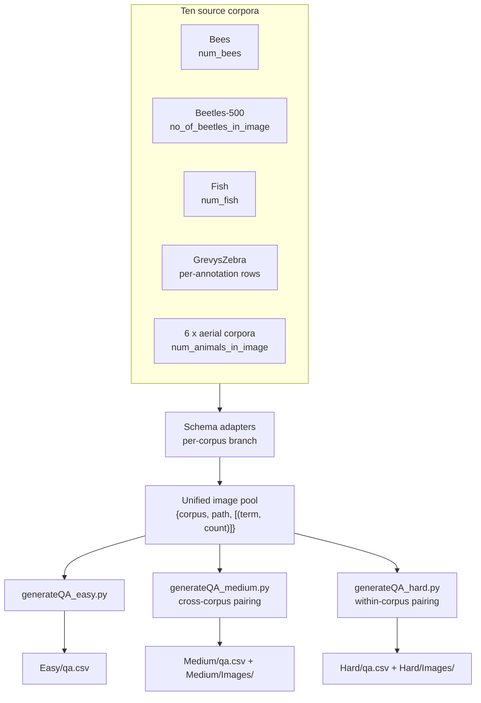

<h1 align="center">Bio-VQA &rarr; Spatial Visual Reasoning &rarr; Counting &rarr; QA Generation</h1>
<p align="center">
  <b>Construction of the Three Panel Conditions from Ten Biological Corpora</b>
</p>
<p align="center">
  
  
  
  
  
  
</p>

> Construction of the Counting evaluation set. This document describes the schema
> adaptation across ten heterogeneous corpora, the derived nested-count expansion, the
> rejection-sampling constraints that define each tier, the canvas synthesis geometry, and
> the output contract consumed by the inference stage.

---

## Table of contents

1. [Overview](#1-overview)
2. [Design contract](#2-design-contract)
3. [System architecture](#3-system-architecture)
4. [Source corpora and schema adaptation](#4-source-corpora-and-schema-adaptation)
   - 4.1 [Per-corpus adapters](#41-per-corpus-adapters)
   - 4.2 [Derived nested counts](#42-derived-nested-counts)
   - 4.3 [Lexical normalisation of the question stem](#43-lexical-normalisation-of-the-question-stem)
5. [Tier construction](#5-tier-construction)
   - 5.1 [Easy: single panel](#51-easy-single-panel)
   - 5.2 [Medium: cross-corpus pairing](#52-medium-cross-corpus-pairing)
   - 5.3 [Hard: within-corpus pairing](#53-hard-within-corpus-pairing)
   - 5.4 [Comparative summary](#54-comparative-summary)
6. [Canvas synthesis](#6-canvas-synthesis)
   - 6.1 [Height-matched concatenation](#61-height-matched-concatenation)
   - 6.2 [The area-partition law and its tier dependence](#62-the-area-partition-law-and-its-tier-dependence)
7. [Sampling, determinism, and acceptance rates](#7-sampling-determinism-and-acceptance-rates)
8. [Output schema](#8-output-schema)
9. [Reproduction](#9-reproduction)
10. [Operational behaviour](#10-operational-behaviour)

---

## 1. Overview

We convert ten source corpora — each with its own CSV schema, directory convention, and
notion of a count annotation — into three uniform question–answer manifests. Three scripts
implement the three tiers. We write three scripts rather than one parameterised script
because the tiers differ in algorithm rather than configuration: Easy performs no image
synthesis, while Medium and Hard construct new images under different sampling constraints.

The stage emits, per tier, a four-column `qa.csv` and — for the two-panel tiers — a
directory of synthesised canvases. Every downstream column is added by the preprocessing
stage ([Section 4.6 of the inference document](../2.Experiment_Runs/README.md#46-emitted-schema));
nothing downstream requires additional columns here.

---

## 2. Design contract

Four commitments hold across all three generators.

| Contract | Rationale |
|---|---|
| **No re-annotation.** Ground truth comes exclusively from source metadata. | We inherit published annotations rather than introducing our own, so every item remains auditable against its original corpus and carries that corpus's citation. |
| **Seeded sampling.** All pair selection is governed by an explicit `--seed`. | A reviewer regenerates the same pairings, the same counts, and the same questions. |
| **Exclusion rules are named predicates, not side effects.** | Every rejected pair type is an explicit, testable condition in the code, so the composition of each tier is fully specified by its predicate list. |
| **Aspect ratio is preserved; no image is distorted.** | Anisotropic scaling would change apparent organism density and confound the count. |

---

## 3. System architecture



| Script | Tier | Image synthesis | Sampling |
|---|---|---|---|
| `generateQA_easy.py` | Easy | none | exhaustive |
| `generateQA_medium.py` | Medium | concatenation | seeded rejection, global |
| `generateQA_hard.py` | Hard | concatenation | seeded rejection, stratified by corpus |

---

## 4. Source corpora and schema adaptation

### 4.1 Per-corpus adapters

Each corpus stores its count differently, and each ships a different repetition structure:
some emit one row per detection, others one row per image. We branch on corpus name and
normalise to a common record, using a corpus-specific deduplication key.

| Corpus | Deduplication key | Count extraction | Image path convention |
|---|---|---|---|
| `Bees` | `image` | `row['num_bees']` | `Bees/Images/<image>` |
| `Beetles-500` | `group_image_path` | `row['no_of_beetles_in_image']` | `Beetles-500/<group_image_path>` |
| `Fish` | `image_name` | `row['num_fish']` | `Fish/Images/<image_name>` |
| `GrevysZebra` | group by `image fname` | derived, [Section 4.2](#42-derived-nested-counts) | `GrevysZebra/Images/<image fname>` |
| aerial (6 corpora) | `image_path` | `row['num_animals_in_image']` | `<corpus>/Images/<basename>` |

The aerial branch covers `Camel-500`, `Cattle-500`, `Kiang-500`, `Seal-500`, `Sheep-500`,
and `Zebra-500`. We locate each corpus's metadata by globbing `*.csv` within its directory
and taking the first match, so a corpus may rename its metadata file without breaking the
pipeline.

### 4.2 Derived nested counts

`GrevysZebra` is the only corpus annotated at the individual level — one CSV row per
detected animal, carrying an `annot species` field. We group by image filename and derive
three nested counts:

$$
\begin{aligned}
n_{\text{animals}}(I) &= \bigl|\{a \in \text{annotations}(I)\}\bigr| \\[2pt]
n_{\text{zebras}}(I) &= \bigl|\{a : \texttt{"zebra"} \in \text{lower}(\text{species}(a))\}\bigr| \\[2pt]
n_{\text{grevys}}(I) &= \bigl|\{a : \text{species}(a) = \texttt{"zebra\_grevys"}\}\bigr|
\end{aligned}
$$

with $n_{\text{grevys}} \le n_{\text{zebras}} \le n_{\text{animals}}$ holding by
construction.

We emit all three as separate questions on the same photograph, which yields at zero
annotation cost a **within-image taxonomic-specificity probe**: identical pixels, identical
enumeration task, three levels of taxonomic granularity. A model answering all three
identically has not resolved species; a model whose accuracy degrades from *animals* through
*zebras* to *grevys zebras* exhibits granularity collapse within a single image.

Two structural consequences follow, and both are handled explicitly downstream. The corpus
contributes roughly three times the rows of any other, which is the reason the headline
metric macro-averages over corpus
([Section 6 of the evaluation document](../3.Evaluate/README.md#6-aggregation)). And three
questions share one photograph, so they are not independent observations, which is why
confidence intervals resample images rather than rows
([Section 7 of the evaluation document](../3.Evaluate/README.md#7-uncertainty-the-clustered-bootstrap)).

### 4.3 Lexical normalisation of the question stem

The question is assembled from a corpus's class name, which requires English pluralisation.
We handle the cases that occur in the label space:

```python
def get_plural(cls_name):
    if cls_name in ['cattle', 'sheep']:
        return cls_name          # zero-plural nouns
    return f"{cls_name}s"
```

`cattle` and `sheep` are zero-plural; naive suffixation would produce *"How many
sheeps…"*, introducing a distribution shift of our own making into one corpus's questions
and not others'. Holding the question stem grammatically uniform across corpora is a
prerequisite for macro-averaging over corpus to be meaningful.

---

## 5. Tier construction

### 5.1 Easy: single panel

The simplest generator: no image synthesis, no sampling, no randomness. We enumerate every
unique image in every corpus and emit one question per available count annotation.

```
for corpus in CORPORA:
    df ← read first *.csv in corpus directory
    df ← deduplicate on the corpus-specific key
    for each row:
        emit { image, image_path, question, answer }
```

The script imports no random number generator and uses no stochastic operation, so two runs
over identical inputs produce identical output: iteration proceeds over a fixed corpus list
and pandas preserves CSV row order throughout.

Easy-tier `image_path` values are relative to the **datasets** root
(`Bees/Images/x.jpg`), whereas the two-panel tiers emit paths relative to their own task
directory (`Images/concat_x.jpg`). This asymmetry is deliberate — the two-panel canvases are
new artefacts that live with the task, not with the source corpora — and is resolved
explicitly during preprocessing
([Section 4.4 of the inference document](../2.Experiment_Runs/README.md#44-path-resolution)).

### 5.2 Medium: cross-corpus pairing

We concatenate two photographs from *different* corpora and ask about one panel by naming
its species.

**Pool construction.** We first build a unified pool of every image with its count
annotations, verifying existence on disk before admission:

$$
\mathcal{P} = \bigl\{\,(c, p, Q) \;:\; \text{corpus } c,\ \text{path } p \text{ exists},\ Q = [(\text{term}_j, n_j)]_j \,\bigr\}
$$

For all corpora except `GrevysZebra`, $|Q| = 1$; for `GrevysZebra`, $|Q| = 3$.

**Rejection predicates.** We draw ordered pairs uniformly with replacement from
$\mathcal{P}$ and reject those violating any predicate:

| # | Predicate | Rationale |
|---|---|---|
| 1 | $c_1 = c_2$ | Same corpus implies same species, so the species cue no longer identifies the panel. That construction defines the Hard tier, not this one. |
| 2 | $\{c_1, c_2\} \subseteq \{\texttt{Zebra-500}, \texttt{GrevysZebra}\}$ | Both corpora answer to *"zebras"*, so the cue would be ambiguous and the item unanswerable as specified. |
| 3 | $p_1 = p_2$ | An image concatenated with itself is degenerate. |
| 4 | $(p_1, p_2) \in \mathcal{S}$ | Already-emitted layout. Note $(A,B) \neq (B,A)$: order matters, because left/right is the variable under test. |

**Question emission.** For each accepted pair we emit *all* questions from both panels —
$|Q_1| + |Q_2|$ rows sharing one canvas:

```
"How many {term} are there in the left image?"     for each (term, n) in Q1
"How many {term} are there in the right image?"    for each (term, n) in Q2
```

A `GrevysZebra`–`Bees` pair therefore yields four rows: three left, one right.

### 5.3 Hard: within-corpus pairing

Structurally parallel to Medium, with two decisive changes.

**Stratified within-corpus sampling.** We partition the pool by corpus and sample *within*
each partition under a fixed quota,

$$
N_c = \left\lfloor \frac{N_{\text{total}}}{|\mathcal{C}_{\text{valid}}|} \right\rfloor
\quad \text{for each } c \in \mathcal{C}_{\text{valid}},
$$

where $\mathcal{C}_{\text{valid}}$ are corpora contributing at least one image. Stratifying
is deliberate: uniform sampling over a pooled set would let the largest corpus dominate the
tier, and we would then be macro-averaging over an imbalance of our own creation rather than
one inherited from the sources.

Both panels showing the same species is exactly what renders the species cue uninformative,
so the model must resolve `left` or `right` to identify the target. Both panels also share
a capture pipeline, which is what holds the canvas area partition near-balanced — the
property that governs the tier's empirical relationship to Medium
([Section 6.2](#62-the-area-partition-law-and-its-tier-dependence)).

**The count-inequality constraint.** The additional predicate, and the one that makes the
tier stringent:

$$
n_1^{(1)} = n_2^{(1)} \;\Longrightarrow\; \text{reject},
$$

where $n_i^{(1)}$ is the primary count of panel $i$. If both panels held the same number of
animals, a model ignoring the panel instruction entirely would still score a perfect exact
match, and the item would measure nothing. Excluding these guarantees that **every Hard item
is diagnostic of panel resolution** — a property Medium does not enforce and which makes
Hard the more stringent of the two two-panel conditions by construction.

Full predicate set:

| # | Predicate | Note |
|---|---|---|
| 1 | $(p_1,p_2) \in \mathcal{S}$ | duplicate layout, order-sensitive |
| 2 | $p_1 = p_2$ | self-pair |
| 3 | $n_1^{(1)} = n_2^{(1)}$ | **non-diagnostic item** |

**Provenance in the filename.** Hard filenames embed the source corpus, which is
unambiguous because both panels come from it:

```
concat_{corpus}_{name1}_{name2}_{suffix}.jpg
```

Preprocessing exploits this to recover `source_dataset` by prefix matching rather than by
inference. Medium filenames carry no corpus name — there would be two — which is why Medium
requires the term-based recovery procedure documented in
[Section 4.5 of the inference document](../2.Experiment_Runs/README.md#45-source-corpus-recovery).

### 5.4 Comparative summary

| Property | Easy | Medium | Hard |
|---|---|---|---|
| Script | `generateQA_easy.py` | `generateQA_medium.py` | `generateQA_hard.py` |
| Image synthesis | none | concatenation | concatenation |
| Sampling | exhaustive | uniform, global | uniform, stratified by corpus |
| Pairing constraint | — | different corpus | same corpus |
| Count constraint | — | none | $n_1 \neq n_2$ |
| Zebra-ambiguity exclusion | — | applied | not required |
| Attempt ceiling | — | $10N$ | $50 N_c$ |
| Panel term | `this image` | `left` / `right` image | `left` / `right` image |
| Corpus encoded in filename | n/a | no | yes |
| Panel-area partition | n/a | may be uneven | near-balanced |

---

## 6. Canvas synthesis

### 6.1 Height-matched concatenation

Given images $I_1$ of size $(w_1, h_1)$ and $I_2$ of size $(w_2, h_2)$, we scale $I_2$ to
match $I_1$'s height while preserving aspect ratio,

$$
w_2' = \left\lfloor w_2 \cdot \frac{h_1}{h_2} \right\rceil, \qquad h_2' = h_1,
$$

and paste onto a canvas of size $(w_1 + w_2') \times h_1$ with $I_1$ at the origin and
$I_2'$ at $(w_1, 0)$. Resampling uses the **Lanczos** kernel, which preserves high-frequency
detail better than bilinear interpolation — material when the downstream task is enumerating
small organisms.

```
       w1                w2'
  ┌──────────┬──────────────────┐
  │          │                  │
  │    I1    │       I2'        │  h1
  │  (left)  │     (right)      │
  └──────────┴──────────────────┘
       canvas = (w1 + w2') x h1      no padding, no separator
```

We add no separator, border, or whitespace. A visible divider would supply an additional cue
to the panel boundary that we did not intend to provide, and would make the two-panel
condition easier in a way we could not attribute.

### 6.2 The area-partition law and its tier dependence

Writing $\alpha_i = w_i/h_i$ for the aspect ratio of each source image, we have
$w_1 = \alpha_1 h_1$ and $w_2' = \alpha_2 h_1$, so the fraction of canvas area occupied by
panel 1 is

$$
\boxed{\;f_1 = \frac{\alpha_1}{\alpha_1 + \alpha_2}\;}
$$

**The partition depends only on the ratio of aspect ratios**, not on absolute resolution.
This is the property that distinguishes the two two-panel tiers at the level of construction:

- **Hard** pairs images from one corpus, which share a sensor, mounting geometry, and crop
  convention, so $\alpha_1 \approx \alpha_2$ and $f_i \approx 0.5$. Neither panel dominates
  the other's share of the encoder's budget.
- **Medium** pairs images from two corpora with systematically different geometries, so
  $\alpha_1/\alpha_2$ departs from 1 and one panel receives a larger share than the other.

Because every pair emits questions about both panels, Medium is a mixture of favoured and
starved panels while Hard is concentrated at the balanced point. The two tiers therefore
carry nearly the same mean per-panel budget and differ in spread, which is the analytic
basis for the empirical relationship between them reported in
[Section 6.4 of the task document](../README.md#64-panel-balance-accounts-for-the-mediumhard-residual).

---

## 7. Sampling, determinism, and acceptance rates

Both two-panel generators seed the RNG explicitly from `--seed` before any draw, so pairings,
counts, questions, and answers reproduce exactly. `generateQA_easy.py` uses no randomness at
all.

**Medium acceptance rate.** With $K$ corpora of roughly equal size, predicate 1 alone
rejects a fraction $\approx 1/K$ of draws, so

$$
\Pr[\text{accept}] \;\approx\; 1 - \frac{1}{K} - \Pr[\text{zebra pair}] \;\approx\; 0.88
$$

for $K = 10$. The $10N$ attempt ceiling is therefore generous by roughly an order of
magnitude and exists only to bound the loop against an exhausted pool.

**Hard acceptance rate.** The count-inequality predicate has a materially lower acceptance
rate. For a corpus whose count distribution places probability $\Pr[n=v]$ on value $v$, the
collision probability is

$$
\Pr\!\left[n_1 = n_2\right] \;=\; \sum_v \Pr[n=v]^2,
$$

which on skewed corpora exceeds 0.15. The attempt ceiling is set correspondingly higher at
$50 N_c$.

**Resumability.** Both generators check whether a canvas already exists before synthesising
it and skip if so. Synthesising ~10,000 canvases is I/O-bound and may exceed a wall-clock
limit, so re-invocation resumes rather than restarting, making image synthesis idempotent.

---

## 8. Output schema

All three scripts write `qa.csv` with an identical four-column schema.

| Column | Type | Easy | Medium / Hard |
|---|---|---|---|
| `image` | str | source basename | `concat_*.jpg` |
| `image_path` | str | relative to **datasets** root | relative to **task** directory (`Images/…`) |
| `question` | str | `…in this image?` | `…in the left/right image?` |
| `answer` | int | source count | count for the named panel |

**Example rows.**

```csv
image,image_path,question,answer
Doettingen_Hive_1_866.jpg,Bees/Images/Doettingen_Hive_1_866.jpg,How many bees are there in this image?,20
```

```csv
concat_Beetles-500_A0000123_A0000456_481920.jpg,Images/concat_Beetles-500_A0000123_A0000456_481920.jpg,How many beetles are there in the left image?,7
```

---

## 9. Reproduction

```bash
python generateQA_easy.py \
    --base_dir   $BIOVQA_DATA/datasets \
    --output_dir $BIOVQA_DATA/tasks/Counting/Easy

python generateQA_medium.py \
    --base_dir   $BIOVQA_DATA/datasets \
    --output_dir $BIOVQA_DATA/tasks/Counting/Medium \
    --num_pairs 10000 --seed 42

python generateQA_hard.py \
    --base_dir   $BIOVQA_DATA/datasets \
    --output_dir $BIOVQA_DATA/tasks/Counting/Hard \
    --num_pairs 10000 --seed 42
```

Realised row counts per corpus and tier are tabulated in
[Section 4.3 of the task document](../README.md#43-realised-scale).

**Next stage:** [`../2.Experiment_Runs/README.md`](../2.Experiment_Runs/README.md) —
consolidation, sharding, and inference.

---

## 10. Operational behaviour

**Missing corpora degrade gracefully.** A corpus directory that does not exist, or contains
no CSV, produces a warning and is skipped, so the pipeline runs on any subset without
modification. This is the mechanism used for smoke tests.

**Existence is verified at pool-construction time.** The two-panel generators call
`os.path.exists` before admitting an image to $\mathcal{P}$, so a metadata row referencing a
missing file never reaches the sampler and cannot silently reduce the realised pair count.

**Synthesis failures are non-fatal and accounted.** A corrupt or unreadable source image
causes the concatenation routine to return without writing; that pair emits no rows and the
loop continues. This is why realised row counts differ slightly across corpora in
[Section 4.3 of the task document](../README.md#43-realised-scale) rather than being exactly
equal.