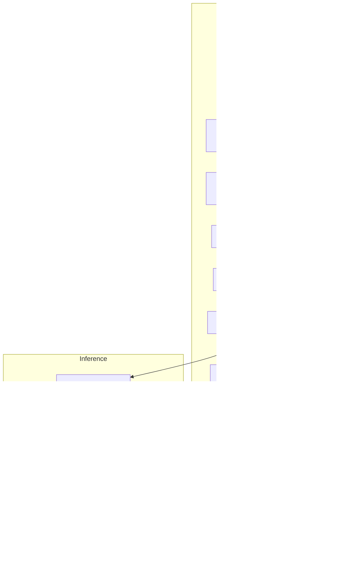

<h1 align="center">Bio-VQA &rarr; Spatial Visual Reasoning &rarr; Counting &rarr; Preprocessing &amp; Inference</h1>
<p align="center">
  <b>Manifest Consolidation and Controlled Inference across Eighteen Vision&ndash;Language Models</b>
</p>
<p align="center">
  
  
  
  
  
  
  
</p>

> Consolidation of the three tier manifests into a single sharded evaluation set, and
> inference across eighteen open-weight vision–language models under an invariant harness.
> This document specifies the enrichment performed during preprocessing, the prompt and
> decoding configuration held constant across models, the per-family vision budgets, and
> the correctness guards that protect a 108-job run.

---

## Table of contents

1. [Overview](#1-overview)
2. [Motivation](#2-motivation)
   - 2.1 [One manifest, one model load](#21-one-manifest-one-model-load)
   - 2.2 [Interleaved sharding](#22-interleaved-sharding)
   - 2.3 [The invariant harness](#23-the-invariant-harness)
3. [System architecture](#3-system-architecture)
4. [Manifest consolidation](#4-manifest-consolidation)
   - 4.1 [Tier registration](#41-tier-registration)
   - 4.2 [Question parsing](#42-question-parsing)
   - 4.3 [Question normalisation](#43-question-normalisation)
   - 4.4 [Path resolution](#44-path-resolution)
   - 4.5 [Source-corpus recovery](#45-source-corpus-recovery)
   - 4.6 [Emitted schema](#46-emitted-schema)
   - 4.7 [Idempotence guard](#47-idempotence-guard)
5. [Pre-run audit](#5-pre-run-audit)
6. [The inference harness](#6-the-inference-harness)
   - 6.1 [Invariant and variant decomposition](#61-invariant-and-variant-decomposition)
   - 6.2 [Prompt construction](#62-prompt-construction)
   - 6.3 [Decoding configuration](#63-decoding-configuration)
   - 6.4 [Vision-token budget](#64-vision-token-budget)
   - 6.5 [Model registry](#65-model-registry)
   - 6.6 [Answer resolution](#66-answer-resolution)
   - 6.7 [Correctness guards](#67-correctness-guards)
7. [Outputs](#7-outputs)
   - 7.1 [Per-shard artefacts](#71-per-shard-artefacts)
   - 7.2 [The run record](#72-the-run-record)
   - 7.3 [Merge contract](#73-merge-contract)
8. [Reproduction](#8-reproduction)
9. [Operational checklist](#9-operational-checklist)

---

## 1. Overview

This stage consumes the three tier manifests produced by
[QA generation](../1.Generate_QA/README.md) and produces one prediction file per model per
shard. It divides into consolidation — where the tiers are merged, enriched, and sharded —
and inference, where eighteen models are run against the resulting shards.

The controlling design principle is that **everything outside the model block is
byte-identical across all eighteen runners**. Prompt construction, answer resolution,
batching, error handling, write-back, and the run record are the controlled portion of the
experiment; only checkpoint loading and the forward pass vary. When we report a difference
between two models, that difference cannot originate in harness drift.

---

## 2. Motivation

### 2.1 One manifest, one model load

The three tiers could be run as three inference passes. We fold them into a single manifest
instead. Checkpoint loading dominates short jobs — a 38B model takes minutes to load and
shard across GPUs while inference itself costs milliseconds per item — so three passes would
mean three loads. One combined manifest cuts per-model wall-clock by roughly a third across
108 jobs.

### 2.2 Interleaved sharding

We assign rows to shards by stride rather than by contiguous block. Shard $i$ receives

$$
\mathcal{C}_i = \{\, r_j \;:\; j \equiv i \!\!\pmod{K} \,\}, \qquad K = 6 .
$$

Under interleaving every shard carries approximately the same tier mixture and the same
corpus mixture. Under contiguous partitioning, shard 0 would be entirely Easy-tier and shard
5 entirely Hard-tier, so a single failed array task would delete an entire experimental
condition rather than thin the set uniformly. Partition completeness is asserted before any
shard is written:

$$
\sum_{i=0}^{K-1} \bigl|\mathcal{C}_i\bigr| \;=\; \bigl|\mathcal{D}\bigr| .
$$

### 2.3 The invariant harness

Eighteen runners share one harness. The prompt, the integer resolver, the batching loop, the
position-indexed write-back, the guards, and the output schema are identical files; the model
block differs. This is what licenses the cross-model comparisons in
[Section 6 of the task document](../README.md#6-results): a per-tier delta of $+0.064$
holding for 18 out of 18 models is evidence about models only if the eighteen measurements
were taken with the same instrument.

---

## 3. System architecture



---

## 4. Manifest consolidation

`Preprocess/split_qa.py` reads the three tier manifests, enriches them, and shards. Both data
roots are required arguments and `--run_dir` defaults to the script's own directory.

### 4.1 Tier registration

Directory names map to tier labels at load time, and the labels are what appear in every
downstream artefact.

| Directory | Tier label | `n_panels` |
|---|---|:---:|
| `Easy/` | `single` | 1 |
| `Medium/` | `cued` | 2 |
| `Hard/` | `positional` | 2 |

### 4.2 Question parsing

A single regular expression extracts the organism term and the panel:

```python
Q_RE = re.compile(
    r"how many (.+?) are there in (?:the (left|right)|this) (?:image|photograph)\?",
    re.I)
```

yielding `animal_term` in {bees, beetles, fish, camels, …, animals, grevys zebras, zebras}
and `panel` in {left, right, single}. Rows failing to match are counted and reported with an
example rather than dropped silently: an unparsed question indicates a template change
upstream that must be reconciled deliberately rather than absorbed.

### 4.3 Question normalisation

Panel references are rewritten from `image` to `photograph`, with the original preserved
verbatim in `question_original`.

> *"How many bees are there in the left image?"*

is ambiguous when the canvas is itself a single image file: a model may reasonably read *"the
left image"* as *the left region of one scene*. We rewrite to *"the left photograph"*, which
together with the panel clause in the prompt ([Section 6.2](#62-prompt-construction)) fixes
the intended reading. Retaining both strings means the effect of the rewrite remains
measurable from the released data without re-running inference.

### 4.4 Path resolution

Easy-tier `image_path` values are relative to the **datasets** root
(`Bees/Images/x.jpg`); two-panel values are relative to their own **task** directory
(`Images/concat_x.jpg`). We resolve both once, here, into an absolute `image_abspath`, trying
candidates in order:

$$
\texttt{base}/p \;\to\; \texttt{taskdir}/\texttt{Images}/\mathrm{basename}(p) \;\to\; \texttt{datasets\_root}/p ,
$$

where $\texttt{base}$ is the datasets root for single-panel rows and the tier directory for
two-panel rows. Resolution happens here rather than in the runner because shard CSVs live
under `chunks/chunkNN/` while images live elsewhere, so a relative path would be
unresolvable from every shard and eighteen runners would each need identical resolution
logic. Missing files are counted and the first is printed, so a partial-corpus smoke test
remains possible while the operator always sees the count.

When publishing prediction CSVs, `image_abspath` is dropped; `split_qa.py` reconstructs it
from `--datasets_root`.

### 4.5 Source-corpus recovery

`source_dataset` is required for macro-averaging, and each tier admits a different exact
recovery strategy.

**Easy.** The path prefix is the corpus name:
`"Bees/Images/x.jpg"` → `Bees`.

**Hard.** The generator embeds the corpus in the filename
([Section 5.3 of the generation document](../1.Generate_QA/README.md#53-hard-within-corpus-pairing)).
We strip the `concat_` prefix and match against known corpus names sorted by descending
length, so a short name cannot shadow a longer one sharing its prefix.

**Medium.** Neither method applies: the path carries no corpus, and the filename would have
to carry two. We map from `animal_term` through a lookup table, which resolves every term
except one — `"zebras"` is emitted by both `Zebra-500` and `GrevysZebra`.

We disambiguate using a structural property of the generator rather than a heuristic. A
`GrevysZebra` panel *always* emits three questions — *animals*, *grevys zebras*, *zebras* —
whereas a `Zebra-500` panel emits only *zebras*. Therefore

$$
\text{source}(i, p) =
\begin{cases}
\texttt{GrevysZebra} & \text{if } (i,p) \in \mathcal{G} \\
\texttt{Zebra-500} & \text{otherwise,}
\end{cases}
$$

where $\mathcal{G}$ is the set of (image, panel) keys on which *animals* or *grevys zebras*
appears. The key is *(image, panel)*, not image, so the two panels of one canvas are resolved
independently. This follows deterministically from the generator's emission rule and is
therefore exact.

### 4.6 Emitted schema

| Column | Origin | Description |
|---|---|---|
| `row_id` | assigned | Global index; restores original order after merge |
| `tier` | assigned | `single` / `cued` / `positional` |
| `n_panels` | assigned | 1 or 2 — drives the prompt panel clause only |
| `panel` | parsed | `left` / `right` / `single` |
| `source_dataset` | recovered | [Section 4.5](#45-source-corpus-recovery) |
| `animal_term` | parsed | normalised organism term |
| `image` | source | basename; the clustering key for bootstrap |
| `image_abspath` | resolved | absolute path, [Section 4.4](#44-path-resolution) |
| `question` | normalised | [Section 4.3](#43-question-normalisation) |
| `question_original` | source | never modified |
| `answer` | source | cast to nullable `Int64` |

### 4.7 Idempotence guard

If `chunks/` already exists, the script refuses to run without `--force`. Re-sharding would
orphan prediction CSVs already written into the previous shard directories, silently
invalidating completed inference across up to 108 jobs. The guard requires the operator to
state that intent explicitly.

---

## 5. Pre-run audit

`Preprocess/stats.py` is read-only and runs before any GPU hours are committed. It reports
three things.

**Integrity.** Row count, unique images, non-numeric answers, count range, and how many
unique `image_abspath` values resolve on disk. A non-zero missing count is a hard stop: it
means the generated tiers and the datasets root disagree.

**The constant-predictor floor.** For each `(tier, corpus)` group we compute what a model
scores by always answering that group's modal count,

$$
\hat{y}_{\text{modal}} = \operatorname*{arg\,max}_{v} \; \bigl|\{\, i : y_i = v \,\}\bigr| ,
$$

$$
\text{modalEM} = \frac{1}{n}\sum_i \mathbb{1}\!\left[\hat{y}_{\text{modal}} = y_i\right],
\qquad
\text{modalCAS} = \frac{1}{n}\sum_i \max\!\left(0,\; 1 - \frac{|\hat{y}_{\text{modal}} - y_i|}{\max(|y_i|, 1)}\right).
$$

Computing this *before* running any model is deliberate. It forecloses the failure mode in
which a result is reported and only later found to sit below a constant predictor. On this
task the floor is high — modalCAS $\approx 0.501$ pooled — and one of the eighteen models
clears it by 0.013 ([Section 6.2 of the task document](../README.md#62-the-constant-predictor-floor)).

**Runtime projection.** A measured seconds-per-question table gives total serial GPU-hours

$$
T_{\text{serial}} = \frac{n}{3600} \sum_{m} s_m ,
$$

and wall-clock under $K$ shards and $L$ parallel lanes as
$T_{\text{wall}} \approx T_{\text{serial}} / (K L)$. The constants are measured rather than
estimated and range from 0.15 s/q (Qwen2.5-VL-3B) to 0.90 s/q (Phi-3.5-Vision,
InternVL-38B).

---

## 6. The inference harness

```bash
python qwenVL2_5_7B.py --qa_csv chunks/chunk00/qa.csv [--out_dir DIR] \
                       [--batch_size N] [--overwrite] [--limit N]
```

`--out_dir` defaults to the directory holding `--qa_csv`, so shard outputs land beside their
input.

### 6.1 Invariant and variant decomposition

| Invariant across all eighteen | Variant (the model block) |
|---|---|
| `PANEL_FRAME`, `INSTRUCTION`, `build_prompt` | `MODEL_ID`, `MODEL_KEY` |
| `resolve_int` integer resolver | `load_model()` |
| `run_all`: batching, write-back, guards | `run_batch()` |
| Output schema and run record | `DEFAULT_BATCH_SIZE`, resolution controls |

Any drift in the invariant region is an experimental error rather than a code-style matter.

### 6.2 Prompt construction

The prompt is assembled from three parts:

```
[PANEL_FRAME if n_panels > 1] + question + INSTRUCTION
```

**`PANEL_FRAME`**, added only for two-panel tiers:

```
This image consists of two separate photographs placed side by side.
Count only within the photograph named in the question and ignore the other one.
```

**`INSTRUCTION`**, appended to every item in every tier:

```
Count every individual, including any that are partially visible or cut off
at the edge of the photograph.
Give a single best estimate even if you are uncertain.
Respond with one integer and nothing else: no words, no units, no ranges.
If you count seven, respond: 7
```

Each clause suppresses a specific observed failure mode.

| Clause | Failure mode suppressed |
|---|---|
| *including any that are partially visible* | ambiguity about edge-clipped individuals, a real source of ±1–2 disagreement |
| *give a single best estimate even if uncertain* | refusal on dense scenes (*"it is not possible to count precisely"*) |
| *one integer and nothing else — no ranges* | hedged output (*"about 20–25"*), which the resolver would truncate to 20 |
| *If you count seven, respond: 7* | format anchor, using a value that is the modal count in no corpus |

**The panel clause is the only tier-conditional text in the entire prompt.** All other
scaffolding is identical across tiers, so the tier contrasts reported in
[Section 6.3 of the task document](../README.md#63-the-two-panel-penalty-is-universal) cannot
be contaminated by a prompt difference. Every runner prints both rendered prompts to stdout
at startup, so the exact text is recoverable from any job log.

<details>
<summary>Rendered prompt, Easy tier</summary>

```
How many bees are there in this image?

Count every individual, including any that are partially visible or cut off at the edge of the photograph.
Give a single best estimate even if you are uncertain.
Respond with one integer and nothing else: no words, no units, no ranges.
If you count seven, respond: 7
```
</details>

<details>
<summary>Rendered prompt, Medium and Hard tiers</summary>

```
This image consists of two separate photographs placed side by side.
Count only within the photograph named in the question and ignore the other one.

How many bees are there in the left photograph?

Count every individual, including any that are partially visible or cut off at the edge of the photograph.
Give a single best estimate even if you are uncertain.
Respond with one integer and nothing else: no words, no units, no ranges.
If you count seven, respond: 7
```
</details>

### 6.3 Decoding configuration

Identical across all eighteen models.

| Parameter | Value | Rationale |
|---|---|---|
| `do_sample` | `False` | Greedy. Sampling would introduce variance requiring replicates to average out. |
| `max_new_tokens` | `8` | The answer is one integer; a tight budget bounds cost and suppresses rambling. |
| `dtype` | `bfloat16` (17/18) | Molmo2 uses `dtype="auto"` per its model card. |
| `attn_implementation` | `sdpa` (11/18) | Phi-3.5-Vision requires `eager`; remote-code models set their own. |
| `device_map` | `auto` | Multi-GPU sharding for the 30B–38B checkpoints. |
| `padding_side` | `left` | Required for correct batched decoder-only generation. |

All are overridable by environment variable (`MODEL_ID`, `MAX_NEW_TOKENS`, `NUM_CROPS`,
`ATTN_IMPL`) without editing source.

### 6.4 Vision-token budget

The most consequential per-family setting, and the quantity that
[Section 5 of the task document](../README.md#5-canvas-geometry-and-the-perceptual-budget)
identifies as governing the tier ladder. Counting plates in this corpus reach 12 megapixels;
uncapped, a single item expands to roughly 10k vision tokens.

**Qwen family (5 models).** Budget expressed in units of the $28 \times 28$ patch:

$$
\text{MIN\_PIXELS} = 256 \cdot 28^2, \qquad \text{MAX\_PIXELS} = 1280 \cdot 28^2 \approx 1.00\ \text{MP}.
$$

This matches the Component C4 setting exactly, so the two components remain comparable.

**InternVL family (5 models).** Dynamic tiling at $448 \times 448$ with

$$
\text{MAX\_NUM\_TILES} = 6 \quad (\text{library default: } 12),
$$

an effective budget of $6 \times 448^2 \approx 1.20$ MP — deliberately close to the Qwen
budget. We fix 6 across *all* InternVL sizes so that tiling is not a hidden variable between
8B and 38B; this is what makes the within-family size comparisons in
[Section 6.6 of the task document](../README.md#66-scale-is-not-the-bottleneck) interpretable.
The tiling algorithm selects the decomposition $(i,j)$ with $i \cdot j \le 6$ minimising
$|\alpha - i/j|$ for canvas aspect ratio $\alpha$, so two-panel canvases — roughly twice as
wide as tall — tile as $3\times1$ or $2\times1$ rather than square.

**Phi-3.5-Vision.** `NUM_CROPS = 16`.

**Remaining models** (Gemma-3/4, LLaVA-NeXT ×2, Llama-3.2-Vision, Pixtral, Molmo2) use their
processor defaults, since their tiling schemes are not commensurable with a single common
budget. Within-family comparisons are therefore budget-controlled; cross-family comparisons
are not, which is why the ten Qwen and InternVL models constitute the controlled core of the
model set.

### 6.5 Model registry

| `MODEL_KEY` | Checkpoint | Batch | Vision budget |
|---|---|---:|---|
| `qwenVL2_5_3B` | `Qwen/Qwen2.5-VL-3B-Instruct` | 16 | 1280·28² |
| `qwenVL2_5_7B` | `Qwen/Qwen2.5-VL-7B-Instruct` | 8 | 1280·28² |
| `qwen3vl_8B` | `Qwen/Qwen3-VL-8B-Instruct` | 8 | 1280·28² |
| `qwenVL3_30B` | `Qwen/Qwen3-VL-30B-A3B-Instruct` | 4 | 1280·28² |
| `qwenVL3_32B` | `Qwen/Qwen3-VL-32B-Instruct` | 4 | 1280·28² |
| `internvl3_8B-Instruct` | `OpenGVLab/InternVL3-8B-Instruct` | 8 | 6 tiles |
| `internvl3_38B-Instruct` | `OpenGVLab/InternVL3-38B-Instruct` | 4 | 6 tiles |
| `internvl3_5_8B-Instruct` | `OpenGVLab/InternVL3_5-8B-Instruct` | 8 | 6 tiles |
| `internvl3_5_30B_A3B-Instruct` | `OpenGVLab/InternVL3_5-30B-A3B-Instruct` | 4 | 6 tiles |
| `internvl3_5_38B-Instruct` | `OpenGVLab/InternVL3_5-38B-Instruct` | 4 | 6 tiles |
| `gemma3_12B` | `google/gemma-3-12b-it` | 8 | processor default |
| `gemma4_12B` | `google/gemma-4-12B-it` | 8 | processor default |
| `llama3_2_11B` | `meta-llama/Llama-3.2-11B-Vision-Instruct` | 8 | processor default |
| `llava_next_mistral_7B` | `llava-hf/llava-v1.6-mistral-7b-hf` | 16 | processor default |
| `llava_next_vicuna_7B` | `llava-hf/llava-v1.6-vicuna-7b-hf` | 8 | processor default |
| `pixtral_12B` | `mistral-community/pixtral-12b` | 4 | processor default |
| `phi35_vision` | `microsoft/Phi-3.5-vision-instruct` | 4 * | `NUM_CROPS=16` |
| `molmo2_8B` | `allenai/Molmo2-8B` | 4 | processor default |

\* Phi-3.5-Vision does not batch cleanly; its `run_batch` generates sequentially and the
batch size controls only progress-log cadence.

**Architecture resolution.** We load through `AutoModelForImageTextToText` wherever possible
rather than naming a concrete class. A mismatched concrete class randomly initialises layers
that do not correspond, producing a model that loads without error and emits noise. `Auto`
resolves the architecture from the checkpoint config, and every runner prints the resolved
class name — a one-line verification in every job log.

**Compatibility shims.** Phi-3.5-Vision's remote modelling code targets a `transformers`
cache API that has since been removed, so generation fails on a missing attribute. We
re-attach the legacy names onto the current API. `transformers` is pinned at **4.57.1**
across the run for InternVL and Molmo compatibility.

### 6.6 Answer resolution

Models routinely wrap the number despite the instruction — *"There are 13 bees in this
image"*. We take the first integer anywhere in the string and write **two** columns:

| Column | Content |
|---|---|
| `<MODEL_KEY>_answer_unfiltered` | Raw decoded string, verbatim |
| `<MODEL_KEY>_answer` | Resolved integer, or `NA` |

Nothing is discarded, and the evaluation stage never re-parses free text. Retaining the raw
string means any parsing decision can be revisited without repeating a multi-day, 108-job
operation — including the negative-value handling applied downstream
([Section 8 of the evaluation document](../3.Evaluate/README.md#8-domain-guards)).

### 6.7 Correctness guards

Five guards, in the order they fire.

**Position-indexed write-back.** Row *position* travels with each work item, so answers are
written back to the row they came from:

```python
work.append((pos, image_path, prompt))
...
df.iat[pos, col_idx] = value
```

A skipped row — missing image, unreadable file — cannot shift every subsequent answer by
one. This class of off-by-one contamination is silent and would invalidate an entire run.

**Empty-work abort.** If not a single image resolves on disk, the runner aborts with a
message pointing at `split_qa.py`, catching a wrong `--datasets_root` in seconds rather than
after a full shard of null predictions.

**Fail-fast sanity check.** After the first 20 answers, if none contains an integer, the
runner aborts. A model emitting no integers is misconfigured — wrong class, broken chat
template, dead environment — and failing at 20 items rather than 9,000 is the difference
between a minute and several GPU-hours.

**Partial-CSV guard.** If more than half of batches raise, the runner aborts *without
writing*:

$$
\text{failed batches} > \tfrac{1}{2}\left\lceil \frac{|W|}{B} \right\rceil \;\Longrightarrow\; \text{abort, no CSV.}
$$

A half-empty CSV that looks complete is worse than no CSV, because the merge step would
accept it. Below the threshold the runner writes and records `failed_batches` in the run
record.

**Idempotence.** If the output CSV exists and `--overwrite` is not passed, the runner exits
immediately, so re-submitting a partially-failed array job re-runs only the missing shards.

---

## 7. Outputs

### 7.1 Per-shard artefacts

```
chunks/chunkNN/qa_<MODEL_KEY>.csv            all input columns + 2 answer columns
chunks/chunkNN/qa_<MODEL_KEY>.summary.json   run record
```

### 7.2 The run record

Written to disk rather than only to the scheduler log, so the run remains auditable after
logs rotate.

```json
{
  "model_key": "qwenVL2_5_7B",
  "model_id": "Qwen/Qwen2.5-VL-7B-Instruct",
  "task": "counting",
  "rows": 8917, "scored": 8917, "unparsed": 0,
  "missing_images": 0, "failed_batches": 0,
  "batch_size": 8, "max_new_tokens": 8,
  "prompt_instruction": "...", "prompt_panel_frame": "...",
  "indicative_EM": 0.173, "indicative_MAE": 5.33,
  "seconds": 2704.8, "finished_utc": "2026-08-17T22:14:03Z"
}
```

It embeds the **full prompt text**, so a released prediction file carries its own provenance.
`indicative_EM` and `indicative_MAE` are unweighted convenience figures for spotting a broken
run at a glance; every runner logs *"(evaluate.py is authoritative)"* beside them, and no
reported result derives from them.

### 7.3 Merge contract

The evaluation stage expects one merged CSV per model at `results/qa_<MODEL_KEY>.csv`,
reassembled from the six shards and sorted by `row_id`, together with a completeness
manifest asserting that every model has all six shards at the expected row count. The
manifest is the gate that distinguishes a complete model from one silently missing a shard,
and it is the first item on the post-inference checklist in
[Section 9](#9-operational-checklist).

---

## 8. Reproduction

```bash
# Consolidate the three tiers and shard.
python Preprocess/split_qa.py \
    --task_root     $BIOVQA_DATA/tasks/Counting \
    --datasets_root $BIOVQA_DATA/datasets \
    --run_dir       . \
    --n_chunks 6

# Audit and record the constant-predictor floor.
python Preprocess/stats.py --run_dir .

# Inference: one model, one shard. 18 x 6 = 108 jobs.
python qwenVL2_5_7B.py --qa_csv chunks/chunk00/qa.csv
```

**Next stage:** [`../3.Evaluate/README.md`](../3.Evaluate/README.md) — metrics, baselines,
aggregation, and uncertainty.

---

## 9. Operational checklist

Before committing GPU hours:

- [ ] `split_qa.py` reports `missing=0` for all three tiers
- [ ] `split_qa.py` reports zero unparsed questions
- [ ] Row totals per tier match the generation stage
- [ ] `stats.py` reports 0 missing images
- [ ] `modalEM` and `modalCAS` recorded — the floor every result must clear
- [ ] Panel balance approximately symmetric between `left` and `right`
- [ ] Projected wall-clock fits the partition time limit

After inference:

- [ ] Every model has 6 shard CSVs and 6 run records
- [ ] `failed_batches = 0` in every record
- [ ] `unparsed` low and comparable across models; an outlier indicates a format-following
      failure rather than a counting failure
- [ ] Resolved class name in each log matches the intended architecture
- [ ] Completeness manifest shows every model at the expected row count