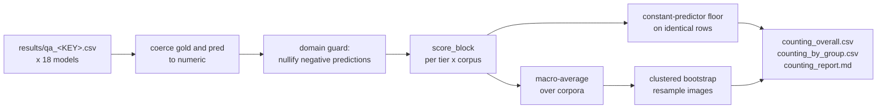

<h1 align="center">Bio-VQA &rarr; Spatial Visual Reasoning &rarr; Counting &rarr; Evaluation</h1>
<p align="center">
  <b>Scoring Calculus, Baselines, Aggregation, and Uncertainty</b>
</p>
<p align="center">
  
  
  
  
  
  
</p>

> The authoritative scoring stage for the Counting task. This document defines every metric
> and its equation, the constant-predictor baseline against which all results are read, the
> macro-aggregation rule, the clustered bootstrap, and the empirical findings the calculus
> exposes.

---

## Table of contents

1. [Overview](#1-overview)
2. [Motivation](#2-motivation)
   - 2.1 [Why exact match is insufficient for a numeric task](#21-why-exact-match-is-insufficient-for-a-numeric-task)
   - 2.2 [Why every result is read against a floor](#22-why-every-result-is-read-against-a-floor)
   - 2.3 [Why aggregation is macro](#23-why-aggregation-is-macro)
3. [Input contract](#3-input-contract)
4. [The scoring calculus](#4-the-scoring-calculus)
   - 4.1 [Count Accuracy Score](#41-count-accuracy-score)
   - 4.2 [Exact match and tolerance bands](#42-exact-match-and-tolerance-bands)
   - 4.3 [A worked example](#43-a-worked-example)
   - 4.4 [Error magnitude and direction](#44-error-magnitude-and-direction)
   - 4.5 [Rank correlation](#45-rank-correlation)
   - 4.6 [What each score implies](#46-what-each-score-implies)
5. [Baselines](#5-baselines)
6. [Aggregation](#6-aggregation)
7. [Uncertainty: the clustered bootstrap](#7-uncertainty-the-clustered-bootstrap)
8. [Domain guards](#8-domain-guards)
9. [Results](#9-results)
   - 9.1 [Order of inspection](#91-order-of-inspection)
   - 9.2 [The two-panel penalty and the panel-balance account](#92-the-two-panel-penalty-and-the-panel-balance-account)
   - 9.3 [Rank correlation as shortcut detector](#93-rank-correlation-as-shortcut-detector)
   - 9.4 [Scale](#94-scale)
   - 9.5 [Where the difficulty lives](#95-where-the-difficulty-lives)
10. [Reproduction](#10-reproduction)
11. [Outputs](#11-outputs)
12. [References](#12-references)

---

## 1. Overview

Counting is a numeric prediction task presented in the form of a question-answering task,
and applying question-answering metrics to it discards most of the available signal. This
stage therefore scores each prediction on a graded, scale-relative metric bounded in
$[0,1]$, reports it alongside exact match, two domain-interpretable tolerance bands, two
error-magnitude measures, a directional bias term, and a rank correlation that no
constant-answer shortcut can fake. Every figure is accompanied by the score of a constant
predictor computed on the identical rows.

The calculus is not decorative. Each of the three principal findings in
[the task document](../README.md#6-results) is visible only through a specific column:
the universal two-panel penalty through the per-tier macro decomposition, the distinction
between counting and guessing through rank correlation, and the inversion between absolute
and scale-relative difficulty through the contrast between mean absolute error and the
graded score.

---

## 2. Motivation

### 2.1 Why exact match is insufficient for a numeric task

Consider a photograph containing 47 beetles, and three models answering 46, 3, and 47.

| Model | Prediction | Exact match | What occurred |
|---|---:|---:|---|
| A | 46 | 0 | off by one — an excellent estimate |
| B | 3 | 0 | catastrophic failure |
| C | 47 | 1 | exact |

Exact match assigns A and B the same score. It is also acutely sensitive to scene density:
nobody counts 180 bees exactly, so on dense corpora it collapses toward the modal-answer
rate and ceases to discriminate. Empirically, across our eighteen models exact match spans
$0.066$–$0.239$ against a constant-predictor floor of $0.089$, so several models fall
*below* the floor on exact match while sitting well above it on the graded score. We retain
exact match as a reference point and build the evaluation around metrics that remain
informative where it cannot be.

### 2.2 Why every result is read against a floor

For every group we construct the predictor that always answers that group's modal count and
score it with identical metrics on the identical row subset as the model under test. The
row-subset condition matters: a model with a lower parse rate is scored on fewer rows, so
its baseline must be recomputed on those rows or the comparison is invalid.

On this task the floor is $0.501$ on the graded metric and $0.089$ on exact match, making
the entire measurable band 0.30 wide and placing one of eighteen models within 0.013 of its
own floor ([Section 5](#5-baselines)). A counting result reported without this floor is
substantially a report of the answer distribution's skew.

### 2.3 Why aggregation is macro

Source corpora differ ten-fold in row count, and `GrevysZebra` alone contributes 2.9× the
median because it emits three nested questions per photograph
([Section 4.2 of the generation document](../1.Generate_QA/README.md#42-derived-nested-counts)).
Under micro-averaging that corpus would supply roughly 29% of the headline; under
macro-averaging, 10%. The imbalance is an artefact of our own construction, so we decline to
let it set the leaderboard ([Section 6](#6-aggregation)).

---

## 3. Input contract

`evaluate.py` reads merged per-model CSVs:

```
--results_dir/
    qa_<MODEL_KEY>.csv     one per model, six shards reassembled, sorted by row_id
```

Each carries the columns emitted by `split_qa.py`
([Section 4.6 of the inference document](../2.Experiment_Runs/README.md#46-emitted-schema))
plus the two answer columns from the runner. The prediction column is located as
`<MODEL_KEY>_answer`, derived from the filename; failing that, the first column ending in
`_answer` that is not `_unfiltered`.



---

## 4. The scoring calculus

Let $y_i$ be the gold count and $\hat{y}_i$ the resolved prediction for scored item $i$,
over $n$ items.

### 4.1 Count Accuracy Score

The headline metric.

$$
\boxed{\;\mathrm{CAS} = \frac{1}{n}\sum_{i=1}^{n} \max\!\left(0,\; 1 - \frac{|\hat{y}_i - y_i|}{\max(|y_i|,\,1)}\right)\;}
$$

Four properties are load-bearing.

**Bounded.** $\mathrm{CAS} \in [0,1]$, attaining 1 exactly when every prediction is exact.

**Zero floor.** Once $|\hat{y}_i - y_i| \ge \max(|y_i|,1)$ the item scores 0, so an
arbitrarily bad overestimate cannot produce negative credit and drag the mean below what a
uniformly poor model would score — a property mean absolute error lacks.

**Scale-relative.** Error is normalised by the true count, so being 5 out on 10 costs $0.5$
while being 5 out on 100 costs $0.05$. This is the decision that separates the two failure
regimes in [Section 9.5](#95-where-the-difficulty-lives), and it encodes directly the
judgement a biologist applies when reading an abundance estimate.

**Zero-safe.** The $\max(|y_i|,1)$ denominator handles $y_i = 0$ without division by zero:
predicting 0 scores 1, predicting 1 or more scores 0.

### 4.2 Exact match and tolerance bands

$$
\mathrm{EM} = \frac{1}{n}\sum_i \mathbb{1}\!\left[\hat{y}_i = y_i\right],
\qquad
\mathrm{acc}_\tau = \frac{1}{n}\sum_i \mathbb{1}\!\left[\frac{|\hat{y}_i - y_i|}{\max(|y_i|,1)} \le \tau\right],
\quad \tau \in \{0.10,\, 0.25\}.
$$

Exact match is reported for comparability with the question-answering literature and is
never the headline. The tolerance bands are the accuracies an ecologist would accept for an
abundance estimate; unlike CAS they read directly as a proportion of usable answers, which
makes them the right figures to quote to a domain audience.

### 4.3 A worked example

| $y$ | $\hat{y}$ | $\lvert\hat{y}-y\rvert$ | $\max(\lvert y\rvert,1)$ | CAS | EM | acc25 |
|---:|---:|---:|---:|---:|---:|---:|
| 10 | 10 | 0 | 10 | 1.000 | 1 | 1 |
| 10 | 12 | 2 | 10 | 0.800 | 0 | 1 |
| 10 | 15 | 5 | 10 | 0.500 | 0 | 0 |
| 10 | 20 | 10 | 10 | 0.000 | 0 | 0 |
| 10 | 90 | 80 | 10 | 0.000 | 0 | 0 |
| 100 | 95 | 5 | 100 | 0.950 | 0 | 1 |
| 0 | 0 | 0 | 1 | 1.000 | 1 | 1 |
| 0 | 1 | 1 | 1 | 0.000 | 0 | 0 |

Rows two and three make the argument for the graded metric: exact match assigns both zero,
while CAS reports the first as a strong estimate and the second as a weak one. Rows four and
five make the argument for the zero floor: a miss of 10 and a miss of 80 both score zero, so
a handful of wild outputs cannot dominate the mean.

### 4.4 Error magnitude and direction

$$
\mathrm{MAE} = \frac{1}{n}\sum_i |\hat{y}_i - y_i|,
\qquad
\mathrm{RMSLE} = \sqrt{\frac{1}{n}\sum_i \left(\log\frac{\hat{y}_i+1}{y_i+1}\right)^{\!2}},
\qquad
\mathrm{bias} = \frac{1}{n}\sum_i \log\frac{\hat{y}_i+1}{y_i+1}.
$$

Mean absolute error is directly interpretable in animals but dominated by dense corpora, so
we read it per corpus rather than pooled. Root mean squared logarithmic error places a
10-versus-20 miss on the same footing as 100-versus-200, the multiplicative view MAE cannot
provide; the $+1$ offsets keep it defined at zero counts.

**Bias measures direction where RMSLE measures magnitude**, and we treat it as a finding in
its own right. It is negative for 16 of 18 models, establishing that models under-report
rather than answering randomly when uncertain
([Section 6.8 of the task document](../README.md#68-systematic-undercounting)).

### 4.5 Rank correlation

$$
\rho = \frac{\mathrm{cov}\bigl(\mathrm{rank}(\hat{y}),\, \mathrm{rank}(y)\bigr)}{\sigma_{\mathrm{rank}(\hat{y})}\,\sigma_{\mathrm{rank}(y)}}
$$

Implemented directly on pandas ranks to avoid a SciPy dependency, returning `NaN` when
$n < 3$ or either rank vector is constant.

**This is the shortcut-immune metric.** A model that always answers the modal count has zero
rank variance and scores $\rho \approx 0$ or `NaN`, while still posting a respectable exact
match and CAS on a skewed distribution. If $\rho$ is near zero, nothing was counted,
whatever the other columns report ([Section 9.3](#93-rank-correlation-as-shortcut-detector)).

### 4.6 What each score implies

| Score | Question it answers | Principal use |
|---|---|---|
| `macroCAS` | How close are the counts, weighting corpora equally? | **headline** |
| `CAS` | The same, weighting rows equally. | micro comparison |
| `EM` | Is the count exactly right? | comparability with the QA literature |
| `acc10`, `acc25` | What proportion of answers is usable? | domain-facing figure |
| `MAE` | How many animals out, on average? | per-corpus diagnosis |
| `RMSLE` | How far out multiplicatively? | scale-free magnitude |
| `bias` | Over- or under-counting? | direction of the failure mode |
| `rho` | Is the model counting at all? | **shortcut detector** |
| `modalCAS`, `modalEM` | What does answering nothing achieve? | floor |
| `parse_rate` | Did the model follow the format? | separates format failure from counting failure |

---

## 5. Baselines

For every group we construct

$$
\hat{y}^{\text{modal}} = \mathrm{arg\,max}_{v}\;\bigl|\{i : y_i = v\}\bigr|
$$

and score it on the identical rows as the model:

$$
\text{modalEM} = \frac{1}{n}\sum_i \mathbb{1}\!\left[\hat{y}^{\text{modal}} = y_i\right],
\qquad
\text{modalCAS} = \frac{1}{n}\sum_i \mathrm{cas}\bigl(y_i,\, \hat{y}^{\text{modal}}\bigr).
$$

In our results the floor sits at modalCAS $= 0.501$ and modalEM $= 0.089$. Against it, the
best model clears by $+0.298$ and the weakest by $+0.009$, and several models score below
the floor on exact match while clearing it comfortably on the graded metric — the empirical
justification for [Section 2.1](#21-why-exact-match-is-insufficient-for-a-numeric-task).

---

## 6. Aggregation

**Micro**, pooled over all rows:

$$
\mathrm{CAS}_{\text{micro}} = \frac{1}{N}\sum_{d}\sum_{i \in d} \mathrm{cas}_i .
$$

**Macro**, equal weight per source corpus:

$$
\boxed{\;\mathrm{macroCAS} = \frac{1}{|D|}\sum_{d \in D} \left(\frac{1}{n_d}\sum_{i \in d}\mathrm{cas}_i\right)\;}
$$

The two disagree substantively — for InternVL3-38B, macroCAS $= 0.799$ against CAS $= 0.773$
— and the gap is not constant across models, so micro and macro do not merely rescale one
another but can reorder. We compute macro at two levels: within tier, appearing in
`counting_by_group.csv` on rows where `source_dataset = __ALL__`, and overall across all
tier × corpus cells.

---

## 7. Uncertainty: the clustered bootstrap

Rows are not independent, for two structural reasons. In the two-panel tiers one canvas
carries several questions that share an image, a resize, and a vision-token budget. In every
tier `GrevysZebra` contributes three questions per photograph over identical pixels.

Resampling rows would treat these as independent and produce intervals that are too narrow.
We resample **images**:

$$
\text{for } b = 1 \dots B:\quad
\mathcal{I}^{(b)} \sim \mathrm{Unif}\bigl(\mathcal{I},\, |\mathcal{I}|\bigr) \text{ with replacement},\quad
\theta^{(b)} = \mathrm{CAS}\!\left(\bigcup_{I \in \mathcal{I}^{(b)}} \text{rows}(I)\right),
$$

reporting the percentile interval $\bigl[Q_{2.5}(\theta),\, Q_{97.5}(\theta)\bigr]$ as
`CAS_lo` and `CAS_hi`. All rows belonging to a resampled image enter or leave together,
which preserves exactly the dependence structure present in the data.

At $B = 2000$ the intervals have mean width $0.005$ on CAS — narrow, because
$n \approx 53{,}500$, and correctly so. A row-level bootstrap would report roughly
$\sqrt{3}$ narrower on the `GrevysZebra` strata and overstate precision.

---

## 8. Domain guards

A count cannot be negative. The runner's resolver accepts a leading minus sign
([Section 6.6 of the inference document](../2.Experiment_Runs/README.md#66-answer-resolution)),
so an output of `-1`, or a hyphenated range parsed from the wrong side, yields a negative
integer, and then

$$
\log\frac{\hat{y}+1}{y+1} \;\longrightarrow\; -\infty \quad \text{as } \hat{y} \to -1,
$$

making RMSLE and bias infinite for the entire model. A single malformed output would
otherwise destroy two metrics across 53,000 rows silently.

We nullify rather than clip:

```python
n_negative = int((pred < 0).sum())
if n_negative:
    pred = pred.where(pred >= 0)      # -> NA, excluded from scoring
```

Clipping to zero would invent a prediction the model never made and inflate CAS on true-zero
items. Treating the value as unresolved is the correct handling, and the count is reported in
`negative_preds` and flagged on the console. In our runs it is 0 for 16 of 18 models and 66
for Gemma-4-12B, which also accounts for that model's parse rate of $0.987$.

---

## 9. Results

### 9.1 Order of inspection

1. **`parse_rate`** — below ~0.95 indicates a format-following failure rather than a counting
   failure; a distinct diagnosis requiring a distinct write-up.
2. **`negative_preds`** — non-zero means inspecting raw outputs before trusting RMSLE or bias.
3. **`rho`** — near zero means nothing was counted; everything else is then an artefact of the
   answer distribution.
4. **`macroCAS` against `modalCAS`** — the actual margin over the floor.
5. **`bias`** — the direction of the failure.
6. **Per-corpus rows** — where the pooled figure originates.

### 9.2 The two-panel penalty and the panel-balance account

Per-tier macro decomposition yields the component's principal result. Across all eighteen
models,

$$
\Delta_{\text{Easy} \to \text{Medium}} = +0.064\ (\sigma = 0.037), \qquad \textbf{positive for } 18/18,
$$
$$
\Delta_{\text{Medium} \to \text{Hard}} = -0.005\ (\sigma = 0.027), \qquad \text{positive for } 6/18.
$$

The first contrast is unanimous across eighteen architectures, five families, and a
twelve-fold parameter range — the first-order consequence of halving each panel's share of
the perceptual budget. The second is an order of magnitude smaller with a standard deviation
five times its mean, the signature of the second-order curvature term predicted by the
area-partition analysis in
[Section 5.3 of the task document](../README.md#53-medium-and-hard-differ-in-variance-not-in-mean).
Medium and Hard are both two-panel and therefore both absorb the first-order penalty in
full; they differ only in whether panel area is balanced, which is a variance property rather
than a difficulty ordering. The full argument and its three confirmed predictions are set out
in [Section 6.4 of the task document](../README.md#64-panel-balance-accounts-for-the-mediumhard-residual).

A complementary measure is computable from the released data without new inference. Because
both panels' gold counts are recoverable by joining on `image`, the **panel-confusion rate**

$$
\mathrm{PCR} = \frac{1}{n}\sum_i \mathbb{1}\!\left[\,\bigl|\hat{y}_i - y_i^{\text{other}}\bigr| < \bigl|\hat{y}_i - y_i^{\text{own}}\bigr|\,\right]
$$

measures panel resolution directly and independently of the count distributions of the two
tiers.

### 9.3 Rank correlation as shortcut detector

LLaVA-NeXT-Vicuna-7B posts CAS $= 0.514$ against a floor of $0.501$ and $\rho = 0.103$; in
two of three tiers its per-tier $\rho$ is undefined outright, indicating constant output.
Without $\rho$ this model reads as merely weak. With $\rho$ it is visibly not performing the
task. Across the leaderboard $\rho$ spans $0.103$ to $0.900$, a wider dynamic range than
exact match provides, which is why it heads the inspection order in
[Section 9.1](#91-order-of-inspection).

### 9.4 Scale

Spearman correlation between parameter count and score across the eighteen models:

| Against | ρ |
|---|---:|
| macroCAS | 0.623 |
| EM | 0.586 |
| rho | 0.525 |

Positive but far from deterministic, with systematic exceptions: an 8B InternVL3.5 (0.747)
outperforms a 30B InternVL3.5-A3B (0.727) within one family and generation, and a 3B
Qwen2.5-VL (0.640) outperforms a 12B Gemma-3 (0.606). What does track performance is
vision-encoder configuration — the two families in which the vision budget is fixed
explicitly across sizes occupy eight of the top ten positions
([Section 6.6 of the task document](../README.md#66-scale-is-not-the-bottleneck)).

### 9.5 Where the difficulty lives

Per-corpus CAS for the strongest model, with Easy-tier mean absolute error alongside:

| Corpus | Easy | Medium | Hard | MAE (Easy) |
|---|---:|---:|---:|---:|
| Beetles-500 | 0.900 | 0.888 | 0.890 | 2.7 |
| Kiang-500 | 0.881 | 0.864 | 0.863 | 1.1 |
| Bees | 0.870 | 0.809 | 0.793 | 5.6 |
| Cattle-500 | 0.860 | 0.831 | 0.835 | 3.1 |
| Camel-500 | 0.848 | 0.847 | 0.828 | 1.3 |
| Sheep-500 | 0.821 | 0.774 | 0.783 | 5.3 |
| Zebra-500 | 0.813 | 0.799 | 0.793 | 1.4 |
| GrevysZebra | **0.745** | 0.662 | 0.660 | 1.8 |
| Fish | **0.688** | 0.587 | 0.651 | 6.5 |

Two failure regimes are visible, and the graded metric separates them where absolute error
cannot. `Fish` combines high density, occlusion, and low contrast: largest absolute error
(6.5 animals) and lowest score, a genuine acuity limit. `GrevysZebra` carries a *small*
absolute error (1.8 animals) yet the second-lowest score, because its true counts are small
— a one-animal error on a three-zebra photograph costs 0.33 on a scale-relative metric — and
it is the only corpus requiring taxonomic discrimination within the count.

Ranked by absolute error, `GrevysZebra` appears among the easiest corpora; ranked
scale-relatively, it is the second-hardest in the benchmark. **This inversion is the direct
empirical justification for the scale-relative construction of CAS**
([Section 4.1](#41-count-accuracy-score)): the metric is not merely a smoother version of
exact match but reorders the difficulty landscape in a way that matches domain judgement.

---

## 10. Reproduction

```bash
python evaluate.py                                    # results/ beside this script
python evaluate.py --results_dir DIR --out_dir DIR
python evaluate.py --bootstrap 2000                   # clustered CIs
python evaluate.py --dump_predictions                 # long-format row dump
```

The merge contract producing the input files is specified in
[Section 7.3 of the inference document](../2.Experiment_Runs/README.md#73-merge-contract).

---

## 11. Outputs

| File | Contents |
|---|---|
| `counting_overall.csv` | One row per model: `n, EM, CAS, acc10, acc25, MAE, RMSLE, bias, rho, modalEM, modalCAS, model, parse_rate, negative_preds, macroCAS, macroEM, CAS_lo, CAS_hi`. |
| `counting_by_group.csv` | One row per model × tier × corpus; rows with `source_dataset = __ALL__` hold the per-tier macro aggregate. |
| `counting_report.md` | Leaderboard sorted by macroCAS, per-tier table, and interpretation. |
| `counting_predictions.csv` | Optional long-format dump (`row_id, tier, source_dataset, panel, image, question, answer, model, pred, raw`) for error analysis. |

Publishing `counting_predictions.csv` alongside the aggregates means any alternative metric
can be computed on identical predictions without repeating inference, so the scoring choices
documented here remain auditable and revisable by third parties.

---

## 12. References

Clustered resampling for dependent observations follows standard bootstrap practice [1, 2].
Scale-relative and logarithmic error measures for count regression follow established
practice in the counting and abundance-estimation literature [3, 4].

[1] B. Efron and R. J. Tibshirani. **An Introduction to the Bootstrap.** Chapman & Hall,
1993.

[2] A. C. Cameron and D. L. Miller. **A Practitioner's Guide to Cluster-Robust Inference.**
*Journal of Human Resources*, 50(2):317–372, 2015.

[3] P. Chattopadhyay, R. Vedantam, R. R. Selvaraju, D. Batra, and D. Parikh. **Counting
Everyday Objects in Everyday Scenes.** *Proceedings of the IEEE Conference on Computer
Vision and Pattern Recognition (CVPR)*, pp. 4428–4437, 2017.

[4] V. Lempitsky and A. Zisserman. **Learning to Count Objects in Images.** *Advances in
Neural Information Processing Systems (NeurIPS)*, pp. 1324–1332, 2010.