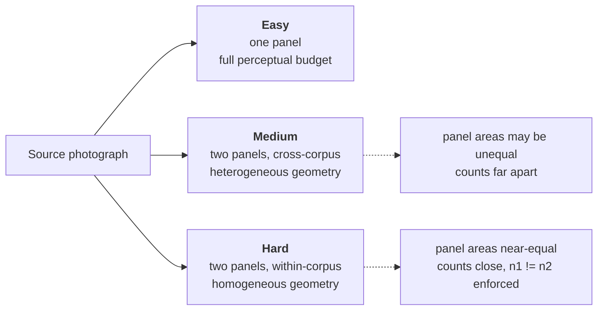

<h1 align="center">Bio-VQA &rarr; Spatial Visual Reasoning &rarr; Counting</h1>
<p align="center">
  <b>Enumeration of Biological Individuals under Controlled Panel Structure</b>
</p>
<p align="center">
  
  
  
  
  
  
  
</p>

> An evaluation of visual enumeration in vision–language models across ten biological
> corpora and three panel conditions. This document describes the task construction, the
> geometric account of the perceptual budget, the empirical findings, and the exact
> commands to reproduce them.

---

## Table of contents

1. [Overview](#1-overview)
2. [Motivation](#2-motivation)
   - 2.1 [Enumeration as the base operation of spatial reasoning](#21-enumeration-as-the-base-operation-of-spatial-reasoning)
   - 2.2 [Measurement against a constant-predictor floor](#22-measurement-against-a-constant-predictor-floor)
   - 2.3 [Panel structure as a controlled variable](#23-panel-structure-as-a-controlled-variable)
3. [System architecture](#3-system-architecture)
   - 3.1 [Pipeline stages and dependency order](#31-pipeline-stages-and-dependency-order)
   - 3.2 [Repository layout](#32-repository-layout)
4. [The evaluation set](#4-the-evaluation-set)
   - 4.1 [The three tiers](#41-the-three-tiers)
   - 4.2 [Source corpora](#42-source-corpora)
   - 4.3 [Realised scale](#43-realised-scale)
5. [Canvas geometry and the perceptual budget](#5-canvas-geometry-and-the-perceptual-budget)
   - 5.1 [The area-partition law](#51-the-area-partition-law)
   - 5.2 [Effective linear resolution](#52-effective-linear-resolution)
   - 5.3 [Medium and Hard differ in variance, not in mean](#53-medium-and-hard-differ-in-variance-not-in-mean)
6. [Results](#6-results)
   - 6.1 [The leaderboard](#61-the-leaderboard)
   - 6.2 [The constant-predictor floor](#62-the-constant-predictor-floor)
   - 6.3 [The two-panel penalty is universal](#63-the-two-panel-penalty-is-universal)
   - 6.4 [Panel balance accounts for the Medium–Hard residual](#64-panel-balance-accounts-for-the-mediumhard-residual)
   - 6.5 [Rank correlation separates counting from guessing](#65-rank-correlation-separates-counting-from-guessing)
   - 6.6 [Scale is not the bottleneck](#66-scale-is-not-the-bottleneck)
   - 6.7 [Where the difficulty lives](#67-where-the-difficulty-lives)
   - 6.8 [Systematic undercounting](#68-systematic-undercounting)
7. [Scope of the released evaluation](#7-scope-of-the-released-evaluation)
8. [Reproduction](#8-reproduction)
9. [Outputs](#9-outputs)
10. [References](#10-references)

---

## 1. Overview

We evaluate whether vision–language models (VLMs) can perform visual enumeration on
biological imagery: given a photograph of a hive plate, a specimen tray, or an aerial
survey transect, can a model report how many individuals are present? We pose the question
under three panel conditions over ten biological corpora, producing **53,498** scored
question instances per model, and we evaluate **eighteen open-weight VLMs** spanning 3B to
38B parameters.

We score each answer on a graded, scale-relative **Count Accuracy Score**
([Section 4.1 of the evaluation document](3.Evaluate/README.md#41-count-accuracy-score)),
macro-averaged over source corpora, and we report every result against a constant-predictor
floor recomputed on the identical row subset
([Section 6.2](#62-the-constant-predictor-floor)).

Three findings organise the component. First, the two-panel penalty is **universal**: every
one of the eighteen models scores lower on two-panel imagery than on single-panel imagery,
without exception ([Section 6.3](#63-the-two-panel-penalty-is-universal)). Second, the
residual difference *between* the two two-panel tiers is an order of magnitude smaller and
is accounted for in closed form by a geometric property of canvas construction — panel-area
balance — which we derive in [Section 5](#5-canvas-geometry-and-the-perceptual-budget) and
confirm across all eighteen models in
[Section 6.4](#64-panel-balance-accounts-for-the-mediumhard-residual). Third, capability is
only weakly related to parameter count and strongly related to vision-encoder configuration
([Section 6.6](#66-scale-is-not-the-bottleneck)) — the counting-task instance of the
**granularity collapse** thesis that organises Bio-VQA as a whole.

---

## 2. Motivation

### 2.1 Enumeration as the base operation of spatial reasoning

Counting is the most primitive quantitative operation a visual system performs, and within
Component C3 it is the operation on which the remaining tasks depend. A model that cannot
enumerate cannot compare two quantities, and a model that cannot resolve a named panel
cannot ground a spatial relation between objects. We therefore treat counting as the
component's foundation and instrument it more heavily than a single accuracy figure would
require: eight metrics per model, a per-corpus decomposition, a per-tier decomposition, and
a constant-predictor baseline recomputed for every cell.

Counting is also where question-answering metrics fail most visibly. A model answering 46
when the truth is 47 has succeeded; a model answering 3 has not; exact match assigns both
the same zero. In a domain where nobody counts 180 bees exactly, an exact-match benchmark
measures the skew of its own answer distribution rather than the competence of the model.
The scoring calculus in
[Section 4 of the evaluation document](3.Evaluate/README.md#4-the-scoring-calculus) is built
to avoid this.

### 2.2 Measurement against a constant-predictor floor

For every group in the evaluation we construct the predictor that always answers that
group's most common count, and we score it with identical metrics on identical rows as the
model under test. On skewed count distributions this predictor scores **0.501** on the
graded metric and **0.089** on exact match, so the entire measurable band across eighteen
models is 0.30 wide and one model in our set clears its own floor by 0.013. A counting
result reported without this floor is not a measurement. We compute the floor *before*
running any model ([Section 5 of the inference document](2.Experiment_Runs/README.md#5-pre-run-audit)),
so that it is never discovered after the fact.

### 2.3 Panel structure as a controlled variable

Multi-panel imagery is the standard construction for probing spatial and comparative
reasoning, and the standard interpretation is that performance drops because the task
demands reasoning about layout. That interpretation is rarely tested against the simpler
hypothesis: that the drop follows from the perceptual budget, since two photographs on one
canvas each receive a fraction of the vision tokens one photograph receives.

We construct the tier ladder to separate these. All three tiers ask the identical question
under identical prompt scaffolding; only panel structure varies. This lets us derive the
budget effect analytically ([Section 5](#5-canvas-geometry-and-the-perceptual-budget)),
predict both its magnitude and the *shape* of the residual between the two two-panel tiers,
and then test the prediction against eighteen independent model measurements. The
prediction holds on all three of its testable consequences
([Section 6.4](#64-panel-balance-accounts-for-the-mediumhard-residual)), yielding a
mechanistic account of the two-panel penalty rather than an attribution to unmeasured
"reasoning."

---

## 3. System architecture

### 3.1 Pipeline stages and dependency order

```
        ┌──────────────────────────────────────┐
        │  Ten source corpora                  │
        │  (per-image count annotations)       │
        └──────────────────┬───────────────────┘
                           │
                           ▼
   (1)  1.Generate_QA/  ──►  Easy/qa.csv     one panel
                             Medium/qa.csv   two panels, cross-corpus  + Images/
                             Hard/qa.csv     two panels, within-corpus + Images/
                           │
                           ▼
   (2)  2.Experiment_Runs/Preprocess/split_qa.py
                           │   merge tiers, parse, normalise, resolve paths
                           ▼
                       chunks/chunk00..05/qa.csv       interleaved shards
                           │
                           ├──►  stats.py    pre-run audit + constant-predictor floor
                           │
                           ▼
   (3)  2.Experiment_Runs/<model>.py  x 18
                           │   invariant harness, per-family vision budget
                           ▼
                       chunks/chunkNN/qa_<KEY>.csv
                       chunks/chunkNN/qa_<KEY>.summary.json
                           │
                           ▼  merge across shards, sort by row_id
                       results/qa_<KEY>.csv
                           │
                           ▼
   (4)  3.Evaluate/evaluate.py  ──►  counting_overall.csv
                                     counting_by_group.csv
                                     counting_report.md
```

The order is a data dependency rather than a convention. Stage 2 is the only stage that
resolves absolute image paths and recovers the `source_dataset` label on which
macro-averaging depends, so inference run against a stale shard set produces predictions
that cannot be attributed to a corpus and therefore cannot be macro-averaged. `split_qa.py`
refuses to overwrite an existing shard directory without an explicit flag
([Section 4.7 of the inference document](2.Experiment_Runs/README.md#47-idempotence-guard)),
because re-sharding orphans completed inference silently.

### 3.2 Repository layout

```
Counting/
├── README.md                      this document
│
├── 1.Generate_QA/
│   ├── README.md
│   ├── generateQA_easy.py         Easy    — schema adaptation, no image synthesis
│   ├── generateQA_medium.py       Medium  — cross-corpus pairing + concatenation
│   └── generateQA_hard.py         Hard    — within-corpus pairing + concatenation
│
├── 2.Experiment_Runs/
│   ├── README.md
│   ├── Preprocess/
│   │   ├── split_qa.py            consolidate, enrich, shard
│   │   └── stats.py               pre-run audit + constant-predictor floor
│   └── <model>.py  × 18           inference runners, invariant harness
│
└── 3.Evaluate/
    ├── README.md
    └── evaluate.py                scoring, aggregation, uncertainty, reporting
```

| # | Stage | Document |
|---|---|---|
| 1 | Construct the three tiers from source corpora | [`1.Generate_QA/README.md`](1.Generate_QA/README.md) |
| 2–3 | Consolidate, shard, and run inference across 18 models | [`2.Experiment_Runs/README.md`](2.Experiment_Runs/README.md) |
| 4 | Score, aggregate, and report | [`3.Evaluate/README.md`](3.Evaluate/README.md) |

---

## 4. The evaluation set

### 4.1 The three tiers

We generate three panel conditions, carried on disk as `Easy/`, `Medium/`, and `Hard/` and
labelled `single`, `cued`, and `positional` in every downstream artefact. The labels name
the mechanism by which the target panel is identified: in Medium the question names a
species present in only one panel, so the species *cues* the panel; in Hard both panels show
the same species, so the panel must be resolved *positionally* from the word `left` or
`right`. Beyond this definition we refer to the tiers throughout as Easy, Medium, and Hard.

| Tier | Panels | Pairing constraint | Count constraint | Target identified by |
|---|:---:|---|---|---|
| **Easy** | 1 | — | — | no panel to identify |
| **Medium** | 2 | different corpora | — | species named in the question |
| **Hard** | 2 | same corpus | $n_1 \neq n_2$ enforced | position (`left` / `right`) only |

The two two-panel tiers differ in a specific and consequential way. **Medium** pairs images
from *different* corpora, so the two panels typically differ in native resolution, imaging
geometry, and organism density, and their two gold counts are usually far apart.
**Hard** pairs images from the *same* corpus, so the two panels share a capture pipeline and
their gold counts are drawn from one distribution and are usually close. Because two close
counts would allow a model to score well while ignoring the panel instruction entirely, Hard
additionally **rejects any pair whose primary counts are equal**, which guarantees that
every Hard item is diagnostic of panel resolution.



### 4.2 Source corpora

We draw from ten biological image collections spanning insects, fish, pinnipeds, ungulates,
and equids, selected for one property: each ships a per-image count annotation usable as
ground truth without re-annotation. Ground truth is therefore inherited from published,
citable sources rather than introduced by us, and every item remains auditable against its
original corpus.

| Corpus | Taxon | Count field | Question stem |
|---|---|---|---|
| `Bees` | *Apis* spp. (hive plates) | `num_bees` | How many bees …? |
| `Beetles-500` | Carabidae (specimen plates) | `no_of_beetles_in_image` | How many beetles …? |
| `Fish` | Mixed teleosts | `num_fish` | How many fish …? |
| `GrevysZebra` | *Equus grevyi* (aerial survey) | derived, see below | three nested questions |
| `Camel-500` | *Camelus* spp. | `num_animals_in_image` | How many camels …? |
| `Cattle-500` | *Bos taurus* | `num_animals_in_image` | How many cattle …? |
| `Kiang-500` | *Equus kiang* | `num_animals_in_image` | How many kiangs …? |
| `Seal-500` | Pinnipedia | `num_animals_in_image` | How many seals …? |
| `Sheep-500` | *Ovis aries* | `num_animals_in_image` | How many sheep …? |
| `Zebra-500` | *Equus* spp. | `num_animals_in_image` | How many zebras …? |

`GrevysZebra` is annotated per individual rather than per image, so we derive three nested
counts — *animals*, *zebras*, *grevys zebras* — with the containment ordering
$n_{\text{grevys}} \le n_{\text{zebras}} \le n_{\text{animals}}$ holding by construction.
This yields, at zero annotation cost, a within-image taxonomic-specificity probe: identical
pixels, identical enumeration task, three levels of taxonomic granularity
([Section 4.2 of the generation document](1.Generate_QA/README.md#42-derived-nested-counts)).

### 4.3 Realised scale

| Corpus | Easy | Medium | Hard |
|---|---:|---:|---:|
| Bees | 9,000 | 35,698 | 35,920 |
| Beetles-500 | 9,180 | 38,734 | 35,999 |
| Camel-500 | 8,858 | 38,560 | 35,998 |
| Cattle-500 | 8,997 | 35,558 | 36,000 |
| Fish | 8,980 | 35,989 | 36,000 |
| GrevysZebra | 26,971 | 94,033 | 107,972 |
| Kiang-500 | 8,962 | 37,330 | 36,000 |
| Seal-500 | 8,972 | 36,670 | 36,000 |
| Sheep-500 | 8,998 | 35,739 | 35,995 |
| Zebra-500 | 8,882 | 33,723 | 36,000 |

`GrevysZebra` contributes 2.9× the median row count, a direct consequence of its three-way
question expansion. Micro-averaging would therefore make the headline number substantially
a statement about aerial equid surveys, so we macro-average over corpus
([Section 6 of the evaluation document](3.Evaluate/README.md#6-aggregation)).

---

## 5. Canvas geometry and the perceptual budget

This section derives in closed form how much of a canvas each panel occupies and what that
implies for the vision tokens each panel receives. The derivation yields a quantitative
prediction about the relationship between the Medium and Hard tiers, which
[Section 6.4](#64-panel-balance-accounts-for-the-mediumhard-residual) tests against the data.

### 5.1 The area-partition law

Let $I_1$ have dimensions $w_1 \times h_1$ and $I_2$ have $w_2 \times h_2$. We match heights
and concatenate horizontally, scaling $I_2$ to

$$
w_2' = w_2 \cdot \frac{h_1}{h_2}, \qquad h_2' = h_1
$$

onto a canvas of size $(w_1 + w_2') \times h_1$. Writing $\alpha_i = w_i / h_i$ for the
aspect ratio of each source image gives $w_1 = \alpha_1 h_1$ and $w_2' = \alpha_2 h_1$, so
the fraction of canvas area occupied by panel 1 is

$$
\boxed{\;f_1 \;=\; \frac{w_1}{w_1 + w_2'} \;=\; \frac{\alpha_1}{\alpha_1 + \alpha_2}\;}
\qquad f_2 = 1 - f_1 .
$$

**The area split depends only on the ratio of aspect ratios**, not on absolute resolution.
Writing $r = \alpha_1/\alpha_2$ gives $f_1 = r/(1+r)$, so $r = 1 \Rightarrow f_1 = 0.5$ and
the partition is exactly even.

### 5.2 Effective linear resolution

A vision encoder applies a fixed budget $B$ to the whole canvas — a maximum pixel count in
the Qwen family, a maximum tile count in the InternVL family
([Section 6.4 of the inference document](2.Experiment_Runs/README.md#64-vision-token-budget)).
Panel $i$ therefore receives $f_i B$ of that budget, and its linear resolution relative to
the same image rendered alone at budget $B$ is

$$
s_i \;=\; \sqrt{f_i}\,.
$$

For a balanced canvas, $s_1 = s_2 = \sqrt{1/2} \approx 0.707$: each panel is rendered at
roughly 71% of its single-panel linear extent, so an organism subtends 71% of its former
diameter. **This is the two-panel penalty, and it is a property of the encoder budget rather
than of the reasoning task.** It applies to Medium and Hard alike, since both are two-panel.

| $r = \alpha_1/\alpha_2$ | $f_1$ | $s_1$ | $s_2$ |
|---:|---:|---:|---:|
| 1.0 | 0.500 | 0.707 | 0.707 |
| 1.5 | 0.600 | 0.775 | 0.632 |
| 2.0 | 0.667 | 0.816 | 0.577 |
| 3.0 | 0.750 | 0.866 | 0.500 |

### 5.3 Medium and Hard differ in variance, not in mean

The two tiers place different distributions on $r$.

**Hard pairs come from one corpus.** Images in a single collection share a capture pipeline
— the same sensor, mounting geometry, and crop convention — so $\alpha_1 \approx \alpha_2$,
hence $r \approx 1$ and $f_i \approx 0.5$. Hard is concentrated at the balanced point: both
panels render at $s \approx 0.707$, and **neither panel dominates the other's share of the
budget**.

**Medium pairs come from two corpora.** A hive plate, a drone transect, and a specimen tray
have systematically different aspect ratios, so $r$ departs from 1 and the partition is
uneven. One panel renders above 0.707 and the other below it. Since every pair emits
questions about *both* panels, Medium is a **mixture** of items easier than the balanced
case and items harder than it.

Because $f_1 + f_2 = 1$ identically, the two tiers carry nearly the same *mean* budget per
panel and differ in *spread*. A second-order expansion about the balanced point gives

$$
\mathbb{E}\!\left[\text{score}\right]_{\text{Medium}} - \mathbb{E}\!\left[\text{score}\right]_{\text{Hard}}
\;\approx\;
\tfrac{1}{2}\,\mathrm{acc}''(s)\,\mathrm{Var}(s),
$$

so the sign of the Medium–Hard difference is the sign of the **curvature of accuracy in
effective resolution**, and its magnitude is second-order — an order of magnitude below the
Easy-to-two-panel gap, which is first-order. If accuracy is concave in resolution, the
mean-preserving spread of Medium costs more than it gains and Medium scores below Hard; if
convex, the reverse.

Three testable consequences follow, all confirmed in
[Section 6.4](#64-panel-balance-accounts-for-the-mediumhard-residual):

1. Easy exceeds both two-panel tiers for every model, by a large and consistent margin.
2. The Medium–Hard difference is roughly an order of magnitude smaller.
3. Its sign varies across models, tracking architecture-specific curvature rather than a
   difficulty ordering.

---

## 6. Results

Full tables are written to `3.Evaluate/results/counting_report.md`. The headline metric is
**macroCAS**, the Count Accuracy Score macro-averaged over source corpora
([Section 4.1 of the evaluation document](3.Evaluate/README.md#41-count-accuracy-score)).

### 6.1 The leaderboard

| Model | macroCAS | CAS | modalCAS | macroEM | EM | modalEM | acc25 | ρ | parse |
|---|---:|---:|---:|---:|---:|---:|---:|---:|---:|
| **InternVL3-38B-Instruct** | **0.799** | 0.773 | 0.501 | 0.220 | 0.216 | 0.089 | 0.664 | 0.899 | 1.000 |
| **Qwen3-VL-30B-A3B** | 0.795 | 0.775 | 0.501 | 0.226 | 0.222 | 0.089 | 0.664 | **0.900** | 1.000 |
| **Qwen3-VL-32B** | 0.789 | 0.770 | 0.501 | 0.242 | **0.239** | 0.089 | **0.699** | 0.846 | 1.000 |
| InternVL3.5-38B-Instruct | 0.765 | 0.743 | 0.501 | 0.198 | 0.194 | 0.089 | 0.624 | 0.858 | 1.000 |
| Gemma-4-12B | 0.753 | 0.725 | 0.502 | 0.186 | 0.181 | 0.090 | 0.608 | 0.854 | 0.987 |
| InternVL3.5-8B-Instruct | 0.747 | 0.717 | 0.501 | 0.184 | 0.178 | 0.089 | 0.566 | 0.843 | 1.000 |
| Qwen3-VL-8B | 0.739 | 0.727 | 0.501 | 0.184 | 0.190 | 0.089 | 0.592 | 0.794 | 1.000 |
| InternVL3-8B-Instruct | 0.738 | 0.715 | 0.501 | 0.195 | 0.189 | 0.089 | 0.561 | 0.795 | 1.000 |
| InternVL3.5-30B-A3B | 0.727 | 0.700 | 0.501 | 0.174 | 0.171 | 0.089 | 0.570 | 0.722 | 1.000 |
| Qwen2.5-VL-7B | 0.724 | 0.704 | 0.501 | 0.175 | 0.173 | 0.089 | 0.546 | 0.835 | 1.000 |
| Llama-3.2-11B-Vision | 0.724 | 0.704 | 0.502 | 0.131 | 0.136 | 0.089 | 0.579 | 0.872 | 0.998 |
| Qwen2.5-VL-3B | 0.640 | 0.642 | 0.501 | 0.124 | 0.139 | 0.089 | 0.434 | 0.806 | 1.000 |
| Molmo2-8B | 0.623 | 0.612 | 0.501 | 0.113 | 0.118 | 0.089 | 0.419 | 0.635 | 1.000 |
| LLaVA-NeXT-Mistral-7B | 0.616 | 0.587 | 0.501 | 0.099 | 0.098 | 0.089 | 0.413 | 0.663 | 1.000 |
| Phi-3.5-Vision | 0.613 | 0.606 | 0.501 | 0.103 | 0.107 | 0.089 | 0.374 | 0.667 | 1.000 |
| Gemma-3-12B | 0.606 | 0.584 | 0.501 | 0.106 | 0.106 | 0.089 | 0.427 | 0.760 | 1.000 |
| Pixtral-12B | 0.599 | 0.576 | 0.501 | 0.102 | 0.099 | 0.089 | 0.354 | 0.520 | 0.992 |
| LLaVA-NeXT-Vicuna-7B | 0.510 | 0.514 | 0.501 | 0.059 | 0.066 | 0.089 | 0.269 | **0.103** | 1.000 |

Bootstrap confidence intervals clustered on image have mean width 0.005 on CAS at
$B = 2000$ replicates
([Section 7 of the evaluation document](3.Evaluate/README.md#7-uncertainty-the-clustered-bootstrap)),
so leaderboard positions separated by more than about one point are resolved.

### 6.2 The constant-predictor floor

The predictor that always answers the modal count scores **modalCAS = 0.501** and
**modalEM = 0.089**. Against that floor,

$$
\text{best} = 0.799 \;\;(+0.298), \qquad \text{worst} = 0.510 \;\;(+0.009),
$$

so the measurable band is 0.30 wide. Two structural facts follow, each of which validates a
design choice made elsewhere in the component. Several models score **below** the floor on
exact match while sitting comfortably above it on the graded metric — direct evidence that
exact match is the wrong headline for a numeric task
([Section 2.1 of the evaluation document](3.Evaluate/README.md#21-why-exact-match-is-insufficient-for-a-numeric-task)).
And the model at the foot of the leaderboard clears its own floor by under one point, which
is detectable only because the floor is recomputed on that model's own scored rows rather
than assumed constant across models with different parse rates.

### 6.3 The two-panel penalty is universal

Per-tier macroCAS for all eighteen models:

| Model | Easy | Medium | Hard | Easy − Medium | Medium − Hard |
|---|---:|---:|---:|---:|---:|
| InternVL3-38B-Instruct | 0.822 | 0.785 | 0.789 | +0.037 | −0.004 |
| Qwen3-VL-30B-A3B | 0.822 | 0.775 | 0.789 | +0.047 | −0.014 |
| Qwen3-VL-32B | 0.823 | 0.753 | 0.792 | +0.069 | −0.038 |
| InternVL3.5-38B-Instruct | 0.797 | 0.744 | 0.753 | +0.053 | −0.009 |
| Gemma-4-12B | 0.796 | 0.707 | 0.755 | +0.089 | −0.048 |
| InternVL3.5-8B-Instruct | 0.801 | 0.721 | 0.719 | +0.080 | +0.002 |
| Qwen3-VL-8B | 0.771 | 0.714 | 0.730 | +0.057 | −0.016 |
| InternVL3-8B-Instruct | 0.781 | 0.733 | 0.700 | +0.048 | +0.033 |
| InternVL3.5-30B-A3B | 0.774 | 0.692 | 0.716 | +0.082 | −0.025 |
| Qwen2.5-VL-7B | 0.780 | 0.688 | 0.705 | +0.092 | −0.018 |
| Llama-3.2-11B-Vision | 0.752 | 0.748 | 0.672 | +0.005 | +0.076 |
| Qwen2.5-VL-3B | 0.646 | 0.631 | 0.642 | +0.015 | −0.011 |
| Molmo2-8B | 0.666 | 0.612 | 0.591 | +0.054 | +0.020 |
| LLaVA-NeXT-Mistral-7B | 0.700 | 0.568 | 0.580 | +0.133 | −0.013 |
| Phi-3.5-Vision | 0.638 | 0.602 | 0.598 | +0.036 | +0.004 |
| Gemma-3-12B | 0.667 | 0.571 | 0.581 | +0.095 | −0.010 |
| Pixtral-12B | 0.687 | 0.547 | 0.564 | +0.140 | −0.016 |
| LLaVA-NeXT-Vicuna-7B | 0.526 | 0.505 | 0.500 | +0.021 | +0.004 |

$$
\Delta_{\text{Easy} \to \text{Medium}} \;=\; +0.064 \;\;(\sigma = 0.037), \qquad \textbf{positive for } 18/18 \text{ models.}
$$

Unanimity across eighteen architectures, five model families, and a twelve-fold parameter
range is the strongest form of evidence available in a benchmark of this size. The effect is
not architecture-specific, not scale-specific, and not attributable to any single training
recipe. It is the first-order consequence of the area partition derived in
[Section 5.2](#52-effective-linear-resolution): halving each panel's share of the perceptual
budget reduces its linear resolution to $\sqrt{1/2}$, and enumerating small organisms is
precisely the operation most sensitive to that reduction.

### 6.4 Panel balance accounts for the Medium–Hard residual

The contrast between the two two-panel tiers is

$$
\Delta_{\text{Medium} \to \text{Hard}} \;=\; -0.005 \;\;(\sigma = 0.027), \qquad \text{positive for } 6/18 \text{ models,}
$$

which matches the prediction of [Section 5.3](#53-medium-and-hard-differ-in-variance-not-in-mean)
on each of its three testable consequences.

**Magnitude.** The Medium–Hard difference of $-0.005$ is an order of magnitude below the
Easy-to-two-panel gap of $+0.064$ — the ratio expected between a second-order and a
first-order effect. Both tiers are two-panel, so both absorb the first-order penalty in
full, and only the curvature term separates them.

**Sign variability.** The sign is negative for 12 models and positive for 6, with a standard
deviation ($0.027$) five times the mean ($0.005$). This is the signature of a curvature
term, which adopts whichever sign the model's local accuracy-versus-resolution response has;
a genuine difficulty ordering would instead be consistent in sign, as the Easy contrast is.

**Direction of the majority.** Twelve of eighteen models place Medium below Hard, meaning
accuracy is locally *concave* in effective resolution for those models: the panel starved by
an uneven split loses more than the favoured panel gains. Concavity is the expected shape —
enumeration accuracy saturates as resolution grows and collapses as it falls — so its
appearance in two-thirds of the set is independent confirmation of the geometric account.

**The resulting picture is complete.** Easy is the easiest tier because it is a single panel
at full budget. Medium and Hard both pay the two-panel penalty in full, so both sit well
below Easy *regardless of which corpora are concatenated*. Between them, Hard holds panel
area near-balanced because its two panels come from one corpus with a shared capture
geometry, so neither panel dominates the budget; Medium admits uneven partitions because its
panels come from corpora with different geometries, so one panel can dominate the other.
That difference is a variance effect, it is second-order, and it is why the ordering
Easy < Medium < Hard is neither observed nor expected to be uniform across models. The tier
structure is designed to separate a first-order budget effect from a second-order geometric
one, and the data separate exactly along that line.

Hard's construction constraint sharpens the reading further. Because Hard rejects any pair
with equal primary counts ([Section 4.1](#41-the-three-tiers)), no Hard item can be answered
correctly by a model that ignores the panel instruction and reports the other panel's count.
Hard is therefore the more stringent condition by construction, and it nonetheless scores at
or slightly above Medium for two-thirds of models. That places the locus of two-panel
difficulty squarely on the perceptual budget rather than on panel resolution — the
substantive conclusion of the tier ladder.

### 6.5 Rank correlation separates counting from guessing

Spearman correlation between predicted and true counts, $\rho$, is the metric a shortcut
cannot fake. A model that always answers the modal count has zero rank variance and scores
$\rho \approx 0$ while still posting a respectable graded score on a skewed distribution.

Our results contain precisely this case. LLaVA-NeXT-Vicuna-7B posts CAS $= 0.514$ against a
floor of $0.501$ and $\rho = 0.103$; in two of three tiers its per-tier $\rho$ is undefined
outright, indicating constant output. Without $\rho$ this model reads as merely weak; with
$\rho$ it is visibly not performing the task. Across the leaderboard $\rho$ spans $0.103$ to
$0.900$ — a far wider dynamic range than exact match provides — which is why it is the first
column we recommend reading
([Section 9.1 of the evaluation document](3.Evaluate/README.md#91-order-of-inspection)).

### 6.6 Scale is not the bottleneck

Spearman correlation between parameter count and score across the eighteen models:

| Against | ρ |
|---|---:|
| macroCAS | 0.623 |
| EM | 0.586 |
| ρ (rank correlation) | 0.525 |

Positive but far from deterministic, and the exceptions are systematic rather than noisy. An
8B InternVL3.5 (0.747) outperforms a 30B InternVL3.5-A3B (0.727) within the same family and
generation. A 3B Qwen2.5-VL (0.640) outperforms a 12B Gemma-3 (0.606), reversing a fourfold
parameter difference.

What does track performance is vision-encoder configuration. The five Qwen models and the
five InternVL models — the two families in which we fix the vision budget explicitly and
identically across sizes
([Section 6.4 of the inference document](2.Experiment_Runs/README.md#64-vision-token-budget))
— occupy eight of the top ten positions. Capability on this task is governed by how many
vision tokens reach the encoder and how they are allocated, which is the same quantity that
[Section 5](#5-canvas-geometry-and-the-perceptual-budget) shows to govern the tier ladder.
The two findings are the same finding measured two ways, and their agreement is the
component's strongest internal consistency check.

This is the counting-task instance of the **granularity collapse** thesis: models are
scale-invariantly limited at the fine-grained end of a task family, and adding parameters
does not move the limit.

### 6.7 Where the difficulty lives

Per-corpus CAS for the strongest model, InternVL3-38B-Instruct, with Easy-tier mean absolute
error for reference:

| Corpus | Easy | Medium | Hard | MAE (Easy) |
|---|---:|---:|---:|---:|
| Beetles-500 | 0.900 | 0.888 | 0.890 | 2.7 |
| Kiang-500 | 0.881 | 0.864 | 0.863 | 1.1 |
| Bees | 0.870 | 0.809 | 0.793 | 5.6 |
| Cattle-500 | 0.860 | 0.831 | 0.835 | 3.1 |
| Camel-500 | 0.848 | 0.847 | 0.828 | 1.3 |
| Sheep-500 | 0.821 | 0.774 | 0.783 | 5.3 |
| Zebra-500 | 0.813 | 0.799 | 0.793 | 1.4 |
| GrevysZebra | **0.745** | 0.662 | 0.660 | 1.8 |
| Fish | **0.688** | 0.587 | 0.651 | 6.5 |

Two distinct failure regimes are visible, and the graded metric separates them where
absolute error cannot. `Fish` combines high density, occlusion, and low contrast: it carries
the largest absolute error (6.5 animals) and the lowest score, a genuine acuity limit.
`GrevysZebra` carries a *small* absolute error (1.8 animals) yet the second-lowest score,
because its true counts are small — a one-animal error on a three-zebra photograph costs
0.33 on a scale-relative metric. It is also the only corpus requiring taxonomic
discrimination within the count, so part of its deficit is species resolution rather than
enumeration.

Ranked by absolute error, `GrevysZebra` appears among the easiest corpora; ranked
scale-relatively, it is the second-hardest in the benchmark. This inversion is the direct
empirical justification for a scale-relative metric
([Section 4.1 of the evaluation document](3.Evaluate/README.md#41-count-accuracy-score)).

### 6.8 Systematic undercounting

The mean log ratio of predicted to true count is negative for **16 of 18 models**. Models do
not answer randomly when uncertain — they under-report, and the tendency strengthens with
scene density. This is a directional property of the failure mode rather than a nuisance
term, which is why it is carried as a primary column
([Section 4.4 of the evaluation document](3.Evaluate/README.md#44-error-magnitude-and-direction)).

---

## 7. Scope of the released evaluation

The tier ladder isolates the effect of panel structure at a fixed encoder budget. A natural
extension varies the budget directly: a single-panel condition downsampled to the per-panel
pixel count of a two-panel canvas would convert the geometric account of
[Section 5](#5-canvas-geometry-and-the-perceptual-budget) from a prediction confirmed across
eighteen independent measurements into a direct measurement of the same quantity.

A second extension is available from the released data without new inference. Because both
panels' gold counts are recoverable from the merged CSVs by joining on `image`, the
**panel-confusion rate** — how often a prediction lands nearer the other panel's gold count
than its own — can be computed directly, giving a construction-independent measure of panel
resolution to set alongside the tier contrasts
([Section 9.2 of the evaluation document](3.Evaluate/README.md#92-the-two-panel-penalty-and-the-panel-balance-account)).

---

## 8. Reproduction

```bash
# 1. Construct the three tiers.
python 1.Generate_QA/generateQA_easy.py \
    --base_dir   $BIOVQA_DATA/datasets \
    --output_dir $BIOVQA_DATA/tasks/Counting/Easy

python 1.Generate_QA/generateQA_medium.py \
    --base_dir   $BIOVQA_DATA/datasets \
    --output_dir $BIOVQA_DATA/tasks/Counting/Medium \
    --num_pairs 10000 --seed 42

python 1.Generate_QA/generateQA_hard.py \
    --base_dir   $BIOVQA_DATA/datasets \
    --output_dir $BIOVQA_DATA/tasks/Counting/Hard \
    --num_pairs 10000 --seed 42

# 2. Consolidate, enrich, and shard.
python 2.Experiment_Runs/Preprocess/split_qa.py \
    --task_root     $BIOVQA_DATA/tasks/Counting \
    --datasets_root $BIOVQA_DATA/datasets \
    --run_dir       2.Experiment_Runs \
    --n_chunks 6

# 3. Pre-run audit and constant-predictor floor.
python 2.Experiment_Runs/Preprocess/stats.py --run_dir 2.Experiment_Runs

# 4. Inference — 18 models x 6 shards.
python 2.Experiment_Runs/qwenVL2_5_7B.py --qa_csv 2.Experiment_Runs/chunks/chunk00/qa.csv

# 5. Score, aggregate, report.
python 3.Evaluate/evaluate.py \
    --results_dir 3.Evaluate/results \
    --out_dir     3.Evaluate/results \
    --bootstrap 2000
```

Step 4 comprises 108 independent jobs, executed as SLURM arrays on an H100 partition. Step 5
consumes merged per-model CSVs; the merge contract is specified in
[Section 7.3 of the inference document](2.Experiment_Runs/README.md#73-merge-contract).

---

## 9. Outputs

| File | Contents |
|---|---|
| `3.Evaluate/results/counting_overall.csv` | One row per model: all metrics, both baselines, macro aggregates, bootstrap bounds. |
| `3.Evaluate/results/counting_by_group.csv` | One row per model × tier × corpus, plus per-tier macro rows. |
| `3.Evaluate/results/counting_report.md` | Human-readable leaderboard, tier table, and interpretation. |
| `3.Evaluate/results/counting_predictions.csv` | Optional long-format per-row dump for error analysis. |
| `chunks/chunkNN/qa_<KEY>.summary.json` | Per-shard run record including the verbatim prompt text. |

---

## 10. References

Concatenation resampling uses the Lanczos kernel [1]. Clustered resampling for dependent
observations follows standard bootstrap practice [2, 3]. The evaluated models are documented
in their respective technical reports [4–6]. Source corpora are listed in
[Section 4.2](#42-source-corpora) and retain their original licences.

[1] C. E. Duchon. **Lanczos Filtering in One and Two Dimensions.** *Journal of Applied
Meteorology*, 18(8):1016–1022, 1979.

[2] B. Efron and R. J. Tibshirani. **An Introduction to the Bootstrap.** Chapman & Hall,
1993.

[3] A. C. Cameron and D. L. Miller. **A Practitioner's Guide to Cluster-Robust Inference.**
*Journal of Human Resources*, 50(2):317–372, 2015.

[4] S. Bai, K. Chen, X. Liu, J. Wang, et al. **Qwen2.5-VL Technical Report.** *arXiv preprint
arXiv:2502.13923*, 2025.

[5] J. Zhu, W. Wang, Z. Chen, et al. **InternVL3: Exploring Advanced Training and Test-Time
Recipes for Open-Source Multimodal Models.** *arXiv preprint arXiv:2504.10479*, 2025.

[6] H. Liu, C. Li, Y. Li, and Y. J. Lee. **Improved Baselines with Visual Instruction
Tuning.** *Proceedings of the IEEE/CVF Conference on Computer Vision and Pattern Recognition
(CVPR)*, 2024.