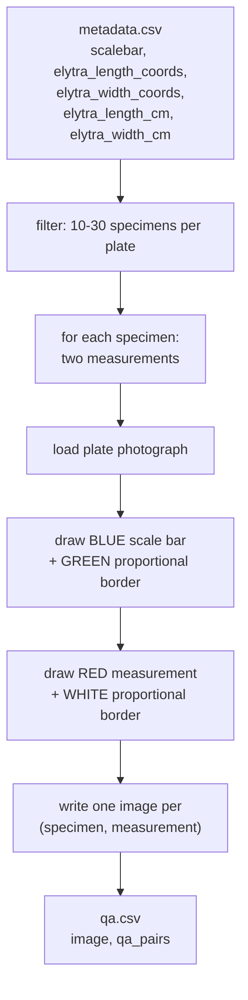

<h1 align="center">Bio-VQA &rarr; Spatial Visual Reasoning &rarr; Absolute Distance &rarr; QA Generation</h1>
<p align="center">
  <b>Annotation Rendering and Item Construction from Specimen-Plate Morphometry</b>
</p>
<p align="center">
  
  
  
  
  
  
</p>

> Construction of the Absolute Distance evaluation set. This document describes the source
> schema, the specimen-density filter, the bordered-line rendering algorithm and the reasons
> for its geometry, the one-measurement-per-image emission policy, and the output contract
> consumed by the inference stage.

---

## Table of contents

1. [Overview](#1-overview)
2. [Design contract](#2-design-contract)
3. [Source corpus and schema](#3-source-corpus-and-schema)
   - 3.1 [Required fields](#31-required-fields)
   - 3.2 [Specimen-density filter](#32-specimen-density-filter)
4. [Annotation rendering](#4-annotation-rendering)
   - 4.1 [The bordered-line primitive](#41-the-bordered-line-primitive)
   - 4.2 [Proportional border geometry](#42-proportional-border-geometry)
   - 4.3 [The colour scheme](#43-the-colour-scheme)
5. [Item construction](#5-item-construction)
   - 5.1 [One measurement per image](#51-one-measurement-per-image)
   - 5.2 [Question and answer templates](#52-question-and-answer-templates)
   - 5.3 [What the question deliberately omits](#53-what-the-question-deliberately-omits)
6. [Output schema](#6-output-schema)
7. [Reproduction](#7-reproduction)
8. [Operational behaviour](#8-operational-behaviour)

---

## 1. Overview

This stage converts a morphometric annotation table into a visual measurement benchmark. The
source corpus records, for every beetle specimen, the pixel coordinates of a scale bar, the
pixel coordinates of two morphological measurements, and the corresponding physical lengths
in centimetres. We render the coordinates onto the plate photograph as coloured line
segments and emit one question per (specimen, measurement) pair.

The stage is a single script. It performs no sampling, no randomised pairing, and no
synthesis beyond drawing two annotated lines onto an existing photograph, which makes the
generated set a deterministic function of the source table and the density filter.



---

## 2. Design contract

| Contract | Rationale |
|---|---|
| **No re-measurement.** Ground truth is the corpus's own `elytra_length_cm` and `elytra_width_cm`. | Every item remains auditable against the published corpus, and the benchmark inherits its citation rather than introducing an unvalidated measurement of our own. |
| **The plate photograph is never resized, cropped, or recompressed beyond the single JPEG write.** | The task is a ratio between two pixel lengths. Any geometric transform applied after the coordinates were recorded would invalidate the ground truth. |
| **Exactly one red line per image.** | The referent of *"the red line"* must be unambiguous. See [Section 5.1](#51-one-measurement-per-image). |
| **Annotation thickness and border extent scale with the line.** | A fixed pixel width would occlude short measurements and vanish beside long ones across a corpus whose specimens differ several-fold in size. |

---

## 3. Source corpus and schema

### 3.1 Required fields

The NEON Beetles specimen-plate corpus is the only collection in our data carrying all four
properties this task requires: scale-bar pixel coordinates, per-measurement pixel
coordinates, the corresponding physical length, and a uniform tray photography protocol at a
fixed working distance.

| Field | Type | Use |
|---|---|---|
| `group_image_path` | str | Locates the plate photograph |
| `scalebar` | dict literal | `{x1, y1, x2, y2}` — endpoints of the 1 cm reference |
| `elytra_length_coords` | dict literal | `{x1, y1, x2, y2}` — endpoints of the length measurement |
| `elytra_width_coords` | dict literal | `{x1, y1, x2, y2}` — endpoints of the width measurement |
| `elytra_length_cm` | float | Ground truth, centimetres |
| `elytra_width_cm` | float | Ground truth, centimetres |
| `no_of_beetles_in_image` | int | Density filter, [Section 3.2](#32-specimen-density-filter) |

Coordinate fields are stored as Python dict literals and parsed with `ast.literal_eval`.

The uniform working distance is what makes the task well posed. Because every plate is
photographed at a single scale, the scale bar and the specimens on that plate share one
pixels-per-centimetre factor, so the ratio the model is asked to compute is exact rather than
approximate. This is the property that disqualifies field imagery from this task and it is
the reason the component uses tray photography here.

### 3.2 Specimen-density filter

We restrict to plates carrying between **10 and 30 specimens inclusive**:

```python
df = df[(df['no_of_beetles_in_image'] >= 10) & (df['no_of_beetles_in_image'] <= 30)]
```

The bound is two-sided and each side removes a distinct defect. Below ten specimens, a plate
contributes too few items to justify the fixed cost of its own scale bar and the plate-level
clustering becomes unbalanced enough to distort the bootstrap
([Section 7 of the evaluation document](../3.Evaluate/README.md#7-uncertainty-the-clustered-bootstrap)).
Above thirty, specimens crowd densely enough that a drawn measurement line frequently
overlaps neighbouring individuals, and the annotation's referent becomes ambiguous — the
model can no longer tell which specimen the red line belongs to.

The filter yields **864 plates** and **14,108 items**, an average of 16.3 items per plate.

---

## 4. Annotation rendering

### 4.1 The bordered-line primitive

Both annotations are drawn by one routine, which renders a coloured line segment inside a
proportional rectangular frame:

```
                    perpendicular extent = 0.20 * L
        ┌───────────────────────────────────────────┐
        │                                           │
   ─────┼───────────────  L  ──────────────────────┼─────
        │                                           │
        └───────────────────────────────────────────┘
     0.20*L                                     0.20*L
   axial extension                          axial extension
```

Given endpoints $p_1, p_2$ with $L = \|p_2 - p_1\|$, unit vector
$\hat{u} = (p_2 - p_1)/L$, and perpendicular $\hat{v} = (-\hat{u}_y, \hat{u}_x)$, the frame
corners are

$$
\bigl(p_1 - \epsilon\hat{u}\bigr) \pm \epsilon\hat{v}, \qquad
\bigl(p_2 + \epsilon\hat{u}\bigr) \pm \epsilon\hat{v}, \qquad
\epsilon = 0.20\,L .
$$

The line is drawn first at thickness 7 and the frame second at thickness 3, so the frame
never occludes the measurement it delimits.

### 4.2 Proportional border geometry

Scaling the frame with $L$ rather than fixing it in pixels is the decision that makes the
annotation legible across the corpus. Carabid elytra in this collection differ several-fold
in length between the smallest and largest specimens, and a plate photograph is dense with
pinned individuals, labels, and pin shadows.

A fixed border of, say, 15 px would produce two failure modes at opposite ends of the size
range. On the longest measurements it would be a hairline the model could miss entirely
against plate clutter. On the shortest it would be comparable to the measurement itself,
occluding the specimen and inflating the apparent extent of the red line — which would
introduce a **size-dependent bias into the very quantity being measured**, precisely the
artefact that would be indistinguishable from the range compression the evaluation is
designed to detect
([Section 5.3 of the task document](../README.md#53-range-compression-and-its-closed-form-anchor)).

Proportional geometry removes that coupling: the frame occupies the same fraction of the
annotation at every specimen size, so the rendering contributes no systematic size-dependent
signal.

### 4.3 The colour scheme

| Element | Line | Border | Rationale |
|---|---|---|---|
| Scale bar | blue | green | Saturated primaries at maximum separation in hue from one another and from the plate's browns and greys |
| Measurement | red | white | White frames maximally against a dark specimen; red is the strongest available contrast to blue |

Both annotations are named explicitly by colour in the question stem and again in the
inference prompt, so the model is never required to infer which line is which from position
or length. This is deliberate: the task is measurement, not annotation disambiguation, and
loading it with an identification sub-problem would confound the two.

---

## 5. Item construction

### 5.1 One measurement per image

For each specimen we render **two separate images** — one with the length marked, one with
the width marked — rather than a single image bearing both. The plate photograph is reloaded
from disk before each render, so the two annotations never coexist on one canvas.

Two consequences follow, and both are load-bearing downstream.

**The referent is unambiguous.** With one red line per image, *"the red line"* denotes
exactly one segment. Drawing both measurements would require the model to first identify
which of two red lines is meant, converting a measurement task into a measurement-plus-
disambiguation task and confounding any failure between the two.

**It creates the within-specimen contrast.** Each specimen yields two items that differ only
in which dimension is marked, over the same pixels, the same scale bar, and the same
magnification. That pairing is what makes the compression index computable: the difference in
log-ratio bias between the two measurement types is a within-specimen quantity, and it has a
closed-form saturation point that turns it into a normalised shortcut index
([Section 5.3 of the task document](../README.md#53-range-compression-and-its-closed-form-anchor)).

The cost is that each item requires its own decoded copy of the plate photograph, which makes
the stage I/O-bound rather than compute-bound. We accept that cost because it buys the
diagnostic.

### 5.2 Question and answer templates

One template, instantiated with the measurement type:

> *What is the measurement of the elytra **{length|width}** (marked with red line with white
> border) with respect to the scalebar (marked with blue line with green border) in cm?*

The answer is the corpus value rounded to three decimal places with an explicit unit:

```
1.117 cm
```

Both are stored as a JSON object in a single `qa_pairs` column, which the preprocessing stage
flattens so that no downstream script parses JSON or a unit string again
([Section 4.2 of the inference document](../2.Experiment_Runs/README.md#42-flattening-and-unit-normalisation)).

Retaining the unit in the gold string rather than storing a bare float is intentional: it
keeps the released answer self-describing, and the preprocessing stage derives a numeric
`answer_cm` column beside it rather than in place of it.

### 5.3 What the question deliberately omits

The question states that the answer is wanted in centimetres and identifies both lines by
colour, but **never states how long the scale bar is**.

This is by design, and the missing constant is supplied at inference time rather than in the
question stem. Without it the pixel ratio is computable but the answer in centimetres is not,
so a model could only produce a number by recalling typical beetle dimensions — exactly the
shortcut the task exists to rule out. Supplying the constant in the prompt, together with the
explicit procedure and an instruction not to answer from prior knowledge
([Section 6.2 of the inference document](../2.Experiment_Runs/README.md#62-prompt-construction)),
makes the task fully determined by the image and removes any excuse for prior-driven
answering.

Keeping the constant in the prompt rather than the stem also means the released QA file
remains usable under a different framing — a reader who wishes to evaluate ratio estimation
rather than metric measurement can re-prompt without regenerating a single image.

---

## 6. Output schema

`qa.csv` carries two columns.

| Column | Type | Content |
|---|---|---|
| `image` | str | Path relative to the task root, `Images/<plate>_<type>_<id>.jpg` |
| `qa_pairs` | str | JSON object `{"Q": ..., "A": "1.117 cm"}` |

Rendered filenames follow

```
<plate_accession>_<measure_type>_<id>.jpg
```

from which the preprocessing stage recovers both `measure_type` and `plate_id` by pattern
match — the latter being the clustering key on which every confidence interval in the
component depends
([Section 4.3 of the inference document](../2.Experiment_Runs/README.md#43-deriving-measure_type-and-plate_id)).

**Example row.**

```csv
image,qa_pairs
Images/A00000001831_length_753877c6.jpg,"{""Q"": ""What is the measurement of the elytra length (marked with red line with white border) with respect to the scalebar (marked with blue line with green border) in cm?"", ""A"": ""1.117 cm""}"
```

---

## 7. Reproduction

```bash
python generateQA.py \
    --base_dir        $BIOVQA_DATA/datasets/Beetles-500 \
    --output_base_dir "$BIOVQA_DATA/tasks/Absolute Distance Measurements"
```

`--base_dir` must contain `Images/` and `metadata.csv`. Quote the output path — the task
directory name contains spaces. The stage writes `qa.csv` and `Images/` under
`--output_base_dir` and prints the realised item count on completion.

Realised scale and cluster structure are tabulated in
[Section 4.3 of the task document](../README.md#43-scale-and-cluster-structure).

**Next stage:** [`../2.Experiment_Runs/README.md`](../2.Experiment_Runs/README.md) —
flattening, sharding, and inference.

---

## 8. Operational behaviour

**Missing photographs are skipped.** A metadata row whose `group_image_path` does not resolve
on disk is passed over, so the stage runs against a partial image set without modification.
This is the mechanism used for smoke tests.

**Malformed coordinate literals are skipped.** Each specimen is processed inside a guard, so
a row whose coordinate fields fail to parse, or whose photograph fails to decode, contributes
no items and the loop continues. This is why the realised item count is a function of the
source table's completeness rather than a fixed multiple of the plate count.

**Per-item image decode.** The plate photograph is reloaded before each measurement render so
that annotations never accumulate across items
([Section 5.1](#51-one-measurement-per-image)). The stage is therefore I/O-bound; on a
shared filesystem it benefits substantially from staging the source images to local scratch
first.