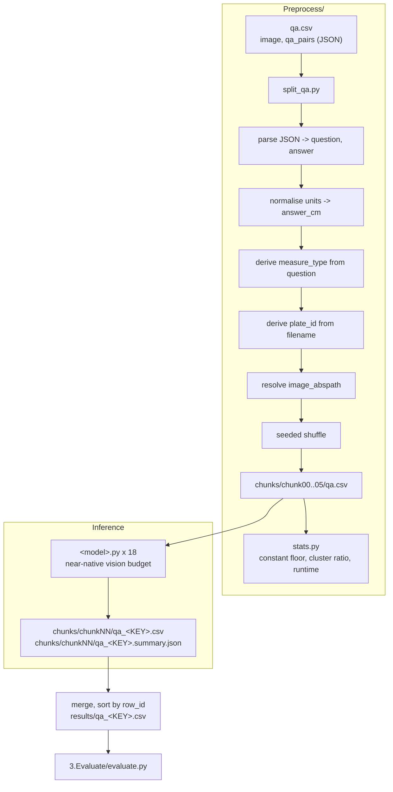

<h1 align="center">Bio-VQA &rarr; Spatial Visual Reasoning &rarr; Absolute Distance &rarr; Preprocessing &amp; Inference</h1>
<p align="center">
  <b>Manifest Flattening and Near-Native-Resolution Inference across Eighteen Models</b>
</p>
<p align="center">
  
  
  
  
  
  
  
</p>

> Flattening of the generated QA file into a sharded evaluation manifest, and inference
> across eighteen open-weight vision–language models under an invariant harness. This
> document specifies the derived columns on which the shortcut analysis depends, the
> resolution decision that makes the task measurable at all, the prompt that supplies the
> missing scale constant, and the correctness guards protecting a 108-job run.

---

## Table of contents

1. [Overview](#1-overview)
2. [Motivation](#2-motivation)
   - 2.1 [The invariant harness](#21-the-invariant-harness)
   - 2.2 [Resolution as a first-class design decision](#22-resolution-as-a-first-class-design-decision)
3. [System architecture](#3-system-architecture)
4. [Manifest preparation](#4-manifest-preparation)
   - 4.1 [Input schema](#41-input-schema)
   - 4.2 [Flattening and unit normalisation](#42-flattening-and-unit-normalisation)
   - 4.3 [Deriving measure_type and plate_id](#43-deriving-measure_type-and-plate_id)
   - 4.4 [Path resolution](#44-path-resolution)
   - 4.5 [Shuffle before shard](#45-shuffle-before-shard)
   - 4.6 [Emitted schema](#46-emitted-schema)
   - 4.7 [Idempotence guard](#47-idempotence-guard)
5. [Pre-run audit](#5-pre-run-audit)
   - 5.1 [The constant-predictor floor](#51-the-constant-predictor-floor)
   - 5.2 [Cluster diagnostics](#52-cluster-diagnostics)
   - 5.3 [Runtime projection](#53-runtime-projection)
6. [The inference harness](#6-the-inference-harness)
   - 6.1 [Invariant and variant decomposition](#61-invariant-and-variant-decomposition)
   - 6.2 [Prompt construction](#62-prompt-construction)
   - 6.3 [Decoding configuration](#63-decoding-configuration)
   - 6.4 [Vision-token budget](#64-vision-token-budget)
   - 6.5 [Model registry](#65-model-registry)
   - 6.6 [Answer resolution and unit handling](#66-answer-resolution-and-unit-handling)
   - 6.7 [Correctness guards](#67-correctness-guards)
7. [Outputs](#7-outputs)
   - 7.1 [Per-shard artefacts](#71-per-shard-artefacts)
   - 7.2 [The run record](#72-the-run-record)
   - 7.3 [Merge contract](#73-merge-contract)
8. [Reproduction](#8-reproduction)
9. [Operational checklist](#9-operational-checklist)

---

## 1. Overview

This stage consumes the two-column QA file produced by
[QA generation](../1.Generate_QA/README.md), flattens it into an analysis-ready manifest,
shards it for scheduling, and runs eighteen models against the resulting shards.

Two properties distinguish it from the other tasks in the component. First, the manifest
derives **`measure_type`** and **`plate_id`**, on which the entire shortcut analysis and every
confidence interval respectively depend — neither is present in the source file, and both are
recovered here by exact pattern match rather than by inference. Second, this is the most
acuity-sensitive task in the component, so the vision-token budget is raised to near-native
resolution for every model rather than reusing the budget applied elsewhere
([Section 6.4](#64-vision-token-budget)).

As throughout the component, **everything outside the model block is byte-identical across
all eighteen runners**. Prompt construction, unit resolution, batching, write-back, the
guards, and the run record are the controlled portion of the experiment.

---

## 2. Motivation

### 2.1 The invariant harness

Eighteen runners share one harness. The prompt frame, the instruction block, the
number-and-unit resolver, the batching loop, the position-indexed write-back, and the output
schema are identical files; only checkpoint loading and the forward pass differ. This is what
licenses the cross-model claims in
[Section 6 of the task document](../README.md#6-results). When we report that a constant
predictor outscores fifteen of eighteen models, that is evidence about models only if the
eighteen measurements were taken with the same instrument.

### 2.2 Resolution as a first-class design decision

The answer is a ratio between two short line segments. Any resolution loss propagates
directly into the answer, which makes this the one task in the component where the
vision-token budget is not a throughput parameter but a determinant of whether the task is
answerable at all.

Beetle plates in this corpus are approximately 2.8 megapixels. At the budget used for the
Counting task — roughly 1.0 MP — a 1 cm scale bar renders to about 41 px and the shortest
elytra to about 12 px. Estimating a ratio between a 12 px segment and a 41 px segment to
within 20% is not achievable by any means, model or otherwise: the quantisation error alone
exceeds the tolerance. We therefore raise the budget to approximately native resolution,
identically for every model ([Section 6.4](#64-vision-token-budget)), so that a failure
reported in the results is a failure of measurement rather than an artefact of downsampling
we imposed.

---

## 3. System architecture



---

## 4. Manifest preparation

`Preprocess/split_qa.py` is the only stage that touches the source QA file. `--task_root` is
required; `--run_dir` defaults to the script's own directory.

### 4.1 Input schema

Two columns: `image`, and `qa_pairs` holding a JSON object
`{"Q": ..., "A": "1.117 cm"}`. Every downstream column is derived here, so no later script
parses JSON or a unit string again.

### 4.2 Flattening and unit normalisation

We parse `qa_pairs` as JSON, falling back to a Python literal if that fails, and emit
`question` and `answer` as separate columns with `answer` preserved verbatim. A numeric
`answer_cm` is derived beside it:

```python
CM_RE = re.compile(r"([-+]?\d*\.?\d+)\s*(mm|cm)?", re.I)
```

with millimetre values divided by ten and a bare number read as centimetres. Retaining both
the verbatim string and the derived float means the released manifest is self-describing
while the evaluation stage never re-parses text.

Rows whose `qa_pairs` cannot be parsed are counted, reported, and dropped rather than
silently coerced — an unparseable cell indicates a template change upstream that must be
reconciled deliberately.

### 4.3 Deriving measure_type and plate_id

Two derived columns carry the analytical weight of the component.

**`measure_type`** is extracted from the question stem:

```python
df["measure_type"] = df["question"].str.extract(r"elytra\s+(length|width)",
                                                flags=re.I).str.lower()
```

Every element of the shortcut analysis is conditioned on it. The constant predictor is fitted
per measurement type, rank correlation is computed within measurement type, and the
compression index is defined as a difference between the two types
([Section 5 of the task document](../README.md#5-the-shortcut-analysis)). Without this column
the evaluation would report a pooled rank correlation inflated by roughly +0.15 and a
constant-predictor floor understated by more than ten points.

**`plate_id`** is recovered from the rendered filename by stripping the generation stage's
identifier suffix:

```python
df["plate_id"] = df["image"].str.replace(r"_[0-9a-f]{6,}\.jpe?g$", "", regex=True)
```

so `A00000001831_753877c6.jpg` yields `A00000001831`. This is the clustering key for every
confidence interval in the component. The generation stage encodes the plate accession as the
filename prefix precisely so that the association survives into the manifest without a join
against the source table.

### 4.4 Path resolution

Shard CSVs live under `chunks/chunkNN/` while images remain in `<task_root>/Images/`, so a
relative path would be unresolvable from every shard and eighteen runners would each need
identical resolution logic. We resolve once, here, into an absolute `image_abspath`. Missing
files are counted and the first is printed, so a partial-image smoke test remains possible
while the operator always sees the count.

When publishing prediction CSVs, `image_abspath` is dropped; `split_qa.py` reconstructs it
from `--task_root`.

### 4.5 Shuffle before shard

The source file alternates length, width, length, width — one specimen contributes its two
items consecutively. A plain stride assignment $j \equiv i \pmod{K}$ with an even $K$ would
preserve that parity exactly, and **every shard would come out entirely one measurement
type**. Losing a single array task would then delete one of the two experimental conditions
outright rather than thinning both.

We therefore apply a seeded shuffle before sharding:

```python
df = df.sample(frac=1.0, random_state=args.seed).reset_index(drop=True)
```

`row_id` is assigned **before** the shuffle, so the original order remains exactly
recoverable at merge time and the shuffle costs nothing in traceability. The seed is an
explicit argument and is recorded, so the split reproduces.

### 4.6 Emitted schema

| Column | Origin | Description |
|---|---|---|
| `row_id` | assigned pre-shuffle | Restores original order at merge time |
| `plate_id` | derived | Specimen-plate accession; the bootstrap clustering key |
| `measure_type` | derived | `length` or `width`; conditions the entire shortcut analysis |
| `image` | source | Basename of the rendered image |
| `image_abspath` | resolved | Absolute path, [Section 4.4](#44-path-resolution) |
| `question` | flattened | The `Q` field |
| `answer` | flattened | The `A` field verbatim, e.g. `1.117 cm` |
| `answer_cm` | derived | The same value as a float in centimetres |

The script prints plate count, mean items per plate, and per-type descriptive statistics for
`answer_cm` before writing, so the distribution the constant-predictor floor is fitted to is
visible at split time.

### 4.7 Idempotence guard

If `chunks/` already exists, the script refuses to run without `--force`. Re-sharding would
orphan prediction CSVs already written into the previous shard directories, silently
invalidating completed inference across up to 108 jobs. Because this task additionally
shuffles, a re-split with a different seed would also change which rows land in which shard,
so the guard prevents a subtler corruption than in the unshuffled tasks.

---

## 5. Pre-run audit

`Preprocess/stats.py` is read-only and settles three questions before any GPU time is spent.

### 5.1 The constant-predictor floor

For each measurement type the script fits two constants over a 1,500-point grid spanning the
observed range:

$$
c_t^{\text{relErr}} = \operatorname*{arg\,min}_{c} \; \frac{1}{n_t}\sum_{i \in t} \left|\frac{c}{y_i} - 1\right|,
\qquad
c_t^{\text{acc}} = \operatorname*{arg\,max}_{c} \; \frac{1}{n_t}\sum_{i \in t} \mathbb{1}\!\left[\left|\frac{c}{y_i} - 1\right| \le 0.20\right],
$$

and reports both together with the scores they achieve. Two properties of this construction
are essential and are preserved identically in the evaluation stage.

**Fitted per type.** The question states which dimension is wanted, so answering one fixed
number for every length question and another for every width question requires no
measurement. This is the prior-driven shortcut in its strongest form and it reaches
acc@20 = 0.410, far above what a single pooled constant would suggest.

**Fitted against the metric compared.** $c^{\text{relErr}}$ and $c^{\text{acc}}$ are
different values, and the gap is large: on the length items the relErr-optimal constant
scores acc@20 of about 0.30 while the acc-optimal constant scores 0.43. A baseline fitted
against the wrong metric flatters the models instead of bounding them.

Computing the floor before inference forecloses the failure mode in which a result is
reported and only later found to sit below a predictor that never looks at the image. On this
task that outcome is the common case rather than the exception: fifteen of eighteen models
fall below the floor
([Section 6.2 of the task document](../README.md#62-the-constant-predictor-outscores-fifteen-of-eighteen-models)).

The audit also states plainly that the same predictor inflates pooled rank correlation to
about +0.63, and that the evaluation therefore reports rank correlation computed within
measurement type
([Section 5.2 of the task document](../README.md#52-why-pooled-rank-correlation-is-inadmissible)).

### 5.2 Cluster diagnostics

The script reports the ratio of mean within-plate standard deviation to total standard
deviation:

$$
r_{\text{cluster}} = \frac{\overline{\mathrm{SD}}_{\text{within plate}}}{\mathrm{SD}_{\text{total}}} .
$$

Every specimen on a plate shares one scale bar, one magnification, one illumination, and one
focal plane, and each contributes both a length and a width item. Within-plate spread is
roughly a seventh of total spread, so approximately 16 rows from one plate behave close to a
single observation and the effective sample size is far nearer the plate count (864) than the
row count (14,108). The evaluation stage bootstraps over plates for this reason
([Section 7 of the evaluation document](../3.Evaluate/README.md#7-uncertainty-the-clustered-bootstrap)).

### 5.3 Runtime projection

A measured seconds-per-question table gives total serial GPU-hours

$$
T_{\text{serial}} = \frac{n}{3600}\sum_{m} s_m ,
$$

with wall-clock under $K$ shards and $L$ lanes as $T_{\text{serial}}/(KL)$. The constants
here are roughly twice those of the Counting task at the same model sizes — 0.30 s/q for
Qwen2.5-VL-3B up to 1.70 s/q for the 38B InternVL checkpoints — which is the direct cost of
the near-native vision budget.

---

## 6. The inference harness

```bash
python qwenVL2_5_7B.py --qa_csv chunks/chunk00/qa.csv [--out_dir DIR] \
                       [--batch_size N] [--overwrite] [--limit N]
```

`--out_dir` defaults to the directory holding `--qa_csv`.

### 6.1 Invariant and variant decomposition

| Invariant across all eighteen | Variant (the model block) |
|---|---|
| `FRAME`, `INSTRUCTION`, `build_prompt` | `MODEL_ID`, `MODEL_KEY` |
| `resolve_cm` number-and-unit resolver | `load_model()` |
| `run_all`: batching, write-back, guards | `run_batch()` |
| Output schema and run record | `DEFAULT_BATCH_SIZE`, `VISION_BUDGET` |

### 6.2 Prompt construction

```
FRAME + question + INSTRUCTION
```

**`FRAME`** — supplies the constant the question stem deliberately omits
([Section 5.3 of the generation document](../1.Generate_QA/README.md#53-what-the-question-deliberately-omits)):

```
This image shows a plate of pinned beetle specimens, photographed at a single scale.
A BLUE line marks the scale bar. The scale bar is exactly 1 cm long.
A RED line marks the measurement asked about below.
```

**`INSTRUCTION`** — supplies the procedure, two worked ratios, and an explicit prohibition:

```
Compare the pixel length of the red line to the pixel length of the blue scale bar.
Because the scale bar is exactly 1 cm long, the red line's length in centimetres equals
that ratio: if the red line is half as long as the blue line the answer is 0.50 cm, and
if it is twice as long the answer is 2.00 cm.
Measure the two lines as they appear in this image. Do not answer from what you know
about typical beetle sizes.
Respond with one number rounded to two decimal places followed by cm, and nothing else.
No explanation, no range, no other units.
Example: 0.87 cm
```

Each element removes a specific route to a spurious score.

| Element | What it forecloses |
|---|---|
| *The scale bar is exactly 1 cm long* | The answer being underdetermined, which would leave prior recall as the only available strategy |
| Explicit ratio procedure with two worked cases | Failure to compose the two measurements into a ratio being scored as failure to measure |
| *Do not answer from what you know about typical beetle sizes* | Any claim that the shortcut was merely an unprompted default rather than a capability limit |
| *One number to two decimal places, followed by cm* | Hedged ranges and free-text wrapping that the resolver would have to disambiguate |
| *Example: 0.87 cm* | Format ambiguity, using a value that is neither fitted constant |

The prohibition clause deserves emphasis. Fifteen of eighteen models score below a predictor
that ignores the image entirely
([Section 6.2 of the task document](../README.md#62-the-constant-predictor-outscores-fifteen-of-eighteen-models)),
and they do so **having been told in the prompt not to answer from prior knowledge, and
having been given the exact procedure to follow instead**. The shortcut is not an artefact of
under-specification.

Every runner prints the fully rendered prompt to stdout at startup, and the run record embeds
both blocks verbatim ([Section 7.2](#72-the-run-record)), so the exact text is recoverable
from any job log or any released prediction file.

### 6.3 Decoding configuration

Identical across all eighteen models.

| Parameter | Value | Rationale |
|---|---|---|
| `do_sample` | `False` | Greedy; sampling would add variance requiring replicates to average out |
| `max_new_tokens` | `12` | Accommodates `0.87 cm` with margin for a leading article, while bounding rambling |
| `dtype` | `bfloat16` | Molmo2 uses `dtype="auto"` per its model card |
| `attn_implementation` | `sdpa` | Phi-3.5-Vision requires `eager`; remote-code models set their own |
| `device_map` | `auto` | Multi-GPU sharding for the 30B–38B checkpoints |
| `padding_side` | `left` | Required for correct batched decoder-only generation |

All are overridable by environment variable without editing source.

### 6.4 Vision-token budget

The decision that makes the task measurable, and the one most consequential to the results.

**Qwen family (5 models).**

$$
\text{MIN\_PIXELS} = 256 \cdot 28^2, \qquad
\text{MAX\_PIXELS} = 3840 \cdot 28^2 \approx 3.0\ \text{MP},
$$

against $1280 \cdot 28^2 \approx 1.0$ MP used for the Counting task — a threefold increase,
placing the budget at approximately the plates' native 2.8 MP.

**InternVL family (5 models).** `MAX_NUM_TILES = 12`, the library default, against 6 used
elsewhere in the component. Effective budget $12 \times 448^2 \approx 2.4$ MP.

**Phi-3.5-Vision.** `NUM_CROPS = 16`.

**Remaining models** use their processor defaults, since their tiling schemes are not
commensurable with a single common budget.

The increase costs nothing in upsampling — the images genuinely carry the detail — and it is
applied identically to every model, so it is a property of the task rather than a per-model
advantage. Batch sizes are reduced correspondingly (2–8 against 4–16 for Counting) to stay
within memory at the higher token count.

At the lower budget the task would be unanswerable by construction: a 1 cm scale bar renders
to roughly 41 px and the shortest elytra to roughly 12 px, and no estimator can resolve that
ratio to 20%. Raising the budget removes the excuse and makes the reported failures
attributable to measurement.

### 6.5 Model registry

| `MODEL_KEY` | Checkpoint | Batch | Vision budget |
|---|---|---:|---|
| `qwenVL2_5_3B` | `Qwen/Qwen2.5-VL-3B-Instruct` | 8 | max_pixels = 3840·28² |
| `qwenVL2_5_7B` | `Qwen/Qwen2.5-VL-7B-Instruct` | 4 | max_pixels = 3840·28² |
| `qwen3vl_8B` | `Qwen/Qwen3-VL-8B-Instruct` | 4 | max_pixels = 3840·28² |
| `qwenVL3_30B` | `Qwen/Qwen3-VL-30B-A3B-Instruct` | 2 | max_pixels = 3840·28² |
| `qwenVL3_32B` | `Qwen/Qwen3-VL-32B-Instruct` | 2 | max_pixels = 3840·28² |
| `internvl3_8B-Instruct` | `OpenGVLab/InternVL3-8B-Instruct` | 4 | 12 tiles |
| `internvl3_38B-Instruct` | `OpenGVLab/InternVL3-38B-Instruct` | 2 | 12 tiles |
| `internvl3_5_8B-Instruct` | `OpenGVLab/InternVL3_5-8B-Instruct` | 4 | 12 tiles |
| `internvl3_5_30B_A3B-Instruct` | `OpenGVLab/InternVL3_5-30B-A3B-Instruct` | 2 | 12 tiles |
| `internvl3_5_38B-Instruct` | `OpenGVLab/InternVL3_5-38B-Instruct` | 2 | 12 tiles |
| `gemma3_12B` | `google/gemma-3-12b-it` | 4 | processor default |
| `gemma4_12B` | `google/gemma-4-12B-it` | 4 | processor default |
| `llama3_2_11B` | `meta-llama/Llama-3.2-11B-Vision-Instruct` | 4 | processor default |
| `llava_next_mistral_7B` | `llava-hf/llava-v1.6-mistral-7b-hf` | 8 | processor default |
| `llava_next_vicuna_7B` | `llava-hf/llava-v1.6-vicuna-7b-hf` | 8 | processor default |
| `pixtral_12B` | `mistral-community/pixtral-12b` | 2 | processor default |
| `phi35_vision` | `microsoft/Phi-3.5-vision-instruct` | 2 | `NUM_CROPS = 16` |
| `molmo2_8B` | `allenai/Molmo2-8B` | 2 | processor default |

**Architecture resolution.** We load through `AutoModelForImageTextToText` wherever possible
rather than naming a concrete class. A mismatched concrete class randomly initialises layers
that do not correspond, producing a model that loads without error and emits noise. Every
runner prints the resolved class name — a one-line verification in every job log.

`transformers` is pinned at **4.57.1** across the run for InternVL and Molmo compatibility;
Phi-3.5-Vision additionally requires compatibility shims re-attaching legacy cache-API names.

### 6.6 Answer resolution and unit handling

```python
NUM_RE = re.compile(r"([-+]?\d*\.?\d+)\s*(mm|millimet\w*|cm|centimet\w*)?", re.I)
```

The resolver takes the first number with an optional unit, handling `0.87 cm`, `8.7mm`,
`.63 cm`, `approximately 1.1 centimetres`, and a bare `0.87`.

**Millimetres are converted rather than rejected.** Several models answer `8.7 mm` for a
0.87 cm line, which is correct physics in the wrong unit. Scoring that as 8.7 would be our
defect, not the model's, and would additionally corrupt the log-scale metrics for the entire
model. A bare number is read as centimetres, which is what the prompt requests.

Two columns are written:

| Column | Content |
|---|---|
| `<MODEL_KEY>_answer_unfiltered` | Raw decoded string, verbatim |
| `<MODEL_KEY>_answer` | Resolved value in centimetres, or `NA` |

Retaining the raw string means any parsing decision can be revisited without repeating a
multi-day, 108-job operation — including the plausibility guard applied downstream
([Section 8 of the evaluation document](../3.Evaluate/README.md#8-domain-guards)).

### 6.7 Correctness guards

Five guards, in the order they fire.

**Position-indexed write-back.** Row position travels with each work item, so answers return
to the row they came from and a skipped row cannot shift every subsequent answer by one. This
class of off-by-one contamination is silent and would invalidate an entire run.

**Empty-work abort.** If not a single image resolves on disk, the runner aborts with a message
pointing at `split_qa.py`, catching a wrong `--task_root` in seconds rather than after a full
shard of null predictions.

**Fail-fast sanity check.** After the first 20 answers, if none contains a number, the runner
aborts. A model emitting no numbers is misconfigured — wrong class, broken chat template, dead
environment — and failing at 20 items rather than 2,350 is the difference between a minute and
several GPU-hours.

**Partial-CSV guard.** If more than half of batches raise, the runner aborts without writing:

$$
\text{failed batches} > \tfrac{1}{2}\left\lceil |W| / B \right\rceil \;\Longrightarrow\; \text{abort, no CSV.}
$$

A half-empty CSV that looks complete is worse than no CSV, because the merge step would accept
it.

**Idempotence.** If the output CSV exists and `--overwrite` is not passed, the runner exits
immediately, so re-submitting a partially-failed array job re-runs only the missing shards.

---

## 7. Outputs

### 7.1 Per-shard artefacts

```
chunks/chunkNN/qa_<MODEL_KEY>.csv            all manifest columns + 2 answer columns
chunks/chunkNN/qa_<MODEL_KEY>.summary.json   run record
```

### 7.2 The run record

Written to disk rather than only to the scheduler log, so the run remains auditable after logs
rotate.

```json
{
  "model_key": "qwenVL2_5_7B",
  "model_id": "Qwen/Qwen2.5-VL-7B-Instruct",
  "task": "morphometry",
  "rows": 2352, "scored": 2352, "unparsed": 0,
  "missing_images": 0, "failed_batches": 0,
  "batch_size": 4, "max_new_tokens": 12,
  "vision_budget": "qwen max_pixels=3840*28*28",
  "prompt_frame": "...", "prompt_instruction": "...",
  "indicative_mean_rel_err": 0.553, "indicative_acc20": 0.334,
  "seconds": 1293.5, "finished_utc": "2026-08-17T22:14:03Z"
}
```

It embeds the **full prompt text and the vision budget**, so a released prediction file
carries its own provenance — which matters here more than elsewhere, because the resolution
decision is itself a claim the results depend on.

`indicative_mean_rel_err` and `indicative_acc20` are unweighted convenience figures for
spotting a broken run at a glance; every runner logs *"(evaluate.py is authoritative)"* beside
them, and no reported result derives from them.

### 7.3 Merge contract

The evaluation stage expects one merged CSV per model at `results/qa_<MODEL_KEY>.csv`,
reassembled from the six shards and sorted by `row_id`, together with a completeness manifest
asserting that every model has all six shards at the expected row count. Sorting by `row_id`
restores the pre-shuffle order ([Section 4.5](#45-shuffle-before-shard)), so merged files from
different models align row for row.

---

## 8. Reproduction

```bash
# Flatten, derive, shuffle, and shard.
python Preprocess/split_qa.py \
    --task_root "$BIOVQA_DATA/tasks/Absolute Distance Measurements" \
    --run_dir   . \
    --n_chunks 6 --seed 42

# Constant-predictor floor, cluster diagnostics, runtime projection.
python Preprocess/stats.py --run_dir .

# Inference: one model, one shard. 18 x 6 = 108 jobs.
python qwenVL2_5_7B.py --qa_csv chunks/chunk00/qa.csv
```

Quote the task root — it contains spaces.

**Next stage:** [`../3.Evaluate/README.md`](../3.Evaluate/README.md) — the scoring calculus and
the three shortcut controls.

---

## 9. Operational checklist

Before committing GPU hours:

- [ ] `split_qa.py` reports zero unparseable `qa_pairs` rows
- [ ] `split_qa.py` reports `missing = 0`
- [ ] `plate_id` count is 864 and mean items per plate is approximately 16
- [ ] `measure_type` splits evenly between `length` and `width`
- [ ] Every shard contains both measurement types — confirms the shuffle applied
- [ ] Constant-predictor floor recorded, both `cRelErr` and `cAcc20` constants
- [ ] Within-plate to total SD ratio recorded
- [ ] Projected wall-clock fits the partition time limit at the raised vision budget

After inference:

- [ ] Every model has 6 shard CSVs and 6 run records
- [ ] `failed_batches = 0` in every record
- [ ] `vision_budget` in each record matches the intended setting for that family
- [ ] `unparsed` low and comparable across models; an outlier indicates a format-following
      failure rather than a measurement failure
- [ ] Resolved class name in each log matches the intended architecture
- [ ] Completeness manifest shows every model at the expected row count