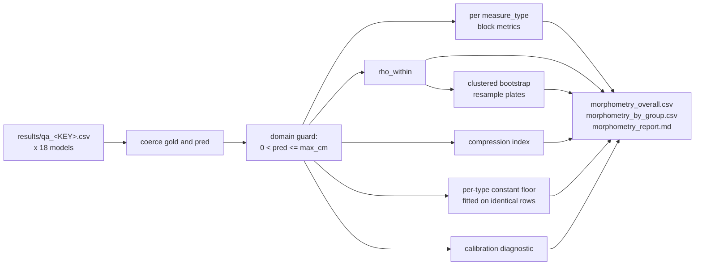

<h1 align="center">Bio-VQA &rarr; Spatial Visual Reasoning &rarr; Absolute Distance &rarr; Evaluation</h1>
<p align="center">
  <b>Scoring Calculus, Shortcut Controls, and Uncertainty</b>
</p>
<p align="center">
  
  
  
  
  
  
</p>

> The authoritative scoring stage for the Absolute Distance task. This document defines every
> metric and its equation, the three complementary shortcut controls that jointly exclude
> prior-driven answering, the calibration diagnostic that separates ranking from scaling, the
> plate-clustered bootstrap, and the findings the calculus exposes.

---

## Table of contents

1. [Overview](#1-overview)
2. [Motivation](#2-motivation)
   - 2.1 [Why relative error alone is satisfiable without measuring](#21-why-relative-error-alone-is-satisfiable-without-measuring)
   - 2.2 [Three controls for three shortcuts](#22-three-controls-for-three-shortcuts)
3. [Input contract](#3-input-contract)
4. [The scoring calculus](#4-the-scoring-calculus)
   - 4.1 [Precision metrics](#41-precision-metrics)
   - 4.2 [Error direction and magnitude](#42-error-direction-and-magnitude)
   - 4.3 [Within-type rank correlation](#43-within-type-rank-correlation)
   - 4.4 [A worked example](#44-a-worked-example)
   - 4.5 [What each score implies](#45-what-each-score-implies)
5. [The shortcut controls](#5-the-shortcut-controls)
   - 5.1 [The per-type constant predictor](#51-the-per-type-constant-predictor)
   - 5.2 [The compression index](#52-the-compression-index)
   - 5.3 [Coverage of the control set](#53-coverage-of-the-control-set)
6. [The calibration diagnostic](#6-the-calibration-diagnostic)
7. [Uncertainty: the clustered bootstrap](#7-uncertainty-the-clustered-bootstrap)
8. [Domain guards](#8-domain-guards)
9. [Results](#9-results)
   - 9.1 [Order of inspection](#91-order-of-inspection)
   - 9.2 [The floor outscores fifteen of eighteen models](#92-the-floor-outscores-fifteen-of-eighteen-models)
   - 9.3 [Compression is near-universal and its anchor is exact](#93-compression-is-near-universal-and-its-anchor-is-exact)
   - 9.4 [Ranking and calibration dissociate](#94-ranking-and-calibration-dissociate)
   - 9.5 [The width asymmetry](#95-the-width-asymmetry)
10. [Reproduction](#10-reproduction)
11. [Outputs](#11-outputs)
12. [References](#12-references)

---

## 1. Overview

The answer to every item is a physical length in centimetres, and carabid elytra occupy a
narrow size band. That combination makes the task unusual among visual benchmarks: a model
can post a respectable relative error **without extracting any information from the image**,
simply by recalling typical beetle dimensions.

This stage is therefore built around three complementary shortcut controls rather than a
single accuracy figure. Each catches a different prior-driven strategy, and only a model
clearing all three has measured anything. The headline metric is the one no constant-answering
strategy can satisfy; precision metrics are reported beside it and are always accompanied by
the floor that bounds them.

---

## 2. Motivation

### 2.1 Why relative error alone is satisfiable without measuring

Consider a model that ignores the image entirely and answers 1.16 cm to every length question
and 0.55 cm to every width question. It has performed no measurement, consulted no scale bar,
and localised nothing. It scores:

| Metric | Score |
|---|---:|
| mean relative error | 0.374 |
| acc@20 | **0.410** |
| rank correlation, pooled | ≈ +0.63 |
| rank correlation, within type | **0.000** |

Two of those four numbers would place it mid-table on a conventional leaderboard. The
question stem states which dimension is wanted, so even the per-type distinction requires no
visual input. **Any evaluation of this task that reports relative error or pooled rank
correlation without this baseline is crediting prior recall as measurement.**

### 2.2 Three controls for three shortcuts

Prior-driven answering has more than one form, and a single control does not catch all of
them. We install three.

| Control | Strategy it catches | Score under that strategy |
|---|---|---|
| Per-type constant floor | Type-aware prior recall: one value for length, another for width | acc@20 = 0.410, which the model must beat |
| `rho_within` | Any predictor constant within a measurement type | $\rho_{\text{within}} = 0$ |
| Compression index $\kappa$ | Single-anchor answering: one remembered size for both types | $\kappa \approx 1$ |

The controls are genuinely complementary rather than redundant. The per-type constant
predictor is fitted separately for each type, so **its own compression is approximately
zero** — it is caught by `rho_within`, not by $\kappa$. Conversely a single-anchor model may
already sit below the per-type floor while exhibiting $\kappa \approx 1$, which identifies
*why* it is below. Together the three leave no route to a high score that does not involve
reading the image.

---

## 3. Input contract

`evaluate.py` reads merged per-model CSVs:

```
--results_dir/
    qa_<MODEL_KEY>.csv     one per model, six shards reassembled, sorted by row_id
```

Each carries the columns emitted by `split_qa.py`
([Section 4.6 of the inference document](../2.Experiment_Runs/README.md#46-emitted-schema))
plus the two answer columns from the runner. The prediction column is located as
`<MODEL_KEY>_answer`, derived from the filename; failing that, the first column ending in
`_answer` that is not `_unfiltered`.

Three columns are load-bearing and their absence changes what can be computed:
`answer_cm` (gold), `measure_type` (conditions all three shortcut controls), and `plate_id`
(the bootstrap clustering key).



---

## 4. The scoring calculus

Let $y_i > 0$ be the gold length in centimetres and $\hat{y}_i > 0$ the resolved prediction,
over $n$ scored items.

### 4.1 Precision metrics

$$
\mathrm{relErr} = \frac{1}{n}\sum_i \frac{|\hat{y}_i - y_i|}{y_i},
\qquad
\mathrm{acc}_\tau = \frac{1}{n}\sum_i \mathbb{1}\!\left[\frac{|\hat{y}_i - y_i|}{y_i} \le \tau\right],
\quad \tau \in \{0.10,\, 0.20,\, 0.25\}.
$$

Relative rather than absolute error is the only defensible choice here. Length and width
differ by a factor of roughly two in physical extent, so an absolute error metric would
weight the two measurement types unequally and make the per-type decomposition
uninterpretable. **acc@20 is the reported precision figure**, chosen because it is the
tolerance at which a morphometric measurement remains diagnostically useful, and because it
is the metric against which the constant-predictor floor is fitted.

### 4.2 Error direction and magnitude

$$
\operatorname{bias} = \frac{1}{n}\sum_i \log\frac{\hat{y}_i}{y_i},
\qquad
\mathrm{logRMSE} = \sqrt{\frac{1}{n}\sum_i \left(\log\frac{\hat{y}_i}{y_i}\right)^{\!2}} .
$$

The logarithmic form is required rather than convenient. A model over-measuring by a factor
of two and one under-measuring by a factor of two are equally wrong, and only a log-scale
statistic treats them so; a linear bias term would rate the second as the smaller error.
`bias` measures direction, `logRMSE` measures magnitude, and the difference between the
two types' biases is the compression index
([Section 5.2](#52-the-compression-index)).

### 4.3 Within-type rank correlation

The headline metric.

$$
\boxed{\;\rho_{\text{within}} \;=\; \frac{1}{|T|}\sum_{t \in T} \operatorname{Spearman}\!\left(\hat{y}_{|t},\; y_{|t}\right), \qquad T = \{\text{length}, \text{width}\}\;}
$$

Spearman is computed **inside each measurement type and then averaged**, never pooled.

Elytra length is roughly twice elytra width and the question states which is being asked, so
a model that measures nothing and merely answers a larger number for length than for width
achieves a **pooled correlation of about +0.63** entirely from between-type separation. The
same predictor scores exactly zero within each type, because a constant has no rank variance.

We report `rho_pooled` alongside solely so the gap remains visible. In our results it exceeds
`rho_within` by up to **+0.171** and by more than 0.10 for five of eighteen models
([Section 9.1](#91-order-of-inspection)). **Read `rho_within`.**

Correlation is implemented directly on pandas ranks to avoid a SciPy dependency, returning
`NaN` when $n < 3$ or either rank vector is constant — a `NaN` here is itself the strongest
available statement that a model produced no within-type variation.

### 4.4 A worked example

A specimen with gold elytra length 1.20 cm, under four strategies.

| Strategy | Prediction | relErr | acc@20 | Contribution to $\rho_{\text{within}}$ | Contribution to $\kappa$ |
|---|---:|---:|---:|---|---|
| Exact measurement | 1.20 | 0.000 | 1 | positive | 0 |
| Measures, mis-scaled by 0.7× | 0.84 | 0.300 | 0 | **positive** | 0 |
| Per-type constant | 1.16 | 0.033 | 1 | **zero** | ≈ 0 |
| Single remembered size | 0.85 | 0.292 | 0 | zero | ≈ 1 |

Rows two and three make the case for the metric set. Row two scores **worse** than row three
on both precision metrics while being the only one of the two that measured anything — a
model that reads the image but applies the wrong scale factor is penalised by acc@20 and
rewarded by `rho_within`. Row three is the shortcut that acc@20 alone cannot detect and
`rho_within` catches exactly.

### 4.5 What each score implies

| Score | Question it answers | Principal use |
|---|---|---|
| `rho_within` | Did the model measure anything in the image? | **headline** |
| `rho_pooled` | — | reported only to expose its gap from `rho_within` |
| `acc20` | How precise is it? | precision, always read against `const_acc20` |
| `const_acc20` | What does answering nothing achieve? | **floor** |
| `relErr` | Mean fractional error | secondary precision |
| `bias` | Over- or under-measuring? | direction |
| `logRMSE` | Scale-free error magnitude | secondary |
| `compression` / $\kappa$ | Is the model answering from one remembered size? | **shortcut index** |
| `acc20_calib` | How well would it do if told the right scale factor? | diagnostic, not a score |
| `parse_rate` | Did the model follow the format? | separates format failure from measurement failure |
| `implausible` | How many outputs fell outside physical range? | parser and guard audit |

---

## 5. The shortcut controls

### 5.1 The per-type constant predictor

For each measurement type $t$ we fit the constant that optimises the metric under comparison,
over the gold values on the **identical rows** the model was scored on:

$$
c_t^{\text{relErr}} = \operatorname*{arg\,min}_{c} \; \frac{1}{n_t}\sum_{i \in t} \left|\frac{c}{y_i} - 1\right|,
\qquad
c_t^{\text{acc}} = \operatorname*{arg\,max}_{c} \; \frac{1}{n_t}\sum_{i \in t} \mathbb{1}\!\left[\left|\frac{c}{y_i} - 1\right| \le 0.20\right],
$$

each by exhaustive search over a 1,500-point grid spanning the observed range.

Three properties of this construction each raise the bar the models must clear, and all three
are deliberate.

**Fitted per type, not pooled.** The question states which dimension is wanted, so type-aware
constant answering requires no measurement. A pooled constant reaches acc@20 of roughly 0.30;
the per-type predictor reaches **0.410**. Using the pooled figure would understate the floor
by eleven points and move four additional models above it.

**Fitted against the metric it is compared to.** $c^{\text{relErr}}$ and $c^{\text{acc}}$ are
different values. On the length items the relErr-optimal constant scores acc@20 of about 0.30
while the acc-optimal constant scores 0.43. A baseline that optimises the wrong objective
flatters the models instead of bounding them.

**Fitted on the model's own scored rows.** A model with a lower parse rate is evaluated on
fewer rows, so its floor is recomputed on exactly those rows. Llama-3.2-11B-Vision, at parse
rate 0.970, is scored against a floor of 0.415 rather than 0.410.

The fitted values — $c^{\text{acc}}_{\text{length}} = 1.16$ cm and
$c^{\text{acc}}_{\text{width}} = 0.55$ cm — are written into every results row as
`const_values`, so the floor can never be separated from the numbers it bounds.

### 5.2 The compression index

The third control has a **closed-form saturation point**, which turns a qualitative signature
into a normalised index.

Define

$$
\text{compression} \;=\; \operatorname{bias}(\text{width}) - \operatorname{bias}(\text{length}) .
$$

A model that measures correctly has no reason to be biased in opposite directions on two
dimensions of the same specimen, so compression $\approx 0$. Now take a model answering a
single remembered value $c$ regardless of which dimension is asked. Its per-type biases are
$\operatorname{bias}(t) = \log c - \mathbb{E}[\log y_{|t}]$, so

$$
\boxed{\;\text{compression}_{\text{single-anchor}} \;=\; \mathbb{E}[\log y_{|\text{length}}] - \mathbb{E}[\log y_{|\text{width}}] \;=\; \log \frac{\mathrm{GM}(\text{length})}{\mathrm{GM}(\text{width})}\;}
$$

**independent of $c$** — the anchor value cancels entirely, so the saturation point is a
property of the gold distribution alone and not of the model. Using the fitted per-type
constants as a proxy for central tendency gives

$$
\log\frac{1.16}{0.55} \;\approx\; 0.746,
\qquad
\kappa \;=\; \frac{\text{compression}}{0.746},
$$

with $\kappa = 0$ denoting true measurement and $\kappa = 1$ denoting pure single-anchor
answering. Positive compression means the model overestimates the smaller quantity and
underestimates the larger one — squeezing every answer toward one central value, which is what
recall of a remembered beetle size produces and what genuine measurement cannot.

The index is computable **because** the generation stage emits one measurement per image
([Section 5.1 of the generation document](../1.Generate_QA/README.md#51-one-measurement-per-image)):
each specimen yields two items differing only in which dimension is marked, over identical
pixels and one scale bar, so compression is a within-specimen quantity free of any
between-specimen confound.

### 5.3 Coverage of the control set

| Strategy | Beats the per-type floor? | High `rho_within`? | Low $\kappa$? |
|---|:---:|:---:|:---:|
| Single remembered size | no | no | **no** |
| Per-type constant | ties | **no** | yes |
| Measures, mis-scaled | often no | **yes** | yes |
| Measures and calibrates | **yes** | **yes** | **yes** |

Only the last row clears all three. The third row — measurement without calibration — is the
case the controls were designed to distinguish from the first two, and it occurs in our data
([Section 9.4](#94-ranking-and-calibration-dissociate)).

---

## 6. The calibration diagnostic

`acc20_calib` rescores each model after removing its own per-type bias, dividing every
prediction by the exponentiated mean log ratio within its measurement type:

$$
\hat{y}_i^{\text{calib}} = \frac{\hat{y}_i}{\exp\!\left(\operatorname{bias}(t_i)\right)},
\qquad
\text{acc20}_{\text{calib}} = \sum_{t} \frac{n_t}{n} \cdot \frac{1}{n_t}\sum_{i \in t} \mathbb{1}\!\left[\frac{|\hat{y}_i^{\text{calib}} - y_i|}{y_i} \le 0.20\right].
$$

This removes exactly the systematic scale offset and leaves only the scatter, so the gap
between `acc20` and `acc20_calib` separates *cannot measure* from *measures but does not
calibrate*.

**The correction is fitted on the same rows it is applied to, so `acc20_calib` is an
optimistic ceiling and a diagnostic, not a score a model earned.** It answers the question:
how well would this model do if someone told it the right scale factor? We label it as such
in every table and never rank models by it.

---

## 7. Uncertainty: the clustered bootstrap

Rows are strongly dependent. Every specimen on a plate shares one scale bar, one
magnification, one illumination, and one focal plane, and each contributes both a length and a
width item. Within-plate spread is roughly a seventh of total spread, so approximately 16 rows
from one plate behave close to a single observation and the effective sample size is far
nearer the plate count (864) than the row count (14,108).

We therefore resample **plates**:

$$
\text{for } b = 1 \dots B:\quad
\mathcal{P}^{(b)} \sim \mathrm{Unif}\bigl(\mathcal{P},\, |\mathcal{P}|\bigr) \text{ with replacement},\quad
\theta^{(b)} = \rho_{\text{within}}\!\left(\bigcup_{P \in \mathcal{P}^{(b)}} \text{rows}(P)\right),
$$

reporting the percentile interval $\bigl[Q_{2.5}(\theta),\, Q_{97.5}(\theta)\bigr]$ as
`rho_within_lo` and `rho_within_hi`. All rows belonging to a resampled plate enter or leave
together, preserving the dependence structure exactly.

The resampling function receives the resampled **dataframe** rather than two arrays,
specifically so that within-type statistics can be recomputed on each replicate. Bootstrapping
a pooled statistic and reporting it as an interval on a within-type one would be a category
error, and the interface prevents it by construction.

---

## 8. Domain guards

A length must be positive and physically plausible for an elytron. Values outside that range
are parser artefacts rather than measurements, and because every headline statistic here is
computed on a log scale, a single value near zero or in the hundreds would dominate `bias` and
`logRMSE` for an entire model.

```python
n_bad = int(((pred <= 0) | (pred > args.max_cm)).sum())
pred = pred.where((pred > 0) & (pred <= args.max_cm))     # -> NA, excluded
```

with `--max_cm` defaulting to 20.0, roughly an order of magnitude above the largest elytron in
the corpus, so the guard removes only genuine artefacts and never a plausible measurement.

We nullify rather than clip. Clipping would invent a prediction the model never made and
manufacture a bounded error where the model in fact produced nonsense. The count is reported
in `implausible` and flagged on the console: in our runs it is 0 for 17 of 18 models and 407
for Llama-3.2-11B-Vision, which also accounts for that model's parse rate of 0.970.

---

## 9. Results

### 9.1 Order of inspection

1. **`parse_rate` and `implausible`** — below ~0.95, or a non-zero implausible count, indicates
   a format-following failure rather than a measurement failure; a distinct diagnosis.
2. **`rho_within`** — near zero or undefined means nothing in the image was measured, and
   every other column is then an artefact of the size prior.
3. **`acc20` against `const_acc20`** — precision against the floor that bounds it.
4. **$\kappa$** — which shortcut, if any, the model is using.
5. **`acc20_calib` minus `acc20`** — whether the deficit is measurement or calibration.
6. **Per-measurement rows** — where the pooled figure originates.

The `rho_pooled` column is reported only to be discounted. It exceeds `rho_within` by up to
+0.171 (Molmo2-8B: 0.682 pooled against 0.511 within) and by more than 0.10 for five models;
every point of that gap is between-type separation available to a model that measures nothing.

### 9.2 The floor outscores fifteen of eighteen models

$$
\text{acc@20}_{\text{per-type constant}} = 0.410, \qquad \textbf{cleared by only } 3/18 \text{ models.}
$$

Only Qwen3-VL-32B (0.622), Qwen3-VL-30B-A3B (0.528), and InternVL3.5-38B-Instruct (0.503)
exceed a predictor that never looks at the image. By measurement type the picture is sharper:
**6 of 18 clear the length floor of 0.382, and 2 of 18 clear the width floor of 0.438.**

The result is robust by construction, because the floor is fitted three ways and the most
conservative is used at each choice — per type rather than pooled, against the compared metric
rather than a convenient one, and on each model's own scored rows
([Section 5.1](#51-the-per-type-constant-predictor)). Every one of those choices raises the
bar. It is also not an artefact of under-specification: the prompt supplies the scale
constant, the explicit ratio procedure, two worked examples, and a direct instruction not to
answer from prior knowledge
([Section 6.2 of the inference document](../2.Experiment_Runs/README.md#62-prompt-construction)),
and the vision budget is raised to near-native resolution so the segments are legible
([Section 6.4 of the inference document](../2.Experiment_Runs/README.md#64-vision-token-budget)).

### 9.3 Compression is near-universal and its anchor is exact

Mean log-ratio bias by measurement type across all eighteen models:

$$
\overline{\operatorname{bias}}(\text{length}) = -0.178, \qquad \overline{\operatorname{bias}}(\text{width}) = +0.262,
$$

$$
\text{compression} > 0 \;\text{ for }\; \textbf{17/18 models}; \quad
\operatorname{bias}(\text{length}) < 0 \text{ for } 15/18; \quad
\operatorname{bias}(\text{width}) > 0 \text{ for } 14/18 .
$$

Models systematically under-measure the larger dimension and over-measure the smaller one.
This is not a generic accuracy deficit — a generic deficit produces bias of the same sign on
both types. It is the specific signature derived in
[Section 5.2](#52-the-compression-index), and its near-unanimity across eighteen architectures
is the strongest form of evidence available at this sample size.

| $\kappa$ band | Count | Models |
|---|---:|---|
| $\kappa < 0.20$ | 3 | Qwen3-VL-32B (0.085), Qwen3-VL-30B (0.168), InternVL3.5-38B (0.189) |
| $0.20 \le \kappa < 0.80$ | 9 | partial measurement blended with a size prior |
| $\kappa \ge 0.80$ | 6 | within 20% of pure single-anchor answering |

The index agrees with the other two controls while catching a different strategy:
$\rho(\kappa, \rho_{\text{within}}) = -0.689$ and $\rho(\kappa, \text{acc@20}) = -0.775$.

**Qwen3-VL-32B reports identical bias on length and width (−0.046 on both), giving
$\kappa = 0.085$** — the only model whose error structure carries no trace of a size prior. It
is also the model with the highest `rho_within` and the only one exceeding the floor by more
than twenty points. The three independent controls converge on one model, which is the
sharpest available evidence that they measure what they are intended to.

### 9.4 Ranking and calibration dissociate

| Model | rho_within | acc@20 | acc@20 calib | Gain | Diagnosis |
|---|---:|---:|---:|---:|---|
| InternVL3.5-8B-Instruct | 0.703 | 0.263 | 0.509 | **+0.246** | measures, does not calibrate |
| Qwen3-VL-8B | 0.682 | 0.303 | 0.453 | +0.151 | measures, does not calibrate |
| Gemma-4-12B | 0.753 | 0.385 | 0.512 | +0.127 | measures, does not calibrate |
| Qwen3-VL-32B | 0.858 | 0.622 | 0.614 | −0.008 | measures and calibrates |
| Qwen2.5-VL-3B | 0.081 | 0.194 | 0.306 | +0.112 | neither |
| LLaVA-NeXT-Vicuna-7B | −0.023 | 0.217 | 0.326 | +0.110 | neither |

**InternVL3.5-8B-Instruct is the cleanest case.** It ranks fourth of eighteen on `rho_within`
at 0.703 — ordering specimens about as well as a 38B model — while ranking fifteenth on raw
acc@20 at 0.263, below the constant-predictor floor. Its $\kappa$ of 0.906 is the highest in
the set. Removing its per-type bias lifts it from 0.263 to 0.509, from below the floor to
third place. The information required to answer correctly is present in its predictions; it is
applied at the wrong scale.

This dissociation is the argument for leading with `rho_within`. The two metrics correlate at
$\rho = 0.755$, leaving substantial disagreement; after bias removal the correlation rises to

$$
\rho\bigl(\rho_{\text{within}},\, \text{acc@20}_{\text{calib}}\bigr) = 0.934 .
$$

The residual disagreement between ranking and precision is therefore **almost entirely a
calibration offset rather than a measurement failure** — a decomposition no single-number
leaderboard would surface, and one that changes what the results mean: several models that
appear not to measure in fact do, and fail at the final binding of ratio to unit.

### 9.5 The width asymmetry

$$
\overline{\text{relErr}}(\text{length}) = 0.338, \qquad \overline{\text{relErr}}(\text{width}) = 0.609,
$$

with width worse for 14 of 18 models and floor-clearance falling from 6/18 on length to 2/18
on width.

Two mechanisms compound and the data separate them. Width is roughly half of length in
physical extent, so it subtends fewer pixels and is the more acuity-limited measurement. And
because width lies further below the central tendency of the pooled size distribution, a model
anchored on a remembered size overshoots it more severely — the
$\overline{\operatorname{bias}}(\text{width}) = +0.262$ reported above.

The extreme cases isolate the second mechanism cleanly. Phi-3.5-Vision posts relative error of
1.436 and acc@20 of 0.060 on width against 0.463 and 0.336 on length; Qwen2.5-VL-3B posts
1.419 and 0.067 against 0.469 and 0.321. Both are over-measuring width by a factor of
approximately 2.2 — the length-to-width ratio — which is the arithmetic fingerprint of
answering the *length* value to a *width* question, and it is visible only because the per-type
decomposition is carried through the whole calculus.

---

## 10. Reproduction

```bash
python evaluate.py                                       # results/ beside this script
python evaluate.py --results_dir DIR --out_dir DIR
python evaluate.py --bootstrap 2000                      # plate-clustered CIs
python evaluate.py --max_cm 20.0                         # plausibility guard
```

The merge contract producing the input files is specified in
[Section 7.3 of the inference document](../2.Experiment_Runs/README.md#73-merge-contract).

---

## 11. Outputs

| File | Contents |
|---|---|
| `morphometry_overall.csv` | One row per model: `n, relErr, acc10, acc20, acc25, rho_pooled, bias, logRMSE, rho_within, acc20_calib, compression, model, parse_rate, implausible, plates, const_relErr, const_acc20, const_values, const_rho_within`, plus bootstrap bounds when requested. |
| `morphometry_by_group.csv` | One row per model × measurement type, with per-type constants and biases. |
| `morphometry_report.md` | Leaderboard sorted by `rho_within`, per-measurement table, and interpretation. |

Every row carries its own floor (`const_acc20`, `const_values`, `const_rho_within`) rather
than referring to a floor computed elsewhere, so a single extracted row remains fully
interpretable and no reader can quote a score without its baseline.

---

## 12. References

Rank correlation follows Spearman [1]. Clustered resampling for dependent observations follows
standard bootstrap practice [2, 3]. Logarithmic error measures for positive-valued regression
follow established practice in the measurement literature [4].

[1] C. Spearman. **The Proof and Measurement of Association between Two Things.** *The
American Journal of Psychology*, 15(1):72–101, 1904.

[2] B. Efron and R. J. Tibshirani. **An Introduction to the Bootstrap.** Chapman & Hall, 1993.

[3] A. C. Cameron and D. L. Miller. **A Practitioner's Guide to Cluster-Robust Inference.**
*Journal of Human Resources*, 50(2):317–372, 2015.

[4] J. M. Bland and D. G. Altman. **Statistical Methods for Assessing Agreement between Two
Methods of Clinical Measurement.** *The Lancet*, 327(8476):307–310, 1986.