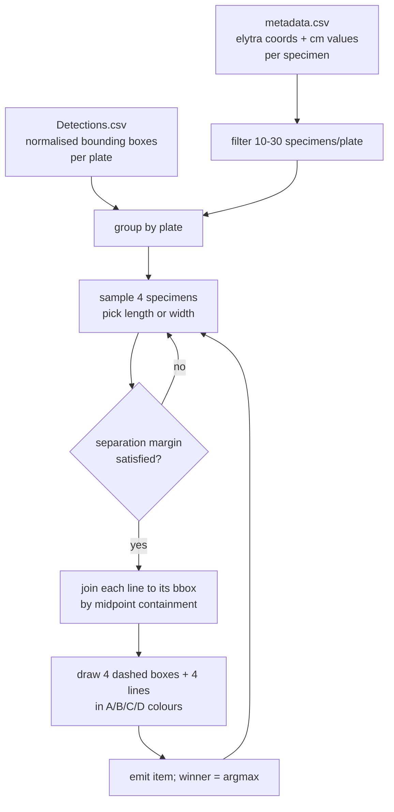

<h1 align="center">Bio-VQA &rarr; Spatial Visual Reasoning &rarr; Relative Size &rarr; QA Generation</h1>
<p align="center">
  <b>Quartet Sampling, Margin Filtering, and Four-Colour Annotation Rendering</b>
</p>
<p align="center">
  
  
  
  
  
  
</p>

> Construction of the Relative Size evaluation set. This document describes the two source
> tables and how they are joined, the quartet sampling procedure and its yield controls, the
> separation-margin filter and its analytical consequence, the dotted-box and line rendering,
> and the output contract consumed by the inference stage.

---

## Table of contents

1. [Overview](#1-overview)
2. [Design contract](#2-design-contract)
3. [Source tables and the geometric join](#3-source-tables-and-the-geometric-join)
   - 3.1 [Required fields](#31-required-fields)
   - 3.2 [Specimen-density filter](#32-specimen-density-filter)
   - 3.3 [Joining measurement lines to bounding boxes](#33-joining-measurement-lines-to-bounding-boxes)
4. [Quartet sampling](#4-quartet-sampling)
   - 4.1 [The sampling loop](#41-the-sampling-loop)
   - 4.2 [The separation-margin filter](#42-the-separation-margin-filter)
   - 4.3 [Yield controls](#43-yield-controls)
   - 4.4 [Determinism](#44-determinism)
5. [Annotation rendering](#5-annotation-rendering)
   - 5.1 [The dashed-rectangle primitive](#51-the-dashed-rectangle-primitive)
   - 5.2 [The colour map](#52-the-colour-map)
   - 5.3 [Why box and line are both drawn](#53-why-box-and-line-are-both-drawn)
6. [Item emission](#6-item-emission)
7. [Output schema](#7-output-schema)
8. [Reproduction](#8-reproduction)
9. [Operational behaviour](#9-operational-behaviour)

---

## 1. Overview

This stage converts a morphometric annotation table and a detection table into a four-way
comparative-choice benchmark. For each accepted quartet of specimens on a plate we render
four coloured dotted boxes and four coloured measurement lines onto the plate photograph and
emit one question naming the largest.

The stage is a single seeded script. It performs no image synthesis beyond drawing onto an
existing photograph, and — critically for the task's validity — **no geometric transform of
any kind**, so the pixel lengths of the four lines remain exactly proportional to the real
measurements ([Section 4.2 of the task document](../README.md#42-why-no-scale-bar-is-needed)).



---

## 2. Design contract

| Contract | Rationale |
|---|---|
| **No re-measurement.** Ground truth is the corpus's own `elytra_length_cm` and `elytra_width_cm`. | The benchmark inherits published annotations and remains auditable against the source corpus. |
| **No geometric transform of the plate photograph.** Lines are drawn from the corpus's pixel coordinates onto the unmodified image. | The task's validity rests on on-screen line length being proportional to real size. Any crop, warp, or anisotropic resize applied after the coordinates were recorded would break that proportionality and invalidate every item. |
| **All four candidates come from one plate.** | One magnification means one pixels-per-centimetre factor, so the comparison needs no scale bar and admits no unit error. |
| **A quartet is accepted only above an explicit separation margin.** | Guarantees every item is resolvable, and — because the margin differs by measurement type — supplies a free internal validity check ([Section 4.2](#42-the-separation-margin-filter)). |
| **Seeded throughout.** `random`, `numpy`, and `PYTHONHASHSEED` are all set from `--seed`. | The quartet sample, the measurement-type choice, and the plate order all reproduce. |

---

## 3. Source tables and the geometric join

### 3.1 Required fields

Two tables are joined. `metadata.csv` supplies per-specimen morphometry; `Detections.csv`
supplies per-plate bounding boxes.

| Table | Field | Type | Use |
|---|---|---|---|
| `metadata.csv` | `group_image_path` | str | Plate identity; the grouping key |
| | `elytra_length_coords` | dict literal | `{x1,y1,x2,y2}` — length line endpoints, pixels |
| | `elytra_width_coords` | dict literal | `{x1,y1,x2,y2}` — width line endpoints, pixels |
| | `elytra_length_cm` | float | Ground truth for length quartets |
| | `elytra_width_cm` | float | Ground truth for width quartets |
| | `no_of_beetles_in_image` | int | Density filter |
| `Detections/Detections.csv` | `image_name` | str | Join key to the plate |
| | `coordinates` | JSON | List of `{x_min,y_min,x_max,y_max}`, **normalised to [0,1]** |

Detection coordinates are parsed as JSON with a Python-literal fallback, and a doubled-quote
repair is applied first — the field is a JSON document embedded in a CSV cell, so quoting is
escaped on write and must be unescaped on read. A plate whose detections fail to parse under
both routes is skipped rather than admitted with partial boxes.

### 3.2 Specimen-density filter

We restrict to plates carrying between **10 and 30 specimens inclusive**, matching
[Absolute Distance](../../Distance_Absolute/1.Generate_QA/README.md#32-specimen-density-filter)
so that the two tasks draw from the same plate population and their results are directly
comparable.

The lower bound is load-bearing here in a way it is not in the absolute task: a quartet
requires at least four annotated specimens, and a plate with barely more than four offers
very few distinct combinations, so its twenty question sets would be near-duplicates of one
another. The upper bound bounds annotation ambiguity — on a dense plate a dotted box drawn
around one specimen begins to overlap its neighbours.

### 3.3 Joining measurement lines to bounding boxes

The two tables are not keyed to one another at the specimen level: `metadata.csv` gives a
measurement line, `Detections.csv` gives a set of boxes, and nothing states which box
contains which line. We resolve the correspondence **geometrically**, by midpoint
containment.

For a line with endpoints $(x_1,y_1)$ and $(x_2,y_2)$, take the midpoint

$$
m = \left(\tfrac{x_1 + x_2}{2},\; \tfrac{y_1 + y_2}{2}\right)
$$

and return the first detection box, denormalised to pixel coordinates by the plate's width
and height, that contains it:

$$
\text{box} = \bigl\{ b \;:\; b_{x_{\min}} W \le m_x \le b_{x_{\max}} W \;\wedge\; b_{y_{\min}} H \le m_y \le b_{y_{\max}} H \bigr\} .
$$

The midpoint rather than an endpoint is the right test statistic: an elytra line runs the
length of the specimen, so its endpoints sit at or near the box boundary and are vulnerable
to off-by-one inclusion in a neighbouring box, whereas the midpoint lies close to the
specimen's centroid.

**Fallback.** If no box contains the midpoint — the detector missed that individual, or the
box is slightly misregistered — we synthesise a box from the line's own extent with 30 px of
padding, clamped to the image bounds:

$$
\bigl(\max(0,\, \min x - 30),\; \max(0,\, \min y - 30)\bigr) \;\text{to}\;
\bigl(\min(W,\, \max x + 30),\; \min(H,\, \max y + 30)\bigr) .
$$

The fallback keeps the item well posed rather than dropping it. The box exists to bind an
option letter to a specimen, and a padded box around the correct line does that correctly;
it is merely less tightly fitted than a detector box. Because the *line* is drawn from the
corpus coordinates in either case, the measurement the model must compare is unaffected by
which branch was taken.

---

## 4. Quartet sampling

### 4.1 The sampling loop

For each plate with at least four annotated specimens and a parsed detection list:

```
base_img ← decode plate photograph                (once per plate)
while sets_from_plate < 20 and attempts < 500:
    quartet   ← random.sample(specimen_pool, 4)   (without replacement)
    m_type    ← random.choice(['length', 'width'])
    if not margin_satisfied(quartet, m_type): continue
    img ← base_img.copy()
    draw 4 dashed boxes + 4 lines in A/B/C/D colours
    emit item with winner = argmax
```

The plate photograph is decoded **once** and copied per accepted quartet, rather than
re-decoded per item. On a corpus of high-resolution plate scans this is the difference
between an I/O-bound stage and a prohibitively slow one.

Plate order is shuffled before iteration and generation halts at `target_count`, so a
truncated run yields a sample spread across the plate population rather than the first
plates in filesystem order.

### 4.2 The separation-margin filter

The decisive predicate. Writing $v_1 \dots v_4$ for the four gold values and
$v_{\max} = \max_i v_i$, a quartet is accepted only when

$$
v_i \;<\; \gamma \cdot v_{\max} \quad \text{for every non-winner } i,
\qquad
\gamma = \begin{cases} 0.95 & \text{length} \\ 0.90 & \text{width,} \end{cases}
$$

with exact ties on the maximum rejected outright. Equivalently, the runner-up must fall
below 95% of the winner on length and below 90% on width.

**Why a margin at all.** Without it, a substantial fraction of quartets would separate first
from second place by less than the annotation's own precision, and the item would be
unanswerable in principle rather than merely difficult. The filter guarantees that every
released item has a resolvable answer.

**Why the two thresholds differ.** Elytra width has a narrower absolute spread than length in
this corpus, so a common 5% margin would have rejected the great majority of width quartets
and left the stratum too small to report. Doubling the width margin restores yield.

**Its analytical consequence.** Width items therefore carry **twice the separation** of
length items and are strictly easier by construction. This turns a yield parameter into a
falsifiable prediction: under any account in which the model resolves the four line lengths
and reports the maximum, width accuracy must exceed length accuracy. The prediction fails
for thirteen of eighteen models
([Section 6.4 of the task document](../README.md#64-the-margin-asymmetry-inverts)), which
makes the filter the component's sharpest evidence about mechanism — obtained at no
annotation cost.

**A note on sample composition.** Because the width margin is harder to satisfy in absolute
terms, the accepted width quartets are drawn from a more separated tail of the within-plate
spread than the length quartets are. The released set is therefore an easier-than-uniform
sample of all possible quartets, which is stated in the results as the condition that makes
the task answerable at all.

### 4.3 Yield controls

Two bounds prevent a single plate from dominating the benchmark and prevent an unsatisfiable
plate from stalling the loop.

| Control | Value | Purpose |
|---|---:|---|
| `max_pairs_per_image` | 20 | Caps one plate's contribution. Without it, a plate with 30 specimens — offering $\binom{30}{4} = 27{,}405$ quartets — could supply the entire benchmark. |
| `max_attempts_per_image` | 500 | Bounds rejection sampling on a plate whose specimens are too uniform to satisfy the margin. |

The realised mean is 19.2 items per plate against a cap of 20, so the cap binds on nearly
every plate and the attempt ceiling is rarely reached. The consequence for analysis is
direct: up to twenty question sets share one plate and **reuse the same specimens in
different combinations**, so rows within a plate are strongly dependent and every confidence
interval resamples plates
([Section 7 of the evaluation document](../3.Evaluate/README.md#7-uncertainty-the-clustered-bootstrap)).

### 4.4 Determinism

The seed is applied to all three sources of randomness before any sampling:

```python
def set_seed(seed=42):
    random.seed(seed)
    np.random.seed(seed)
    os.environ['PYTHONHASHSEED'] = str(seed)
```

`random` governs the plate shuffle, the quartet sample, and the length-or-width choice, so
the accepted quartets, their measurement types, and their winners all reproduce exactly
under a fixed seed.

---

## 5. Annotation rendering

### 5.1 The dashed-rectangle primitive

Each option's bounding box is drawn as a dashed rectangle. For each of the four edges, the
segment of length $d$ is divided into $n = \max(1, \lfloor d / 15 \rfloor)$ dashes and only
the first half of each interval is stroked:

$$
\text{dash}_i:\quad p_1 + \frac{i}{n}(p_2 - p_1) \;\longrightarrow\; p_1 + \frac{i + 0.5}{n}(p_2 - p_1),
\qquad i = 0 \dots n-1 ,
$$

giving a 50% duty cycle at a nominal 15 px period, stroked at thickness 4.

Dashed rather than solid is deliberate. A solid rectangle around a specimen on a cluttered
plate reads as an occluding boundary and can be mistaken for part of the specimen or the
pin; a dashed outline is unambiguously an overlay. The dashes also leave the underlying
pixels partly visible along the box edge, so the annotation does not hide the specimen
margin the model may be using.

### 5.2 The colour map

| Option | Colour | BGR triple |
|---|---|---|
| A | red | `(0, 0, 255)` |
| B | blue | `(255, 0, 0)` |
| C | green | `(0, 255, 0)` |
| D | white | `(255, 255, 255)` |

Three saturated primaries plus white, chosen for maximum mutual separation and for contrast
against the browns and greys of a specimen tray. Box and line share one colour per option, so
the binding between the two annotations requires no inference.

The colour-to-option assignment is **fixed**, not permuted: A is always red, D always white.
The correct answer's *identity* is randomised by the quartet sample rather than by the colour
map, so the key remains near-uniform over the four letters
([Section 4.4 of the task document](../README.md#44-scale-and-cluster-structure)) while the
colour vocabulary stays constant across the benchmark. Permuting the assignment is the
natural next control and is discussed in
[Section 7 of the task document](../README.md#7-scope-of-the-released-evaluation).

The measurement line is stroked at thickness 6 against the box's 4, so the quantity under
comparison is the visually dominant mark.

### 5.3 Why box and line are both drawn

The two annotations answer two different questions, and neither alone suffices on a plate
holding ten to thirty specimens.

**The box binds an option letter to a specimen.** Without it, four coloured lines float on a
dense plate and the model must infer which individual each belongs to before it can compare
anything.

**The line specifies the measurement.** Without it, the option identifies a beetle but not a
dimension — and elytra length and width are different measurements of the same object, so a
box alone leaves the question underdetermined.

Drawing both also means the answer is recoverable from the annotation geometry alone, which
is what makes the annotation-only control proposed in
[Section 7 of the task document](../README.md#7-scope-of-the-released-evaluation) a clean
ablation rather than a degenerate one.

---

## 6. Item emission

The winner is the option with the largest gold value:

$$
\text{answer} = \mathrm{arg\,max}_{\ell \in \{A,B,C,D\}} v_\ell ,
$$

uniquely defined because exact ties are rejected by the margin filter
([Section 4.2](#42-the-separation-margin-filter)).

The question enumerates all four options with their colours:

> *Among the four highlighted beetle specimens, which one has the largest elytral
> {length|width}? Beetle A (red dotted box/line), Beetle B (blue dotted box/line), Beetle C
> (green dotted box/line), and Beetle D (white dotted box/line)*

and the answer is stored as a natural-language string, `Beetle C`, from which preprocessing
derives the bare option letter
([Section 4.3 of the inference document](../2.Experiment_Runs/README.md#43-resolving-the-option-letter)).

Rendered filenames follow

```
<plate_accession>_set<N>_<id>.jpg
```

where `<N>` indexes the question set within the plate. Preprocessing recovers both
`plate_id` and `set_index` from this pattern, the former being the clustering key for every
confidence interval in the component.

---

## 7. Output schema

`qa.csv` carries two columns.

| Column | Type | Content |
|---|---|---|
| `image` | str | Rendered filename, `<plate>_set<N>_<id>.jpg` |
| `qa_pairs` | str | JSON object `{"Q": ..., "A": "Beetle C"}` |

**Example row.**

```csv
image,qa_pairs
A00000050030_set0_582333.jpg,"{""Q"": ""Among the four highlighted beetle specimens, which one has the largest elytral length? Beetle A (red dotted box/line), Beetle B (blue dotted box/line), Beetle C (green dotted box/line), and Beetle D (white dotted box/line)"", ""A"": ""Beetle C""}"
```

---

## 8. Reproduction

```bash
python generateQA.py \
    --base_dir        $BIOVQA_DATA/datasets/Beetles-500 \
    --output_base_dir $BIOVQA_DATA/tasks/Distance-Relative/Hard \
    --seed 42
```

`--base_dir` must contain `Images/`, `metadata.csv`, and `Detections/Detections.csv`. The
stage writes `qa.csv` and `Images/` under `--output_base_dir` and prints the realised item
count on completion.

Realised scale and cluster structure are tabulated in
[Section 4.4 of the task document](../README.md#44-scale-and-cluster-structure).

**Next stage:** [`../2.Experiment_Runs/README.md`](../2.Experiment_Runs/README.md) —
flattening, sharding, and inference.

---

## 9. Operational behaviour

**Plates below the quartet threshold are skipped.** A plate group with fewer than four
annotated specimens, or with no entry in the detection table, contributes no items and the
loop continues.

**Undecodable photographs are skipped.** The plate image is decoded once before the sampling
loop begins; a decode failure skips the plate before any sampling work is done.

**Coordinate parse failures skip the quartet, not the plate.** Each specimen's line
coordinates are parsed inside the loop, so one malformed record costs one attempt rather
than the whole plate.

**The stage is I/O-bound.** One decode per plate and one JPEG write per accepted item; on a
shared filesystem it benefits substantially from staging the source images to local scratch
first.