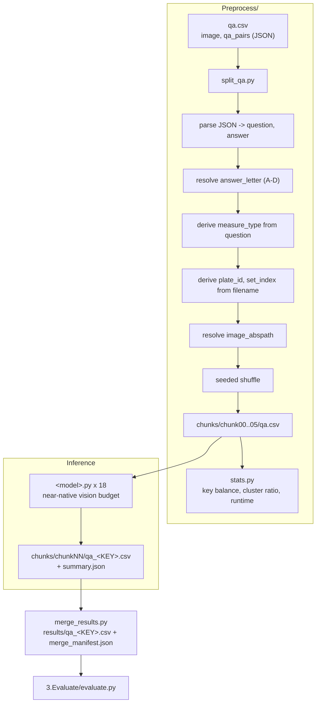

<h1 align="center">Bio-VQA &rarr; Spatial Visual Reasoning &rarr; Relative Size &rarr; Preprocessing &amp; Inference</h1>
<p align="center">
  <b>Manifest Flattening and Near-Native-Resolution Inference across Eighteen Models</b>
</p>
<p align="center">
  
  
  
  
  
  
  
</p>

> Flattening of the generated QA file into a sharded evaluation manifest, and inference
> across eighteen open-weight vision–language models under an invariant harness. This
> document specifies the derived columns on which the analysis depends, the option-letter
> resolution that a naive regular expression gets wrong, the resolution decision, the prompt
> that forecloses a spurious scale correction, and the correctness guards.

---

## Table of contents

1. [Overview](#1-overview)
2. [Motivation](#2-motivation)
   - 2.1 [The invariant harness](#21-the-invariant-harness)
   - 2.2 [Resolution as a first-class design decision](#22-resolution-as-a-first-class-design-decision)
3. [System architecture](#3-system-architecture)
4. [Manifest preparation](#4-manifest-preparation)
   - 4.1 [Input schema](#41-input-schema)
   - 4.2 [Flattening](#42-flattening)
   - 4.3 [Resolving the option letter](#43-resolving-the-option-letter)
   - 4.4 [Deriving measure_type, plate_id, and set_index](#44-deriving-measure_type-plate_id-and-set_index)
   - 4.5 [Shuffle before shard](#45-shuffle-before-shard)
   - 4.6 [Emitted schema](#46-emitted-schema)
   - 4.7 [Idempotence guard](#47-idempotence-guard)
5. [Pre-run audit](#5-pre-run-audit)
6. [The inference harness](#6-the-inference-harness)
   - 6.1 [Invariant and variant decomposition](#61-invariant-and-variant-decomposition)
   - 6.2 [Prompt construction](#62-prompt-construction)
   - 6.3 [Decoding configuration](#63-decoding-configuration)
   - 6.4 [Vision-token budget](#64-vision-token-budget)
   - 6.5 [Model registry](#65-model-registry)
   - 6.6 [Answer resolution](#66-answer-resolution)
   - 6.7 [Correctness guards](#67-correctness-guards)
7. [Outputs](#7-outputs)
   - 7.1 [Per-shard artefacts](#71-per-shard-artefacts)
   - 7.2 [The run record](#72-the-run-record)
   - 7.3 [Merge contract](#73-merge-contract)
8. [Reproduction](#8-reproduction)
9. [Operational checklist](#9-operational-checklist)

---

## 1. Overview

This stage consumes the two-column QA file produced by
[QA generation](../1.Generate_QA/README.md), flattens it into an analysis-ready manifest,
shards it for scheduling, and runs eighteen models against the resulting shards.

Three derived columns carry the analytical weight. **`answer_letter`** reduces the gold
string `Beetle C` to the bare option letter the evaluation scores against, using an
extraction rule that a naive pattern gets systematically wrong
([Section 4.3](#43-resolving-the-option-letter)). **`measure_type`** carries the
separation-margin stratification on which the component's internal validity check depends.
**`plate_id`** is the clustering key for every confidence interval.

As throughout Component C3, **everything outside the model block is byte-identical across all
eighteen runners** — prompt construction, letter resolution, batching, write-back, guards,
and the run record are the controlled portion of the experiment.

---

## 2. Motivation

### 2.1 The invariant harness

Eighteen runners share one harness; only checkpoint loading and the forward pass differ. This
is what licenses the cross-model claims in
[Section 6 of the task document](../README.md#6-results). When we report that the mean
predicted share of option D is 0.077 against a gold share of 0.248, that is evidence about
models only if all eighteen saw the same prompt, the same option ordering, and the same
answer-parsing rule.

The option ordering matters especially. The four choices are enumerated in a fixed order,
A through D, in a prompt string identical across models, so the position effect reported in
[Section 6.3 of the task document](../README.md#63-systematic-avoidance-of-the-last-option)
cannot be an artefact of prompt variation.

### 2.2 Resolution as a first-class design decision

The generator accepts a quartet only when the winner exceeds the runner-up by 5% on length or
10% on width ([Section 4.2 of the generation document](../1.Generate_QA/README.md#42-the-separation-margin-filter)).
Those margins are a few pixels once a plate scan is downsampled to a typical vision budget:
an elytron rendering to 60 px must be distinguished from one rendering to 57 px.

We therefore raise the budget to approximately native resolution, identically for every
model ([Section 6.4](#64-vision-token-budget)), matching the setting used for
[Absolute Distance](../../Distance_Absolute/2.Experiment_Runs/README.md#64-vision-token-budget)
so the two beetle tasks remain directly comparable. The increase costs nothing in upsampling
— the plate scans genuinely carry the detail — and it means a failure reported in the results
is a failure of comparison rather than an artefact of downsampling we imposed.

---

## 3. System architecture



---

## 4. Manifest preparation

`Preprocess/split_qa.py` is the only stage that touches the source QA file. `--task_root` is
required; `--run_dir` defaults to the script's own directory.

### 4.1 Input schema

Two columns: `image`, and `qa_pairs` holding a JSON object
`{"Q": ..., "A": "Beetle C"}`. Every downstream column is derived here.

### 4.2 Flattening

We parse `qa_pairs` as JSON with a Python-literal fallback and emit `question` and `answer`
as separate columns, the latter preserved verbatim. Rows that fail both parsers are counted,
reported with an example, and dropped rather than silently coerced — an unparseable cell
indicates a template change upstream that must be reconciled deliberately.

### 4.3 Resolving the option letter

The gold answer is the string `Beetle C`; the evaluation scores against the bare letter. The
obvious extraction is a first-match search for a letter in `[ABCD]`, and it is **completely
wrong**:

> The word **B**eetle begins with a B.

A first-match `[ABCD]` search therefore resolves **every single answer to B**, on every row,
silently. The resulting manifest would look entirely well formed — one letter per row, no
parse failures, no warnings — while the answer key had been replaced by a constant. Any model
would then score the gold share of B, roughly 0.25, and the benchmark would report eighteen
models at chance with no indication that anything had gone wrong.

We anchor on the word instead, with a boundary-guarded fallback for any other phrasing:

```python
letter   = answer.str.extract(r"beetle\s*([ABCD])\b", flags=re.I)
fallback = answer.str.extract(r"(?<![A-Za-z])([ABCD])(?![A-Za-z])")
df["answer_letter"] = letter.fillna(fallback).str.upper()
```

The fallback's lookaround assertions require the letter to stand alone, so it cannot match
inside a word. Rows resolving under neither pattern are counted, reported with an example,
and dropped.

The same reasoning governs the runner's own output parser
([Section 6.6](#66-answer-resolution)), which faces the identical hazard on model
predictions — models overwhelmingly answer `Beetle C` rather than a bare `C`.

### 4.4 Deriving measure_type, plate_id, and set_index

```python
df["measure_type"] = df["question"].str.extract(r"elytral\s+(length|width)", flags=re.I).str.lower()
df["plate_id"]     = df["image"].str.replace(r"_set\d+_[0-9a-f]+\.jpe?g$", "", regex=True, flags=re.I)
df["set_index"]    = df["image"].str.extract(r"_set(\d+)_")
```

**`measure_type`** carries the separation-margin stratification. The generator applies a 5%
margin to length and 10% to width, so the two strata are not equally difficult and must be
reported separately — the contrast is the component's internal validity check
([Section 6.4 of the task document](../README.md#64-the-margin-asymmetry-inverts)).

**`plate_id`** is the clustering key. Up to twenty question sets are drawn from one plate,
reusing the same specimens in different combinations, so rows within a plate share their
photograph, their magnification, and often several of their four candidates.

**`set_index`** identifies which draw of four a row came from, which allows the dependence
structure to be inspected directly rather than assumed.

All three are recovered by exact pattern match from artefacts the generator produces
deliberately, so none is a heuristic.

### 4.5 Shuffle before shard

Rows arrive grouped by plate and, within a plate, in set order. A plain stride assignment
$j \equiv i \pmod{K}$ would hand each shard a systematic slice — shard $i$ would receive set
indices $\equiv i \pmod 6$ from every plate, correlating shard identity with set index.

We therefore apply a seeded shuffle before sharding:

```python
df = df.sample(frac=1.0, random_state=args.seed).reset_index(drop=True)
```

`row_id` is assigned **before** the shuffle, so the original order remains exactly
recoverable at merge time and the shuffle costs nothing in traceability. The seed is an
explicit argument and is recorded.

### 4.6 Emitted schema

| Column | Origin | Description |
|---|---|---|
| `row_id` | assigned pre-shuffle | Restores original order at merge time |
| `plate_id` | derived | Specimen-plate accession; the bootstrap clustering key |
| `set_index` | derived | Which draw of four from that plate |
| `measure_type` | derived | `length` or `width`; carries the margin stratification |
| `image` | source | Basename of the rendered image |
| `image_abspath` | resolved | Absolute path; shard CSVs and images live in different trees |
| `question` | flattened | The `Q` field |
| `answer` | flattened | The `A` field verbatim, e.g. `Beetle C` |
| `answer_letter` | derived | `A`, `B`, `C`, or `D` — what the evaluation scores against |

Before writing, the script prints the plate count, mean and maximum rows per plate, the
**answer-letter distribution against a stated chance of 0.250**, and the measurement-type
split — so the key balance on which plain accuracy depends is visible at split time rather
than discovered later.

### 4.7 Idempotence guard

If `chunks/` already exists, the script refuses to run without `--force`. Re-sharding would
orphan prediction CSVs already written into the previous shard directories, silently
invalidating completed inference across up to 108 jobs. Because this task also shuffles, a
re-split under a different seed would additionally change which rows land in which shard, so
the guard prevents a subtler corruption than in an unshuffled task.

---

## 5. Pre-run audit

`Preprocess/stats.py` is read-only and settles three questions before any GPU time is spent.

**Is the answer key balanced?** The script reports the share of each option letter. If the
key is near-uniform, chance is 0.250 and plain accuracy is meaningful; if one letter
dominates, that share becomes the floor and balanced accuracy is the column to read instead.
The realised key is A 0.257, B 0.249, C 0.246, D 0.248 — near-uniform, which is what makes
this the one task in Component C3 with no gold skew to correct for.

**How badly are rows clustered?** Up to twenty question sets are drawn from one plate,
reusing specimens across combinations, so the effective sample size is far closer to the
plate count (207) than the row count (3,976). The script prints mean and maximum rows per
plate so the ratio is explicit before any interval is computed.

**Is the length/width split even?** It is not, and deliberately so: the generator's differing
margins yield 3,437 length items against 539 width items. The script reports the split
because the two strata are not equally difficult and must never be pooled into a single
accuracy figure.

A measured seconds-per-question table then gives total serial GPU-hours
$T = \frac{n}{3600}\sum_m s_m$ and wall-clock under $K$ shards and $L$ lanes as $T/(KL)$.
The constants range from 0.30 s/q to 1.70 s/q and reflect the raised vision budget.

---

## 6. The inference harness

```bash
python qwenVL2_5_7B.py --qa_csv chunks/chunk00/qa.csv [--out_dir DIR] \
                       [--batch_size N] [--overwrite] [--limit N]
```

### 6.1 Invariant and variant decomposition

| Invariant across all eighteen | Variant (the model block) |
|---|---|
| `FRAME`, `INSTRUCTION`, `build_prompt` | `MODEL_ID`, `MODEL_KEY` |
| `resolve_letter` option-letter resolver | `load_model()` |
| `run_all`: batching, write-back, guards | `run_batch()` |
| Output schema and run record | `DEFAULT_BATCH_SIZE`, `VISION_BUDGET` |

### 6.2 Prompt construction

```
FRAME + question + INSTRUCTION
```

**`FRAME`** — establishes the scene and the colour-to-option binding:

```
This image shows a single plate of pinned beetle specimens, photographed at one
magnification. Four specimens are marked, each with a dotted box and a coloured line
drawn along its elytra:
  Beetle A - red      Beetle B - blue
  Beetle C - green    Beetle D - white
```

**`INSTRUCTION`** — supplies the procedure and forecloses a spurious correction:

```
Compare the lengths of the four coloured lines as they appear in this image. Because all
four specimens are in the same photograph at the same magnification, the line drawn on
screen is directly proportional to the real measurement - no scale conversion is needed.
Exactly one of the four is the largest. Choose it even if the difference is small.
Respond with one letter and nothing else: A, B, C or D.
```

Each element removes a specific route to a spurious score or a spurious failure.

| Element | What it forecloses |
|---|---|
| *photographed at one magnification … no scale conversion is needed* | A model that assumed the four came from different photographs attempting a scale correction that does not exist — a plausible failure given the [Absolute Distance](../../Distance_Absolute/README.md) framing, and one that would be scored as a comparison failure |
| Colour-to-option table restated in the frame | Option identification competing with the comparison, so a wrong answer means a wrong comparison rather than a mis-read legend |
| *Exactly one of the four is the largest* | Hedging or refusal on near-margin quartets |
| *Choose it even if the difference is small* | Abstention on the 5%-margin length items, which are the majority stratum |
| *One letter and nothing else* | Free-text wrapping that the resolver would have to disambiguate |

The magnification clause is the load-bearing one. It converts the task from *measure and
compare* to *compare only*, which is exactly the isolation the task exists to achieve
([Section 2.1 of the task document](../README.md#21-comparison-isolated-from-calibration)).

Every runner prints the fully rendered prompt to stdout at startup, and the run record embeds
both blocks verbatim, so the exact text is recoverable from any job log or released
prediction file.

### 6.3 Decoding configuration

Identical across all eighteen models.

| Parameter | Value | Rationale |
|---|---|---|
| `do_sample` | `False` | Greedy; sampling would add variance requiring replicates to average out |
| `max_new_tokens` | `8` | Accommodates `Beetle C` with margin while bounding rambling |
| `dtype` | `bfloat16` | Molmo2 uses `dtype="auto"` per its model card |
| `attn_implementation` | `sdpa` | Phi-3.5-Vision requires `eager`; remote-code models set their own |
| `device_map` | `auto` | Multi-GPU sharding for the 30B–38B checkpoints |
| `padding_side` | `left` | Required for correct batched decoder-only generation |

### 6.4 Vision-token budget

**Qwen family (5 models).**

$$
\text{MIN\_PIXELS} = 256 \cdot 28^2, \qquad \text{MAX\_PIXELS} = 3840 \cdot 28^2 \approx 3.0\ \text{MP} .
$$

**InternVL family (5 models).** `MAX_NUM_TILES = 12`, the library default, giving
$12 \times 448^2 \approx 2.4$ MP.

**Phi-3.5-Vision.** `NUM_CROPS = 16`.

**Remaining models** use their processor defaults, since their tiling schemes are not
commensurable with a single common budget.

These match [Absolute Distance](../../Distance_Absolute/2.Experiment_Runs/README.md#64-vision-token-budget)
exactly, so the two beetle tasks are directly comparable and any difference between them is
attributable to the task rather than to the encoder configuration. Batch sizes are reduced
correspondingly (2–8) to stay within memory at the higher token count.

### 6.5 Model registry

| `MODEL_KEY` | Checkpoint | Batch | Vision budget |
|---|---|---:|---|
| `qwenVL2_5_3B` | `Qwen/Qwen2.5-VL-3B-Instruct` | 8 | max_pixels = 3840·28² |
| `qwenVL2_5_7B` | `Qwen/Qwen2.5-VL-7B-Instruct` | 4 | max_pixels = 3840·28² |
| `qwen3vl_8B` | `Qwen/Qwen3-VL-8B-Instruct` | 4 | max_pixels = 3840·28² |
| `qwenVL3_30B` | `Qwen/Qwen3-VL-30B-A3B-Instruct` | 2 | max_pixels = 3840·28² |
| `qwenVL3_32B` | `Qwen/Qwen3-VL-32B-Instruct` | 2 | max_pixels = 3840·28² |
| `internvl3_8B-Instruct` | `OpenGVLab/InternVL3-8B-Instruct` | 4 | 12 tiles |
| `internvl3_38B-Instruct` | `OpenGVLab/InternVL3-38B-Instruct` | 2 | 12 tiles |
| `internvl3_5_8B-Instruct` | `OpenGVLab/InternVL3_5-8B-Instruct` | 4 | 12 tiles |
| `internvl3_5_30B_A3B-Instruct` | `OpenGVLab/InternVL3_5-30B-A3B-Instruct` | 2 | 12 tiles |
| `internvl3_5_38B-Instruct` | `OpenGVLab/InternVL3_5-38B-Instruct` | 2 | 12 tiles |
| `gemma3_12B` | `google/gemma-3-12b-it` | 4 | processor default |
| `gemma4_12B` | `google/gemma-4-12B-it` | 4 | processor default |
| `llama3_2_11B` | `meta-llama/Llama-3.2-11B-Vision-Instruct` | 4 | processor default |
| `llava_next_mistral_7B` | `llava-hf/llava-v1.6-mistral-7b-hf` | 8 | processor default |
| `llava_next_vicuna_7B` | `llava-hf/llava-v1.6-vicuna-7b-hf` | 8 | processor default |
| `pixtral_12B` | `mistral-community/pixtral-12b` | 2 | processor default |
| `phi35_vision` | `microsoft/Phi-3.5-vision-instruct` | 2 | `NUM_CROPS = 16` |
| `molmo2_8B` | `allenai/Molmo2-8B` | 2 | processor default |

**Architecture resolution.** We load through `AutoModelForImageTextToText` wherever possible
rather than naming a concrete class. A mismatched concrete class randomly initialises layers
that do not correspond, producing a model that loads without error and emits noise. Every
runner prints the resolved class name — a one-line verification in every job log.
`transformers` is pinned at **4.57.1** for InternVL and Molmo compatibility; Phi-3.5-Vision
additionally requires shims re-attaching legacy cache-API names.

### 6.6 Answer resolution

The runner's parser faces the same hazard as the gold parser
([Section 4.3](#43-resolving-the-option-letter)): models overwhelmingly answer `Beetle C`
rather than a bare `C`, and the word *Beetle* contains a B.

```python
def resolve_letter(answer):
    m = re.search(r"beetle\s+([ABCD])\b", answer, re.I)
    if m:
        return m.group(1).upper()
    m = LETTER_RE.search(answer.upper())     # boundary-guarded standalone letter
    return m.group(1) if m else None
```

Word-anchored first, boundary-guarded standalone letter second. Had the naive pattern been
used, **every model would have appeared to answer B on every item**, and the resulting
uniform-at-chance leaderboard would have been indistinguishable from a genuine finding.

Two columns are written:

| Column | Content |
|---|---|
| `<MODEL_KEY>_answer_unfiltered` | Raw decoded string, verbatim |
| `<MODEL_KEY>_answer` | Resolved letter `A`–`D`, or `NA` |

Retaining the raw string means any parsing decision can be revisited without repeating a
108-job operation, and it is what allows the position-bias analysis in
[Section 6.3 of the task document](../README.md#63-systematic-avoidance-of-the-last-option)
to be audited against verbatim model output.

### 6.7 Correctness guards

Five guards, in the order they fire.

**Position-indexed write-back.** Row position travels with each work item, so answers return
to the row they came from and a skipped row cannot shift every subsequent answer by one. This
class of off-by-one contamination is silent and would invalidate an entire run.

**Empty-work abort.** If not a single image resolves on disk, the runner aborts with a message
pointing at `split_qa.py`, catching a wrong `--task_root` in seconds rather than after a full
shard of null predictions.

**Fail-fast sanity check.** After the first 20 answers, if none resolves to an option letter,
the runner aborts. A model emitting no letters is misconfigured — wrong class, broken chat
template, dead environment.

**Partial-CSV guard.** If more than half of batches raise, the runner aborts without writing.
A half-empty CSV that looks complete is worse than no CSV, because the merge step would
accept it.

**Idempotence.** If the output CSV exists and `--overwrite` is not passed, the runner exits
immediately, so re-submitting a partially-failed array job re-runs only the missing shards.

The guards are calibrated for a four-way choice, where a broken run is *harder* to spot than
in a numeric task: a misconfigured model emitting a constant letter still produces a
well-formed CSV at roughly chance accuracy. This is why the evaluation's control set
([Section 5 of the task document](../README.md#5-the-control-set)) rather than the runner's
guards is the mechanism that catches constant prediction, and why `predTopShare` is the first
column of the leaderboard.

---

## 7. Outputs

### 7.1 Per-shard artefacts

```
chunks/chunkNN/qa_<MODEL_KEY>.csv            all manifest columns + 2 answer columns
chunks/chunkNN/qa_<MODEL_KEY>.summary.json   run record
```

### 7.2 The run record

Written to disk rather than only to the scheduler log, so the run remains auditable after
logs rotate. It embeds the **full prompt text and the vision budget**, so a released
prediction file carries its own provenance — which matters here because the resolution
decision is itself a claim the results depend on
([Section 2.2](#22-resolution-as-a-first-class-design-decision)).

Indicative accuracy is recorded for spotting a broken run at a glance; every runner logs
*"(evaluate.py is authoritative)"* beside it, and no reported result derives from it.

### 7.3 Merge contract

`3.Evaluate/merge_results.py` reassembles the six shards into one CSV per model, sorted by
`row_id`, and writes `merge_manifest.json` recording what was merged and whether anything is
missing.

```bash
python ../3.Evaluate/merge_results.py --run_dir . --out_dir ../3.Evaluate/results
```

Merging is kept strictly separate from scoring so that every number in the paper comes from
exactly one place. **The manifest is the gate:** a model whose merged row count does not
match the split must not be reported, and the manifest makes a partially finished sweep
obvious later rather than at the point where a leaderboard is being written. This matters
concretely here — Llama-3.2-11B-Vision reaches a parse rate of 0.642, so its scored subset is
legitimately smaller than the others', and the manifest is what distinguishes that from a
missing shard.

---

## 8. Reproduction

```bash
# Flatten, derive, shuffle, and shard.
python Preprocess/split_qa.py \
    --task_root $BIOVQA_DATA/tasks/Distance-Relative/Hard \
    --run_dir   . \
    --n_chunks 6 --seed 42

# Key balance, cluster diagnostics, runtime projection.
python Preprocess/stats.py --run_dir .

# Inference: one model, one shard. 18 x 6 = 108 jobs.
python qwenVL2_5_7B.py --qa_csv chunks/chunk00/qa.csv

# Merge.
python ../3.Evaluate/merge_results.py --run_dir . --out_dir ../3.Evaluate/results
```

**Next stage:** [`../3.Evaluate/README.md`](../3.Evaluate/README.md) — the control set,
scoring, and uncertainty.

---

## 9. Operational checklist

Before committing GPU hours:

- [ ] `split_qa.py` reports zero unparseable `qa_pairs` rows
- [ ] `split_qa.py` reports zero answers without an option letter
- [ ] Answer-letter distribution is near-uniform — confirms chance is 0.250
- [ ] `plate_id` count is 207 and mean rows per plate is approximately 19
- [ ] Length and width both present in every shard — confirms the shuffle applied
- [ ] `missing = 0` on image resolution
- [ ] Projected wall-clock fits the partition time limit at the raised vision budget

After inference:

- [ ] `merge_manifest.json` shows every model complete at the expected row count
- [ ] `failed_batches = 0` in every run record
- [ ] `vision_budget` in each record matches the intended setting for that family
- [ ] Resolved class name in each log matches the intended architecture
- [ ] Spot-check `<KEY>_answer_unfiltered` against `<KEY>_answer` on a sample — confirms the
      word-anchored letter resolution behaved as intended