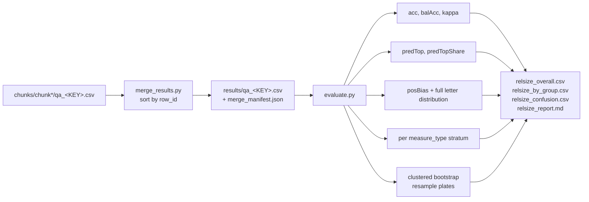

<h1 align="center">Bio-VQA &rarr; Spatial Visual Reasoning &rarr; Relative Size &rarr; Evaluation</h1>
<p align="center">
  <b>Merging, the Constant-Predictor Control Set, and Position-Bias Diagnostics</b>
</p>
<p align="center">
  
  
  
  
  
  
</p>

> The authoritative scoring stage for the Relative Size task. This document defines the
> merge contract, every metric and its equation, the three statistics that a constant
> predictor cannot pass, the position-bias index, the plate-clustered bootstrap, and the
> findings the control set exposes.

---

## Table of contents

1. [Overview](#1-overview)
2. [Motivation](#2-motivation)
   - 2.1 [A uniform key changes what must be controlled](#21-a-uniform-key-changes-what-must-be-controlled)
   - 2.2 [Accuracy and bias are different quantities](#22-accuracy-and-bias-are-different-quantities)
3. [Merging and input contract](#3-merging-and-input-contract)
4. [The scoring calculus](#4-the-scoring-calculus)
   - 4.1 [Accuracy and balanced accuracy](#41-accuracy-and-balanced-accuracy)
   - 4.2 [Chance-corrected agreement](#42-chance-corrected-agreement)
   - 4.3 [The position-bias index](#43-the-position-bias-index)
   - 4.4 [A worked example](#44-a-worked-example)
   - 4.5 [What each score implies](#45-what-each-score-implies)
5. [Coverage of the control set](#5-coverage-of-the-control-set)
6. [Stratification by measurement type](#6-stratification-by-measurement-type)
7. [Uncertainty: the clustered bootstrap](#7-uncertainty-the-clustered-bootstrap)
8. [Results](#8-results)
   - 8.1 [Order of inspection](#81-order-of-inspection)
   - 8.2 [A narrow band above chance](#82-a-narrow-band-above-chance)
   - 8.3 [The last-option deficit](#83-the-last-option-deficit)
   - 8.4 [The margin check](#84-the-margin-check)
   - 8.5 [Bias predicts accuracy](#85-bias-predicts-accuracy)
9. [Reproduction](#9-reproduction)
10. [Outputs](#10-outputs)
11. [References](#11-references)

---

## 1. Overview

This stage merges the sharded predictions into one file per model and scores them. The
scoring problem here differs from every other task in Component C3 in one respect that
determines the whole design: **the answer key is near-uniform by construction**, so there is
no gold skew to correct for, plain accuracy is meaningful, and chance is exactly 0.250.

What remains to be controlled is the *model's* answer distribution rather than the key's. A
four-way forced choice invites a model to answer the same letter every time, which scores
whatever share that letter holds. We therefore report three statistics that a constant
predictor cannot pass, plus the full predicted-letter distribution, and treat the model's own
answer mix as a first-class diagnostic rather than a footnote
([Section 5](#5-coverage-of-the-control-set)).

---

## 2. Motivation

### 2.1 A uniform key changes what must be controlled

In [Counting](../../Counting/3.Evaluate/README.md#5-baselines) and
[Absolute Distance](../../Distance_Absolute/3.Evaluate/README.md#5-the-shortcut-controls) the
gold distribution is skewed, so a constant predictor scores well and the floor must be fitted
from the data. Here the generator's quartet sampling assigns the winner's option letter
independently of anything visual, so the realised key is

$$
\Pr[y = A] = 0.257, \quad \Pr[y = B] = 0.249, \quad \Pr[y = C] = 0.246, \quad \Pr[y = D] = 0.248 ,
$$

near-uniform to within one point. Chance is $1/4$ and no fitted floor is required.

The failure mode that remains is a model that always answers one letter. Its accuracy is that
letter's gold share — about 0.25 — which is indistinguishable from chance on accuracy alone,
but its *behaviour* is entirely different from a model guessing uniformly, and the distinction
matters for what the result means. Three statistics separate them
([Section 5](#5-coverage-of-the-control-set)), and two models in our set are caught by all
three ([Section 8.2](#82-a-narrow-band-above-chance)).

### 2.2 Accuracy and bias are different quantities

A model can post respectable accuracy while distributing its answers very unlike the key, and
the two facts mean different things. We therefore report an explicit bias index beside
accuracy rather than folding one into the other
([Section 4.3](#43-the-position-bias-index)).

The design earns its place empirically: two models in our set attain **identical balanced
accuracy of 0.443** while differing twofold in position bias, 0.133 against 0.258
([Section 8.5](#85-bias-predicts-accuracy)). No single number expresses that difference.

---

## 3. Merging and input contract

`merge_results.py` reassembles the six shards into one CSV per model.

```bash
python merge_results.py --run_dir ../2.Experiment_Runs --out_dir results
python merge_results.py --model gemma3_12B        # one model only
```

It reads `<run_dir>/chunks/chunk*/qa_<MODEL_KEY>.csv` and writes
`<out_dir>/qa_<MODEL_KEY>.csv` sorted by `row_id` — restoring the pre-shuffle order
([Section 4.5 of the inference document](../2.Experiment_Runs/README.md#45-shuffle-before-shard))
so that merged files from different models align row for row — together with
`merge_manifest.json` recording what was merged and whether anything is missing.

**Merging performs no scoring.** Every number in the paper comes from `evaluate.py` alone,
and the manifest is the gate that prevents a partially finished sweep from being reported: a
model whose row count does not match the split must not appear in a leaderboard.

`evaluate.py` then reads:

```
--results_dir/
    qa_<MODEL_KEY>.csv     one per model
```

Three columns are load-bearing: `answer_letter` (gold), `measure_type` (the margin
stratification), and `plate_id` (the bootstrap clustering key). The prediction column is
located as `<MODEL_KEY>_answer`, derived from the filename.



---

## 4. The scoring calculus

Let $y_i, \hat{y}_i \in \{A, B, C, D\}$ be the gold and predicted option letters over $n$
scored items, and $\mathcal{L} = \{A,B,C,D\}$.

### 4.1 Accuracy and balanced accuracy

$$
\mathrm{acc} = \frac{1}{n}\sum_i \mathbb{1}\!\left[\hat{y}_i = y_i\right],
\qquad
\boxed{\;\mathrm{balAcc} = \frac{1}{|\mathcal{L}'|}\sum_{\ell \in \mathcal{L}'} \frac{\bigl|\{i : y_i = \ell \wedge \hat{y}_i = \ell\}\bigr|}{\bigl|\{i : y_i = \ell\}\bigr|}\;}
$$

where $\mathcal{L}'$ are the letters actually present in the gold. Balanced accuracy averages
**recall over the four gold letters**, and its decisive property is:

> A predictor that always answers letter $\ell^\star$ recalls $\ell^\star$ perfectly and the
> other three not at all, scoring exactly $1/4$ — **whatever the gold distribution happens to
> be.**

Plain accuracy lacks this: a constant predictor scores $\Pr[y = \ell^\star]$, which drifts
with the key. Because our key is near-uniform the two coincide closely in practice — the
largest `acc` − `balAcc` gap across eighteen models is 0.008 — but we report `balAcc` as the
headline because its floor is a fixed constant rather than a property of the sample.

### 4.2 Chance-corrected agreement

$$
\kappa = \frac{p_o - p_e}{1 - p_e},
\qquad
p_o = \frac{1}{n}\sum_i \mathbb{1}\!\left[\hat{y}_i = y_i\right],
\qquad
p_e = \sum_{\ell \in \mathcal{L}} \Pr[y = \ell]\,\Pr[\hat{y} = \ell] .
$$

Cohen's kappa corrects for **both** marginal distributions, so it is zero for a constant
predictor and zero for any model whose answers are independent of the gold. Where balanced
accuracy fixes the floor by construction, kappa removes the agreement attributable to the two
answer distributions happening to overlap — a distinct correction, which is why both are
reported.

### 4.3 The position-bias index

$$
\boxed{\;\mathrm{posBias} = \tfrac{1}{2} \sum_{\ell \in \mathcal{L}} \bigl| \Pr[\hat{y} = \ell] - \Pr[y = \ell] \bigr|\;}
$$

the total variation distance between the predicted and gold letter distributions.

**Range.** $\mathrm{posBias} \in [0, 1 - \min_\ell \Pr[y=\ell]]$. Against our near-uniform
key the maximum is $1 - 0.25 = 0.75$, attained by always answering one letter. Zero means the
answer mix matches the key's exactly.

**Why total variation.** It is the natural distance for two distributions over a small
discrete alphabet, it is bounded and interpretable as a probability gap, and — unlike a
$\chi^2$ statistic — it does not grow with sample size, so it is comparable across models
whose scored subsets differ in size. That last property matters concretely:
Llama-3.2-11B-Vision is scored on 2,553 items against the others' 3,976, and its posBias of
0.463 is directly comparable to theirs.

We additionally write the **full predicted distribution** to `relsize_confusion.csv`, because
the scalar records the magnitude of the bias but not its direction, and the direction is
where the finding is ([Section 8.3](#83-the-last-option-deficit)).

### 4.4 A worked example

Four strategies against a uniform key, on a hypothetical 1,000 items.

| Strategy | acc | balAcc | kappa | posBias | predTopShare |
|---|---:|---:|---:|---:|---:|
| Perfect | 1.000 | 1.000 | 1.000 | 0.000 | ≈0.25 |
| Uniform random guessing | 0.250 | 0.250 | 0.000 | ≈0.00 | ≈0.25 |
| Always answer A | 0.257 | **0.250** | **0.000** | **0.743** | **1.000** |
| Correct 40% of the time, never answers D | 0.400 | 0.400 | 0.200 | ≈0.25 | ≈0.35 |

Rows two and three are the pair the control set exists to separate. Both score at chance on
accuracy and balanced accuracy and zero on kappa; **only `posBias` and `predTopShare`
distinguish them.** Uniform guessing and constant answering are equally uninformative about
the image but are entirely different behaviours, and a benchmark that cannot tell them apart
cannot report what a model is doing.

Row four is the case that motivates reporting bias beside accuracy rather than instead of it:
a model can be meaningfully above chance and still systematically avoid an option — which is
what most of our models do ([Section 8.3](#83-the-last-option-deficit)).

### 4.5 What each score implies

| Score | Question it answers | Constant-predictor value | Role |
|---|---|---:|---|
| `balAcc` | How often is it right, floor-normalised? | 0.250 | **headline** |
| `acc` | How often is it right? | gold share of that letter | reported for comparability |
| `kappa` | Agreement beyond both marginals? | 0.000 | chance correction |
| `posBias` | How far is the answer mix from the key's? | 0.750 | **bias magnitude** |
| `predTop` / `predTopShare` | What does it answer most, how often? | that letter / 1.000 | **read first** |
| per-letter shares | Which options are avoided? | — | bias direction |
| `plates` | Effective sample size | — | interval width |
| `parse_rate` | Did it follow the format? | — | separates format from task failure |

---

## 5. Coverage of the control set

| Strategy | acc ≈ chance? | balAcc = 0.250? | kappa = 0? | posBias high? | predTopShare ≈ 1? |
|---|:---:|:---:|:---:|:---:|:---:|
| Uniform guessing | yes | yes | yes | **no** | **no** |
| Constant single letter | yes | yes | yes | **yes** | **yes** |
| Biased but informative | no | no | no | **yes** | maybe |
| Unbiased and informative | no | no | no | **no** | no |

The four rows are mutually distinguishable, which is the property the control set is designed
for. Each column alone is ambiguous; together they identify the strategy.

---

## 6. Stratification by measurement type

Every statistic is additionally computed within `measure_type`. This is not a routine
breakdown but the component's **internal validity check**.

The generator accepts a quartet only when the winner exceeds the runner-up by 5% on length
but **10% on width**
([Section 4.2 of the generation document](../1.Generate_QA/README.md#42-the-separation-margin-filter)).
Width items therefore carry twice the separation and are strictly easier to resolve. Under
any account in which the model compares the four line lengths and reports the maximum,

$$
\mathbb{E}\!\left[\mathrm{balAcc} \mid \text{width}\right] \;>\; \mathbb{E}\!\left[\mathrm{balAcc} \mid \text{length}\right] .
$$

The prediction is falsifiable, costs nothing, and follows from a generator parameter chosen
for an unrelated reason. It fails ([Section 8.4](#84-the-margin-check)).

The width stratum is the smaller of the two (539 items against 3,437), so an individual
model's gap carries wide uncertainty. The reliable read is the sign pattern across all
eighteen models, which is why the stratified table is reported in full rather than
summarised.

---

## 7. Uncertainty: the clustered bootstrap

Rows are strongly dependent. Up to twenty question sets are drawn from a single plate,
**reusing the same specimens in different combinations**, so two rows from one plate may
share three of their four candidates in addition to sharing the photograph, the
magnification, and the illumination.

We therefore resample **plates**:

$$
\text{for } b = 1 \dots B:\quad
\mathcal{P}^{(b)} \sim \mathrm{Unif}\bigl(\mathcal{P},\, |\mathcal{P}|\bigr) \text{ with replacement},\quad
\theta^{(b)} = f\!\left(\bigcup_{P \in \mathcal{P}^{(b)}} \text{rows}(P)\right),
$$

reporting the percentile interval $\bigl[Q_{2.5}(\theta),\, Q_{97.5}(\theta)\bigr]$. All rows
belonging to a resampled plate enter or leave together, preserving the dependence structure
exactly.

The resampling function receives the resampled **dataframe** rather than two arrays,
specifically so that stratified and distribution-valued statistics can be recomputed on each
replicate rather than only pooled scalars.

With 207 plates against 3,976 rows, the effective sample size is roughly a twentieth of the
nominal one. A row-level bootstrap would report intervals several times too narrow and would
make differences of one or two points between adjacent models look resolved when they are
not.

---

## 8. Results

### 8.1 Order of inspection

1. **`predTopShare`** — near 1.00 means a constant predictor; read nothing else in the row
   until this is checked.
2. **`parse_rate`** — below ~0.95 indicates a format-following failure rather than a
   comparison failure; a distinct diagnosis on a distinct row subset.
3. **`balAcc` against 0.250** — the actual margin over chance.
4. **`posBias`** and the per-letter shares — magnitude and direction of the answer-mix
   distortion.
5. **Per-measurement rows** — the margin check.

### 8.2 A narrow band above chance

$$
\text{chance} = 0.250, \qquad \text{best} = 0.443, \qquad \text{worst} = 0.250 .
$$

The measurable band is **0.193 wide** and three models sit within 0.01 of chance. Two —
LLaVA-NeXT-Vicuna-7B and LLaVA-NeXT-Mistral-7B — answer **A on all 3,976 items**, and the
control set identifies this from three independent directions simultaneously:

$$
\mathrm{balAcc} = 0.250 \text{ (exactly)}, \qquad
\kappa = 0.000 \text{ (exactly)}, \qquad
\mathrm{posBias} = 0.743 \text{ (of a maximum } 0.750).
$$

Their plain accuracy of 0.257 is exactly the gold share of A. Reported alone it would be
unremarkable — a weak model near chance. Reported with the control set it is a model that
never looked at the image.

### 8.3 The last-option deficit

Against a near-uniform key, the models' aggregate answer distribution is not:

$$
\overline{\Pr}[\hat{y} = A] = 0.441 \;(\text{gold } 0.257),
\qquad
\overline{\Pr}[\hat{y} = D] = 0.077 \;(\text{gold } 0.248).
$$

The last option is under-selected **3.2×** and the first over-selected **1.7×**; the median
per-model ratio $\Pr[\hat{y}=A]/\Pr[\hat{y}=D]$ is **15.4**.

| Predicted share of D | Models |
|---|---:|
| exactly 0.000 | 6 |
| below 0.05 | 12 / 18 |
| below 0.10 | 14 / 18 |
| at or above the gold 0.248 | 2 |

Six models never answer D on any item despite D being correct on roughly a quarter of them.
Nothing in the stimulus distinguishes D: the colour map is fixed, the winner's letter is
assigned by the quartet sample rather than by position, and the key is uniform. The effect
is a property of the **answer-slot ordering in the prompt**, and it is the reason the
predicted distribution is written out in full rather than summarised into `posBias` alone.

Molmo2-8B inverts the pattern rather than escaping it — 50.0% D against 3.5% A — which is the
same defect with the opposite sign and which `posBias` scores at 0.306.

### 8.4 The margin check

$$
\text{width} > \text{length for } \mathbf{5/18} \text{ models}; \qquad
\overline{\Delta}_{\text{width}-\text{length}} = -0.013 .
$$

Thirteen of eighteen models perform **better on the harder stratum**, and the inversion is
largest among the strongest models: InternVL3.5-38B −0.071, Qwen3-VL-32B −0.065, Molmo2-8B
−0.061.

Across eighteen independent architectures, a construction-guaranteed doubling of the
discriminative margin produces no aggregate improvement. If models were resolving the four
line lengths and returning the maximum, doubling the gap between first and second place could
not fail to help. This is the sharpest available evidence that most models are not performing
the comparison the task asks for, and it required no additional annotation
([Section 6](#6-stratification-by-measurement-type)).

### 8.5 Bias predicts accuracy

$$
\rho\!\left(\mathrm{posBias},\, \mathrm{balAcc}\right) = -0.768,
\qquad
\rho\!\left(\mathrm{predTopShare},\, \mathrm{balAcc}\right) = -0.702 .
$$

Models whose answer mix is closest to the key perform best, monotonically across nearly the
whole leaderboard.

The two-model tie at the top is the case that justifies reporting the two quantities
separately. Gemma-4-12B and Qwen3-VL-32B attain **identical balanced accuracy of 0.443**,
but Gemma-4-12B carries posBias 0.133 with a predicted distribution
(A 0.164, B 0.304, C 0.324, D 0.208) close to uniform, while Qwen3-VL-32B carries 0.258 and
answers C on 48.9% of items. Equal accuracy, materially different behaviour — a distinction
no single number expresses, and one that changes which of the two a reader should trust on a
new plate.

---

## 9. Reproduction

```bash
# Merge the six shards per model.
python merge_results.py --run_dir ../2.Experiment_Runs --out_dir results

# Score.
python evaluate.py --results_dir results --out_dir results --bootstrap 2000
```

Confirm `merge_manifest.json` shows every model complete before scoring
([Section 3](#3-merging-and-input-contract)).

---

## 10. Outputs

| File | Contents |
|---|---|
| `relsize_overall.csv` | One row per model: `n, acc, balAcc, kappa, posBias, majority, predTop, predTopShare, model, parse_rate, plates`, plus bootstrap bounds when requested. |
| `relsize_by_group.csv` | One row per model × measurement type — the stratum carrying the margin check. |
| `relsize_confusion.csv` | Gold and predicted share of each option letter, per model — the direction of the bias. |
| `relsize_report.md` | Leaderboard, per-measurement table, answer-distribution table, and interpretation. |
| `merge_manifest.json` | What was merged and whether any model is incomplete. |

Every row carries its own `majority` and `plates` alongside its scores, so a single extracted
row remains interpretable without reference to a floor computed elsewhere.

---

## 11. References

Chance-corrected agreement follows Cohen [1]. Balanced accuracy as a class-imbalance-robust
estimator follows Brodersen et al. [2]. Clustered resampling for dependent observations
follows standard bootstrap practice [3, 4].

[1] J. Cohen. **A Coefficient of Agreement for Nominal Scales.** *Educational and
Psychological Measurement*, 20(1):37–46, 1960.

[2] K. H. Brodersen, C. S. Ong, K. E. Stephan, and J. M. Buhmann. **The Balanced Accuracy and
Its Posterior Distribution.** *Proceedings of the 20th International Conference on Pattern
Recognition (ICPR)*, pp. 3121–3124, 2010.

[3] B. Efron and R. J. Tibshirani. **An Introduction to the Bootstrap.** Chapman & Hall, 1993.

[4] A. C. Cameron and D. L. Miller. **A Practitioner's Guide to Cluster-Robust Inference.**
*Journal of Human Resources*, 50(2):317–372, 2015.