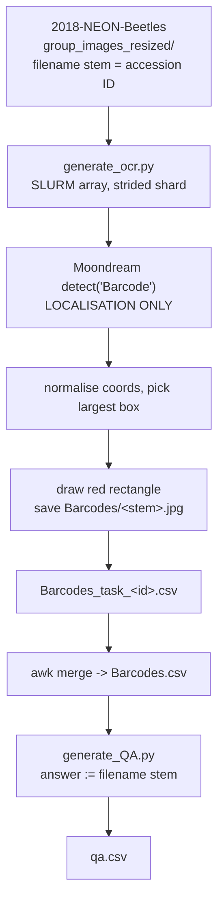

<h1 align="center">Bio-VQA &rarr; Spatial Visual Reasoning &rarr; OCR &rarr; QA Generation</h1>
<p align="center">
  <b>Barcode Localisation and Accession-Code Manifest Construction</b>
</p>
<p align="center">
  
  
  
  
  
  
</p>

> Construction of the OCR evaluation set. This document describes the two-script split and why
> localisation is separated from manifest construction, the detection and box-selection
> procedure, the guarantee that no model output enters the ground truth, the resumability and
> sharding machinery required for an API-bound stage, and the output contract.

---

## Table of contents

1. [Overview](#1-overview)
2. [Design contract](#2-design-contract)
3. [System architecture](#3-system-architecture)
4. [Barcode localisation](#4-barcode-localisation)
   - 4.1 [Detection and coordinate normalisation](#41-detection-and-coordinate-normalisation)
   - 4.2 [Largest-box selection](#42-largest-box-selection)
   - 4.3 [Box padding and what the box encloses](#43-box-padding-and-what-the-box-encloses)
   - 4.4 [Rendering](#44-rendering)
5. [Ground truth](#5-ground-truth)
   - 5.1 [The accession ID is the filename stem](#51-the-accession-id-is-the-filename-stem)
   - 5.2 [The leakage hazard this creates](#52-the-leakage-hazard-this-creates)
6. [Operating an API-bound stage](#6-operating-an-api-bound-stage)
   - 6.1 [Strided sharding](#61-strided-sharding)
   - 6.2 [Retry with exponential backoff](#62-retry-with-exponential-backoff)
   - 6.3 [Resumability and incremental flush](#63-resumability-and-incremental-flush)
   - 6.4 [Skip accounting](#64-skip-accounting)
7. [Manifest construction](#7-manifest-construction)
8. [Output schema](#8-output-schema)
9. [Reproduction](#9-reproduction)
10. [Operational behaviour](#10-operational-behaviour)

---

## 1. Overview

This stage converts NEON beetle tray photographs into a transcription benchmark. It runs in
two scripts with different characters:

| Script | Role | Nature |
|---|---|---|
| `generate_ocr.py` | Detect the barcode, draw a red box, record the detection | Network-bound, rate-limited, resumable, sharded |
| `generate_QA.py` | Build `qa.csv` from the detection table | Pure local transformation, deterministic, cheap |

The split is deliberate. Localisation calls an external API and can fail on any individual
image for transient reasons; manifest construction cannot fail except on malformed input.
Keeping them separate means **a rate-limit failure never corrupts the QA manifest**, and the
manifest can be rebuilt from the cached detection table without re-detecting a single image.



---

## 2. Design contract

| Contract | Rationale |
|---|---|
| **The detector never produces the answer.** Moondream is asked to detect, never to read. | Ground truth must be independent of every model in the pipeline. See [Section 5](#5-ground-truth). |
| **Ground truth is the NEON accession ID**, a curatorial record, not a transcription. | Exact by construction, auditable against the collection, and free of annotation error. |
| **Output filenames are `<stem>.jpg` and must stay so.** | `qa.csv` is frozen and models have already been run against it; renaming would silently break the join. |
| **The source photograph is never resized, cropped, or re-encoded beyond one JPEG write at quality 95.** | Small printed characters are the entire task; recompression is the one operation guaranteed to destroy it. |
| **Every failure mode is counted, not silently dropped.** | The realised item count must be explicable, and an API outage must be distinguishable from a corpus property. |

---

## 3. System architecture

The stage is designed around one operational fact: **the detection step is the expensive,
failure-prone part of the whole benchmark's construction.** It makes one external API call
per image, is subject to rate limits and network faults, and may be killed by a wall-time
limit part-way through. Every structural decision in `generate_ocr.py` — sharding, retry,
resume, incremental flush, per-task CSVs — follows from that
([Section 6](#6-operating-an-api-bound-stage)).

`generate_QA.py`, by contrast, is a twenty-line transformation over a table. It reads the
merged detection CSV, takes the filename stem as the answer, and writes the QA manifest.

---

## 4. Barcode localisation

### 4.1 Detection and coordinate normalisation

Each image is submitted to the detector with the prompt `"Barcode"`, returning zero or more
objects with corner coordinates.

The API may return coordinates **either normalised to $[0,1]$ or in absolute pixels**, and
the script handles both without being told which:

```python
if max(vals) <= 1.0:
    x0, y0, x1, y1 = vals[0]*w, vals[1]*h, vals[2]*w, vals[3]*h
else:
    x0, y0, x1, y1 = vals
```

The heuristic is safe on this corpus because tray photographs are far larger than a single
pixel in both dimensions, so a genuinely absolute box can never have all four coordinates at
or below 1.0. Handling both conventions rather than assuming one is what makes the stage
robust to an API-side representation change.

After scaling, coordinates are sorted, rounded, and clamped to the image bounds, and a box
that degenerates to zero width or height is rejected:

$$
0 \le x_0 < x_1 \le w-1, \qquad 0 \le y_0 < y_1 \le h-1 .
$$

Rejected boxes are counted under `bad_box` rather than drawn.

### 4.2 Largest-box selection

A tray photograph may contain several barcode-like regions — the specimen barcode, a
collection label, a scale marker — so the detector can return multiple objects. We keep the
one with the greatest area:

$$
\text{box} = \mathrm{arg\,max}_{b \in \text{objects}} \; (x_1^b - x_0^b)(y_1^b - y_0^b) .
$$

Area is the right selection statistic here because the specimen barcode is the dominant
printed element on a NEON tray label, while spurious detections are typically small text
fragments. Taking the first returned object would depend on an undocumented ordering; taking
the highest-confidence one would depend on a score field the API does not guarantee. Area is
computable from what is always present.

An image with objects returned but no valid box after normalisation is counted under
`bad_box`; an image with no objects at all under `no_detection`. The two are distinguished
because they indicate different problems — a coordinate-format change versus a genuine
detection failure.

### 4.3 Box padding and what the box encloses

`--box_pad_frac` grows the box by a fraction of its own dimensions:

$$
(x_0 - f\,\Delta x,\; y_0 - f\,\Delta y) \;\to\; (x_1 + f\,\Delta x,\; y_1 + f\,\Delta y),
$$

clamped to the image bounds. **It is zero for the released set**, and the consequence is
stated explicitly in the code: the detector boxes *the bars*, and the accession code is
printed *beneath* them, so the released box points at the region without enclosing the
answer text.

This is the intended degree of assistance. The box removes the region-selection problem — a
tray photograph contains dozens of specimens and several text regions, and deciding which
text to read is a different task from reading it — while leaving the transcription itself
unassisted. Enclosing the characters would additionally tell the model exactly which glyphs
constitute the answer.

Raising the parameter changes the images, so inference must be re-run; the argument's help
text says so. Because the detection results are cached in `Barcodes.csv`, a re-render at a
different padding requires **no further API calls**, which makes a padding ablation cheap —
it is the extension proposed in
[Section 7 of the task document](../README.md#7-scope-of-the-released-evaluation).

### 4.4 Rendering

The box is drawn as a solid red rectangle whose line width scales with the image:

```python
width = thickness if thickness > 0 else max(3, round(min(w, h) * 0.006))
```

Scaling the stroke rather than fixing it in pixels keeps the outline equally visible across a
corpus of varying photograph sizes — a 3 px line is a hairline on a large tray scan and
obtrusive on a small one. The floor of 3 px guarantees visibility at any size.

Red is chosen for maximum separation from the browns, greys, and blacks of a specimen tray
and from the black-on-white barcode itself.

The image is saved once at **JPEG quality 95**. This is the only re-encode in the pipeline,
and the quality is set high deliberately: the task is resolving small printed glyphs, and
compression artefacts at a lower quality would be indistinguishable from a model's reading
error.

---

## 5. Ground truth

### 5.1 The accession ID is the filename stem

This is the property that makes the task's ground truth exact, and it is worth stating
precisely because an external vision model appears earlier in the pipeline.

**The gold answer is the NEON specimen accession ID**, which the source corpus stores as the
photograph's filename stem. It is a curatorial record assigned by the collection when the
specimen was catalogued — not a transcription, not a detection output, and not a label
produced by any model.

**Moondream never reads anything.** It is asked to detect a barcode; its output is four
coordinates; those coordinates are drawn onto the image and recorded in `barcode_bbox`. The
answer column is set from the filename:

```python
stem = os.path.splitext(name)[0]
writer.writerow({"image": rel_path, "barcode": stem, ...})
```

A detector failure therefore costs an *item* — the image is skipped and contributes nothing —
but can never produce a *wrong answer*. The two failure modes are structurally separated:
localisation errors reduce the sample, and cannot corrupt it.

This also means the benchmark carries no annotation error of its own. Unlike a
human-transcribed OCR set, where the gold string is itself a reading, every gold code here is
the collection's own identifier and is auditable against the NEON catalogue.

### 5.2 The leakage hazard this creates

The convenience has a hazard, and the code records it as a warning to future work:

> *The answer happens to equal the image filename stem. That is convenient for verification
> but means any future pipeline must never place the filename in the prompt.*

Passing the basename to a model — in a prompt, in a system message, or in any tool-visible
context — would leak the answer completely and produce an apparently perfect result. The
released runners pass only the resolved absolute path to the image loader and the question
text to the model; the basename never enters the prompt
([Section 6.2 of the inference document](../2.Experiment_Runs/README.md#62-prompt-construction)).

Anyone extending this task — adding a retrieval step, a caption, or an agentic loop with
filesystem access — must preserve that separation.

---

## 6. Operating an API-bound stage

Four mechanisms, each addressing a distinct failure mode of a long-running network-bound job.

### 6.1 Strided sharding

Work is divided across SLURM array tasks by stride rather than contiguous block:

```python
shard = all_names[task_id::num_tasks]
```

over a **sorted** filename list. Because tray photographs vary substantially in file size,
and file size correlates with the API's per-image cost, a contiguous split would hand one
task a disproportionate share of the large images and leave others idle. Striding over a
sorted list gives every task a comparable mix — the code says so directly.

Sorting first also makes the shard assignment deterministic: the same image always lands in
the same task, which is what makes resume meaningful across re-submissions.

### 6.2 Retry with exponential backoff

Every detection call is wrapped:

$$
\text{delay}_k = \texttt{backoff} \times 2^{k}, \qquad k = 0, 1, \dots, \texttt{retries}-1 ,
$$

with defaults `retries = 3` and `backoff = 2.0`, giving waits of 2 s, 4 s, and 8 s before the
final failure. Exponential rather than fixed backoff is the correct response to rate limiting
specifically: a fixed retry interval synchronises across parallel array tasks and re-triggers
the limit, while doubling spreads them apart.

A call that exhausts its retries raises, is caught, counted under `api_error`, and printed
with its exception type — so a systematic outage is visible in the log as a run of identical
messages rather than a silently short output file.

A `--sleep` argument adds a fixed inter-call delay for operating under a known request-rate
ceiling.

### 6.3 Resumability and incremental flush

Two mechanisms guard against a wall-time kill.

**Incremental flush.** The CSV writer flushes after **every row**:

```python
f.flush()  # survive an 8h wall-time kill
```

Without this, a job killed at the wall-time limit would lose everything still in the buffer —
potentially thousands of API calls already paid for.

**Resume.** With `--resume`, the task reads back its own CSV, collects the image paths already
recorded, and skips them:

```python
done = already_done(csv_path)          # set of image paths in this task's CSV
...
if rel_path in done:
    skipped["resumed"] += 1
    continue
```

The file is then opened in append mode with the header suppressed. Combined with deterministic
sharding ([Section 6.1](#61-strided-sharding)), re-submitting the array resumes exactly where
it stopped, and the skip counter reports how many images were already done.

**Per-task CSVs.** Each array task writes `Barcodes_task_<id>.csv` rather than appending to a
shared file, so parallel tasks never contend for a single handle and a corrupted task output
can be regenerated in isolation. The per-task files are merged into `Barcodes.csv` afterwards.

### 6.4 Skip accounting

Every image that produces no item is counted in one of five named buckets, reported at the
end of each task:

| Bucket | Cause |
|---|---|
| `no_detection` | The detector returned no objects |
| `bad_box` | Objects returned, but none yielded a valid box after normalisation |
| `unreadable` | The source photograph failed to decode |
| `api_error` | Retries exhausted |
| `resumed` | Already present in this task's CSV |

The distinction matters because the buckets have different meanings for the released set.
`no_detection` and `bad_box` are corpus properties and reduce the sample legitimately;
`api_error` is an infrastructure failure and means the run should be resumed rather than
reported. Collapsing them into one "skipped" count would make the two indistinguishable.

---

## 7. Manifest construction

`generate_QA.py` reads the merged `Barcodes.csv` and emits `qa.csv`. It is deterministic,
performs no I/O beyond two CSVs, and has no failure mode other than a malformed input table.

For each detection row it composes:

- **question** — one fixed string for the whole corpus:

  > *What is the text under the barcode (starting with A0...) shown in this image?*

- **answer** — the `barcode` column, which is the filename stem
  ([Section 5.1](#51-the-accession-id-is-the-filename-stem))

- **image_path** — reconstructed as
  `<barcode_dir_basename>/Barcodes/<basename>`, relative to the **tasks root** rather than to
  the task directory. This is a deliberate difference from the other tasks in Component C3 and
  is handled explicitly by the preprocessing resolver
  ([Section 4.4 of the inference document](../2.Experiment_Runs/README.md#44-path-resolution)).

The script accepts either `image_path` or `image` as the source column, so a detection table
written under either convention loads without modification.

The `A0...` hint in the question is a property of the accession scheme, not a giveaway: it
identifies which text on the label is wanted, and the informative characters are the trailing
digits. The inference prompt restates the format precisely once and does not repeat the hint
([Section 6.2 of the inference document](../2.Experiment_Runs/README.md#62-prompt-construction)).

---

## 8. Output schema

### `Barcodes.csv` — the detection table

| Column | Content |
|---|---|
| `image` | Source path relative to the dataset root, e.g. `group_images_resized/A00000032929.jpg` |
| `barcode` | The accession code — the filename stem, and the gold answer |
| `barcode_bbox` | The retained box as `[{"x_min":…, "y_min":…, "x_max":…, "y_max":…}]` in pixels |
| `request_id` | The detection API's request identifier, for auditing a specific call |

`request_id` is retained deliberately: it is the only handle by which an individual detection
could later be traced or disputed, and it costs one column.

### `qa.csv` — the QA manifest

| Column | Content |
|---|---|
| `image_path` | `<task dir>/Barcodes/<stem>.jpg`, relative to the **tasks root** |
| `qa` | A **Python dict repr** — `{'Q': ..., 'A': 'A00000032929'}` |

Note the `qa` column is written with `str(dict)` and therefore uses **single quotes**, which
`json.loads` rejects. The preprocessing stage tries `ast.literal_eval` first for exactly this
reason ([Section 4.2 of the inference document](../2.Experiment_Runs/README.md#42-parsing-the-qa-column)).

**Example row.**

```csv
image_path,qa
Optical Character Recognition - OCR/Barcodes/A00000032929.jpg,"{'Q': 'What is the text under the barcode (starting with A0...) shown in this image?', 'A': 'A00000032929'}"
```

---

## 9. Reproduction

```bash
export MOONDREAM_API_KEY=...

# Localisation — one SLURM array task per shard, resumable.
python generate_ocr.py \
    --base_dir   $BIOVQA_DATA/eda/2018-NEON-Beetles \
    --output_dir "$BIOVQA_DATA/tasks/Optical Character Recognition - OCR" \
    --task_id $SLURM_ARRAY_TASK_ID --num_tasks 6 \
    --resume

# Merge the per-task CSVs into Barcodes.csv, then build the manifest.
python generate_QA.py \
    --base_dir $BIOVQA_DATA/tasks \
    --barcode_dir_basename "Optical Character Recognition - OCR"
```

Quote the output path — the task directory name contains spaces and a dash. `MOONDREAM_API_KEY`
is read from the environment and the script exits immediately if it is unset; **the key must
never be written into a script or committed.**

Realised scale and code structure are tabulated in
[Section 4.3 of the task document](../README.md#43-scale-and-code-structure).

**Next stage:** [`../2.Experiment_Runs/README.md`](../2.Experiment_Runs/README.md) — parsing,
sharding, and inference.

---

## 10. Operational behaviour

**A missing API key aborts before any work.** The check runs before the image directory is
listed, so a misconfigured environment fails in under a second rather than after a shard of
failed calls.

**Undecodable photographs are counted, not fatal.** A decode failure increments `unreadable`
and the loop continues.

**Detection failures reduce the sample and cannot corrupt it.** An image with no usable box
contributes no row and no image, so the released set is smaller than the corpus but every
item in it has both a rendered image and an exact accession code
([Section 5.1](#51-the-accession-id-is-the-filename-stem)).

**`--limit` truncates the shard for a smoke test**, applied after striding so the smoke test
still samples across the corpus rather than its first *N* files.

**Filenames are frozen.** Output images are written as `<stem>.jpg` and `qa.csv` joins on
that basename. Because inference has already been run against the released manifest, any
change to the naming convention would silently break the join between predictions and ground
truth rather than raising an error.