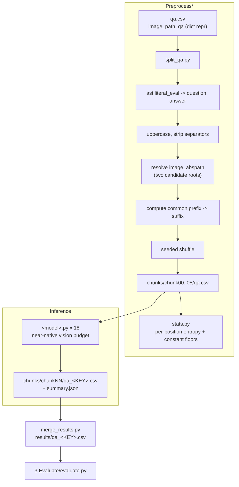

<h1 align="center">Bio-VQA &rarr; Spatial Visual Reasoning &rarr; OCR &rarr; Preprocessing &amp; Inference</h1>
<p align="center">
  <b>Code Normalisation, Prefix Analysis, and Near-Native-Resolution Inference</b>
</p>
<p align="center">
  
  
  
  
  
  
  
</p>

> Parsing of the OCR manifest, computation of the constant prefix that governs the entire
> scoring design, and inference across eighteen models under an invariant harness. This
> document specifies the dict-repr parsing, the two-root path resolution, the code
> normalisation policy, the resolution decision, and the transcription resolver's deliberate
> refusal to repair.

---

## Table of contents

1. [Overview](#1-overview)
2. [Motivation](#2-motivation)
   - 2.1 [Resolution is the task](#21-resolution-is-the-task)
   - 2.2 [The invariant harness](#22-the-invariant-harness)
3. [System architecture](#3-system-architecture)
4. [Manifest preparation](#4-manifest-preparation)
   - 4.1 [Input schema and its three differences](#41-input-schema-and-its-three-differences)
   - 4.2 [Parsing the qa column](#42-parsing-the-qa-column)
   - 4.3 [Code normalisation](#43-code-normalisation)
   - 4.4 [Path resolution](#44-path-resolution)
   - 4.5 [The common prefix](#45-the-common-prefix)
   - 4.6 [Shuffle before shard](#46-shuffle-before-shard)
   - 4.7 [Emitted schema and guards](#47-emitted-schema-and-guards)
5. [Pre-run audit](#5-pre-run-audit)
6. [The inference harness](#6-the-inference-harness)
   - 6.1 [Invariant and variant decomposition](#61-invariant-and-variant-decomposition)
   - 6.2 [Prompt construction](#62-prompt-construction)
   - 6.3 [Decoding configuration](#63-decoding-configuration)
   - 6.4 [Vision-token budget](#64-vision-token-budget)
   - 6.5 [Model registry](#65-model-registry)
   - 6.6 [Transcription resolution](#66-transcription-resolution)
   - 6.7 [Correctness guards](#67-correctness-guards)
7. [Outputs](#7-outputs)
8. [Reproduction](#8-reproduction)
9. [Operational checklist](#9-operational-checklist)

---

## 1. Overview

This stage parses the QA manifest produced by
[QA generation](../1.Generate_QA/README.md), shards it, and runs eighteen models against it.

Two decisions dominate. **The vision budget is raised to approximately native resolution**,
because downsampling a label crop is the one operation guaranteed to convert a reading task
into a guessing task ([Section 6.4](#64-vision-token-budget)). And **the common prefix is
computed here and carried into every shard**, because it is the quantity that makes character
accuracy misleading and it must be available to the evaluation without recomputation
([Section 4.5](#45-the-common-prefix)).

The stage also handles three input-format differences unique to this task among the five in
Component C3 ([Section 4.1](#41-input-schema-and-its-three-differences)) — a dict-repr cell
rather than JSON, a path relative to the tasks root rather than the task directory, and a
task directory name containing both spaces and a dash.

---

## 2. Motivation

### 2.1 Resolution is the task

Every other task in Component C3 combines acuity with a second operation. This one does not:
the characters are printed in the image at a marked location, and the question is whether the
model can resolve them.

That makes the vision budget not a throughput parameter but the determinant of whether the
task is answerable. A NEON tray photograph is a large scan on which the accession code
occupies a small fraction of the frame; at a reduced budget the glyphs fall below the
resolution at which they can be distinguished, and every model would be measured on its
ability to guess a plausible code. We therefore raise the budget to approximately native
resolution, identically for all eighteen models
([Section 6.4](#64-vision-token-budget)), matching
[Absolute Distance](../../Distance_Absolute/2.Experiment_Runs/README.md#64-vision-token-budget)
and [Relative Size](../../Distance_Relative/2.Experiment_Runs/README.md#64-vision-token-budget)
so the three fine-detail tasks remain directly comparable.

The decision is what licenses the interpretation of the results. When seven of eighteen models
score below a no-look constant predictor
([Section 6.2 of the task document](../README.md#62-seven-models-fall-below-the-constant-predictor)),
that is a reading failure and not a downsampling artefact we imposed.

### 2.2 The invariant harness

Eighteen runners share one harness; only checkpoint loading and the forward pass differ. This
is what licenses the cross-model claims in
[Section 6 of the task document](../README.md#6-results) — in particular the family
separation, where the worst Qwen model outperforms the best InternVL model. That is evidence
about models only if all eighteen received the same prompt, the same format statement, the
same vision budget within family, and the same answer-parsing rule.

---

## 3. System architecture



---

## 4. Manifest preparation

### 4.1 Input schema and its three differences

`qa.csv` carries two columns, `image_path` and `qa`. Three properties differ from every other
task in Component C3, and each requires explicit handling.

| Difference | Consequence |
|---|---|
| `qa` is a **Python dict repr** with single quotes — `{'Q': …, 'A': …}` — not JSON | `json.loads` rejects it outright; `ast.literal_eval` is tried **first** |
| `image_path` already carries the task directory as a prefix, so it is relative to the **tasks root**, not to `--task_root` | The resolver must try both roots ([Section 4.4](#44-path-resolution)) |
| The task directory name contains spaces **and** a dash | Every invocation must quote it |

The parser tries `ast.literal_eval` and falls back to `json.loads`, which is the reverse of
the order used in the other tasks — the fallback ordering follows the format actually written
rather than a convention.

### 4.2 Parsing the qa column

```python
def parse_qa(cell):
    try:
        d = ast.literal_eval(str(cell))
    except Exception:
        try:
            d = json.loads(str(cell))
        except Exception:
            return None, None
    return (d.get("Q"), d.get("A")) if isinstance(d, dict) else (None, None)
```

Rows failing both parsers are counted, reported, and dropped rather than silently coerced —
an unparseable cell indicates an upstream template change that must be reconciled
deliberately.

### 4.3 Code normalisation

Gold codes are uppercased and stripped of separators:

```python
df["answer"] = (df["answer"].astype(str).str.upper()
                .str.replace(r"[\s\-_.]", "", regex=True))
```

This is applied to the **gold** side and mirrored exactly on the prediction side by the
runner's resolver ([Section 6.6](#66-transcription-resolution)), so the two are compared on
the same footing. Normalising only one side would manufacture errors.

The policy is deliberately narrow: **case and separators only**. Neither is a reading error —
a model that answers `a 0000 0032 929` has read every glyph correctly and formatted the
output differently. Anything beyond that would begin repairing content
([Section 6.6](#66-transcription-resolution)).

`code_len` is recorded per row so the length distribution is inspectable; the audit prints it
([Section 5](#5-pre-run-audit)).

### 4.4 Path resolution

`image_path` is relative to the tasks root, so the resolver derives that root from
`--task_root` and tries candidates in order:

$$
\texttt{tasks\_root}/p \;\to\; \texttt{task\_root}/\texttt{Barcodes}/\mathrm{base}(p) \;\to\; \texttt{task\_root}/p \;\to\; \texttt{task\_root}/\mathrm{base}(p)
$$

falling back to the second candidate when none resolves, so the reported missing path is the
most likely intended one rather than an arbitrary candidate. When files are missing, the
script prints both the first missing path **and the tasks root it derived**, because the most
common cause is a `--task_root` that points one level too deep or too shallow — and printing
the derived root turns a confusing "file not found" into an obvious off-by-one.

Resolution happens here rather than in the runner because shard CSVs live under
`chunks/chunkNN/` while images stay in the task directory, so a relative path would be
unresolvable from every shard. When publishing prediction CSVs, `image_abspath` is dropped.

### 4.5 The common prefix

The computation that governs the entire scoring design:

```python
prefix = os.path.commonprefix(codes)
df["suffix"] = df["answer"].str[len(prefix):]
```

and the script reports it, together with a warning when it dominates the code:

```
common prefix   'A00000'  (6 of 12 characters)
variable suffix 6 characters, N distinct values
        NOTE: over half of every code is constant. Character
        accuracy on the full string is therefore inflated;
        evaluate.py reports the suffix separately.
```

The warning fires when $|\text{prefix}| \ge 0.5 \times \text{median code length}$, and on this
corpus it fires. Carrying `suffix` into every shard means the evaluation can report
suffix-restricted accuracy without recomputing the prefix from a partial view of the data —
which matters because a single shard would yield a *different, longer* common prefix than the
full corpus, and the two must not diverge.

A duplicate-code check runs alongside: accession numbers are unique identifiers, so a repeat
indicates a merge fault in the detection tables rather than a corpus property.

### 4.6 Shuffle before shard

The source manifest is sorted by accession number, so a plain stride assignment
$j \equiv i \pmod{K}$ would hand each shard a systematic slice of the numeric range —
correlating shard identity with the very digits the models must read.

We therefore apply a seeded shuffle before sharding:

```python
df = df.sample(frac=1.0, random_state=args.seed).reset_index(drop=True)
```

`row_id` is assigned **before** the shuffle, so the original order remains exactly recoverable
at merge time and the shuffle costs nothing in traceability.

### 4.7 Emitted schema and guards

| Column | Origin | Description |
|---|---|---|
| `row_id` | assigned pre-shuffle | Restores original order at merge time |
| `image` | derived | Basename of the rendered image |
| `image_abspath` | resolved | Absolute path, [Section 4.4](#44-path-resolution) |
| `question` | parsed | The `Q` field |
| `answer` | normalised | Uppercased, separators stripped — the gold code |
| `code_len` | derived | Character length; the audit prints the distribution |
| `suffix` | derived | The variable part, [Section 4.5](#45-the-common-prefix) |

**Idempotence guard.** If `chunks/` already exists, the script refuses to run without
`--force`. Re-sharding would orphan prediction CSVs already written into the previous shard
directories, and because this task also shuffles, a re-split under a different seed would
additionally change which rows land in which shard.

---

## 5. Pre-run audit

`Preprocess/stats.py` is read-only and settles one question before any GPU time is spent:
**how much of each code is actually informative?**

**Per-position entropy.** For each character position the audit prints the number of distinct
characters observed and the modal character's share:

```
pos       distinct    modal share
0                1          1.000
1                1          1.000
...
6                k          0.99x
7               10          0.1xx
```

This table is what reveals that the effectively constant region extends **beyond** the common
prefix. `os.path.commonprefix` requires every code to agree and reports 6; the per-position
view shows position 6 is near-constant without being universal. The distinction matters
because the constant-predictor floor is built from modal characters, not from the common
prefix, and is therefore strictly stronger
([Section 5.1 of the task document](../README.md#51-the-modal-string-predictor)).

**The constant-string floor.** The audit constructs the per-position modal string and scores
it against the corpus on four measures — exact match, character accuracy, suffix character
accuracy, and edit distance — using the same Levenshtein implementation the evaluation uses.
On this corpus:

$$
\mathrm{constEM} = 0.002, \quad \mathrm{constCharAcc} = 0.675, \quad \mathrm{constSuffixCharAcc} = 0.349, \quad \mathrm{constCER} = 0.322 .
$$

Computing this *before* inference forecloses the failure mode in which a character accuracy of
0.62 is reported as partial competence and only later found to sit below a fixed string. On
this task that outcome is not hypothetical: seven of eighteen models land there
([Section 6.2 of the task document](../README.md#62-seven-models-fall-below-the-constant-predictor)).

**Integrity and runtime.** Row count, unique images, unique codes, missing-file count, and the
code-length distribution, followed by a measured seconds-per-question table giving serial
GPU-hours and projected wall-clock.

---

## 6. The inference harness

```bash
python qwenVL2_5_7B.py --qa_csv chunks/chunk00/qa.csv [--out_dir DIR] \
                       [--batch_size N] [--overwrite] [--limit N]
```

### 6.1 Invariant and variant decomposition

| Invariant across all eighteen | Variant (the model block) |
|---|---|
| `FRAME`, `INSTRUCTION`, `build_prompt` | `MODEL_ID`, `MODEL_KEY` |
| `resolve_code` transcription resolver | `load_model()` |
| `run_all`: batching, write-back, guards | `run_batch()` |
| Output schema and run record | `DEFAULT_BATCH_SIZE`, `VISION_BUDGET` |

### 6.2 Prompt construction

```
FRAME + question + INSTRUCTION
```

**`FRAME`** — establishes the scene:

```
This image shows a specimen label with a barcode and a printed accession code beneath it.
```

**`INSTRUCTION`** — states the format and forbids repair:

```
Read the printed characters underneath the barcode. The code is always the letter A
followed by eleven digits, twelve characters in total, with no spaces or punctuation.
Transcribe exactly what is printed. Do not guess a plausible code and do not correct
what you see.
Respond with the twelve-character code and nothing else.
Example: A00000012345
```

Each element removes a specific failure mode.

| Element | What it forecloses |
|---|---|
| *the letter A followed by eleven digits, twelve characters* | Format guessing. An unparseable answer becomes genuinely a **reading** failure rather than a formatting one, which is what makes `wellformed` interpretable as a separate axis ([Section 6.4 of the task document](../README.md#64-format-compliance-dissociates-from-reading)) |
| *Transcribe exactly what is printed* | Normalisation toward a canonical-looking code |
| *Do not guess a plausible code and do not correct what you see* | The prefix exploit being defensible as an unprompted default. Models that reproduce the prefix and fabricate the suffix do so **having been told not to** |
| *the twelve-character code and nothing else* | Prose wrapping the answer |
| *Example: A00000012345* | Format ambiguity, using a code that appears nowhere in the corpus |

**Stating the format does not give the answer away.** The informative characters are the
trailing digits, and the audit reports exactly how many of them vary
([Section 5](#5-pre-run-audit)). What the statement removes is a confound: without it, a model
that reads correctly but writes `A-00000-032929` would be scored as a reading failure. The
prompt also deliberately does not repeat the `A0...` hint, which the source question already
carries.

The explicit prohibition on guessing is what makes the central finding attributable. When
Phi-3.5-Vision reproduces the prefix at 0.974 and the suffix at 0.161, it is not filling an
unspecified gap with a reasonable prior — it was instructed not to.

Every runner prints the fully rendered prompt to stdout at startup and the run record embeds
both blocks verbatim.

### 6.3 Decoding configuration

Identical across all eighteen models.

| Parameter | Value | Rationale |
|---|---|---|
| `do_sample` | `False` | Greedy; sampling on a transcription task would introduce variance in exactly the characters being scored |
| `max_new_tokens` | `24` | Twelve characters plus tokenisation overhead — long digit runs tokenise poorly, so the budget is double the character count |
| `dtype` | `bfloat16` | Molmo2 uses `dtype="auto"` per its model card |
| `attn_implementation` | `sdpa` | Phi-3.5-Vision requires `eager`; remote-code models set their own |
| `device_map` | `auto` | Multi-GPU sharding for the 30B–38B checkpoints |
| `padding_side` | `left` | Required for correct batched decoder-only generation |

### 6.4 Vision-token budget

**Qwen family (5 models).**

$$
\text{MIN\_PIXELS} = 256 \cdot 28^2, \qquad \text{MAX\_PIXELS} = 3840 \cdot 28^2 \approx 3.0\ \text{MP} .
$$

**InternVL family (5 models).** `MAX_NUM_TILES = 12`, the library default, giving
$12 \times 448^2 \approx 2.4$ MP.

**Phi-3.5-Vision.** `NUM_CROPS = 16`.

**Remaining models** use their processor defaults.

This is the near-native setting shared with the two beetle morphometry tasks, and it is raised
above the Counting and Viewpoint budget deliberately: printed glyphs occupy a small fraction
of a tray scan, and the reading margin is measured in pixels per stroke.

Crucially, the budget is **fixed identically across all sizes within each family**. That is
what makes the within-family size comparisons in
[Section 6.5 of the task document](../README.md#65-scale-is-irrelevant-family-is-decisive)
interpretable — when both 38B InternVL variants score below both 8B variants, tiling is not
the explanation, because all five receive the same tile budget.

### 6.5 Model registry

| `MODEL_KEY` | Checkpoint | Batch | Vision budget |
|---|---|---:|---|
| `qwenVL2_5_3B` | `Qwen/Qwen2.5-VL-3B-Instruct` | 8 | max_pixels = 3840·28² |
| `qwenVL2_5_7B` | `Qwen/Qwen2.5-VL-7B-Instruct` | 4 | max_pixels = 3840·28² |
| `qwen3vl_8B` | `Qwen/Qwen3-VL-8B-Instruct` | 4 | max_pixels = 3840·28² |
| `qwenVL3_30B` | `Qwen/Qwen3-VL-30B-A3B-Instruct` | 2 | max_pixels = 3840·28² |
| `qwenVL3_32B` | `Qwen/Qwen3-VL-32B-Instruct` | 2 | max_pixels = 3840·28² |
| `internvl3_8B-Instruct` | `OpenGVLab/InternVL3-8B-Instruct` | 4 | 12 tiles |
| `internvl3_38B-Instruct` | `OpenGVLab/InternVL3-38B-Instruct` | 2 | 12 tiles |
| `internvl3_5_8B-Instruct` | `OpenGVLab/InternVL3_5-8B-Instruct` | 4 | 12 tiles |
| `internvl3_5_30B_A3B-Instruct` | `OpenGVLab/InternVL3_5-30B-A3B-Instruct` | 2 | 12 tiles |
| `internvl3_5_38B-Instruct` | `OpenGVLab/InternVL3_5-38B-Instruct` | 2 | 12 tiles |
| `gemma3_12B` | `google/gemma-3-12b-it` | 4 | processor default |
| `gemma4_12B` | `google/gemma-4-12B-it` | 4 | processor default |
| `llama3_2_11B` | `meta-llama/Llama-3.2-11B-Vision-Instruct` | 4 | processor default |
| `llava_next_mistral_7B` | `llava-hf/llava-v1.6-mistral-7b-hf` | 8 | processor default |
| `llava_next_vicuna_7B` | `llava-hf/llava-v1.6-vicuna-7b-hf` | 8 | processor default |
| `pixtral_12B` | `mistral-community/pixtral-12b` | 2 | processor default |
| `phi35_vision` | `microsoft/Phi-3.5-vision-instruct` | 2 | `NUM_CROPS = 16` |
| `molmo2_8B` | `allenai/Molmo2-8B` | 2 | processor default |

**Architecture resolution.** We load through `AutoModelForImageTextToText` wherever possible
rather than naming a concrete class. A mismatched concrete class randomly initialises layers
that do not correspond, producing a model that loads without error and emits noise — which on
a transcription task would be indistinguishable from a genuine reading failure. Every runner
prints the resolved class name. `transformers` is pinned at **4.57.1** for InternVL and Molmo
compatibility; Phi-3.5-Vision additionally requires shims re-attaching legacy cache-API names.

### 6.6 Transcription resolution

```python
CODE_RE   = re.compile(r"[A-Za-z][\s\-_.]*\d[\d\s\-_.]{6,}")
DIGITS_RE = re.compile(r"\d[\d\s\-_.]{6,}")

def resolve_code(answer):
    m = CODE_RE.search(str(answer))
    if m:
        return re.sub(r"[\s\-_.]", "", m.group()).upper()
    m = DIGITS_RE.search(str(answer))
    if m:
        return re.sub(r"[\s\-_.]", "", m.group())
    return None
```

The patterns tolerate separators **inside** the run, because models routinely break long digit
strings for readability — `A 0000 0032 929` is a correct read with inserted whitespace.
Letter-anchored first, bare-digit-run second, so a model that omits the leading `A` still
yields a comparable string.

**What the resolver deliberately does not do**, and why each omission matters:

| Not done | Why |
|---|---|
| **No length padding** | Padding a short answer to twelve characters would manufacture agreement at the padded positions and corrupt the per-position table that carries the central finding ([Section 6.3 of the task document](../README.md#63-the-prefixsuffix-cliff)) |
| **No prefix repair** | Repairing `B00000…` to `A00000…` would hide exactly the prefix behaviour under study |
| **No snapping to a nearby valid code** | The corpus's codes are known; snapping to the nearest would convert a reading benchmark into a retrieval benchmark, and would let a model that reads three digits recover the whole code |

The rule is stated in the source: *a wrong character must stay wrong, or the error rate
becomes meaningless.* Normalisation is confined to case and separators — exactly the two
transformations applied to the gold side
([Section 4.3](#43-code-normalisation)) — so the two are compared on identical footing.

Two columns are written:

| Column | Content |
|---|---|
| `<MODEL_KEY>_answer_unfiltered` | Raw decoded string, verbatim |
| `<MODEL_KEY>_answer` | Resolved code, or `NA` |

Retaining the raw string is what allows `wellformed` to be computed downstream and any
parsing decision to be revisited without repeating a 108-job operation. Parse rate is 1.000
for seventeen of eighteen models and 0.996 for Pixtral-12B, so essentially every model is
scored on the same rows.

### 6.7 Correctness guards

Five guards, in the order they fire.

**Position-indexed write-back.** Row position travels with each work item, so answers return
to the row they came from and a skipped row cannot shift every subsequent answer by one. On a
transcription task this failure would be invisible in aggregate — every model would appear to
read at chance — which makes the guard more important here than anywhere else in the
component.

**Empty-work abort.** If not a single image resolves on disk, the runner aborts with a message
pointing at `split_qa.py`, catching a wrong `--task_root` in seconds rather than after a full
shard of null predictions. Given the two-root path convention
([Section 4.4](#44-path-resolution)), this is the most likely configuration error on this task.

**Fail-fast sanity check.** After the first 20 answers, if none contains a code-like string,
the runner aborts. A model emitting no digit runs at all is misconfigured — wrong class,
broken chat template, dead environment.

**Partial-CSV guard.** If more than half of batches raise, the runner aborts without writing.
A half-empty CSV that looks complete is worse than no CSV, because the merge step would accept
it.

**Idempotence.** If the output CSV exists and `--overwrite` is not passed, the runner exits
immediately, so re-submitting a partially-failed array job re-runs only the missing shards.

---

## 7. Outputs

```
chunks/chunkNN/qa_<MODEL_KEY>.csv            all manifest columns + 2 answer columns
chunks/chunkNN/qa_<MODEL_KEY>.summary.json   run record
```

The run record is written to disk rather than only to the scheduler log, and embeds the **full
prompt text and the vision budget**. Both matter here: the format statement is part of what
the task measures, and the resolution decision is a claim the results depend on
([Section 2.1](#21-resolution-is-the-task)). Indicative accuracy is recorded for spotting a
broken run at a glance; every runner logs *"(evaluate.py is authoritative)"* beside it.

`merge_results.py` reassembles the six shards into one CSV per model, sorted by `row_id` —
restoring the pre-shuffle order ([Section 4.6](#46-shuffle-before-shard)) so merged files from
different models align row for row — and writes `merge_manifest.json`. Merging performs no
scoring, so every number in the paper comes from `evaluate.py` alone, and the manifest is the
gate: a model whose row count does not match the split must not be reported.

---

## 8. Reproduction

```bash
# Parse, normalise, compute the prefix, shuffle, shard.
python Preprocess/split_qa.py \
    --task_root "$BIOVQA_DATA/tasks/Optical Character Recognition - OCR" \
    --run_dir . --n_chunks 6 --seed 42

# Per-position entropy and the constant-string floors.
python Preprocess/stats.py --run_dir .

# Inference: one model, one shard. 18 x 6 = 108 jobs.
python qwenVL2_5_7B.py --qa_csv chunks/chunk00/qa.csv

# Merge.
python ../3.Evaluate/merge_results.py --run_dir . --out_dir ../3.Evaluate/results
```

Quote the task root — it contains spaces and a dash.

**Next stage:** [`../3.Evaluate/README.md`](../3.Evaluate/README.md) — the metric family, the
constant-string floor, and the per-position diagnostic.

---

## 9. Operational checklist

Before committing GPU hours:

- [ ] `split_qa.py` reports zero unparseable `qa` cells
- [ ] `split_qa.py` reports `missing = 0`; if not, check the **derived tasks root** it prints
- [ ] Code-length distribution is a single value — a mixed distribution indicates a merge fault
- [ ] Zero duplicate answer codes — accession numbers are unique identifiers
- [ ] Common prefix reported, and the inflation warning noted if it fires
- [ ] Per-position modal shares recorded — this is what reveals the effectively constant region
- [ ] All four `const*` floors recorded before any model is run
- [ ] Projected wall-clock fits the partition time limit at the raised vision budget

After inference:

- [ ] `merge_manifest.json` shows every model complete at the expected row count
- [ ] `failed_batches = 0` in every run record
- [ ] `vision_budget` in each record matches the intended setting for that family
- [ ] Parse rate near 1.000; any shortfall means outputs contained no code-like string and
      should be inspected in `<KEY>_answer_unfiltered`
- [ ] Spot-check a sample of `<KEY>_answer_unfiltered` against `<KEY>_answer` — confirms the
      resolver stripped separators without repairing content