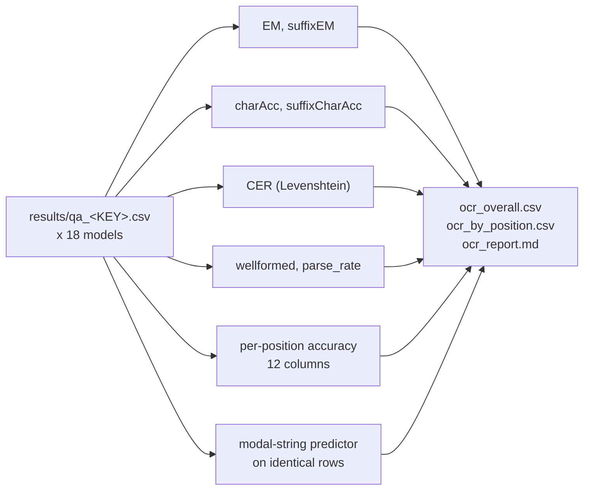

<h1 align="center">Bio-VQA &rarr; Spatial Visual Reasoning &rarr; OCR &rarr; Evaluation</h1>
<p align="center">
  <b>The Metric Family, the Constant-String Floor, and the Per-Position Diagnostic</b>
</p>
<p align="center">
  
  
  
  
  
  
</p>

> The authoritative scoring stage for the OCR task. This document defines every metric and its
> equation, the modal-string predictor that establishes the floor, the per-character-position
> table that localises the failure mechanism, why this is the one task in the component
> without clustering, and the findings the calculus exposes.

---

## Table of contents

1. [Overview](#1-overview)
2. [Motivation](#2-motivation)
   - 2.1 [Why character accuracy is inflated on this corpus](#21-why-character-accuracy-is-inflated-on-this-corpus)
   - 2.2 [Why exact match is the right headline here](#22-why-exact-match-is-the-right-headline-here)
   - 2.3 [Why format compliance is reported separately](#23-why-format-compliance-is-reported-separately)
3. [Merging and input contract](#3-merging-and-input-contract)
4. [The scoring calculus](#4-the-scoring-calculus)
   - 4.1 [Exact match, whole and suffix](#41-exact-match-whole-and-suffix)
   - 4.2 [Character accuracy](#42-character-accuracy)
   - 4.3 [Character error rate](#43-character-error-rate)
   - 4.4 [Well-formedness and parse rate](#44-well-formedness-and-parse-rate)
   - 4.5 [A worked example](#45-a-worked-example)
   - 4.6 [What each score implies](#46-what-each-score-implies)
5. [The constant-string floor](#5-the-constant-string-floor)
   - 5.1 [The modal-string predictor](#51-the-modal-string-predictor)
   - 5.2 [Why it beats the common-prefix predictor](#52-why-it-beats-the-common-prefix-predictor)
6. [The per-position diagnostic](#6-the-per-position-diagnostic)
7. [Uncertainty](#7-uncertainty)
8. [Results](#8-results)
   - 8.1 [Order of inspection](#81-order-of-inspection)
   - 8.2 [Seven models below the floor](#82-seven-models-below-the-floor)
   - 8.3 [The cliff, and what it rules out](#83-the-cliff-and-what-it-rules-out)
   - 8.4 [A perfectly formatted, universally wrong model](#84-a-perfectly-formatted-universally-wrong-model)
   - 8.5 [Metric agreement and the level–ranking distinction](#85-metric-agreement-and-the-levelranking-distinction)
9. [Reproduction](#9-reproduction)
10. [Outputs](#10-outputs)
11. [References](#11-references)

---

## 1. Overview

This stage merges the sharded predictions and scores them. The scoring problem is shaped by
one property of the corpus: **every accession code shares a long fixed prefix**, so the
standard OCR metric — character accuracy — awards a large share of its credit for characters
that never vary.

We therefore compute the strongest no-look predictor available, report it in every results
row, restrict the continuous headline to the variable suffix, and publish a
per-character-position table that localises where each model's accuracy comes from. That last
artefact turns an inference about prefix reproduction into a direct measurement
([Section 6](#6-the-per-position-diagnostic)).

---

## 2. Motivation

### 2.1 Why character accuracy is inflated on this corpus

Character accuracy is the standard OCR measure and it is the wrong headline here. A predictor
emitting the per-position modal character and never looking at an image reaches

$$
\mathrm{charAcc}_{\text{const}} = 0.675 \quad \text{(8.10 of 12 characters)},
\qquad
\mathrm{CER}_{\text{const}} = 0.322 ,
$$

because six positions are identical across the corpus and a seventh is near-constant.

Restricting the same measure to the variable suffix removes most of the free credit:

$$
\mathrm{suffixCharAcc}_{\text{const}} = 0.349 \quad \text{(2.10 of 6 characters)} .
$$

The remaining 2.10 is real — the suffix digits are not uniformly distributed — and is why the
suffix floor is reported rather than assumed to be zero. Mean inflation of `charAcc` over
`suffixCharAcc` across the eighteen models is **0.212**, and it is largest for exactly the
models that read least ([Section 8.5](#85-metric-agreement-and-the-levelranking-distinction)).

### 2.2 Why exact match is the right headline here

Across Bio-VQA, exact match is usually too blunt to lead. On this task it is both the
operationally correct measure and the statistically robust one, and the two reasons are
independent.

**Operationally:** an accession code is a database key. A transcription with one wrong digit
retrieves a different specimen. There is no partial credit in the use to which this output is
put.

**Statistically:** exact match is *immune* to the prefix exploit. A single wrong character
costs the whole item, so a model that reproduces `A00000` and fabricates the rest scores zero:

$$
\mathrm{EM}_{\text{const}} = 0.002 \qquad \text{against} \qquad \mathrm{charAcc}_{\text{const}} = 0.675 .
$$

That contrast — a factor of over 300 between the two floors — is the whole argument. The
metric a collection manager cares about happens to be the metric a constant string cannot
game.

### 2.3 Why format compliance is reported separately

`wellformed` — the share of answers matching `A` followed by eleven digits — measures
instruction-following, not reading. A model with high character accuracy and low
well-formedness can read but not comply; a model with the reverse can comply but not read.

These are different findings requiring different write-ups, and the corpus contains a maximal
instance of the second: a model that is perfectly well-formed on every item and correct on
none ([Section 8.4](#84-a-perfectly-formatted-universally-wrong-model)). Collapsing format
compliance into the reading metrics would make that case invisible.

---

## 3. Merging and input contract

`merge_results.py` reassembles the six shards into one CSV per model, sorted by `row_id` —
restoring the pre-shuffle order
([Section 4.6 of the inference document](../2.Experiment_Runs/README.md#46-shuffle-before-shard))
— and writes `merge_manifest.json`.

```bash
python merge_results.py --run_dir ../2.Experiment_Runs --out_dir results
```

Merging performs no scoring, so every number in the paper comes from `evaluate.py` alone, and
the manifest is the gate: a model whose row count does not match the split must not be
reported.

`evaluate.py` then reads `results/qa_<MODEL_KEY>.csv`, locating the prediction column as
`<MODEL_KEY>_answer`. Two columns are load-bearing: `answer` (gold) and the prefix length,
recoverable from the `suffix` column carried by every shard
([Section 4.5 of the inference document](../2.Experiment_Runs/README.md#45-the-common-prefix)).



---

## 4. The scoring calculus

Let $y_i$ be the gold code and $\hat{y}_i$ the resolved prediction over $n$ scored items, with
$L$ the common-prefix length.

### 4.1 Exact match, whole and suffix

$$
\mathrm{EM} = \frac{1}{n}\sum_i \mathbb{1}\!\left[\hat{y}_i = y_i\right],
\qquad
\mathrm{suffixEM} = \frac{1}{n}\sum_i \mathbb{1}\!\left[\hat{y}_i[L{:}] = y_i[L{:}]\right] .
$$

`suffixEM` equals `EM` whenever the model reproduces the prefix correctly, which is almost
always ([Section 6](#6-the-per-position-diagnostic)). It is retained for the case a model gets
the informative digits right and mangles the prefix — a failure worth separating from a
reading failure, and one the released data shows to be rare: the two differ by at most 0.004
for any model.

### 4.2 Character accuracy

Positional agreement, normalised by total gold characters:

$$
\mathrm{charAcc} = \frac{\sum_i \bigl|\{\, j < \min(|y_i|, |\hat{y}_i|) : y_i[j] = \hat{y}_i[j] \,\}\bigr|}{\sum_i |y_i|},
$$

and `suffixCharAcc` is the same quantity computed on $y_i[L{:}]$ against $\hat{y}_i[L{:}]$.

**`suffixCharAcc` is the continuous headline.** It is the portion of the code that requires
reading, and it is where a model that reproduces the prefix earns nothing free.

Positional agreement does not tolerate insertions or deletions: a prediction missing one
character early misaligns every position after it. That is a real limitation of the measure,
and it is precisely why edit distance is reported alongside
([Section 4.3](#43-character-error-rate)) rather than instead of it — the two disagree exactly
when a model's errors are indels rather than substitutions, which is diagnostic in itself.

### 4.3 Character error rate

$$
\mathrm{CER} = \frac{\sum_i \mathrm{lev}(y_i, \hat{y}_i)}{\sum_i |y_i|},
$$

with $\mathrm{lev}$ the Levenshtein edit distance, implemented as a direct dynamic program —
codes are twelve characters, so the $O(|a||b|)$ cost is irrelevant.

CER **tolerates insertions and deletions** where positional character accuracy does not, so a
model that drops one digit and shifts the rest is penalised once rather than at every
subsequent position. It is unbounded above: a prediction much longer than the gold can exceed
1.0, which is why two models in our set post CER above the constant floor of 0.322
([Section 8.2](#82-seven-models-below-the-floor)).

### 4.4 Well-formedness and parse rate

$$
\mathrm{wellformed} = \frac{1}{n}\sum_i \mathbb{1}\!\left[\hat{y}_i \in \texttt{A}\backslash\texttt{d\{11\}}\right],
\qquad
\mathrm{parse\_rate} = \frac{1}{N}\sum_i \mathbb{1}\!\left[\hat{y}_i \neq \texttt{NA}\right] .
$$

`parse_rate` asks whether the raw output contained a code-like string at all; `wellformed`
asks whether the resolved code matches the stated format exactly. The two are distinct:
`A0000003292` parses but is not well-formed.

### 4.5 A worked example

Gold `A00000032929`, prefix length 6.

| Prediction | EM | charAcc | suffixCharAcc | CER | wellformed | What happened |
|---|---:|---:|---:|---:|---:|---|
| `A00000032929` | 1 | 1.000 | 1.000 | 0.000 | 1 | correct |
| `A00000032939` | 0 | 0.917 | 0.833 | 0.083 | 1 | one digit wrong — **the wrong specimen** |
| `A00000012345` | 0 | 0.583 | 0.167 | 0.417 | 1 | prefix reproduced, suffix fabricated |
| `A00000` | 0 | 0.500 | 0.000 | 0.500 | 0 | prefix only |
| `A 0000 0032 929` | 1 | 1.000 | 1.000 | 0.000 | 1 | correct; separators stripped by the resolver |
| `The code is A00000032929.` | 1 | 1.000 | 1.000 | 0.000 | 1 | correct; prose stripped by the resolver |

Row two is the operational argument for exact match: 0.917 character accuracy sounds like
near-success and retrieves the wrong beetle.

Row three is the prefix exploit in miniature. It reproduces `A00000` perfectly and invents the
rest, scoring **0.583 on character accuracy** — close to the constant floor of 0.675, and
above what four models in our set achieve — while its suffix accuracy of 0.167 correctly
records that nothing was read.

Rows five and six show the resolver's scope: case and separators and surrounding prose are
normalised, content is not
([Section 6.6 of the inference document](../2.Experiment_Runs/README.md#66-transcription-resolution)).

### 4.6 What each score implies

| Score | Question it answers | Constant-predictor value | Role |
|---|---|---:|---|
| `EM` | Is the specimen correctly identified? | 0.002 | **headline** |
| `suffixEM` | Same, ignoring prefix errors | ≈0.002 | separates prefix from suffix failure |
| `suffixCharAcc` | How much of the informative part was read? | 0.349 | **continuous headline** |
| `charAcc` | Positional agreement over the whole code | **0.675** | reported for comparability, **flagged** |
| `CER` | Edit distance, tolerating indels | 0.322 | complements `charAcc` |
| `wellformed` | Does it follow the stated format? | — | instruction-following axis |
| `parse_rate` | Did it emit a code at all? | — | separates non-response from misreading |
| per-position accuracy | *Where* does the accuracy come from? | 1.0 on 0–5 | **mechanism** |

---

## 5. The constant-string floor

### 5.1 The modal-string predictor

$$
\hat{c}_j = \mathrm{arg\,max}_{c} \; \bigl|\{ i : y_i[j] = c \}\bigr|,
\qquad
\hat{y}_{\text{const}} = \hat{c}_0 \hat{c}_1 \cdots \hat{c}_{L_{\max}-1} ,
$$

the constant string minimising character error over the corpus — the strongest predictor
available to a model that never looks at an image. It is scored with the identical metrics on
the **identical rows** as each model, so a model with a lower parse rate is compared against a
floor recomputed on its own scored subset. Pixtral-12B, at parse rate 0.996, is therefore
scored against `constCharAcc` = 0.6748 rather than the 0.6746 the other seventeen face.

Four floors result: `constEM` = 0.002, `constCharAcc` = 0.675, `constSuffixCharAcc` = 0.349,
`constCER` = 0.322. All four are written into every results row, so a score can never be
quoted without the baseline it must clear.

### 5.2 Why it beats the common-prefix predictor

The obvious floor is the common prefix — the longest leading substring on which *every* code
agrees, which `os.path.commonprefix` reports as 6 characters. The modal string is strictly
stronger, and the gap is a full character:

$$
\mathrm{charAcc}_{\text{const}} \times 12 = 8.10 \text{ characters}
= \underbrace{6.00}_{\text{universal prefix}} + \underbrace{2.10}_{\text{variable region}} .
$$

Most of that 2.10 comes from **position 6**, where one character dominates the corpus without
being universal — the common-prefix predictor scores 0 there while the modal predictor scores
near 1. The pre-run audit's per-position modal-share table is what makes this visible
([Section 5 of the inference document](../2.Experiment_Runs/README.md#5-pre-run-audit)).

Using the weaker floor would understate the baseline by roughly one character in twelve and
would place two additional models above the line. The choice of predictor is therefore not a
technicality: it changes which models are reported as reading.

---

## 6. The per-position diagnostic

`ocr_by_position.csv` reports, for each model, accuracy at each of the twelve character
positions. It is the artefact that converts an inference about mechanism into a measurement.

$$
\mathrm{acc}_j = \frac{1}{n}\sum_i \mathbb{1}\!\left[\hat{y}_i[j] = y_i[j]\right] .
$$

Three readings are available from one table.

**A high-left, collapsing-right profile is the signature of prefix reproduction.** A model
reading the label has no reason for accuracy to depend on position; a model reconstructing the
predictable part and fabricating the rest produces a step at exactly the prefix boundary.

**The slope inside the suffix separates two hypotheses.** If accuracy decayed monotonically
across positions 6–11, the mechanism would be sequence-length degradation — a decoder losing
coherence over a long digit run. If it is flat, the mechanism is prefix reproduction. The
table distinguishes them, and the data are unambiguous
([Section 8.3](#83-the-cliff-and-what-it-rules-out)).

**The size of the step grades the leaderboard continuously.** The prefix–suffix gap is a
per-model scalar running from 0.013 to 0.813, and it orders models the same way the headline
metrics do while saying something the headline metrics cannot: *how much of this score was
free*.

---

## 7. Uncertainty

**This is the one task in Component C3 with no cluster structure.** Every label belongs to a
distinct specimen with its own accession number; no two rows share a photograph, a
magnification, or an annotation. Rows are independent observations and the bootstrap resamples
**rows**:

$$
\text{for } b = 1 \dots B:\quad
\mathcal{I}^{(b)} \sim \mathrm{Unif}\bigl(\mathcal{I},\, |\mathcal{I}|\bigr) \text{ with replacement},
\qquad
\theta^{(b)} = f\!\left(\mathcal{I}^{(b)}\right),
$$

reporting the percentile interval $\bigl[Q_{2.5}(\theta),\, Q_{97.5}(\theta)\bigr]$.

Stating this explicitly matters because every other task in the component **requires**
clustered resampling — on plates for the beetle tasks, on canvases for the multi-panel tiers —
and applying that correction here by analogy would inflate the intervals without justification.
The correction is a response to a dependence structure, and this corpus does not have one.

With $n = 522$ the intervals are wider than elsewhere in the component. That is the honest
cost of the smallest evaluation set in C3, and it is why the results emphasise effects that
are large relative to that width — a floor crossing, a factor-of-nine family gap — rather than
adjacent leaderboard positions.

---

## 8. Results

### 8.1 Order of inspection

1. **`parse_rate`** — below ~0.95 means outputs contained no code-like string; a non-response
   failure, not a misreading.
2. **`EM` against `constEM` = 0.002** — the operational number, and the one the prefix exploit
   cannot reach.
3. **`suffixCharAcc` against `constSuffixCharAcc` = 0.349** — did the model read the
   informative characters at all?
4. **`charAcc` against `constCharAcc` = 0.675** — never read standalone.
5. **`wellformed`** — a low value beside a high `charAcc` is an instruction-following finding.
6. **Per-position row** — where the accuracy came from.

### 8.2 Seven models below the floor

$$
\mathrm{charAcc} < 0.675 \text{ for } \mathbf{7/18};
\qquad
\mathrm{suffixCharAcc} < 0.349 \text{ for } \mathbf{5/18};
\qquad
\mathrm{CER} > 0.322 \text{ for } 2/18 .
$$

Seven models — including both 38B InternVL variants and the 30B InternVL3.5-A3B — achieve
character accuracy lower than a fixed string emitted without looking at any image. On the
variable suffix five remain below, and the shortfalls are large: InternVL3-38B reaches 0.246
against a floor of 0.349, Phi-3.5-Vision 0.161.

A model scoring below a constant string on the informative characters is producing output
**anti-correlated** with the truth at those positions — its fabricated digits are worse than
guessing the corpus's most common digit. The per-position table explains why
([Section 8.3](#83-the-cliff-and-what-it-rules-out)).

Two models exceed the edit-distance floor as well: LLaVA-NeXT-Mistral-7B at CER 0.466 and
LLaVA-NeXT-Vicuna-7B at 0.383, both against 0.322 and both at exactly 0.000 exact match.

### 8.3 The cliff, and what it rules out

Averaging over the constant and variable halves of the code:

$$
\overline{\mathrm{acc}}_{\text{pos }0\text{--}5} = \mathbf{0.992},
\qquad
\overline{\mathrm{acc}}_{\text{pos }6\text{--}11} = \mathbf{0.568},
\qquad
\overline{\text{cliff}} = 0.424 .
$$

Fifteen of eighteen models exceed 0.98 on the constant positions — **including every model
that fails the task outright.** The single-step drop from position 5 to position 6 averages
0.248 and reaches 0.744 for InternVL3-38B.

**The decisive observation is what happens inside the suffix.** The mean difference between
position 7 and position 11 is

$$
\overline{\mathrm{acc}_7 - \mathrm{acc}_{11}} = 0.033 ,
$$

essentially flat. Sequence-length degradation predicts monotone decay along the digit run;
prefix reproduction predicts a step at the boundary and a plateau after it. The data show the
second. **The failure is not a decoder losing coherence over twelve characters — it is a model
emitting the part of the code that is predictable from the corpus and the format statement,
and inventing the part that requires reading.**

That interpretation is reinforced by the prompt. The instruction states *"Do not guess a
plausible code and do not correct what you see"*
([Section 6.2 of the inference document](../2.Experiment_Runs/README.md#62-prompt-construction)),
so the models exhibiting the cliff are doing so having been explicitly told not to.

The cliff also grades the leaderboard continuously, from 0.013 for Qwen3-VL-30B-A3B — whose
suffix accuracy is nearly its prefix accuracy — to 0.813 for Phi-3.5-Vision, essentially all
of whose character accuracy comes from the free positions.

### 8.4 A perfectly formatted, universally wrong model

| Model | wellformed | EM | suffixCharAcc | pos00–06 | pos07 |
|---|---:|---:|---:|---:|---:|
| LLaVA-NeXT-Vicuna-7B | **1.000** | **0.000** | 0.214 | 0.990–1.000 | **0.025** |
| LLaVA-NeXT-Mistral-7B | 0.010 | 0.000 | 0.228 | 0.990–1.000 | 0.056 |

**LLaVA-NeXT-Vicuna-7B emits a syntactically perfect twelve-character accession code on every
one of 522 items and gets zero of them right.** Its per-position profile is the complete
explanation: positions 0 through 6 at 0.990 or above, position 7 at 0.025. It reproduces the
prefix flawlessly and then invents six digits.

This is the constant-string exploit realised by an actual model, and it is visible only
because the evaluation reports **format compliance, per-position accuracy, and the constant
floor together**. Any one of the three alone would mislead: `wellformed` = 1.000 suggests
perfect compliance, `charAcc` = 0.607 suggests partial reading, and only the position table
plus the floor establish that nothing was read.

Its sibling fails in the opposite direction — well-formed on 1.0% of items, the highest CER in
the set at 0.466 — and the two have near-identical suffix accuracy and identical exact match.
Two models, indistinguishable on the reading metrics, differing by a factor of a hundred on
format compliance. Reporting the axes separately is what keeps them from being described as
the same failure.

Across the leaderboard $\rho(\mathrm{EM}, \mathrm{wellformed}) = 0.673$, well below the
near-unity agreement among the reading metrics
([Section 8.5](#85-metric-agreement-and-the-levelranking-distinction)), confirming that format
compliance is a genuinely separate axis rather than a proxy for competence.

### 8.5 Metric agreement and the level–ranking distinction

The three reading metrics rank models almost identically:

$$
\rho\!\left(\mathrm{EM},\, \mathrm{suffixCharAcc}\right) = 0.966,
\qquad
\rho\!\left(\mathrm{EM},\, \mathrm{charAcc}\right) = 0.971,
\qquad
\rho\!\left(\mathrm{EM},\, \mathrm{CER}\right) = -0.973 .
$$

**The choice of headline is therefore not load-bearing for the ranking.** A reader preferring
character accuracy or edit distance obtains essentially the same order, which forecloses the
objection that the suffix restriction was chosen to produce a particular leaderboard.

What the choice does determine is the **level**, and there the difference is decisive:

| Model | charAcc | suffixCharAcc | Inflation |
|---|---:|---:|---:|
| Phi-3.5-Vision | 0.568 | 0.161 | **0.407** |
| Pixtral-12B | 0.593 | 0.199 | 0.394 |
| LLaVA-NeXT-Vicuna-7B | 0.607 | 0.214 | 0.393 |
| InternVL3-38B-Instruct | 0.620 | 0.246 | 0.374 |
| … | | | |
| Qwen2.5-VL-3B | 0.969 | 0.940 | 0.029 |
| Qwen3-VL-30B-A3B | 0.993 | 0.987 | **0.007** |

Mean inflation is **0.212**, and it is systematically largest for the models that read least —
$\rho(\mathrm{EM}, \text{inflation})$ is strongly negative by inspection. Character accuracy
therefore compresses exactly the part of the scale where the interesting distinctions live: on
`charAcc` the weakest model reads 0.568, which sounds like partial competence, while on
`suffixCharAcc` it reads 0.161 against a floor of 0.349.

**The metrics agree on who is better. Only the suffix-restricted metric and the constant floor
say whether anyone is reading at all.**

---

## 9. Reproduction

```bash
# Merge the six shards per model.
python merge_results.py --run_dir ../2.Experiment_Runs --out_dir results

# Score.
python evaluate.py --results_dir results --out_dir results --bootstrap 2000
```

Confirm `merge_manifest.json` shows every model complete before scoring
([Section 3](#3-merging-and-input-contract)).

---

## 10. Outputs

| File | Contents |
|---|---|
| `ocr_overall.csv` | One row per model: `n, EM, suffixEM, suffixCharAcc, charAcc, CER, wellformed, parse_rate`, plus `constEM`, `constCharAcc`, `constSuffixCharAcc`, `constCER` and bootstrap bounds. |
| `ocr_by_position.csv` | Twelve per-position accuracy columns per model — the diagnostic of [Section 6](#6-the-per-position-diagnostic). |
| `ocr_report.md` | Leaderboard, per-position table, and interpretation. |
| `merge_manifest.json` | What was merged and whether any model is incomplete. |

Every results row carries all four `const*` columns, so a single extracted row remains
interpretable without reference to a floor computed elsewhere. On this task that is not a
convenience but a requirement: a character accuracy quoted without its 0.675 floor is not
merely incomplete, it is misleading in the direction of overstating competence.

---

## 11. References

Edit distance follows Levenshtein [1]. Character error rate is the standard OCR evaluation
measure [2, 3]. Bootstrap resampling follows Efron and Tibshirani [4].

[1] V. I. Levenshtein. **Binary Codes Capable of Correcting Deletions, Insertions, and
Reversals.** *Soviet Physics Doklady*, 10(8):707–710, 1966.

[2] S. V. Rice, F. R. Jenkins, and T. A. Nartker. **The Fifth Annual Test of OCR Accuracy.**
Information Science Research Institute, University of Nevada, Las Vegas, TR-96-01, 1996.

[3] R. Smith. **An Overview of the Tesseract OCR Engine.** *Proceedings of the Ninth
International Conference on Document Analysis and Recognition (ICDAR)*, pp. 629–633, 2007.

[4] B. Efron and R. J. Tibshirani. **An Introduction to the Bootstrap.** Chapman & Hall, 1993.