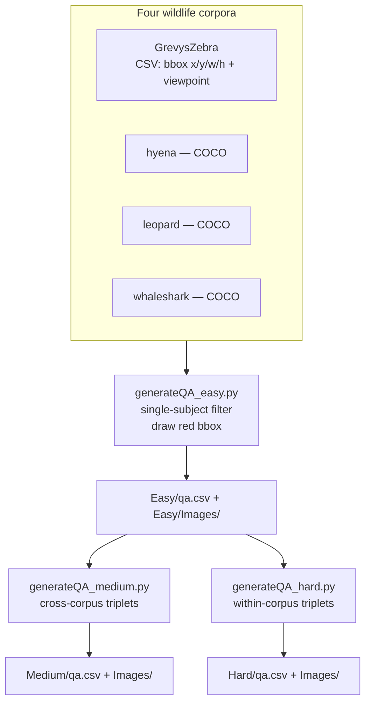

<h1 align="center">Bio-VQA &rarr; Spatial Visual Reasoning &rarr; Viewpoint &rarr; QA Generation</h1>
<p align="center">
  <b>Bounding-Box Rendering and Three-Panel Tier Construction from Four Wildlife Corpora</b>
</p>
<p align="center">
  
  
  
  
  
  
</p>

> Construction of the Viewpoint evaluation set. This document describes the two source
> formats and how they are reconciled, the single-subject constraint, the deterministic
> selection rule, the cascade by which the two multi-panel tiers are built from the
> single-panel tier, and the output contract consumed by the inference stage.

---

## Table of contents

1. [Overview](#1-overview)
2. [Design contract](#2-design-contract)
3. [System architecture](#3-system-architecture)
4. [Source corpora and format reconciliation](#4-source-corpora-and-format-reconciliation)
   - 4.1 [Two annotation formats](#41-two-annotation-formats)
   - 4.2 [The single-subject constraint](#42-the-single-subject-constraint)
   - 4.3 [Admission filters](#43-admission-filters)
   - 4.4 [The deterministic selection rule](#44-the-deterministic-selection-rule)
5. [Tier construction](#5-tier-construction)
   - 5.1 [Easy: one panel](#51-easy-one-panel)
   - 5.2 [Medium: cross-corpus triplets](#52-medium-cross-corpus-triplets)
   - 5.3 [Hard: within-corpus triplets](#53-hard-within-corpus-triplets)
   - 5.4 [Comparative summary](#54-comparative-summary)
6. [Canvas synthesis](#6-canvas-synthesis)
7. [Output schema](#7-output-schema)
8. [Reproduction](#8-reproduction)
9. [Operational behaviour](#9-operational-behaviour)

---

## 1. Overview

This stage converts four wildlife re-identification corpora — one CSV, three COCO — into
three uniform question–answer manifests. Ground truth is the corpora's own Wildbook viewpoint
annotation; we add no labels and re-annotate nothing.

The three generators form a **cascade rather than three parallel branches**. Only
`generateQA_easy.py` reads the source corpora; both multi-panel generators read the Easy
tier's own rendered output. That ordering is a hard dependency and it is also a design
choice: every panel appearing in Medium or Hard is a *pixel-identical copy* of a panel that
also appears in Easy, so the tier contrasts are not confounded by differences in which
photographs were selected or how the boxes were drawn.



---

## 2. Design contract

| Contract | Rationale |
|---|---|
| **No re-annotation.** Viewpoint labels are the corpora's own Wildbook tokens, stored verbatim. | The benchmark inherits an operational annotation scheme used in production re-ID pipelines, and remains auditable against the source corpora. The label vocabulary is therefore discovered from the data rather than imposed. |
| **One annotated subject per source photograph.** | A photograph containing two animals facing different directions has no single correct viewpoint answer. See [Section 4.2](#42-the-single-subject-constraint). |
| **The multi-panel tiers reuse Easy's rendered images.** | Every panel is pixel-identical to an Easy item, so the tier contrast varies panel structure and nothing else. |
| **Deterministic selection.** Candidates are ordered by an explicit sort key before truncation. | The realised set reproduces without depending on filesystem iteration order. |
| **Aspect ratio preserved; no image is distorted.** | Anisotropic scaling would change apparent body proportions, which is the primary cue for orientation. |

---

## 3. System architecture

| Script | Tier | Reads | Panels | Selection |
|---|---|---|:---:|---|
| `generateQA_easy.py` | Easy | four source corpora | 1 | top-$N$ by file size, per corpus |
| `generateQA_medium.py` | Medium | `Easy/` | 3 | index-aligned triplets across corpora |
| `generateQA_hard.py` | Hard | `Easy/` | 3 | seeded sliding-window triplets within corpus |

Both multi-panel generators must run **after** the Easy tier exists. Running them against a
missing or partial Easy directory produces a silently smaller tier rather than an error, so
the item counts should be checked against
[Section 4.3 of the task document](../README.md#43-realised-scale) after every regeneration.

---

## 4. Source corpora and format reconciliation

### 4.1 Two annotation formats

The four corpora do not share a schema, and the generator carries a separate reader for each
format.

**CSV (`GrevysZebra`).** One row per annotation, with `image`, `viewpoint`, and the box as
four separate columns in **absolute pixel** coordinates:

```
bbox = [row["bbox x"], row["bbox y"], row["bbox w"], row["bbox h"]]
```

**COCO (`hyena`, `leopard`, `whaleshark`).** A single JSON document with an `images` array
and an `annotations` array joined on `image_id`, the box stored as `[x, y, w, h]` and the
viewpoint carried on the annotation record.

Both readers normalise to the same tuple — `(image_path, bbox, viewpoint, original_name)` —
so the downstream rendering and emission path is shared and cannot diverge between corpora.
Both bbox conventions are already `[x, y, w, h]` in absolute pixels, so the rectangle is
drawn as $[x,\, y] \to [x + w,\, y + h]$ without a coordinate transform in either branch.

### 4.2 The single-subject constraint

The decisive admission filter. For the CSV corpus:

```python
grouped = df.groupby("image")
valid = [g for _, g in grouped if len(g) == 1]
```

and the COCO reader applies the equivalent constraint on `img_to_anns`.

**Only photographs carrying exactly one annotated animal are admitted.** A photograph
containing two zebras facing opposite directions has two viewpoint annotations and no single
correct answer to *"what is the viewpoint of the animal in this image?"* — and drawing a box
around one of them does not fully resolve the ambiguity, because a model may attend to the
wrong subject while producing an answer that is correct for the other.

The constraint is what makes the red box a sufficient referent rather than a partial one. It
costs a substantial share of each corpus — re-ID imagery frequently contains groups — and we
accept that cost because the alternative is items whose ground truth is not well defined.

### 4.3 Admission filters

Applied in order, before any selection:

| # | Filter | Rationale |
|---|---|---|
| 1 | Exactly one annotation on the photograph | [Section 4.2](#42-the-single-subject-constraint) |
| 2 | `viewpoint` present and non-empty | An unlabelled annotation yields no gold answer. Applied **early**, before file-system work, so unlabelled rows cost nothing. |
| 3 | Image file resolves on disk | A metadata row referencing a missing file must never reach the renderer. |

Filter 2 is applied before filter 3 deliberately: existence checks are the expensive operation
in this stage, and there is no reason to stat a file for a row that cannot produce an item.

### 4.4 The deterministic selection rule

After filtering, candidates are ordered and truncated to `--num_samples` per corpus:

```python
candidates.sort(key=lambda x: (-x[0], x[1]))     # file size desc, then path
selected = candidates[:n_samples]
```

Two properties matter.

**It is deterministic without a seed.** The sort key is total — file size descending, with
the full path as tie-break — so the realised selection is a function of the corpus alone and
does not depend on filesystem iteration order, dictionary ordering, or a random draw. Two
runs on the same corpus produce the same set.

**File size is a resolution proxy.** For a fixed corpus and codec, larger JPEG files
correspond to larger and more detailed photographs. Selecting the largest files preferentially
admits images in which the animal subtends more pixels — which matters because orientation is
read from body-part configuration, and because these same renders are subsequently
concatenated three-to-a-canvas in the multi-panel tiers, where each panel retains roughly
$\sqrt{1/3}$ of its linear extent
([Section 6 of the task document](../README.md#6-canvas-geometry-and-the-perceptual-budget)).

The rule is a proxy rather than a direct measure, and the same ordering is applied identically
to all four corpora and inherited unchanged by both multi-panel tiers, so it introduces no
differential between conditions.

---

## 5. Tier construction

### 5.1 Easy: one panel

For each admitted candidate, the annotated animal is delimited with a red rectangle at
width 4 and the result written as a new JPEG:

```python
draw.rectangle([x, y, x + w, y + h], outline="red", width=4)
```

Red is chosen for maximum separation from the greens, browns, and blues that dominate
terrestrial and marine wildlife photography. A single box means the referent is unambiguous —
guaranteed by the single-subject constraint of
[Section 4.2](#42-the-single-subject-constraint) — so the question needs no colour legend and
no positional qualifier.

The question is fixed:

> *What is the viewpoint of the animal (red bounding box) shown in this image?*

and the answer is the corpus's viewpoint token, stored **verbatim**. Normalising or
remapping the tokens here would silently redefine the label space; instead the vocabulary is
discovered from the emitted data by the preprocessing audit and supplied to the models as a
closed option set at inference time
([Section 6.2 of the inference document](../2.Experiment_Runs/README.md#62-prompt-construction)).

The emitted `dataset` column records which corpus each row came from. It is load-bearing
downstream in two ways: it carries the per-corpus decomposition in the results, and it is the
term the Medium tier's question uses to name the target panel
([Section 5.2](#52-medium-cross-corpus-triplets)).

### 5.2 Medium: cross-corpus triplets

Three panels from **three different corpora**, so the species named in the question
identifies the target panel uniquely.

**Selection.** Within each corpus, Easy items are re-sorted by the same file-size rule and
the top 500 retained. For each index $i \in \{0 \dots 499\}$ the generator forms the 4-tuple
of the $i$-th item from each corpus, then emits all four 3-subsets:

$$
\text{combos} = \{(0,1,2),\; (0,1,3),\; (0,2,3),\; (1,2,3)\}
$$

Every triplet therefore contains three distinct corpora by construction, and each index
position contributes four canvases. The species term is unique within every canvas, so the
question

> *What is the viewpoint of the {dataset} in this image?*

resolves to exactly one panel with no positional word.

**Emission.** Each canvas emits **three rows**, one per panel, each asking about a different
species and carrying that panel's own gold viewpoint. Rows sharing a canvas are therefore
statistically dependent, and they share a resize and a vision-token budget.

### 5.3 Hard: within-corpus triplets

Three panels from the **same corpus**, so the species term is uninformative and the panel
must be resolved positionally.

**Selection.** Within each corpus, candidates are sorted deterministically by the file-size
rule and then **shuffled under a fixed seed** (`random.seed(42)`), after which triplets are
taken by a sliding window of stride 3 over the shuffled list, wrapping modulo its length:

$$
\text{triplet}_k = \bigl(c_{3k \bmod L},\; c_{3k+1 \bmod L},\; c_{3k+2 \bmod L}\bigr)
$$

with a `used_triplets` set rejecting any repeated unordered combination, until 250 triplets
per corpus accumulate. The deterministic sort followed by a seeded shuffle gives a
reproducible ordering that is nonetheless decorrelated from file size, so a triplet does not
consist of three images of near-identical resolution.

**The question is positional:**

> *What is the viewpoint of the {dataset} marked in the {left|middle|right} bounding box?*

and an explicit `position` column is emitted alongside the answer.

**The positional vocabulary is three-valued**, and this is what distinguishes the tier from
its two-panel counterparts elsewhere in the component. `left` and `right` are anchored by the
canvas boundary; **`middle` has no boundary anchor** and is defined only relative to the other
two panels. That asymmetry is the mechanism invoked for the tier ordering in
[Section 7.6 of the task document](../README.md#76-the-tier-ladder).

Hard filenames are prefixed with the corpus name, `{dataset}_{uid}.jpg`, which is
unambiguous because all three panels come from it.

### 5.4 Comparative summary

| Property | Easy | Medium | Hard |
|---|---|---|---|
| Script | `generateQA_easy.py` | `generateQA_medium.py` | `generateQA_hard.py` |
| Reads | four source corpora | `Easy/` | `Easy/` |
| Panels | 1 | 3 | 3 |
| Corpora per canvas | 1 | 3 (distinct) | 1 |
| Panel identified by | — | species name | position |
| Positional vocabulary | — | none | `left` / `middle` / `right` |
| Rows per canvas | 1 | 3 | 3 |
| Selection | top-$N$ by size | index-aligned 3-of-4 | seeded sliding window |
| Seeded | not required | not required | `random.seed(42)` |
| Corpus in filename | no | no | yes |
| `position` column | no | no | yes |

---

## 6. Canvas synthesis

Both multi-panel generators use the same routine: match all panels to the **minimum height**
among them, preserving aspect ratio, then concatenate horizontally with no separator.

```python
min_h = min(img.height for img in imgs)
imgs  = [img.resize((int(img.width * min_h / img.height), min_h)) for img in imgs]
```

```
        w1'            w2'              w3'
  ┌───────────┬──────────────┬─────────────────┐
  │           │              │                 │
  │   left    │    middle    │      right      │  min_h
  │           │              │                 │
  └───────────┴──────────────┴─────────────────┘
       canvas = (w1' + w2' + w3') x min_h    no padding, no separator
```

Matching to the **minimum** height rather than to the first panel's is a deliberate choice: it
guarantees that no panel is ever upsampled, so no canvas contains interpolated detail that was
not present in its source. Every panel is downsampled or left alone.

We add no separator, border, or whitespace. A visible divider would supply an additional cue
to the panel boundaries that we did not intend to provide, and would make the Hard tier's
positional index easier in a way we could not attribute.

**Area partition.** Writing $\alpha_i = w_i/h_i$ for each source panel's aspect ratio, all
panels share the height $h = \min_j h_j$, so $w_i' = \alpha_i h$ and the fraction of canvas
area occupied by panel $i$ is

$$
f_i = \frac{\alpha_i}{\sum_{j=1}^{3} \alpha_j} ,
$$

depending only on the ratios of aspect ratios. This is the quantity that governs the
per-panel share of the encoder's token budget, and it distinguishes Medium — three corpora
with systematically different capture geometries, hence an uneven partition — from Hard —
one corpus, hence a near-even one
([Section 6 of the task document](../README.md#6-canvas-geometry-and-the-perceptual-budget)).

---

## 7. Output schema

All three tiers write `qa.csv` with a shared core schema; Hard adds one column.

| Column | Easy | Medium | Hard |
|---|---|---|---|
| `image` | rendered filename | canvas filename | `{dataset}_{uid}.jpg` |
| `question` | `…the animal (red bounding box)…` | `…the {dataset} in this image?` | `…the {dataset} marked in the {position} bounding box?` |
| `answer` | Wildbook viewpoint token, verbatim | same | same |
| `dataset` | source corpus | corpus of the named panel | corpus of all three panels |
| `position` | — | — | `left` / `middle` / `right` |

**Example rows.**

```csv
image,question,answer,dataset
GZ_00417_3f2a....jpg,What is the viewpoint of the animal (red bounding box) shown in this image?,right,zebra
```

```csv
image,question,answer,dataset,position
whaleshark_9c1e....jpg,What is the viewpoint of the whaleshark marked in the middle bounding box?,backleft,whaleshark,middle
```

Note that `answer` is stored exactly as the corpus records it. The set of distinct values
across the three tiers **is** the label space, and the preprocessing audit enumerates it so
that the inference prompt can present it as a closed option set
([Section 5 of the inference document](../2.Experiment_Runs/README.md#5-pre-run-audit)).

---

## 8. Reproduction

```bash
# Easy first — the other two read its output.
python generateQA_easy.py \
    --grevys_csv        $BIOVQA_DATA/GrevysZebra/annotations.csv \
    --grevys_images     $BIOVQA_DATA/GrevysZebra/Images \
    --hyena_json        $BIOVQA_DATA/HyenaID/instances.json \
    --hyena_images      $BIOVQA_DATA/HyenaID/Images \
    --leopard_json      $BIOVQA_DATA/LeopardID/instances.json \
    --leopard_images    $BIOVQA_DATA/LeopardID/Images \
    --whaleshark_json   $BIOVQA_DATA/WhalesharkID/instances.json \
    --whaleshark_images $BIOVQA_DATA/WhalesharkID/Images \
    --output_dir        $BIOVQA_DATA/tasks/Viewpoint/Easy \
    --num_samples 1000

python generateQA_medium.py --base_dir $BIOVQA_DATA/tasks \
    --input_basename Viewpoint/Easy --output_basename Viewpoint/Medium

python generateQA_hard.py   --base_dir $BIOVQA_DATA/tasks \
    --input_basename Viewpoint/Easy --output_basename Viewpoint/Hard
```

Realised item counts per tier are tabulated in
[Section 4.3 of the task document](../README.md#43-realised-scale). All nine paths on the Easy
generator are required in practice — the four corpus readers each need a metadata file and an
image directory — so supply them explicitly rather than relying on defaults.

**Next stage:** [`../2.Experiment_Runs/README.md`](../2.Experiment_Runs/README.md) —
consolidation, sharding, and inference.

---

## 9. Operational behaviour

**Unlabelled annotations are filtered before file-system work.** The viewpoint check runs
before the existence check, so rows that cannot yield an item cost no I/O
([Section 4.3](#43-admission-filters)).

**Render failures are non-fatal and reported.** A photograph that fails to decode, or whose
box cannot be drawn, prints a skip message and contributes no item; the loop continues. This
is why realised counts per corpus are a function of source completeness rather than a fixed
multiple of `--num_samples`.

**Merge failures in the multi-panel tiers skip the canvas, not the tier.** A triplet
containing one undecodable panel is skipped with a message and the loop proceeds to the next
combination.

**The stage is I/O-bound.** One decode and one JPEG write per Easy item, and three decodes
plus one write per multi-panel canvas; on a shared filesystem it benefits substantially from
staging the source images to local scratch first.