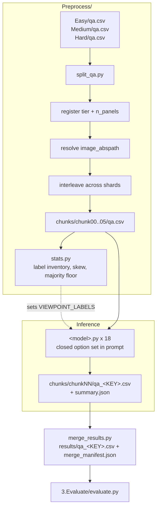

<h1 align="center">Bio-VQA &rarr; Spatial Visual Reasoning &rarr; Viewpoint &rarr; Preprocessing &amp; Inference</h1>
<p align="center">
  <b>Tier Consolidation and Closed-Vocabulary Inference across Eighteen Models</b>
</p>
<p align="center">
  
  
  
  
  
  
  
</p>

> Consolidation of the three Viewpoint tiers into a single sharded manifest, and inference
> across eighteen open-weight vision–language models under an invariant harness. This
> document specifies why the label vocabulary must be enumerated in the prompt, how it is
> discovered, the longest-match label resolver, and the correctness guards.

---

## Table of contents

1. [Overview](#1-overview)
2. [Motivation](#2-motivation)
   - 2.1 [A closed vocabulary must be stated](#21-a-closed-vocabulary-must-be-stated)
   - 2.2 [One manifest, one model load](#22-one-manifest-one-model-load)
   - 2.3 [The invariant harness](#23-the-invariant-harness)
3. [System architecture](#3-system-architecture)
4. [Manifest consolidation](#4-manifest-consolidation)
   - 4.1 [Tier registration](#41-tier-registration)
   - 4.2 [Path resolution](#42-path-resolution)
   - 4.3 [Interleaved sharding](#43-interleaved-sharding)
   - 4.4 [Emitted schema](#44-emitted-schema)
   - 4.5 [Idempotence guard](#45-idempotence-guard)
5. [Pre-run audit](#5-pre-run-audit)
6. [The inference harness](#6-the-inference-harness)
   - 6.1 [Invariant and variant decomposition](#61-invariant-and-variant-decomposition)
   - 6.2 [Prompt construction](#62-prompt-construction)
   - 6.3 [Decoding configuration](#63-decoding-configuration)
   - 6.4 [Vision-token budget](#64-vision-token-budget)
   - 6.5 [Model registry](#65-model-registry)
   - 6.6 [Label resolution](#66-label-resolution)
   - 6.7 [Correctness guards](#67-correctness-guards)
7. [Outputs](#7-outputs)
   - 7.1 [Per-shard artefacts](#71-per-shard-artefacts)
   - 7.2 [The run record](#72-the-run-record)
   - 7.3 [Merge contract](#73-merge-contract)
8. [Reproduction](#8-reproduction)
9. [Operational checklist](#9-operational-checklist)

---

## 1. Overview

This stage folds the three tier manifests produced by
[QA generation](../1.Generate_QA/README.md) into one sharded evaluation set and runs eighteen
models against it.

One decision dominates the design. The gold answers are raw Wildbook viewpoint tokens drawn
from a **closed vocabulary that the question never states**, so the accepted answers are
enumerated in the inference prompt. Without that, the task measures whether a model can guess
an annotation scheme rather than whether it perceives orientation
([Section 2.1](#21-a-closed-vocabulary-must-be-stated)). The decision is vindicated by the
outcome: **parse rate is exactly 1.000 for all eighteen models**, so every model is scored on
the identical 13,000 rows and no leaderboard position reflects a difference in scored subset.

As throughout Component C3, **everything outside the model block is byte-identical across all
eighteen runners** — prompt construction, label resolution, batching, write-back, guards, and
the run record are the controlled portion of the experiment.

---

## 2. Motivation

### 2.1 A closed vocabulary must be stated

The gold labels are annotation tokens: `front`, `backleft`, `frontright`, and so on, written
exactly as the source corpora store them. Asking an open question against a closed, unstated
vocabulary produces a systematic and uninformative failure — models answer *"side view"*,
*"profile"*, *"facing away from the camera"*, all of which may describe the correct
orientation and all of which score zero.

That failure mode measures **annotation-scheme guessing**, not perception. It would also
interact catastrophically with the graded rubric: an unmatched free-text answer decomposes
into no axis components at all, so it lands in `wrong` regardless of how nearly correct the
described orientation was
([Section 5.1 of the task document](../README.md#51-the-graded-rubric)).

We therefore enumerate the accepted answers in the prompt, exactly as stored:

```python
VIEWPOINT_LABELS = [s.strip().lower() for s in os.environ.get(
    "VIEWPOINT_LABELS",
    "front,back,left,right,frontleft,frontright,backleft,backright,up,down"
).split(",") if s.strip()]
```

The vocabulary is an **environment variable, not a literal**, so it can be corrected without
editing eighteen files if the audit reports gold labels outside the default set
([Section 5](#5-pre-run-audit)). Whichever value is used is recorded verbatim in every run
record ([Section 7.2](#72-the-run-record)), so a released prediction file carries the option
set it was produced under.

This converts an open-ended generation task into a ten-way forced choice with a stated
alphabet — which is what makes the chance correction in the evaluation well defined, since
the expected score depends on the model's marginal distribution over a known label set.

### 2.2 One manifest, one model load

The three tiers could be run as three inference passes. We fold them into a single manifest
instead, because checkpoint loading dominates short jobs: a 38B model takes minutes to load
and shard across GPUs while inference costs milliseconds per item. One combined manifest cuts
per-model wall-clock by roughly a third across 108 jobs.

### 2.3 The invariant harness

Eighteen runners share one harness; only checkpoint loading and the forward pass differ. This
is what licenses the cross-model claims in
[Section 7 of the task document](../README.md#7-results). When we report that ranking by exact
match and ranking by the chance-corrected graded score correlate at only $\rho = 0.656$, that
is a statement about models only if all eighteen received the same option list, in the same
order, under the same panel framing.

The option **ordering** matters as much as the option set. All eighteen models see the ten
labels in one fixed order, so the answer-distribution asymmetries visible in the results
cannot be artefacts of prompt variation between models.

---

## 3. System architecture



The dashed edge is a real dependency: the audit establishes the label vocabulary that the
inference prompt must present.

---

## 4. Manifest consolidation

`Preprocess/split_qa.py` reads the three tier manifests, enriches them, and shards.
`--task_root` is required; `--run_dir` defaults to the script's own directory.

### 4.1 Tier registration

Directory names map to tier labels at load time, and the labels are what appear in every
downstream artefact.

| Directory | Tier label | `n_panels` |
|---|---|:---:|
| `Easy/` | `single` | 1 |
| `Medium/` | `cued` | 3 |
| `Hard/` | `positional` | 3 |

`n_panels` drives the panel clause in the prompt and **nothing else**
([Section 6.2](#62-prompt-construction)). Keeping its effect to a single conditional string is
what allows the tier contrasts in
[Section 7.6 of the task document](../README.md#76-the-tier-ladder) to be attributed to panel
structure rather than to a prompt difference.

The loader accepts either `image` or `image_name` as the filename column, so a tier written
under either convention loads without modification.

### 4.2 Path resolution

Shard CSVs live under `chunks/chunkNN/` while images stay under `<tier>/Images/`, so a
relative path would be unresolvable from every shard and eighteen runners would each need
identical resolution logic. We resolve once, here, into an absolute `image_abspath`, trying
the tier's image directory and then the tier directory itself, and passing through any path
that is already absolute.

Missing files are counted per tier and the first is printed, so a partial-image smoke test
remains possible while the operator always sees the count. When publishing prediction CSVs,
`image_abspath` is dropped; `split_qa.py` reconstructs it from `--task_root`.

### 4.3 Interleaved sharding

Rows are assigned to shards by stride rather than contiguous block. Shard $i$ receives

$$
\mathcal{C}_i = \{\, r_j \;:\; j \equiv i \!\!\pmod{K} \,\}, \qquad K = 6 .
$$

Under interleaving every shard carries approximately the same tier mixture and the same
corpus mixture. Under contiguous partitioning, the first shards would be entirely Easy-tier
and the last entirely Hard-tier, so a single failed array task would delete an experimental
condition rather than thin the set uniformly. Partition completeness is asserted before any
shard is written:

$$
\sum_{i=0}^{K-1} \bigl|\mathcal{C}_i\bigr| = \bigl|\mathcal{D}\bigr| .
$$

Unlike the beetle tasks, no shuffle is required here: the concatenated manifest is ordered by
tier and, within a tier, by generation order, which is already decorrelated from the stride
index.

### 4.4 Emitted schema

| Column | Origin | Description |
|---|---|---|
| `row_id` | assigned | Restores original order at merge time |
| `tier` | assigned | `single` / `cued` / `positional` |
| `n_panels` | assigned | 1 or 3 — drives the prompt panel clause only |
| `dataset` | source | Source corpus; carries the per-corpus decomposition |
| `position` | source | `left` / `middle` / `right`, Hard tier only |
| `image` | source | Basename |
| `image_abspath` | resolved | Absolute path |
| `question` | source | Verbatim |
| `answer` | source | Wildbook viewpoint token, verbatim |

### 4.5 Idempotence guard

If `chunks/` already exists, the script refuses to run without `--force`. Re-sharding would
orphan prediction CSVs already written into the previous shard directories, silently
invalidating completed inference across up to 108 jobs.

---

## 5. Pre-run audit

`Preprocess/stats.py` is read-only and settles three questions before any GPU time is spent.
The first is a hard prerequisite for inference rather than a diagnostic.

**What is the label vocabulary?** The audit enumerates every distinct value of `answer`
across the consolidated manifest. That set **is** the label space, and it is what the
inference prompt must present as its option list
([Section 2.1](#21-a-closed-vocabulary-must-be-stated)). A gold label outside the runners'
default `VIEWPOINT_LABELS` would be unanswerable — the model is never offered it — so the
audit must run before inference and its output must be reconciled with the environment
variable.

**How skewed is the distribution?** The audit reports the share of each label and the
majority share. On this corpus `left` and `right` together are roughly 83% of rows and the
single majority label reaches **0.520**, because Wildbook's Grévy's zebra census photographs
the right flank for identification
([Section 4.2 of the task document](../README.md#42-source-corpora-and-the-label-skew)).

Two floors follow directly, and both are computed here rather than discovered later:

$$
\text{majority-label EM} = 0.520,
\qquad
\mathrm{modalVAS} = 0.534,
\qquad
\mathrm{modalMacroVAS} = 0.170 .
$$

The first two are what a constant `right` predictor achieves on exact match and on the
row-averaged graded score; the third is what it achieves once the graded score is
macro-averaged over gold labels. The gap between 0.534 and 0.170 is the quantitative case for
macro-averaging, and knowing it in advance is what prevents a result from being reported and
only later found to sit below a constant predictor — which, on exact match, is where
seventeen of eighteen models land
([Section 7.2 of the task document](../README.md#72-only-one-model-clears-the-majority-class-baseline)).

**How are rows distributed across tiers and corpora?** The audit prints the cross-tabulation,
so the per-tier and per-corpus cell sizes underlying the results decomposition are visible
before any inference is run.

A measured seconds-per-question table then gives total serial GPU-hours and wall-clock under
$K$ shards and $L$ lanes.

---

## 6. The inference harness

```bash
python qwenVL2_5_7B.py --qa_csv chunks/chunk00/qa.csv [--out_dir DIR] \
                       [--batch_size N] [--overwrite] [--limit N]
```

### 6.1 Invariant and variant decomposition

| Invariant across all eighteen | Variant (the model block) |
|---|---|
| `VIEWPOINT_LABELS`, `PANEL_FRAME`, `INSTRUCTION_HEAD`/`TAIL`, `build_prompt` | `MODEL_ID`, `MODEL_KEY` |
| `resolve_label` longest-match resolver | `load_model()` |
| `run_all`: batching, write-back, guards | `run_batch()` |
| Output schema and run record | `DEFAULT_BATCH_SIZE`, vision budget |

### 6.2 Prompt construction

```
[PANEL_FRAME if n_panels > 1] + question + INSTRUCTION_HEAD + options + INSTRUCTION_TAIL
```

**`PANEL_FRAME`** — added only for the multi-panel tiers:

```
This image consists of three separate photographs placed side by side.
```

**`INSTRUCTION_HEAD` + options + `INSTRUCTION_TAIL`** — appended to every item in every tier:

```
Answer with the direction the animal is facing, relative to the camera.
Choose exactly one of these accepted answers:
  front, back, left, right, frontleft, frontright, backleft, backright, up, down

Reply with one of those options, written exactly as above in lower case, and nothing else.
No explanation, no punctuation.
For example, if the animal faces away from the camera and to the left, reply: backleft
```

Each element removes a specific failure mode.

| Element | Failure mode suppressed |
|---|---|
| *relative to the camera* | Answering in the animal's own frame — a genuine ambiguity in an orientation question, and one that would systematically invert left and right |
| Enumerated option list | Free-text paraphrase (*"side view"*, *"profile"*) scoring zero against a closed annotation vocabulary |
| *written exactly as above in lower case* | Casing and spacing variants (`Back Left`, `back-left`) that the resolver would otherwise have to normalise |
| *no explanation, no punctuation* | Wrapped answers that the resolver would have to unwrap |
| *if the animal faces away and to the left, reply: `backleft`* | Compound-token format ambiguity, demonstrated on a compound rather than a cardinal so the concatenation convention is explicit |

**The panel clause is the only tier-conditional text in the entire prompt.** All other
scaffolding is identical across tiers, so the tier contrasts reported in
[Section 7.6 of the task document](../README.md#76-the-tier-ladder) cannot be contaminated by
a prompt difference. Every runner prints both rendered prompts to stdout at startup.

Note that the option list is presented in one fixed order for every model and every item. The
list is not permuted per item, so the evaluation's chance correction — which uses each
model's own marginal distribution over the label set
([Section 5.2 of the task document](../README.md#52-chance-correction)) — absorbs any
order-driven preference into the expected score rather than crediting it.

### 6.3 Decoding configuration

Identical across all eighteen models.

| Parameter | Value | Rationale |
|---|---|---|
| `do_sample` | `False` | Greedy; sampling would add variance requiring replicates to average out |
| `max_new_tokens` | `16` | Accommodates the longest compound token with margin, while bounding rambling |
| `dtype` | `bfloat16` | Molmo2 uses `dtype="auto"` per its model card |
| `attn_implementation` | `sdpa` | Phi-3.5-Vision requires `eager`; remote-code models set their own |
| `device_map` | `auto` | Multi-GPU sharding for the 30B–38B checkpoints |
| `padding_side` | `left` | Required for correct batched decoder-only generation |

All are overridable by environment variable — including `VIEWPOINT_LABELS` — without editing
source.

### 6.4 Vision-token budget

**Qwen family (5 models).**

$$
\text{MIN\_PIXELS} = 256 \cdot 28^2, \qquad \text{MAX\_PIXELS} = 1280 \cdot 28^2 \approx 1.0\ \text{MP} .
$$

**InternVL family (5 models).** Dynamic tiling at $448 \times 448$ with
`MAX_NUM_TILES = 6` — half the library default of 12 — giving $6 \times 448^2 \approx 1.20$
MP, deliberately close to the Qwen budget. Fixing 6 across *all* InternVL sizes means tiling
is not a hidden variable between 8B and 38B.

**Phi-3.5-Vision.** `NUM_CROPS = 16`.

**Remaining models** use their processor defaults.

These match the [Counting](../../Counting/2.Experiment_Runs/README.md#64-vision-token-budget)
setting rather than the near-native budget used for the beetle morphometry tasks, and
deliberately so. Orientation is read from **body-part configuration** — head, limbs, and body
axis — which is a coarse, large-scale cue, unlike the few-pixel line-length differences that
force a near-native budget in
[Absolute Distance](../../Distance_Absolute/2.Experiment_Runs/README.md#64-vision-token-budget).
Holding the budget at the Counting setting also keeps the two multi-panel tasks in Component
C3 directly comparable, so the tier ladder here can be read against the one reported there.

### 6.5 Model registry

| `MODEL_KEY` | Checkpoint | Batch | Vision budget |
|---|---|---:|---|
| `qwenVL2_5_3B` | `Qwen/Qwen2.5-VL-3B-Instruct` | 16 | 1280·28² |
| `qwenVL2_5_7B` | `Qwen/Qwen2.5-VL-7B-Instruct` | 8 | 1280·28² |
| `qwen3vl_8B` | `Qwen/Qwen3-VL-8B-Instruct` | 8 | 1280·28² |
| `qwenVL3_30B` | `Qwen/Qwen3-VL-30B-A3B-Instruct` | 4 | 1280·28² |
| `qwenVL3_32B` | `Qwen/Qwen3-VL-32B-Instruct` | 4 | 1280·28² |
| `internvl3_8B-Instruct` | `OpenGVLab/InternVL3-8B-Instruct` | 8 | 6 tiles |
| `internvl3_38B-Instruct` | `OpenGVLab/InternVL3-38B-Instruct` | 4 | 6 tiles |
| `internvl3_5_8B-Instruct` | `OpenGVLab/InternVL3_5-8B-Instruct` | 8 | 6 tiles |
| `internvl3_5_30B_A3B-Instruct` | `OpenGVLab/InternVL3_5-30B-A3B-Instruct` | 4 | 6 tiles |
| `internvl3_5_38B-Instruct` | `OpenGVLab/InternVL3_5-38B-Instruct` | 4 | 6 tiles |
| `gemma3_12B` | `google/gemma-3-12b-it` | 8 | processor default |
| `gemma4_12B` | `google/gemma-4-12B-it` | 8 | processor default |
| `llama3_2_11B` | `meta-llama/Llama-3.2-11B-Vision-Instruct` | 8 | processor default |
| `llava_next_mistral_7B` | `llava-hf/llava-v1.6-mistral-7b-hf` | 16 | processor default |
| `llava_next_vicuna_7B` | `llava-hf/llava-v1.6-vicuna-7b-hf` | 8 | processor default |
| `pixtral_12B` | `mistral-community/pixtral-12b` | 4 | processor default |
| `phi35_vision` | `microsoft/Phi-3.5-vision-instruct` | 4 | `NUM_CROPS = 16` |
| `molmo2_8B` | `allenai/Molmo2-8B` | 4 | processor default |

**Architecture resolution.** We load through `AutoModelForImageTextToText` wherever possible
rather than naming a concrete class. A mismatched concrete class randomly initialises layers
that do not correspond, producing a model that loads without error and emits noise. Every
runner prints the resolved class name — a one-line verification in every job log.
`transformers` is pinned at **4.57.1** for InternVL and Molmo compatibility; Phi-3.5-Vision
additionally requires shims re-attaching legacy cache-API names.

### 6.6 Label resolution

The resolver canonicalises the raw output and returns the **longest accepted label contained
in it**:

```python
LABELS_BY_LEN = sorted(VIEWPOINT_LABELS, key=len, reverse=True)

def resolve_label(answer):
    t = canon(answer)                 # lower-case, strip punctuation and spacing
    for lab in LABELS_BY_LEN:
        if lab in t:
            return lab
    return None
```

**Longest-first is essential and not a micro-optimisation.** The vocabulary is compositional,
so every compound token *contains* two cardinals as substrings: `backleft` contains both
`back` and `left`. A shortest-first or first-match scan would resolve every `backleft`
prediction to `back`, silently collapsing the four compound labels into cardinals — which
would destroy precisely the `over`/`under` distinction the rubric is built on
([Section 5.1 of the task document](../README.md#51-the-graded-rubric)) and would make the
error-composition analysis meaningless.

Canonicalisation before matching absorbs the formatting variants the prompt asks models to
avoid but that some produce anyway: `Back Left`, `back-left`, `BACKLEFT` all resolve to
`backleft`.

Two columns are written:

| Column | Content |
|---|---|
| `<MODEL_KEY>_answer_unfiltered` | Raw decoded string, verbatim |
| `<MODEL_KEY>_answer` | Resolved label, or `NA` |

Retaining the raw string means any parsing decision can be revisited without repeating a
108-job operation. **Parse rate is 1.000 for all eighteen models**, which is the joint
outcome of the closed option list in the prompt and the substring resolver: no model produced
an output containing no accepted label.

### 6.7 Correctness guards

Five guards, in the order they fire.

**Position-indexed write-back.** Row position travels with each work item, so answers return
to the row they came from and a skipped row cannot shift every subsequent answer by one. This
class of off-by-one contamination is silent and would invalidate an entire run.

**Empty-work abort.** If not a single image resolves on disk, the runner aborts with a message
pointing at `split_qa.py`, catching a wrong `--task_root` in seconds rather than after a full
shard of null predictions.

**Fail-fast sanity check.** After the first 20 answers, if none resolves to an accepted label,
the runner aborts. A model emitting no vocabulary member is misconfigured — wrong class,
broken chat template, dead environment.

**Partial-CSV guard.** If more than half of batches raise, the runner aborts without writing.
A half-empty CSV that looks complete is worse than no CSV, because the merge step would
accept it.

**Idempotence.** If the output CSV exists and `--overwrite` is not passed, the runner exits
immediately, so re-submitting a partially-failed array job re-runs only the missing shards.

As in the other forced-choice task in this component, a misconfigured model here still
produces a well-formed CSV — a constant `right` predictor looks entirely normal and scores
0.520 on exact match. The mechanism that catches constant prediction is therefore the
evaluation's chance correction and `predTopShare`, not the runner's guards
([Section 5.2 of the task document](../README.md#52-chance-correction)).

---

## 7. Outputs

### 7.1 Per-shard artefacts

```
chunks/chunkNN/qa_<MODEL_KEY>.csv            all manifest columns + 2 answer columns
chunks/chunkNN/qa_<MODEL_KEY>.summary.json   run record
```

### 7.2 The run record

Written to disk rather than only to the scheduler log, so the run remains auditable after logs
rotate. It embeds the **full prompt text and the option list**, which matters more here than
elsewhere in the component: the label vocabulary is the task's answer space, and a released
prediction file must carry the alphabet it was produced under. Indicative accuracy is recorded
for spotting a broken run at a glance; every runner logs *"(evaluate.py is authoritative)"*
beside it, and no reported result derives from it.

### 7.3 Merge contract

`merge_results.py` reassembles the six shards into one CSV per model, sorted by `row_id`, and
writes `merge_manifest.json` recording what was merged and whether anything is missing.

```bash
python merge_results.py --run_dir . --out_dir ../3.Evaluate/results
```

Merging performs no scoring, so every number in the paper comes from `evaluate.py` alone.
**The manifest is the gate:** a model whose merged row count does not match the split must not
be reported. Because parse rate is 1.000 for every model here
([Section 6.6](#66-label-resolution)), all eighteen merged files should carry exactly 13,000
rows, and any deviation is a missing shard rather than a legitimate scoring difference — which
makes the manifest check unusually decisive for this task.

---

## 8. Reproduction

```bash
# Consolidate the three tiers and shard.
python Preprocess/split_qa.py \
    --task_root $BIOVQA_DATA/tasks/Viewpoint --run_dir . --n_chunks 6

# Label inventory, skew, and the two constant-predictor floors.
python Preprocess/stats.py --run_dir .

# If the audit reports labels outside the default vocabulary:
export VIEWPOINT_LABELS="front,back,left,right,frontleft,frontright,backleft,backright,up,down"

# Inference: one model, one shard. 18 x 6 = 108 jobs.
python qwenVL2_5_7B.py --qa_csv chunks/chunk00/qa.csv

# Merge.
python merge_results.py --run_dir . --out_dir ../3.Evaluate/results
```

**Next stage:** [`../3.Evaluate/README.md`](../3.Evaluate/README.md) — the rubric, the chance
correction, and the independent angular metric.

---

## 9. Operational checklist

Before committing GPU hours:

- [ ] `split_qa.py` reports `missing = 0` for all three tiers
- [ ] Row totals per tier match the generation stage — 4,000 / 6,000 / 3,000
- [ ] **Every gold label appears in `VIEWPOINT_LABELS`** — a gold token the models are never
      offered is unanswerable by construction
- [ ] Majority-label share and both constant-predictor floors recorded
- [ ] Every shard contains all three tiers — confirms the interleave applied
- [ ] Projected wall-clock fits the partition time limit

After inference:

- [ ] `merge_manifest.json` shows every model complete at 13,000 rows
- [ ] `failed_batches = 0` in every run record
- [ ] `parse_rate = 1.000` for every model; any shortfall means outputs contained no
      vocabulary member and should be inspected in `<KEY>_answer_unfiltered`
- [ ] Resolved class name in each log matches the intended architecture
- [ ] Spot-check compound predictions in `<KEY>_answer_unfiltered` against `<KEY>_answer` —
      confirms longest-match resolution did not collapse compounds to cardinals