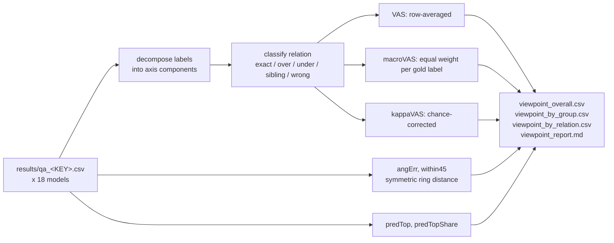

<h1 align="center">Bio-VQA &rarr; Spatial Visual Reasoning &rarr; Viewpoint &rarr; Evaluation</h1>
<p align="center">
  <b>The Graded Rubric, Chance Correction, and Independent Validation</b>
</p>
<p align="center">
  
  
  
  
  
  
</p>

> The authoritative scoring stage for the Viewpoint task. This document defines the graded
> rubric and its component algebra, the chance correction that makes it exploit-proof, the
> macro-averaging that neutralises an 83% label skew, the independent angular metric, the
> rubric sensitivity analysis, and the findings the calculus exposes.

---

## Table of contents

1. [Overview](#1-overview)
2. [Motivation](#2-motivation)
   - 2.1 [Why exact match is the wrong instrument](#21-why-exact-match-is-the-wrong-instrument)
   - 2.2 [Why a graded score alone is exploitable](#22-why-a-graded-score-alone-is-exploitable)
   - 2.3 [Why the skew forces macro-averaging](#23-why-the-skew-forces-macro-averaging)
3. [Merging and input contract](#3-merging-and-input-contract)
4. [The scoring calculus](#4-the-scoring-calculus)
   - 4.1 [Component decomposition and the relation](#41-component-decomposition-and-the-relation)
   - 4.2 [The graded rubric](#42-the-graded-rubric)
   - 4.3 [Macro-averaging](#43-macro-averaging)
   - 4.4 [Chance correction](#44-chance-correction)
   - 4.5 [The independent angular metric](#45-the-independent-angular-metric)
   - 4.6 [A worked example](#46-a-worked-example)
   - 4.7 [What each score implies](#47-what-each-score-implies)
5. [Coverage of the control set](#5-coverage-of-the-control-set)
6. [Rubric sensitivity](#6-rubric-sensitivity)
7. [Uncertainty and stratification](#7-uncertainty-and-stratification)
8. [Results](#8-results)
   - 8.1 [Order of inspection](#81-order-of-inspection)
   - 8.2 [The constant-predictor floors](#82-the-constant-predictor-floors)
   - 8.3 [Error composition drives the reordering](#83-error-composition-drives-the-reordering)
   - 8.4 [Two independent constructions agree](#84-two-independent-constructions-agree)
   - 8.5 [The tier ladder](#85-the-tier-ladder)
9. [Reproduction](#9-reproduction)
10. [Outputs](#10-outputs)
11. [References](#11-references)

---

## 1. Overview

The Viewpoint label space has two properties that jointly determine this stage's design. It is
**compositional** — `frontright` decomposes into `{front, right}` — so predictions stand in
subset, superset, sibling, or disjoint relations to the truth. And it is **severely skewed**:
`left` and `right` together are roughly 83% of rows, and the single majority label reaches
0.520.

Each property defeats a different naive metric. Exact match discards the relational structure
and rates a 45° miss identically to a 180° one. A row-averaged graded score restores the
structure but becomes exploitable under the skew: answering compounds indiscriminately
harvests partial credit on the majority of rows. We therefore grade the relation, macro-average
over gold labels, and chance-correct the result — and then validate the whole construction
against a symmetric geometric metric that shares none of its design decisions
([Section 8.4](#84-two-independent-constructions-agree)).

---

## 2. Motivation

### 2.1 Why exact match is the wrong instrument

The eight horizontal labels lie on a ring at 45° intervals. Against a gold label of `right`:

| Prediction | Angular error | Relation | Exact match |
|---|---:|---|---:|
| `backright` | 45° | superset of the gold components | 0 |
| `back` | 90° | disjoint | 0 |
| `frontleft` | 135° | disjoint | 0 |
| `left` | 180° | disjoint | 0 |

Exact match assigns all four the same zero. On a compositional ring this is not a rounding
concern: across our eighteen models the `over` and `under` relations together account for a
mean of **17.4%** of all rows and reach **62.9%** for two models
([Section 8.3](#83-error-composition-drives-the-reordering)). A metric that scores every one of
those as a total failure is discarding roughly a sixth of the observable signal on average, and
nearly two-thirds for some models.

### 2.2 Why a graded score alone is exploitable

Grading the relation introduces its own exploit. Because 83% of gold labels are **bare
cardinals**, every compound prediction against a cardinal gold lands in `over` and collects
partial credit. A model that answers compounds indiscriminately — never perceiving anything —
harvests that credit on the great majority of rows, and a row-averaged graded score rewards it,
because the credit is genuine on each individual row.

The chance correction ([Section 4.4](#44-chance-correction)) removes exactly this. It subtracts
the score the model's own answer distribution would earn if shuffled against the gold labels,
and a shuffled indiscriminate-compound distribution collects the same `over` credit as the
unshuffled one. The strategy therefore nets to zero.

### 2.3 Why the skew forces macro-averaging

A constant `right` predictor scores **0.520** on exact match and **0.534** on the row-averaged
graded score — respectable numbers on both, achieved without looking at anything. Under
macro-averaging over gold labels the same predictor scores **0.170**, because it earns credit
on one label and near-nothing on the other nine.

The gap between 0.534 and 0.170 is the quantitative case for macro-averaging, and it is not
hypothetical: seventeen of eighteen models fall below the exact-match floor, while eighteen of
eighteen clear the macro-averaged one
([Section 8.2](#82-the-constant-predictor-floors)).

We do not resample the corpus to a uniform label distribution. The skew arises because
Wildbook's Grévy's zebra census photographs the right flank for identification, which is the
operational condition under which viewpoint filtering is actually applied; discarding it would
replace an honest skew with an artificial one.

---

## 3. Merging and input contract

`merge_results.py` reassembles the six shards into one CSV per model, sorted by `row_id`, and
writes `merge_manifest.json`.

```bash
python merge_results.py --run_dir ../2.Experiment_Runs --out_dir results
```

Merging performs no scoring, so every number in the paper comes from `evaluate.py` alone.
Because parse rate is 1.000 for every model
([Section 6.6 of the inference document](../2.Experiment_Runs/README.md#66-label-resolution)),
all eighteen merged files must carry exactly 13,000 rows; any deviation is a missing shard
rather than a legitimate scoring difference.

`evaluate.py` then reads `results/qa_<MODEL_KEY>.csv`, locating the prediction column as
`<MODEL_KEY>_answer`. Three columns are load-bearing: `answer` (gold), `tier`, and `dataset`.



---

## 4. The scoring calculus

### 4.1 Component decomposition and the relation

Every accepted label decomposes into axis components:

$$
\mathrm{comp}(\ell) = \{a \in \{\text{front},\text{back},\text{left},\text{right},\text{up},\text{down}\} : a \text{ is a substring of } \ell\} .
$$

so $\mathrm{comp}(\texttt{frontleft}) = \{\text{front}, \text{left}\}$ and
$\mathrm{comp}(\texttt{right}) = \{\text{right}\}$.

Writing $G = \mathrm{comp}(y)$ and $P = \mathrm{comp}(\hat{y})$, the relation is determined by
set algebra:

$$
\mathrm{rel}(y, \hat{y}) =
\begin{cases}
\texttt{exact}   & y = \hat{y} \\
\texttt{over}    & G \subsetneq P \\
\texttt{under}   & P \subsetneq G \\
\texttt{sibling} & G \cap P \neq \emptyset,\ G \not\subseteq P,\ P \not\subseteq G \\
\texttt{wrong}   & G \cap P = \emptyset \ \text{ or either set is empty}
\end{cases}
$$

The five relations are mutually exclusive and exhaustive, so every row falls in exactly one
class and the shares in `viewpoint_by_relation.csv` sum to 1.

On the eight-point ring the `sibling` relation is always a 90° miss — two compounds sharing one
component, such as `frontright` and `backright` — which is why it sits between `under` and
`wrong` rather than adjacent to either.

### 4.2 The graded rubric

$$
v(y, \hat{y}) = c_{\mathrm{rel}(y,\hat{y})},
\qquad
c = \bigl(c_{\text{exact}}, c_{\text{over}}, c_{\text{under}}, c_{\text{sibling}}, c_{\text{wrong}}\bigr)
  = (1.00,\, 0.50,\, 0.35,\, 0.15,\, 0.00) .
$$

**`over` outranks `under` deliberately.** A model answering `backright` when the annotation
records `right` attempted the finer distinction and got the coarse component correct; one
answering `right` when the annotation records `backright` declined the distinction. Committing
and being partly right is a different act from abstaining.

The asymmetry is a judgement, so we do not merely assert it:

1. **All four credits are command-line arguments** (`--credit_over`, `--credit_under`,
   `--credit_sibling`), so a reader can rescore under their own weighting.
2. **The rubric is written into the report and into `viewpoint_overall.csv`**, so a result can
   never be quoted without the weights that produced it.
3. **A symmetric angular metric is reported alongside**
   ([Section 4.5](#45-the-independent-angular-metric)), so the asymmetry can be inspected
   rather than assumed.
4. **A sensitivity analysis is run and reported** ([Section 6](#6-rubric-sensitivity)), and it
   shows the ranking is nearly invariant to the weights.

### 4.3 Macro-averaging

$$
\mathrm{VAS} = \frac{1}{n}\sum_i v(y_i, \hat{y}_i),
\qquad
\boxed{\;\mathrm{macroVAS} = \frac{1}{|\mathcal{L}'|}\sum_{\ell \in \mathcal{L}'} \frac{1}{n_\ell}\sum_{i : y_i = \ell} v(y_i, \hat{y}_i)\;}
$$

where $\mathcal{L}'$ are the gold labels present. Macro-averaging gives each of the ten
viewpoints equal weight regardless of frequency, so a constant predictor earns credit on one
label and near-nothing on the rest.

`predTopShare` is reported beside it and should be read first: near 1.00 means the model
answered the same thing on nearly every item, and nothing else in the row is interpretable
until that is checked.

### 4.4 Chance correction

The headline metric. Cohen's weighted kappa with the rubric as its weight matrix:

$$
\boxed{\;\mathrm{kappaVAS} = \frac{\mathrm{VAS}_{\text{obs}} - \mathrm{VAS}_{\text{exp}}}{1 - \mathrm{VAS}_{\text{exp}}}\;}
$$

$$
\mathrm{VAS}_{\text{obs}} = \frac{1}{n}\sum_i v(y_i, \hat{y}_i),
\qquad
\mathrm{VAS}_{\text{exp}} = \sum_{a \in \mathcal{L}}\sum_{b \in \mathcal{L}} \Pr[y = a]\,\Pr[\hat{y} = b]\;v(a, b) .
$$

$\mathrm{VAS}_{\text{exp}}$ is the graded score the model would earn if its own answers were
**shuffled** against the gold labels — the score attributable to the product of the two
marginal distributions and to nothing else. Subtracting it and renormalising leaves only the
agreement that depends on the pairing.

This is precisely what macroVAS cannot do. Both quantities are computed from the same rubric,
but macroVAS asks *how much credit was earned per label* while kappaVAS asks *how much credit
was earned beyond what this answer distribution would earn by accident*. A strategy of
answering compounds indiscriminately raises the first and not the second.

**Verified against synthetic strategies** on the actual gold distribution:

| Strategy | kappaVAS |
|---|---:|
| always answer `right` | **0.000** |
| answer compounds indiscriminately | **0.001** |
| genuine perception with 30% one-step noise | **0.773** |

The three values are the calibration of the metric. They establish that the two exploits net
to zero, and that a genuinely perceiving model with substantial noise still scores in the high
0.7s — which is the scale against which the observed maximum of 0.358 should be read.

### 4.5 The independent angular metric

The eight horizontal labels are placed on a ring:

$$
\theta: \texttt{front} \mapsto 0^\circ,\; \texttt{frontright} \mapsto 45^\circ,\; \dots,\; \texttt{frontleft} \mapsto 315^\circ,
$$

$$
\mathrm{angErr}(y, \hat{y}) = \min\bigl(\delta,\; 360 - \delta\bigr), \qquad \delta = |\theta_y - \theta_{\hat{y}}| \bmod 360 ,
$$

reported as a mean in degrees, with `within45` the share of predictions inside one ring step.
`up` and `down` have no ring position and yield `NaN`, excluded from the mean.

**This metric shares no design decision with the rubric.** It has no asymmetry, no credit
weights, no set-relational structure, and no chance correction. Its agreement with kappaVAS is
therefore an *independent* check rather than a restatement, and it is the strongest single
piece of evidence that the rubric measures orientation rather than encoding a preference
([Section 8.4](#84-two-independent-constructions-agree)).

### 4.6 A worked example

Gold label `right`, under five predictions and four strategies.

| Prediction | Relation | VAS credit | angErr |
|---|---|---:|---:|
| `right` | exact | 1.00 | 0° |
| `backright` | over | 0.50 | 45° |
| `frontright` | over | 0.50 | 45° |
| `back` | wrong | 0.00 | 90° |
| `left` | wrong | 0.00 | 180° |

Note that the rubric and the angular metric disagree on rows four and five: both are `wrong`
under the rubric, but 90° and 180° respectively under the angular metric. This is a genuine
difference in what the two measure — the rubric scores *component overlap*, the angular metric
scores *ring distance* — and it is why their close agreement at the model level
([Section 8.4](#84-two-independent-constructions-agree)) is informative rather than tautological.

Now the four strategies, scored across the full skewed corpus:

| Strategy | EM | VAS | macroVAS | **kappaVAS** |
|---|---:|---:|---:|---:|
| always `right` | 0.520 | 0.534 | 0.170 | **0.000** |
| indiscriminate compounds | low | inflated by `over` | inflated | **0.001** |
| 30% one-step noise | moderate | high | high | **0.773** |
| perfect | 1.000 | 1.000 | 1.000 | **1.000** |

Rows one and two are the two exploits. Both post non-trivial VAS; **only kappaVAS returns them
to zero.**

### 4.7 What each score implies

| Score | Question it answers | Constant-`right` value | Role |
|---|---|---:|---|
| `kappaVAS` | Graded agreement beyond chance? | 0.000 | **headline** |
| `macroVAS` | Graded credit, equal weight per label? | 0.170 | uncorrected companion |
| `VAS` | Graded credit, row-averaged? | 0.534 | reported to expose the skew |
| `EM` | Exactly right? | 0.520 | reference; read against the majority share |
| `balAcc` | Recall averaged over labels? | 1/k | nominal analogue of macroVAS |
| `kappa` | Nominal agreement beyond chance? | 0.000 | ungraded analogue of kappaVAS |
| `angErr`, `within45` | How far around the ring? | — | **independent validation** |
| `predTop`, `predTopShare` | What does it answer most, how often? | `right`, 1.000 | **read first** |
| relation shares | Which error class dominates? | all `over`/`wrong` | mechanism |

---

## 5. Coverage of the control set

| Strategy | EM ≈ floor? | VAS ≈ floor? | macroVAS low? | kappaVAS ≈ 0? | predTopShare ≈ 1? |
|---|:---:|:---:|:---:|:---:|:---:|
| Always one label | yes | yes | **yes** | **yes** | **yes** |
| Indiscriminate compounds | no | **no** | **no** | **yes** | no |
| Genuine but noisy | no | no | no | **no** | no |

The middle row is the case only chance correction catches: it clears the exact-match floor,
clears the row-averaged graded floor, and even clears macroVAS, while perceiving nothing.
kappaVAS returns it to 0.001.

---

## 6. Rubric sensitivity

The `over` > `under` asymmetry is a judgement, so we test whether the conclusions depend on it
rather than asserting robustness. All eighteen models are rescored under four credit settings
spanning the plausible range, down to one that removes partial credit entirely:

| Setting | `over` | `under` | Interpretation |
|---|---:|---:|---|
| default | 0.50 | 0.35 | as reported |
| conservative | 0.35 | 0.25 | partial credit halved |
| minimal | 0.25 | 0.15 | partial credit quartered |
| exact-only | 0.00 | 0.00 | **no partial credit at all** |

$$
\text{maximum rank change across all four settings} = \mathbf{2 \text{ positions of } 18},
\qquad \text{mean} = 0.83 .
$$

$$
\rho\!\left(\text{default},\, \text{exact-only}\right) = \mathbf{0.979},
\qquad \text{all pairwise } \rho \ge 0.979 .
$$

Seven of eighteen models do not move at all, and no model moves more than two positions even
when partial credit is removed entirely. **The rubric sharpens the measurement; it does not
determine the ranking.** A reader who rejects the asymmetry outright and prefers exact-match
weighting obtains essentially the same leaderboard.

The per-model spread is written to the sensitivity output, so the analysis is auditable rather
than summarised into a single correlation.

---

## 7. Uncertainty and stratification

**Stratification.** Every statistic is additionally computed per `tier` and per `dataset`,
with `source_dataset = __ALL__` rows carrying the per-tier aggregate. The per-corpus
decomposition matters here because the label skew is corpus-specific — 89% of Grévy's zebra
annotations are `right`, while the marine corpus is the only source of `up` and `down` — so a
pooled figure blends two very different label distributions.

**Uncertainty.** Bootstrap resampling clusters on the canvas rather than the row. In the
multi-panel tiers one canvas carries three questions that share a resize and a vision-token
budget, so rows within a canvas are not independent observations; resampling rows would produce
intervals that are too narrow. All rows belonging to a resampled canvas enter or leave
together.

---

## 8. Results

### 8.1 Order of inspection

1. **`predTopShare`** — near 1.00 means a constant predictor; read nothing else until checked.
   LLaVA-NeXT-Mistral-7B sits at 0.938.
2. **`kappaVAS`** — the chance-corrected headline. At or below zero means no agreement beyond
   what the answer distribution earns by accident.
3. **`macroVAS` against `modalMacroVAS` = 0.170** — graded credit above the constant floor.
4. **Relation shares** in `viewpoint_by_relation.csv` — which error class dominates, and hence
   why exact match and kappaVAS disagree for that model.
5. **`angErr` / `within45`** — the independent geometric read.
6. **Per-tier and per-corpus rows** — where the pooled figure originates.

`VAS` and `EM` are reported to be read *against their floors* of 0.534 and 0.520, never
standalone.

### 8.2 The constant-predictor floors

$$
\mathrm{EM} > 0.520 \text{ for } \mathbf{1/18}; \qquad
\mathrm{VAS} > 0.534 \text{ for } \mathbf{3/18}; \qquad
\mathrm{macroVAS} > 0.170 \text{ for } \mathbf{18/18} .
$$

Only Gemma-4-12B exceeds the exact-match score of a predictor that always answers the majority
label — and it does so while answering `right` on 75.4% of items, itself close to the constant
strategy. Seventeen of eighteen models score below a predictor that never looks at the image.

Under macro-averaging every model separates from the floor. The contrast between 1-of-18 and
18-of-18 is the empirical case for
[Section 2.3](#23-why-the-skew-forces-macro-averaging), and it is why neither exact match nor
row-averaged VAS appears as a headline anywhere in this component.

Two models post **negative** kappaVAS — LLaVA-NeXT-Vicuna-7B at −0.019 and
LLaVA-NeXT-Mistral-7B at −0.005 — meaning their graded agreement is slightly below what their
own answer distribution would earn by chance. The best of eighteen reaches 0.358, against the
0.773 attained by a synthetic model with 30% one-step noise on this same distribution
([Section 4.4](#44-chance-correction)). The ceiling is low on an independently calibrated
scale, not merely relative to 1.

### 8.3 Error composition drives the reordering

Ranking by exact match and by kappaVAS give substantially different orders:

$$
\rho\!\left(\mathrm{EM},\, \mathrm{kappaVAS}\right) = 0.656 .
$$

The `viewpoint_by_relation.csv` table explains every large movement directly:

| Model | EM | EM rank | kappaVAS | kappaVAS rank | Shift | `over` share |
|---|---:|---:|---:|---:|---:|---:|
| Molmo2-8B | 0.228 | 10 | 0.358 | 1.5 | **+8.5** | **0.629** |
| Qwen2.5-VL-7B | 0.050 | 15 | 0.182 | 7.5 | **+7.5** | **0.629** |
| Qwen3-VL-32B | 0.417 | 7 | 0.358 | 1.5 | +5.5 | 0.259 |
| Phi-3.5-Vision | 0.456 | 3.5 | 0.083 | 11 | **−7.5** | 0.007 |
| InternVL3.5-8B-Instruct | 0.456 | 3.5 | 0.117 | 10 | **−6.5** | 0.051 |
| InternVL3.5-38B-Instruct | 0.483 | 2 | 0.208 | 6 | −4.0 | 0.056 |

Models that rise place a large share of answers in `over` — they name a compound where the
annotation records a cardinal, and exact match scores every one of those as zero. Models that
fall place almost nothing in `over` while posting high exact match, largely by answering
`right` on a corpus where `right` is usually correct: Phi-3.5-Vision answers `right` on 63.1%
of items and InternVL3.5-8B on 68.9%.

**The two metrics are measuring different things, and the relation table makes the difference
auditable row by row.** A model whose errors are one ring step from the truth is closer to the
answer than one that is right when the majority label is right and wrong otherwise — and the
next section shows an independent metric agrees.

### 8.4 Two independent constructions agree

The angular metric shares no design decision with the rubric
([Section 4.5](#45-the-independent-angular-metric)). Their agreement across eighteen models:

$$
\rho\!\left(\mathrm{angErr},\, \mathrm{kappaVAS}\right) = \mathbf{-0.961},
\qquad
\rho\!\left(\mathrm{within45},\, \mathrm{kappaVAS}\right) = \mathbf{+0.933} .
$$

A set-relational credit table with a deliberate asymmetry and a symmetric geometric distance
on a ring order eighteen models almost identically. Taken with the rubric-invariance result of
[Section 6](#6-rubric-sensitivity) — Spearman 0.979 between the default weighting and no
partial credit at all — **the ranking reported here does not rest on the scoring choices this
component makes.**

Molmo2-8B is the clearest case. Its exact match is 0.228, which places it tenth. Its angular
error is the best in the set at 44.4° and its `within45` is 0.880, meaning 88% of its answers
land within one ring step of the truth. Both the graded chance-corrected metric and the
independent angular metric rank it first. Exact match alone would have reported it as
mid-table.

### 8.5 The tier ladder

$$
\Delta_{\text{Easy} \to \text{Medium}} = +0.062 \;(\sigma = 0.072), \qquad \text{positive for } \mathbf{16/18},
$$
$$
\Delta_{\text{Medium} \to \text{Hard}} = +0.029 \;(\sigma = 0.062), \qquad \text{positive for } \mathbf{13/18} .
$$

The Easy-to-multi-panel drop is large and nearly universal — the first-order consequence of
three panels on one canvas rendering each animal at $\sqrt{1/3} \approx 0.577$ of its
single-panel linear extent
([Section 6 of the task document](../README.md#6-canvas-geometry-and-the-perceptual-budget)).
The independent angular metric confirms it on its own terms: Easy carries lower angular error
than Medium for **16 of 18** models, by a mean of 8.0°.

The Medium-to-Hard contrast is smaller but consistent in sign for 13 of 18, and it has a
specific mechanism. Hard's positional index is **three-valued**, and `middle` has no boundary
anchor — `left` and `right` are defined by the canvas edges, whereas `middle` is defined only
relative to the other two panels
([Section 4.1 of the task document](../README.md#41-the-three-tiers)). Medium avoids the
problem entirely, because the species name identifies the panel and no positional term is
load-bearing.

The ladder therefore separates two costs cleanly: a first-order perceptual-budget cost shared
by both multi-panel tiers, and a second-order indexing cost paid only by Hard, whose magnitude
tracks the size of the positional vocabulary.

---

## 9. Reproduction

```bash
# Merge the six shards per model.
python merge_results.py --run_dir ../2.Experiment_Runs --out_dir results

# Score under the default rubric.
python evaluate.py --results_dir results --out_dir results --bootstrap 2000

# Rescore under an alternative rubric — the sensitivity analysis of Section 6.
python evaluate.py --results_dir results --out_dir results_exact_only \
    --credit_over 0.0 --credit_under 0.0 --credit_sibling 0.0
```

Confirm `merge_manifest.json` shows every model at 13,000 rows before scoring
([Section 3](#3-merging-and-input-contract)).

---

## 10. Outputs

| File | Contents |
|---|---|
| `viewpoint_overall.csv` | One row per model: `n, macroVAS, VAS, kappaVAS, EM, balAcc, kappa, angErr, within45, majority, modalVAS, modalMacroVAS, predTop, predTopShare`, plus the rubric that produced them and bootstrap bounds when requested. |
| `viewpoint_by_group.csv` | One row per model × tier × corpus; `__ALL__` rows carry the per-tier aggregate. |
| `viewpoint_by_relation.csv` | Share of rows in each rubric class per model — the mechanism behind [Section 8.3](#83-error-composition-drives-the-reordering). |
| `viewpoint_report.md` | Rubric table, leaderboard, error composition, per-tier table, and interpretation. |
| `merge_manifest.json` | What was merged and whether any model is incomplete. |

Every row carries its own `majority`, `modalVAS`, and `modalMacroVAS` alongside its scores, so
a single extracted row remains interpretable without reference to floors computed elsewhere —
which matters on this task, where two of the three floors are high enough that a score quoted
without them would be actively misleading.

---

## 11. References

Chance-corrected nominal agreement follows Cohen [1]; the weighted extension used for the
graded rubric follows Cohen [2]. Balanced accuracy as a class-imbalance-robust estimator
follows Brodersen et al. [3]. Clustered resampling for dependent observations follows standard
bootstrap practice [4, 5].

[1] J. Cohen. **A Coefficient of Agreement for Nominal Scales.** *Educational and Psychological
Measurement*, 20(1):37–46, 1960.

[2] J. Cohen. **Weighted Kappa: Nominal Scale Agreement with Provision for Scaled Disagreement
or Partial Credit.** *Psychological Bulletin*, 70(4):213–220, 1968.

[3] K. H. Brodersen, C. S. Ong, K. E. Stephan, and J. M. Buhmann. **The Balanced Accuracy and
Its Posterior Distribution.** *Proceedings of the 20th International Conference on Pattern
Recognition (ICPR)*, pp. 3121–3124, 2010.

[4] B. Efron and R. J. Tibshirani. **An Introduction to the Bootstrap.** Chapman & Hall, 1993.

[5] A. C. Cameron and D. L. Miller. **A Practitioner's Guide to Cluster-Robust Inference.**
*Journal of Human Resources*, 50(2):317–372, 2015.